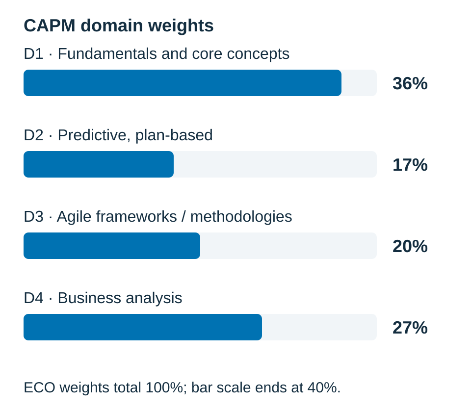
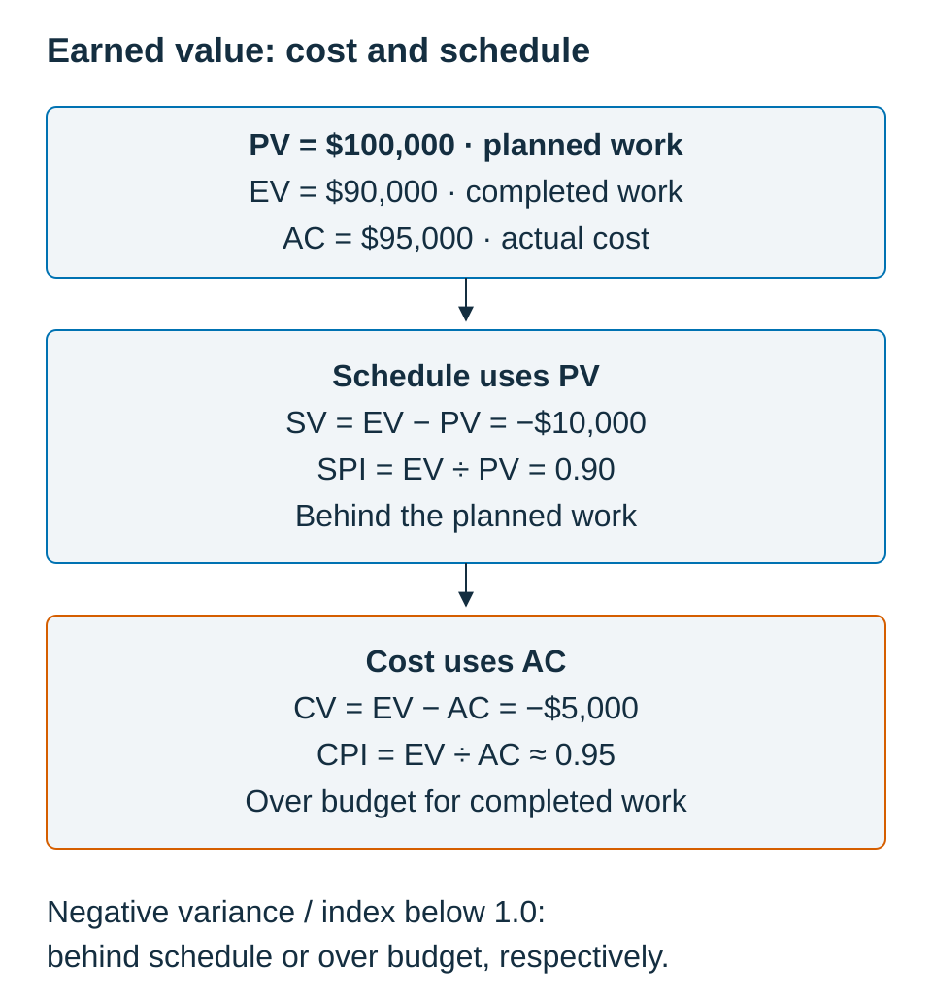
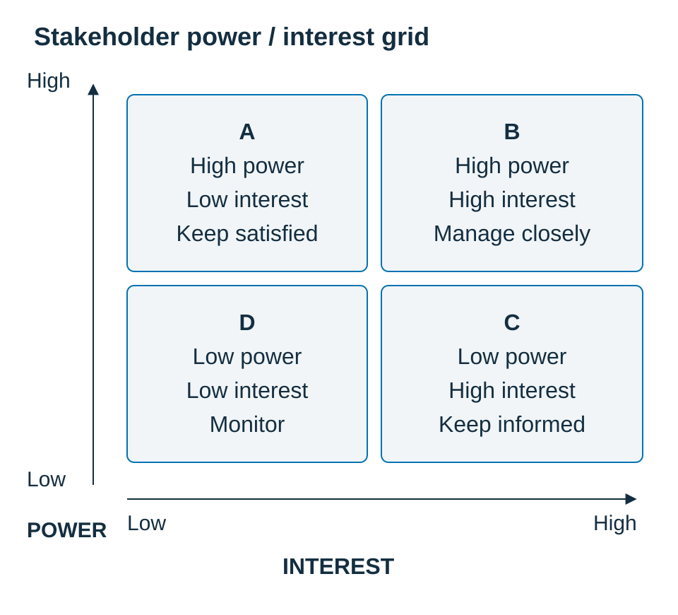

# CAPM® Exam Guide: From Project Management Basics to Exam-Ready {#unit-00-title}

by Kadir Çamoğlu

A free study guide organized around the CAPM Examination Content Outline (2023 Exam Update): four domains, nineteen tasks, and sixty enablers taught in sixty-three sections.

Independent study material for the Certified Associate in Project Management (CAPM)® certification. CAPM is a registered mark of Project Management Institute, Inc. This guide is not affiliated with, endorsed or sponsored by PMI.

The guide includes 108 chapter questions, 32 cumulative-retrieval questions, and a 150-question practice exam. Each question has four options, one keyed answer, an explanation for each option, and a Source pointer and Review link.

Read the [copyright and notices](#unit-01-copyright) for the license, source-material exclusions, and current-information links.

---

# Copyright and notices {#unit-01-copyright}

© 2026 Kadir Çamoğlu.

Except for the third-party material identified below, this guide's original text, questions, and figures are licensed under [Creative Commons Attribution–NonCommercial 4.0 International (CC BY-NC 4.0)](https://creativecommons.org/licenses/by-nc/4.0/). You may share and adapt that material for noncommercial purposes under the license terms. Credit Kadir Çamoğlu, link to the license, and identify changes you make. The guide is shared free of charge.

**Third-party material.** PMI publications, the verbatim CAPM Examination Content Outline enabler statements, and any brief attributed PMI quotations remain the property of Project Management Institute, Inc. They are excluded from this guide's CC BY-NC 4.0 license. Other third-party material retains its own rights and license terms; a reference does not transfer those rights.

**The Scrum Guide.** Ken Schwaber and Jeff Sutherland, *The Scrum Guide: The Definitive Guide to Scrum: The Rules of the Game*, November 2020, © 2020 Ken Schwaber and Jeff Sutherland, available at [scrumguides.org](https://scrumguides.org/scrum-guide.html), is licensed under [CC BY-SA 4.0](https://creativecommons.org/licenses/by-sa/4.0/). Any attributed Scrum Guide quotations retain that license and are excluded from this guide's CC BY-NC 4.0 license. Explanations and hypothetical examples in this guide are independently written commentary; they are not presented as the Scrum Guide's text. Consult the linked original for its complete wording.

**PMI marks and independence.** CAPM, Certified Associate in Project Management (CAPM), PMP, and PMBOK are registered marks of Project Management Institute, Inc. PMI is a mark of Project Management Institute, Inc. This is an independent, unofficial study guide; it is not affiliated with, endorsed or sponsored by PMI. No PMI logo is used. The questions were written for this guide and are not actual PMI exam questions.

**Current official information.** The scope follows the CAPM Examination Content Outline (2023 Exam Update). Citations identify the actual reference editions used; see [References](#unit-12-references). Before applying, booking, or sitting the exam, check the [PMI CAPM page](https://www.pmi.org/certifications/certified-associate-capm), the current [Examination Content Outline](https://www.pmi.org/-/media/pmi/documents/public/pdf/certifications/capm-exam-content-outline-english.pdf), and the [PMI Certification Handbook](https://www.pmi.org/-/media/pmi/documents/public/pdf/certifications/generic-certification-handbook.pdf). Study schedules and practice results are learning aids and do not predict an exam result.

**Feedback.** Send corrections or suggestions to [kadir.camoglu@gmail.com](mailto:kadir.camoglu@gmail.com). Include the chapter, section or question ID and describe the issue.

---

# Introduction — About This Book {#unit-02-introduction}

## What this book is {#unit-02-introduction-what-this-book-is}

This guide introduces project management concepts within the scope of the CAPM Examination Content Outline (ECO). It explains the distinctions through workplace examples and practice questions, with references for further reading.

The CAPM Examination Content Outline (ECO) has four **domains**, nineteen **tasks**, and sixty **enablers**. This guide covers all sixty enablers in sixty-three teaching sections: the framework enabler is split across Scrum, XP, SAFe, and Kanban. Each section includes an explanation, a worked example, practice prompts, and a quick check. The prompts illustrate ways to apply a concept; they do not describe the frequency or wording of actual exam questions.

Two commitments shape every page. The first is to stay on the mapped scope — anchored to the ECO's domains, tasks, and enablers — without drifting into unnecessary advanced detail. The second is that concepts are traceable to their source: predictive scheduling and controls trace to the *PMBOK® Guide*; adaptive material to the *Agile Practice Guide* and *The Scrum Guide*; and business analysis to *Business Analysis for Practitioners: A Practice Guide*. A **Source** pointer at the end of each enabler section and in each question rationale identifies a reference and a section or physical PDF page for further reading. Citations name the editions used; a pointer is not a claim that every sentence is a quotation from that source.

Work through the explanations and practice questions, then use the option-by-option rationale to revisit a mistaken distinction. The questions were written for this guide. Use the cited references when you need more detail.

## Who this book is for {#unit-02-introduction-who-this-book-is-for}

The CAPM has no work-experience requirement — a secondary degree, at least 18 years of age, and at least 23 hours of project management education under the current eligibility rules — and neither does this book. It is written for career changers building the fundamentals from the ground up; for students and recent graduates seeking a recognized first credential; for working professionals who already do project-adjacent work and want to formalize it; and for experienced practitioners who want a precise, exam-focused refresher.

No prior knowledge is assumed. Start with the definitions and worked examples, and use the glossary to revisit unfamiliar terms.

Read each scenario to identify *which role you are playing*: project manager, business analyst, or team member. Then check the authority and responsibilities stated in that situation. Planning, supporting, coordinating, escalating, and communicating are useful associate-level activities to distinguish; a job title alone does not establish decision authority.

## What the exam is built on {#unit-02-introduction-what-the-exam-is-built-on}

PMI states in the CAPM Examination Content Outline (2023 Exam Update, Reference Materials, PDF page 5) that each of its exam questions is supported by at least two references. This is a statement about PMI's exam, not this guide's practice items, and the references are not all PMI publications. This guide's teaching citations identify the actual editions used: *PMBOK® Guide*, Seventh Edition (2021), with Sixth Edition (2017) for detailed predictive processes; *Agile Practice Guide*, Second Edition (2026); *Business Analysis for Practitioners: A Practice Guide*, Second Edition (2024); and *The Scrum Guide* (2020). See [References](#unit-12-references) for edition boundaries and supplementary sources.

The calculation examples in this guide cover earned-value measures (SV, CV, SPI, CPI) and scheduling concepts such as critical path and float. Use the examples to practice interpreting a result as well as calculating it; they do not establish how many calculation questions you will receive.

## How this book is organized {#unit-02-introduction-how-this-book-is-organized}

The book moves through four stages: orientation, then teaching, then practice, and finally reference.

**Chapter 0, CAPM Exam Onboarding,** orients you to the exam itself: the format, the five question formats you may meet, the four domains and their weights, a method for reasoning through practice scenarios, and study plans.

**The teaching core is organized into four Parts, one per domain, and eighteen chapters.** Because a single domain-sized chapter would be overloaded, each domain is split into several focused chapters, and each chapter is split into sections — **one section per ECO enabler, with the framework enabler taught in four sections covering Scrum, XP, SAFe, and Kanban**. Every chapter opener names the exact task and enablers it covers, so you can always trace what you are reading back to the outline. Chapter counts reflect the teaching structure; domain weights describe the exam blueprint:

| Part | Domain | Weight | Chapters |
|---|---|---|---|
| I | Fundamentals and Core Concepts | 36% | 1–7 |
| II | Predictive, Plan-Based Methodologies | 17% | 8–10 |
| III | Agile Frameworks / Methodologies | 20% | 11–14 |
| IV | Business Analysis Frameworks | 27% | 15–18 |

Each of the 18 teaching chapters ends with a **Summary**, **Exam Essentials**, and six **Practice Questions**: 108 chapter questions in total. Each Part has eight **Cumulative Retrieval** questions in its answer section, for 32 retrieval questions. The teaching sections also contain 63 inline quick checks. Attempt questions before opening the answers.

**[Chapter 19 — Practice Exam](#ch19) contains 150 questions**, with an answer key, rationale, Source pointers, and Review links to teaching sections. The chapter and Part answers are collected at the back of the book.

The **back of the book** is reference: quick-reference appendices for formulas, agile, and business analysis; an appendix of related concept pairs; a glossary; and a final revision plan.

## How to read and study it {#unit-02-introduction-how-to-read-and-study-it}

Read [Chapter 0](#ch0) first — it is short and it changes how you read everything after it. Then work the Parts in order. Within each chapter, read the enabler sections, do the inline **quick checks** as you go, and attempt the end-of-chapter **Practice Questions** before checking the rationale. At the end of each Part, take the **Cumulative Retrieval** quiz. Save the full **Practice Exam** for after you have finished all four Parts. Finally, use the appendices and glossary for targeted review, and follow the Final Revision Plan in the last days before your exam. The Study Plans in [Chapter 0](#ch0) give you two concrete schedules to choose from.

---

# How to Use This Book {#unit-03-how-to-use}

## The three voices {#unit-03-how-to-use-the-three-voices}

The book speaks in three voices. The **teaching voice** explains a concept plainly, from the ground up, with a workplace example — most of the book. The **exam voice** steps back and offers practice prompts and compares plausible answers so that you can reason from the concept and the stated situation. The **reference voice** is compact and lookup-friendly: the snapshot tables, the Objective Map, the appendices, and the glossary.

## How each Part is structured {#unit-03-how-to-use-how-each-part-is-structured}

Each Part covers one domain and opens with a **Part opener** that gives the domain's exam weight, how many questions to expect, its source references, and a task map showing which chapters cover which ECO tasks and enablers. A Part contains several chapters, and it closes with a **Cumulative Retrieval** quiz.

## How each chapter is structured {#unit-03-how-to-use-how-each-chapter-is-structured}

Every chapter follows the same shape. It opens by naming the **ECO task and enablers** it covers. The body is a series of **sections covering every enabler; the framework enabler spans separate Scrum, XP, SAFe, and Kanban sections**. Each chapter closes with a **Summary**, **Exam Essentials** (a must-know checklist), and **Practice Questions**, with answers and rationale collected at the back of the book.

## How each enabler section is structured {#unit-03-how-to-use-how-each-enabler-section-is-structured}

This is the teaching structure of the guide. Every enabler is taught with the same repeatable rhythm, so you always know what you are getting:

1. **Section title + ECO tag** — the enabler in plain language, tagged with its ECO location (for example, *ECO 1.1.4*).
2. **Why it matters** — a sentence or two tying the enabler to real work and the distinction being taught.
3. **Concept** — the teaching, definitions first, with comparisons where they help explain a distinction.
4. **Worked example** — grounded in a running scenario, so examples build on each other rather than resetting.
5. **Practice prompts** *(boxed)* — author-written prompts that apply the enabler through a short question or scenario.
6. **Trap answers** *(boxed)* — wrong-answer patterns to compare in the practice material: the adjacent concept, the right-thing-wrong-timing answer, the wrong-role answer.
7. **Quick check** — one or two inline self-test questions; answers are at the end of the chapter.

## The question archetypes {#unit-03-how-to-use-the-question-archetypes}

This guide uses the following question shapes in its Practice prompts boxes. These are teaching categories, not statistics about the exam:

| Archetype | What it asks |
|---|---|
| **Definition-match** | Pick the option that correctly defines a term. |
| **Scenario-classify** | Read a situation and classify it (risk or issue? project or operation?). |
| **BEST / NEXT action** | Choose the most appropriate or the immediate next action. |
| **EXCEPT / NOT** | Three options are true; find the one that is false. |
| **Calculation** | Compute a value (earned value, float). |
| **Sequence / order** | Put steps or components in the right order. |

## Callouts you will see {#unit-03-how-to-use-callouts-you-will-see}

> **Study tip** — a targeted piece of exam strategy.

> **Note** — a clarification, a source pointer, or a definition worth flagging.

> **Watch out** — a mistaken interpretation or a near-miss distinction to compare.

> **Practice prompts** — author-written applications of the enabler you just learned.

> **Trap answers** — wrong-answer patterns illustrated in this guide.

> **Quick check** — inline self-test; answers at the chapter end.

> **Cumulative Retrieval** — end-of-Part questions that pull forward earlier material.

## Study tracks and the practice questions {#unit-03-how-to-use-study-tracks-and-the-practice-questions}

Two schedules are in [Chapter 0](#ch0-0-6-study-plans): a **four-week plan** and a **two-week plan**. Both cover all 18 teaching chapters and reserve time for review. Do the inline quick checks as you read, the end-of-chapter Practice Questions before reading their rationale, and the end-of-Part Cumulative Retrieval to consolidate. Save the full 150-question Practice Exam (Chapter 19) for after all four Parts. Getting a question wrong and then reading exactly why — including why each other option is wrong — helps you identify the distinction to revisit.

---

# Objective Map {#unit-04-objective-map}

This map shows every ECO task **and enabler**, and the exact chapter and section that teaches it. Domains 1–4 are covered by Parts I–IV; 60 enablers are covered in 63 sections, with ECO 3.4.1 split across Scrum, XP, SAFe, and Kanban. Use this to track your preparation one enabler at a time, and to jump straight from any point in the outline to where it is taught.

**First time through?** This is a reference table, not a lesson. Skim it to see the shape of the exam, then return to it to track progress.

## Part I — Domain 1: Project Management Fundamentals and Core Concepts (36%) {#unit-04-objective-map-part-i-domain-1-project-management-fundamentals-and-core-concepts-36}

| ECO | Enabler | Teaching sections | Chapter / retrieval / exam items |
|---|---|---|---|
| 1.1.1 | Project vs. program vs. portfolio | [1.1](#sec-1-1) | [C1-Q01](#c1-q01), [C1-Q03](#c1-q03), [C1-Q05](#c1-q05), [C1-Q06](#c1-q06), [PE-Q001](#pe-q001), [PE-Q002](#pe-q002), [PE-Q003](#pe-q003), [P1-CR02](#p1-cr02); [QC 1.1](#qc-1-1) |
| 1.1.2 | Project vs. operations | [1.2](#sec-1-2) | [C1-Q02](#c1-q02), [PE-Q004](#pe-q004), [PE-Q143](#pe-q143); [QC 1.2](#qc-1-2) |
| 1.1.7 | Project as a vehicle for change | [1.3](#sec-1-3) | [C1-Q04](#c1-q04), [PE-Q010](#pe-q010); [QC 1.3](#qc-1-3) |
| 1.1.3 | Predictive vs. adaptive (and hybrid) | [2.1](#sec-2-1) | [C2-Q01](#c2-q01), [PE-Q005](#pe-q005), [PE-Q063](#pe-q063), [PE-Q106](#pe-q106), [PE-Q133](#pe-q133), [P1-CR05](#p1-cr05), [P2-CR04](#p2-cr04), [P3-CR03](#p3-cr03); [QC 2.1](#qc-2-1) |
| 1.1.4 | Issues vs. risks vs. assumptions vs. constraints | [2.2](#sec-2-2) | [C2-Q02](#c2-q02), [C2-Q03](#c2-q03), [C2-Q06](#c2-q06), [PE-Q006](#pe-q006), [PE-Q007](#pe-q007), [PE-Q008](#pe-q008), [PE-Q019](#pe-q019), [PE-Q079](#pe-q079), [PE-Q110](#pe-q110), [PE-Q126](#pe-q126), [P1-CR01](#p1-cr01); [QC 2.2](#qc-2-2) |
| 1.1.5 | Review / critique project scope | [2.3](#sec-2-3) | [C2-Q04](#c2-q04), [PE-Q030](#pe-q030), [PE-Q103](#pe-q103); [QC 2.3](#qc-2-3) |
| 1.1.6 | Apply the code of ethics to scenarios | [2.4](#sec-2-4) | [C2-Q05](#c2-q05), [PE-Q009](#pe-q009), [PE-Q118](#pe-q118), [PE-Q146](#pe-q146); [QC 2.4](#qc-2-4) |
| 1.2.1 | Purpose of cost, quality, risk, schedule, etc. | [3.1](#sec-3-1) | [C3-Q01](#c3-q01); [QC 3.1](#qc-3-1) |
| 1.2.2 | Project management plan vs. product management plan | [3.2](#sec-3-2) | [C3-Q02](#c3-q02), [C3-Q05](#c3-q05), [PE-Q017](#pe-q017), [PE-Q149](#pe-q149), [P1-CR03](#p1-cr03), [P3-CR05](#p3-cr05), [P4-CR07](#p4-cr07); [QC 3.2](#qc-3-2) |
| 1.2.3 | Milestone vs. task duration | [3.3](#sec-3-3) | [C3-Q03](#c3-q03), [C3-Q06](#c3-q06), [PE-Q014](#pe-q014); [QC 3.3](#qc-3-3) |
| 1.2.4 | Determine number and type of resources | [3.4](#sec-3-4) | [C3-Q04](#c3-q04); [QC 3.4](#qc-3-4) |
| 1.2.5 | Use a risk register in a situation | [4.1](#sec-4-1) | [C4-Q01](#c4-q01), [C4-Q05](#c4-q05), [PE-Q015](#pe-q015), [PE-Q076](#pe-q076), [P2-CR07](#p2-cr07); [QC 4.1](#qc-4-1) |
| 1.2.6 | Use a stakeholder register in a situation | [4.2](#sec-4-2) | [C4-Q02](#c4-q02), [C4-Q04](#c4-q04), [PE-Q016](#pe-q016), [PE-Q083](#pe-q083), [PE-Q131](#pe-q131); [QC 4.2](#qc-4-2) |
| 1.2.7 | Project closure and transitions | [4.3](#sec-4-3) | [C4-Q03](#c4-q03), [C4-Q06](#c4-q06), [PE-Q018](#pe-q018), [PE-Q122](#pe-q122), [P1-CR06](#p1-cr06); [QC 4.3](#qc-4-3) |
| 1.3.1 | Project manager vs. sponsor | [5.1](#sec-5-1) | [C5-Q01](#c5-q01), [PE-Q011](#pe-q011), [P1-CR04](#p1-cr04); [QC 5.1](#qc-5-1) |
| 1.3.2 | Project team vs. sponsor | [5.2](#sec-5-2) | [C5-Q02](#c5-q02), [PE-Q082](#pe-q082); [QC 5.2](#qc-5-2) |
| 1.3.3 | The project manager's role facets | [5.3](#sec-5-3) | [C5-Q03](#c5-q03), [PE-Q021](#pe-q021), [PE-Q022](#pe-q022), [PE-Q088](#pe-q088); [QC 5.3](#qc-5-3) |
| 1.3.4 | Leadership vs. management | [5.4](#sec-5-4) | [C5-Q04](#c5-q04), [C5-Q06](#c5-q06), [PE-Q012](#pe-q012), [PE-Q027](#pe-q027), [PE-Q147](#pe-q147), [P1-CR07](#p1-cr07); [QC 5.4](#qc-5-4) |
| 1.3.5 | Emotional intelligence (EQ) | [5.5](#sec-5-5) | [C5-Q05](#c5-q05), [PE-Q013](#pe-q013), [PE-Q081](#pe-q081), [PE-Q137](#pe-q137); [QC 5.5](#qc-5-5) |
| 1.4.1 | Respond to a planned strategy or framework | [6.1](#sec-6-1) | [C6-Q01](#c6-q01), [C6-Q02](#c6-q02), [C6-Q05](#c6-q05), [PE-Q020](#pe-q020), [PE-Q112](#pe-q112), [PE-Q125](#pe-q125), [PE-Q144](#pe-q144), [P1-CR08](#p1-cr08); [QC 6.1](#qc-6-1) |
| 1.4.2 | Project initiation and benefit planning | [6.2](#sec-6-2) | [C6-Q03](#c6-q03), [C6-Q04](#c6-q04), [C6-Q06](#c6-q06), [PE-Q028](#pe-q028), [PE-Q029](#pe-q029), [PE-Q078](#pe-q078), [PE-Q138](#pe-q138); [QC 6.2](#qc-6-2) |
| 1.5.1 | Evaluate the effectiveness of a meeting | [7.1](#sec-7-1) | [C7-Q01](#c7-q01), [C7-Q06](#c7-q06), [PE-Q026](#pe-q026); [QC 7.1](#qc-7-1) |
| 1.5.2 | Focus groups, standups, brainstorming, etc. | [7.2](#sec-7-2) | [C7-Q02](#c7-q02), [C7-Q03](#c7-q03), [C7-Q04](#c7-q04), [C7-Q05](#c7-q05), [PE-Q024](#pe-q024), [PE-Q025](#pe-q025); [QC 7.2](#qc-7-2) |

## Part II — Domain 2: Predictive, Plan-Based Methodologies (17%) {#unit-04-objective-map-part-ii-domain-2-predictive-plan-based-methodologies-17}

| ECO | Enabler | Teaching sections | Chapter / retrieval / exam items |
|---|---|---|---|
| 2.1.1 | Suitability by organizational structure | [8.1](#sec-8-1) | [C8-Q01](#c8-q01), [C8-Q02](#c8-q02), [C8-Q06](#c8-q06), [PE-Q045](#pe-q045), [PE-Q080](#pe-q080), [PE-Q129](#pe-q129); [QC 8.1](#qc-8-1) |
| 2.1.2 | Determine the activities within each process | [8.2](#sec-8-2) | [C8-Q03](#c8-q03), [C8-Q04](#c8-q04); [QC 8.2](#qc-8-2) |
| 2.1.3 | Examples of typical activities within a process | [8.3](#sec-8-3) | [QC 8.3](#qc-8-3) |
| 2.1.4 | Distinguish differences between project components | [8.4](#sec-8-4) | [QC 8.4](#qc-8-4) |
| 2.2.3 | Work breakdown structures (WBS) | [9.1](#sec-9-1) | [C9-Q01](#c9-q01), [C9-Q05](#c9-q05), [PE-Q042](#pe-q042), [PE-Q141](#pe-q141), [P2-CR03](#p2-cr03); [QC 9.1](#qc-9-1) |
| 2.2.4 | Work packages | [9.2](#sec-9-2) | [C8-Q05](#c8-q05), [PE-Q034](#pe-q034); [QC 9.2](#qc-9-2) |
| 2.2.1 | Apply critical path methods | [9.3](#sec-9-3) | [C9-Q02](#c9-q02), [C9-Q04](#c9-q04), [C9-Q06](#c9-q06), [PE-Q035](#pe-q035), [PE-Q036](#pe-q036), [PE-Q094](#pe-q094), [PE-Q124](#pe-q124), [P2-CR06](#p2-cr06); [QC 9.3](#qc-9-3) |
| 2.2.2 | Calculate schedule variance | [9.4](#sec-9-4) | [C9-Q03](#c9-q03); [QC 9.4](#qc-9-4) |
| 2.2.5 | Apply a quality management plan | [10.1](#sec-10-1) | [C10-Q01](#c10-q01), [PE-Q041](#pe-q041), [PE-Q084](#pe-q084), [PE-Q123](#pe-q123), [P2-CR05](#p2-cr05); [QC 10.1](#qc-10-1) |
| 2.2.6 | Apply an integration management plan | [10.2](#sec-10-2) | [C10-Q02](#c10-q02), [PE-Q033](#pe-q033), [PE-Q044](#pe-q044), [PE-Q102](#pe-q102), [PE-Q105](#pe-q105); [QC 10.2](#qc-10-2) |
| 2.3.1 | Identify predictive project artifacts | [10.3](#sec-10-3) | [C10-Q06](#c10-q06), [PE-Q043](#pe-q043); [QC 10.3](#qc-10-3) |
| 2.3.2 | Calculate cost and schedule variances (EVM) | [10.4](#sec-10-4) | [C10-Q03](#c10-q03), [C10-Q04](#c10-q04), [C10-Q05](#c10-q05), [PE-Q037](#pe-q037), [PE-Q038](#pe-q038), [PE-Q039](#pe-q039), [PE-Q040](#pe-q040), [PE-Q085](#pe-q085), [PE-Q086](#pe-q086), [PE-Q113](#pe-q113), [PE-Q114](#pe-q114), [P2-CR01](#p2-cr01), [P2-CR02](#p2-cr02), [P2-CR08](#p2-cr08); [QC 10.4](#qc-10-4) |

## Part III — Domain 3: Agile Frameworks / Methodologies (20%) {#unit-04-objective-map-part-iii-domain-3-agile-frameworks-methodologies-20}

| ECO | Enabler | Teaching sections | Chapter / retrieval / exam items |
|---|---|---|---|
| 3.1.1 | Pros and cons of adaptive vs. predictive | [11.1](#sec-11-1) | [C11-Q01](#c11-q01), [C11-Q02](#c11-q02), [PE-Q046](#pe-q046), [PE-Q047](#pe-q047), [PE-Q128](#pe-q128); [QC 11.1](#qc-11-1) |
| 3.1.2 | Suitability of adaptive by organizational structure | [11.2](#sec-11-2) | [C11-Q05](#c11-q05), [PE-Q093](#pe-q093); [QC 11.2](#qc-11-2) |
| 3.1.3 | OPAs and EEFs that facilitate adaptive | [11.3](#sec-11-3) | [C11-Q03](#c11-q03), [C11-Q04](#c11-q04), [C11-Q06](#c11-q06), [PE-Q048](#pe-q048); [QC 11.3](#qc-11-3) |
| 3.2.1 | Distinguish the logical units of iterations | [12.1](#sec-12-1) | [C12-Q01](#c12-q01), [PE-Q049](#pe-q049); [QC 12.1](#qc-12-1) |
| 3.2.2 | Interpret the pros and cons of the iteration | [12.2](#sec-12-2) | [C12-Q02](#c12-q02), [PE-Q062](#pe-q062), [PE-Q092](#pe-q092); [QC 12.2](#qc-12-2) |
| 3.2.3 | Translate a WBS to an adaptive iteration | [12.3](#sec-12-3) | [C12-Q03](#c12-q03), [PE-Q120](#pe-q120); [QC 12.3](#qc-12-3) |
| 3.2.4 | Determine inputs for scope | [12.4](#sec-12-4) | [C12-Q05](#c12-q05); [QC 12.4](#qc-12-4) |
| 3.2.5 | Adaptive vs. predictive tracking | [12.5](#sec-12-5) | [C12-Q04](#c12-q04), [C12-Q06](#c12-q06), [PE-Q050](#pe-q050), [PE-Q140](#pe-q140), [P3-CR06](#p3-cr06); [QC 12.5](#qc-12-5) |
| 3.3.1 | Identify adaptive project artifacts | [13.1](#sec-13-1) | [C13-Q01](#c13-q01), [PE-Q058](#pe-q058), [PE-Q109](#pe-q109); [QC 13.1](#qc-13-1) |
| 3.4.1 | Components of Scrum, XP, SAFe, Kanban | [13.2](#sec-13-2), [13.3](#sec-13-3), [13.4](#sec-13-4), [13.5](#sec-13-5) | [C13-Q02](#c13-q02), [C13-Q03](#c13-q03), [C13-Q04](#c13-q04), [C13-Q05](#c13-q05), [C13-Q06](#c13-q06), [PE-Q051](#pe-q051), [PE-Q052](#pe-q052), [PE-Q053](#pe-q053), [PE-Q054](#pe-q054), [PE-Q055](#pe-q055), [PE-Q056](#pe-q056), [PE-Q057](#pe-q057), [PE-Q061](#pe-q061), [PE-Q095](#pe-q095), [PE-Q104](#pe-q104), [PE-Q108](#pe-q108), [PE-Q134](#pe-q134), [PE-Q145](#pe-q145), [P3-CR01](#p3-cr01), [P3-CR02](#p3-cr02), [P3-CR04](#p3-cr04), [P3-CR08](#p3-cr08), [P4-CR05](#p4-cr05); [QC 13.2](#qc-13-2), [QC 13.3](#qc-13-3), [QC 13.4](#qc-13-4), [QC 13.5](#qc-13-5) |
| 3.5.1 | Interpret success criteria of a task | [14.1](#sec-14-1) | [C14-Q01](#c14-q01), [C14-Q03](#c14-q03), [C14-Q06](#c14-q06), [PE-Q059](#pe-q059), [PE-Q098](#pe-q098), [PE-Q116](#pe-q116), [P3-CR07](#p3-cr07); [QC 14.1](#qc-14-1) |
| 3.5.2 | Prioritize tasks in adaptive management | [14.2](#sec-14-2) | [C14-Q02](#c14-q02), [C14-Q04](#c14-q04), [C14-Q05](#c14-q05), [PE-Q060](#pe-q060); [QC 14.2](#qc-14-2) |

## Part IV — Domain 4: Business Analysis Frameworks (27%) {#unit-04-objective-map-part-iv-domain-4-business-analysis-frameworks-27}

| ECO | Enabler | Teaching sections | Chapter / retrieval / exam items |
|---|---|---|---|
| 4.1.1 | Distinguish stakeholder roles | [15.1](#sec-15-1) | [C15-Q01](#c15-q01), [C15-Q06](#c15-q06), [PE-Q064](#pe-q064), [PE-Q065](#pe-q065), [PE-Q148](#pe-q148); [QC 15.1](#qc-15-1) |
| 4.1.2 | The need for roles and responsibilities | [15.2](#sec-15-2) | [C15-Q02](#c15-q02), [PE-Q032](#pe-q032), [PE-Q089](#pe-q089); [QC 15.2](#qc-15-2) |
| 4.1.3 | Internal vs. external roles | [15.3](#sec-15-3) | [C15-Q03](#c15-q03), [PE-Q031](#pe-q031), [PE-Q097](#pe-q097), [P4-CR04](#p4-cr04); [QC 15.3](#qc-15-3) |
| 4.2.1 | Recommend the appropriate communication channel/tool | [15.4](#sec-15-4) | [C15-Q04](#c15-q04), [PE-Q023](#pe-q023), [PE-Q121](#pe-q121); [QC 15.4](#qc-15-4) |
| 4.2.2 | Why BA communication matters between teams | [15.5](#sec-15-5) | [C15-Q05](#c15-q05), [PE-Q111](#pe-q111); [QC 15.5](#qc-15-5) |
| 4.3.1 | Match tools to scenarios (user stories, use cases) | [16.1](#sec-16-1) | [C16-Q03](#c16-q03), [C16-Q06](#c16-q06), [PE-Q068](#pe-q068), [PE-Q119](#pe-q119), [PE-Q132](#pe-q132), [PE-Q136](#pe-q136); [QC 16.1](#qc-16-1) |
| 4.3.2 | Identify the requirements-gathering approach | [16.2](#sec-16-2) | [C16-Q01](#c16-q01), [C16-Q02](#c16-q02), [C16-Q05](#c16-q05), [PE-Q066](#pe-q066), [PE-Q067](#pe-q067), [PE-Q087](#pe-q087), [PE-Q096](#pe-q096), [PE-Q099](#pe-q099), [PE-Q107](#pe-q107), [PE-Q135](#pe-q135), [P4-CR01](#p4-cr01), [P4-CR08](#p4-cr08); [QC 16.2](#qc-16-2) |
| 4.3.3 | Requirements traceability matrix / product backlog | [16.3](#sec-16-3) | [C16-Q04](#c16-q04), [PE-Q069](#pe-q069), [PE-Q077](#pe-q077), [P4-CR02](#p4-cr02); [QC 16.3](#qc-16-3) |
| 4.4.1 | The application of a product roadmap | [17.1](#sec-17-1) | [C17-Q01](#c17-q01), [C17-Q03](#c17-q03), [C17-Q05](#c17-q05), [PE-Q070](#pe-q070), [PE-Q100](#pe-q100), [PE-Q127](#pe-q127); [QC 17.1](#qc-17-1) |
| 4.4.2 | Determine which components go to which releases | [17.2](#sec-17-2) | [C17-Q02](#c17-q02), [C17-Q04](#c17-q04), [C17-Q06](#c17-q06), [PE-Q071](#pe-q071), [PE-Q090](#pe-q090); [QC 17.2](#qc-17-2) |
| 4.5.1 | BA role in adaptive vs. predictive approaches | [18.1](#sec-18-1) | [C18-Q01](#c18-q01), [C18-Q05](#c18-q05), [PE-Q072](#pe-q072), [PE-Q101](#pe-q101), [PE-Q115](#pe-q115); [QC 18.1](#qc-18-1) |
| 4.6.1 | Define acceptance criteria | [18.2](#sec-18-2) | [C18-Q02](#c18-q02), [C18-Q04](#c18-q04), [C18-Q06](#c18-q06), [PE-Q073](#pe-q073), [PE-Q075](#pe-q075), [PE-Q091](#pe-q091), [PE-Q139](#pe-q139), [PE-Q142](#pe-q142), [P4-CR03](#p4-cr03); [QC 18.2](#qc-18-2) |
| 4.6.2 | Determine readiness for delivery | [18.3](#sec-18-3) | [C18-Q03](#c18-q03), [PE-Q074](#pe-q074), [PE-Q117](#pe-q117), [PE-Q130](#pe-q130), [PE-Q150](#pe-q150), [P4-CR06](#p4-cr06); [QC 18.3](#qc-18-3) |

## Coverage + weight summary {#unit-04-objective-map-coverage-weight-summary}

| Part | Domain | Chapters | Enablers | Weight | Book practice-exam items |
|---|---|---|---|---|---|
| [I](#part-1) | Project Management Fundamentals and Core Concepts | 1–7 | 23 | 36% | 54 |
| [II](#part-2) | Predictive, Plan-Based Methodologies | 8–10 | 12 | 17% | 26 |
| [III](#part-3) | Agile Frameworks/Methodologies | 11–14 | 12 | 20% | 30 |
| [IV](#part-4) | Business Analysis Frameworks | 15–18 | 13 | 27% | 40 |
| | **Total** | **18** | **60** | **100%** | **150** |

> **Study tip** — Two Parts (I and IV) together are **63%** of the exam. Give them the most time. The enabler-level sections mean you can study in small, targeted units — a single sitting can comfortably cover two or three enablers.

> **Note** — ECO enabler numbering here follows the order enablers appear under each task in the official outline; within a chapter, closely related enablers are occasionally taught in the most logical teaching order (for example, WBS and work packages are taught just before the critical path in Chapter 9). Every enabler is covered; ECO 3.4.1 is taught in four framework sections.

---

# Chapter 0 — CAPM Exam Onboarding {#ch0}

Start here for the exam format, domain weights, and a method for reading practice questions. Use the official links to check administrative requirements before booking your exam.

## 0.1 — What the CAPM Is {#ch0-0-1-what-the-capm-is}

The **Certified Associate in Project Management (CAPM)®** is PMI's entry-level project management certification. It is designed for people who are starting a career in project management, and for team members who want to demonstrate foundational project knowledge. Unlike the PMP®, it does **not** require project management work experience.

PMI's current eligibility requirements are a **secondary degree** (a high school diploma, GED, or global equivalent), being **at least 18 years old**, and **at least 23 hours of project management education** completed before the exam. Check PMI's current instructions for acceptable education and how to record it when applying.

Once you are approved you have a **one-year eligibility period** in which you may attempt the exam **up to three times**. You can test at a Pearson VUE center or online with a proctor.

The important thing to absorb is what the credential *claims*. It says you understand common project management practices at an associate level, across the full value-delivery spectrum: predictive (plan-based) work, adaptive (agile) work, and the business analysis that supports both. That breadth is why the exam has the four domains you are about to meet.

## 0.2 — Exam Format at a Glance {#ch0-0-2-exam-format-at-a-glance}

These format facts come from the CAPM Examination Content Outline (2023 Exam Update). Because PMI revises its exams periodically, confirm these on the [PMI CAPM page](https://www.pmi.org/certifications/certified-associate-capm) before your exam day.

| Item | Detail |
|---|---|
| Total questions | **150** |
| Scored questions | **135** |
| Unscored pretest questions | **15** (scattered randomly; they do not affect your score) |
| Time | **180 minutes** (3 hours) |
| Break | **One 10-minute break** after Question 75, once you have reviewed that section |
| Domains | **4** (see §0.3) |
| Delivery | Pearson VUE test center or online proctored |
| Languages | English plus several others |

Two practical points follow from this table. First, because 15 of the 150 are unscored pretest questions that look exactly like the rest, you should **answer every question as if it counts** — you cannot tell which is which, and a blank scores the same as a wrong answer. Second, the **break after Q75 is one-way**: once you start it, you cannot return to the first 75 questions. Review that first block before you take the break.

## 0.3 — The Four Domains and Their Weights {#ch0-0-3-the-four-domains-and-their-weights}

The exam is organized into four domains. Their weights tell you how many questions each is worth, and therefore how to budget your study time.

| # | Domain | Weight | ~Questions (of 135 scored) |
|---|---|---|---|
| 1 | Project Management Fundamentals and Core Concepts | **36%** | ~49 |
| 2 | Predictive, Plan-Based Methodologies | **17%** | ~23 |
| 3 | Agile Frameworks / Methodologies | **20%** | ~27 |
| 4 | Business Analysis Frameworks | **27%** | ~36 |

| Domain | Weight |
|---|---|
| Project Management Fundamentals and Core Concepts | 36% |
| Predictive, Plan-Based Methodologies | 17% |
| Agile Frameworks/Methodologies | 20% |
| Business Analysis Frameworks | 27% |

Read this table as a study strategy. **Domain 1 alone is more than a third of the exam**, and its ideas — approaches, roles, planning, the vocabulary of projects — underpin the other three domains. Domain 4, business analysis, carries 27%, greater than either Predictive (17%) or Agile (20%) considered separately. The Predictive chapters introduce scheduling and earned-value calculations; the Agile chapters compare frameworks. Concepts can cross domain boundaries.

> **Note** — The CAPM Examination Content Outline (2023 Exam Update, Domain overview) explains that predictive, adaptive, and business analysis approaches can appear across domains and tasks. So do not expect agile only in [Part III, Chapters 11–14](#part-3); a Domain 1 question can turn on knowing when an adaptive approach fits.

## 0.4 — How CAPM Questions Think {#ch0-0-4-how-capm-questions-think}

In this guide, a scenario is followed by a question and four options. Several options can sound reasonable in isolation; compare them with the stated role, approach, constraints, and requested step. The following two habits are a study method, not a rule that replaces subject knowledge.

### Habit 1 — The role check (do this first) {#ch0-habit-1-the-role-check-do-this-first}

Before you evaluate the options, decide **who you are** in the scenario. The appropriate action depends on the role and authority described in the question.

- If you are the **project team member or associate PM**, check whether you should plan, coordinate, communicate, escalate, or follow an agreed approach; make decisions only within the authority stated in the scenario.
- If you are the **business analyst**, you elicit, document, communicate, trace, and validate requirements — you support the solution, you do not own the delivery decision.
- If you are the **project manager** in the scenario, you integrate, decide among options, and lead the team.

Ask which role you occupy and who has authority for the requested decision. A team member approving a change or a business analyst accepting delivery may exceed the responsibilities stated in a scenario; check the facts rather than rejecting an option solely by job title.

### Habit 2 — Decode the question stem {#ch0-habit-2-decode-the-question-stem}

Read the question keyword together with the situation and the relevant concept.

| Keyword in the stem | What it is really asking |
|---|---|
| **NEXT** | What is the immediate next step in the process — not the eventual goal. Pick the action that comes right after the situation described. |
| **FIRST** | What must happen before anything else. Identify the necessary prerequisite or earliest action in the stated process. |
| **BEST** | Several options may work; choose the most complete, most value-focused, or most appropriate for the role and approach. |
| **EXCEPT / NOT** | Three options are true; you are hunting the one that is false. Read every option to the end. |
| **MOST / PRIMARY** | Prioritize; the answer is the single most important or most direct one. |

> **Study tip — the two-step method.** Put the two habits together: **(1) role-check the scenario, then (2) decode the keyword**, and only then read the options. Role-check eliminates options that don't fit your authority level; keyword-decoding tells you whether the exam wants the *next step* or the *end goal*. Compare whether an otherwise sensible action fits the requested step and the stated authority.

### Practice answer patterns to compare {#ch0-a-few-recurring-traps}

- **The "do it yourself" trap.** An option where you personally solve, decide, or override, when the associate-level move is to communicate, escalate, or follow the plan.
- **The "skip the process" trap.** An option that jumps straight to a solution when the next step is actually to analyze, gather information, or consult a plan or register.
- **The "wrong approach" trap.** An option that applies predictive thinking to an adaptive scenario, or vice versa — always anchor to the approach the scenario describes.

## 0.5 — The Five Question Formats {#ch0-0-5-the-five-question-formats}

Every item in this guide has four options and one keyed answer. For matching, choose the option containing the complete correct mapping; for ordering, choose the complete sequence. Ordering is an additional learning exercise, not a separate format named in the ECO. For a hot-area rehearsal, choose the option naming the labeled region in the diagram; its companion table supplies the same information. On the real exam matching uses drag-and-drop and hot-area questions use image selection. These written rehearsals do not reproduce the interactive interface. The ECO does not list a multiple-response requirement; this guide therefore does not present combined-answer questions as an official format.

The CAPM is not only four-option multiple choice. You may meet five formats. You cannot practice the interactive ones on paper, so this book approximates them as written scenarios — but you should recognize each on exam day.

| Format | What it looks like | How this book approximates it |
|---|---|---|
| **Multiple choice** | A stem and four options; choose the best. | Directly — most questions. |
| **Drag-and-drop (matching)** | Two columns; drag items on the left onto matching boxes on the right. | Matching in prose; ordering exercises are an additional learning activity, not a separate format named in the ECO. |
| **Hot spot / hot area** | A scenario and an image; click the correct region of the image. | As "which of these" questions referring to a described diagram. |
| **Animation** | A short animated video; watch, then answer one multiple-choice question. | As a narrated scenario followed by a question. |
| **Comic strip** | A multi-panel comic showing a scenario; answer one question about it. | As a narrated scenario followed by a question. |

> **Note** — If you take the exam **online (proctored)**, PMI delivers only the **comic-strip** variant of the animation-style items, to avoid audio issues. Center-based candidates may see animation videos with headphones and captions.

## 0.6 — Study Plans {#ch0-0-6-study-plans}

Both plans cover the complete teaching sequence: [Part I, Chapters 1–7](#part-1), [Part II, Chapters 8–10](#part-2), [Part III, Chapters 11–14](#part-3), and [Part IV, Chapters 15–18](#part-4). Use the domain weights to adjust review time, and take [Chapter 19 — Practice Exam](#ch19) after completing all four Parts. The suggested hours are study schedules, not readiness thresholds.

### The four-week plan (about 1 to 1.5 hours a day) {#ch0-the-four-week-plan-about-1-to-1-5-hours-a-day}

- **Week 1** — Chapter 0 and Part I, Chapters 1–7 (Fundamentals and Core Concepts). Complete each chapter's quick checks and six practice questions, then Part I's eight cumulative-retrieval questions.
- **Week 2** — Part II, Chapters 8–10 (Predictive), then Part III, Chapters 11–14 (Agile). Practise the scheduling and earned-value calculations in Chapters 9–10. Complete all seven chapter sets and both Part quizzes; allow extra time if these concepts are new.
- **Week 3** — Part IV, Chapters 15–18 (Business Analysis). Complete the chapter questions and Part IV quiz, then revisit the Exam Essentials across all eighteen teaching chapters. Give additional review time to Domains 1 and 4, which carry 36% and 27% of the blueprint.
- **Week 4** — Take Chapter 19 under timed conditions. Read the rationale for every missed or guessed item and follow its Review link. Revisit weak topics, the appendices, and the [Final Revision Plan](#unit-11-final-revision-plan).

### The two-week plan (about 2.5 to 3 hours a day, for experienced candidates) {#ch0-the-two-week-plan-about-2-5-to-3-hours-a-day-for-experienced-candidates}

- **Days 1–3** — Chapter 0 and Part I, Chapters 1–7; chapter questions and Part I cumulative retrieval.
- **Days 4–6** — Part II, Chapters 8–10, and Part III, Chapters 11–14; chapter questions and both Part quizzes.
- **Days 7–9** — Part IV, Chapters 15–18, its chapter questions and cumulative retrieval. Revisit all chapter Exam Essentials and Appendix D.
- **Days 10–11** — Chapter 19 — Practice Exam, timed; score it and follow the Review links for missed or guessed items.
- **Days 12–14** — Re-study weak topics, practice formulas and framework distinctions, and use the Final Revision Plan. Extend the schedule where explanations remain unclear.

## 0.7 — Exam-Day Notes {#ch0-0-7-exam-day-notes}

A few things that are easy to get right and costly to get wrong.

**Pacing.** 150 questions in 180 minutes is about **72 seconds per question**. That is comfortable if you keep moving. If a question runs past two minutes, mark it, record your best guess, and move on — you can revisit within a section, but not across the mid-exam break.

**The break.** After Question 75, review your answers to the first block, then take the 10-minute break if offered. Remember it is one-way: you cannot return to Q1–75 afterward.

**Answer everything.** There is no penalty for a wrong answer beyond not getting the point, and you cannot identify the 15 unscored pretest questions, so never leave a blank.

**Read to the end.** Especially on EXCEPT/NOT questions and on long scenarios, check whether a final clause changes a condition or the last option provides a better fit.

**Trust the process, not the panic.** When two answers look equally right, re-apply the two-step method: check the role, decode the keyword. Compare each option with the stated authority, the relevant concept, and the exact step requested. If two still seem defensible, identify the assumption that makes them differ.

---

# Part I — Project Management Fundamentals and Core Concepts {#part-1}

**Domain 1 · 36% of the exam · ~49 of 135 scored questions · Source: *PMBOK® Guide* 7th Edition, *Process Groups: A Practice Guide***

Domain 1 is the largest domain on the exam, and its ideas underpin the other three. It sets the vocabulary and logic of projects: what a project is, how it differs from a program, a portfolio, and from operations; the two ways of running projects; the language of risks, issues, assumptions, and constraints; how projects are planned and closed; who does what; and how professionals behave. Get comfortable here and a large share of the whole exam becomes easier to reason through.

Because a single Domain 1 chapter would be overloaded, this Part is split into seven focused chapters. Each teaches a cluster of ECO enablers, one enabler per section.

## Task map for Part I {#part1-task-map-for-part-i}

| Chapter | Covers (ECO) | Focus |
|---|---|---|
| 1 | Task 1 (enablers 1, 2, 7) | Projects, programs, portfolios; operations; projects as change |
| 2 | Task 1 (enablers 3–6) | Predictive vs. adaptive; risk/issue/assumption/constraint; scope; ethics |
| 3 | Task 2 (enablers 1–4) | The management plan; plan vs. product plan; milestones; resources |
| 4 | Task 2 (enablers 5–7) | Risk register; stakeholder register; closure and transitions |
| 5 | Task 3 (enablers 1–5) | Roles: sponsor, PM, team; leadership vs. management; EQ |
| 6 | Task 4 (enablers 1–2) | Following frameworks; initiation and benefits planning |
| 7 | Task 5 (enablers 1–2) | Meeting effectiveness; collaboration techniques |

Chapter answers and the Part-wide Cumulative Retrieval quiz are collected in [Part I — Practice Answers and Cumulative Retrieval](#unit-01-part1-answers) at the back of the book.

A running example threads through this Part. **Meet the *CityPark* project:** a city government wants to reduce illegal parking downtown and improve the parking experience, and has chartered a project to deliver a mobile parking-payment app together with updated enforcement processes. We will return to CityPark to ground each enabler in the same realistic setting.

---

# Chapter 1 — Projects, Programs, and Portfolios {#ch1}

> **This chapter covers ECO Task 1-1, enablers:** distinguish a project, program, and portfolio (1.1.1) · distinguish a project and operations (1.1.2) · explain how a project can be a vehicle for change (1.1.7).

These three enablers introduce foundational vocabulary: project, program, portfolio, operations, and change. Use the scenarios to classify the work and distinguish a nearby concept.

## 1.1 — Project vs. Program vs. Portfolio {#sec-1-1}

**ECO:** 1.1.1 — Distinguish between a project, program, and a portfolio.

**Why it matters.** Project, program, and portfolio describe different levels of work and coordination. Classify the purpose and relationships in the situation before choosing the term; similar names do not make the three concepts interchangeable.

**Concept.** The three differ in *scope* and in *what unifies them*.

A **project** is a *temporary* endeavor undertaken to create a *unique* product, service, or result. Two words carry the weight: **temporary** (a defined beginning and end) and **unique** (its outcome differs from routine output). Building a specific bridge is a project.

A **program** is a group of *related* projects (and sometimes related operational work) managed together to obtain benefits **not available by managing them separately**. The key word is **related** — the projects share a common goal, and coordinating them creates extra value.

A **portfolio** is a collection of projects, programs, and operations managed as a group to achieve **strategic** objectives. The components need **not** be related to one another; what unites them is that they serve the organization's strategy and compete for the same resources.

| Level | Scope | Unifying idea | Guiding question |
|---|---|---|---|
| Project | One unique outcome | Deliver it well | "Are we delivering this right?" |
| Program | Related projects | Coordinate for shared benefit | "Do these belong together?" |
| Portfolio | Any projects/programs/operations | Strategic alignment; resource allocation | "Are we doing the right work?" |

A compact way to hold it: a project is about *doing the work right*, a program is about *coordinating related work*, and a portfolio is about *doing the right work*.

**Worked example (CityPark).** The city runs three related efforts to fix downtown parking: build the payment app, redesign the enforcement process, and run a public-awareness campaign. Coordinated together for one shared benefit — less illegal parking — they form a **program**. Building the app alone is a **project**. The city's entire slate of unrelated investments this year — the parking program, a new library, a road-resurfacing initiative — grouped to fit the annual strategy and budget, is a **portfolio**.

> **Practice prompts**
>
> - *Definition-match:* "Which term describes a temporary endeavor that creates a unique result?" → project.
> - *Scenario-classify:* a paragraph describes several related projects run together — program or portfolio? Look for **related** (program) vs. **strategic/unrelated** (portfolio).
> - *BEST-fit:* "This grouping is BEST described as a…" with all three offered.

> **Trap answers**
>
> - Assuming a portfolio must contain unrelated work. Its components may be related; relatedness is not required. A program specifically coordinates related components for shared benefits.
> - Calling several coordinated related projects a **project** — it is a *program*.
> - Assuming "bigger = portfolio." Size is not the criterion; *relatedness and strategic grouping* are.

> **Quick check 1.1.** (1) A set of related projects run together for a shared benefit is a ___. (2) True/false: a portfolio's components must be related to each other. {#qc-1-1}

**Source:** PMBOK® Guide, 6th ed. (2017), 1.2.3; Table 1-2 (PDF p. 49); PMBOK® Guide, 6th ed. (2017), 1.2.3 (PDF p. 48)

## 1.2 — Project vs. Operations {#sec-1-2}

**ECO:** 1.1.2 — Distinguish between a project and operations.

**Why it matters.** First decide whether the described work is a project or an ongoing operation. If it is ongoing and repetitive, it is operations, and much of the project vocabulary does not apply.

**Concept.** **Operations** are *ongoing and repetitive*: they sustain the business by producing the same output again and again — payroll, manufacturing runs, customer support, monthly reporting. **Projects** are *temporary and unique*: they change the business. The two hand off to each other. A project may *create* a new operational capability, and at closure the result is *transitioned* into operations to be run and sustained.

| | Project | Operations |
|---|---|---|
| Duration | Temporary (start and end) | Ongoing |
| Output | Unique | Repetitive/standard |
| Purpose | Changes the business | Sustains the business |

**Worked example (CityPark).** Building and launching the parking app is a **project** — temporary, unique, ending at go-live. Once launched, *running* the app day to day — processing payments, answering support tickets, applying the same monthly reconciliation — is **operations**. The project created the capability; operations sustains it.

> **Practice prompts**
>
> - *Scenario-classify:* "Which of the following is an example of operations rather than a project?" with one repetitive item among unique endeavours.
> - *BEST-fit:* a described activity with a clear end date and novel output → project; steady-state repeating work → operations.

> **Trap answers**
>
> - Treating a one-time build as operations because it will *later* be run operationally — the *build* is the project.
> - Treating routine repetitive work as a project because it is important or large.

> **Quick check 1.2.** Processing this month's payroll with the established process is a project or operations? {#qc-1-2}

**Source:** PMBOK® Guide, 6th ed. (2017), 1.2.3.4 (PDF p. 52)

## 1.3 — A Project as a Vehicle for Change {#sec-1-3}

**ECO:** 1.1.7 — Explain how a project can be a vehicle for change.

**Why it matters.** This enabler is the "big idea" that explains *why* projects exist, and the exam uses it to reward value- and outcome-focused reasoning over mere task-completion thinking.

**Concept.** Organizations run projects to **move from a current state to a desired future state**. A project is *how* an organization changes — how it realizes a benefit, seizes an opportunity, or solves a problem. This framing is why **outcomes and value** matter more than merely finishing deliverables: a project that ships every planned feature but does not move the organization toward its intended future state has not delivered its point. This theme returns in benefits planning ([Chapter 6](#ch6)) and throughout the business analysis domain (Part IV).

**Worked example (CityPark).** CityPark's *outputs* are an app and a revised enforcement process. Its *desired future state* is measurably less illegal parking and a better experience for drivers. The project is the **vehicle** that carries the city from "too much illegal parking" to "well-managed parking." If the app ships but illegal parking does not fall, the change has not been delivered — a distinction between producing an output and achieving the desired outcome.

> **Practice prompts**
>
> - *BEST-answer:* "A project's success should ultimately be judged by…" → the benefit/change delivered, not activity or on-time task completion.
> - *Scenario-classify:* a project that "shipped every feature on time" but did not achieve its purpose — identify the outcome gap.

> **Trap answers**
>
> - "Success = all deliverables finished on schedule." Output is not the same as outcome.
> - "Success = high activity / many features." Value lives in the change, not the volume of work.

> **Quick check 1.3.** CityPark ships its app on time, but illegal parking is unchanged. In "vehicle for change" terms, was the intended change delivered? {#qc-1-3}

**Source:** PMBOK® Guide, 6th ed. (2017), 1.2.1 (PDF p. 42)

## Chapter 1 — Summary {#ch1-chapter-1-summary}

This chapter set the exam's most basic vocabulary. A **project** is temporary and unique; a **program** coordinates *related* projects for a shared benefit; a **portfolio** is a *strategic* collection whose components need not be related. **Operations** are the ongoing, repetitive counterpart to projects — projects change the business, operations sustain it, and projects hand their results to operations at closure. Finally, every project is a **vehicle for change**: it exists to move an organization from a current state to a desired future state, so assess outcomes and value as well as task completion. The CityPark program will keep grounding these ideas through the rest of [Part I](#part-1).

## Chapter 1 — Exam Essentials {#ch1-chapter-1-exam-essentials}

- **Project = temporary + unique.** A defined start and end, producing a novel result.
- **Program = related projects, coordinated for shared benefit.** Relatedness is the test.
- **Portfolio = strategic collection; need not be related.** Grouped by strategy and shared resources.
- **Operations = ongoing + repetitive**, sustaining the business; projects change it and transition results into operations.
- **A project is a vehicle for change** from a current to a desired future state; judge success by the outcome, not just finished outputs.

## Chapter 1 — Practice Questions {#ch1-chapter-1-practice-questions}

### C1-Q01 {#c1-q01}

Three related initiatives — a payment app, an enforcement redesign, and an awareness campaign — are coordinated to reduce illegal parking, a benefit none could achieve alone. Which grouping BEST describes this?

**ECO:** 1.1.1

**Format:** standard · **Level:** recall

- A. A portfolio selecting investments against broader strategic funding priorities.
- B. A program coordinating related projects for benefits unavailable separately.
- C. A project managing a single temporary effort and its deliverables.
- D. Operations maintaining a continuing service through established procedures.

### C1-Q02 {#c1-q02}

Which of the following is an example of operations rather than a project?

**ECO:** 1.1.2

**Format:** standard · **Level:** recall

- A. Designing a revised payroll control procedure.
- B. Running the established monthly payroll process.
- C. Implementing payroll software for a new subsidiary.
- D. Migrating the payroll records to a new system.

### C1-Q03 {#c1-q03}

A city groups its unrelated parking program, library project, and road-resurfacing initiative to align investment with strategy and allocate shared funding. Which grouping is this?

**ECO:** 1.1.1

**Format:** standard · **Level:** recall

- A. Portfolio.
- B. Operations.
- C. Program.
- D. Project.

### C1-Q04 {#c1-q04}

A team ships every planned app feature on schedule, but the original parking problem remains unchanged. What does this show about the project's outputs and intended outcome?

**ECO:** 1.1.7

**Format:** standard · **Level:** application

- A. The delivered outputs establish that the intended benefit was realized.
- B. Schedule performance establishes that the future-state objective was achieved.
- C. Completing the planned features establishes that operations adopted the change.
- D. Outputs were delivered, but the intended outcome is not demonstrated.

### C1-Q05 {#c1-q05}

Which statement BEST defines a project?

**ECO:** 1.1.1

**Format:** standard · **Level:** recall

- A. Related initiatives coordinated to obtain benefits across several projects.
- B. Investments grouped to support strategy and allocate shared resources.
- C. A temporary effort creating a unique product, service, or result.
- D. An ongoing process repeatedly providing an established product or service.

### C1-Q06 {#c1-q06}

Which is TRUE about a portfolio?

**ECO:** 1.1.1

**Format:** standard · **Level:** recall

- A. One temporary objective groups activities within a single delivery effort.
- B. Shared operational procedures group repeated work within a continuing service.
- C. Shared deliverable dependencies group projects for coordinated program benefits.
- D. Strategic alignment groups components that need not be related.

## Chapter 1 — Quick-Check Answers {#ch1-qc-answers}

§1.1: (1) program; (2) false — a portfolio's components need not be related. §1.2: operations. §1.3: no — the outputs shipped, but the intended change (less illegal parking) was not delivered.

---

# Chapter 2 — Life Cycles, Uncertainty, and Professional Conduct {#ch2}

> **This chapter covers ECO Task 1-1, enablers:** distinguish predictive and adaptive approaches (1.1.3) · distinguish issues, risks, assumptions, and constraints (1.1.4) · review/critique project scope (1.1.5) · apply the project management code of ethics to scenarios (1.1.6).

These four enablers add the language of *how projects are run* and *how professionals behave*. The predictive-vs-adaptive distinction here is foundational — it recurs in every domain — so it is taught in full and cross-referenced later.

## 2.1 — Predictive vs. Adaptive (and Hybrid) {#sec-2-1}

**ECO:** 1.1.3 — Distinguish between predictive and adaptive approaches.

**Why it matters.** The approach must fit the work. Compare uncertainty, feedback needs, delivery constraints, and governance before selecting predictive, adaptive, or hybrid ways of working.

**Concept.** A **predictive** (plan-based, "waterfall") approach plans scope, schedule, and cost in detail up front, then executes against that plan while elaborating details and controlling changes. It fits work where requirements are **well understood and stable**, where change is costly, and where the path to the outcome is clear.

An **adaptive** (agile) approach delivers value in small, prioritized increments, gathering feedback and adjusting as it goes. It fits work where requirements are **uncertain or likely to evolve**, where early feedback is valuable, and where the team can deliver something useful each increment.

A **hybrid** approach combines the two — for example, a predictive plan for a regulated hardware component while its software is developed adaptively. Match the approach or blend to the situation's *certainty and change profile*.

| | Predictive | Adaptive |
|---|---|---|
| Requirements | Clear, stable up front | Uncertain, expected to evolve |
| Planning | Detailed, done early | Just-enough, just-in-time |
| Change | Assessed against approved plans and baselines | Evaluated and reordered within goals, capacity, and governance |
| Delivery | One or more planned deliveries | Frequent increments |
| Best when | Path is known; change is risky | Learning and feedback add value |

| Work context | Consider | Boundary |
|---|---|---|
| Stable requirements; costly change | Predictive | Planned deliveries can be staged; details can be progressively elaborated. |
| Evolving requirements; useful early feedback | Adaptive | Regulation and governance still apply. |
| Stable and evolving components | Hybrid | Combine practices deliberately for the work. |

**Worked example (CityPark).** The **enforcement-process redesign** must meet fixed municipal regulations with a firm council deadline — stable requirements, costly change → **predictive**. The **app's user experience** depends on how drivers actually behave, which the team will learn only by releasing early versions → **adaptive**. Running both together makes CityPark a **hybrid** program.

> **Practice prompts**
>
> - *Scenario-classify:* "requirements are unclear and expected to change" → adaptive; "fixed spec, firm budget, change is costly" → predictive.
> - *BEST-fit:* a scenario with both stable and volatile parts → hybrid.
> - *Definition-match:* pick the description of each approach's planning or change stance.

> **Trap answers**
>
> - Applying **predictive** thinking to an adaptive scenario (locking scope when requirements are still emerging), or vice versa.
> - Treating one approach as universally "better." The exam wants a *fit to the situation*.

> **Quick check 2.1.** A team expects requirements to keep changing as users try early versions. Predictive or adaptive? {#qc-2-1}

**Source:** Agile Practice Guide, 2nd ed. (2026), 3.10.3 (PDF p. 49); Agile Practice Guide, 2nd ed. (2026), 3.10 (PDF p. 45); PMBOK® Guide, 6th ed. (2017), Table 1-2 (PDF p. 49)

## 2.2 — Issues vs. Risks vs. Assumptions vs. Constraints {#sec-2-2}

**ECO:** 1.1.4 — Distinguish between issues, risks, assumptions, and constraints.

**Why it matters.** Distinguish what is uncertain, what has already happened, what is assumed, and what limits the work. Each calls for a different response.

**Concept.**

A **risk** is an *uncertain future event* that, **if it occurs**, has a positive or negative effect. It may or may not happen. ("A supplier *might* be late.")

An **issue** is a *current problem or obstacle* affecting the work now — it can be a risk that has **materialized**, but it can also be a condition never identified as a risk. ("The supplier *is* late.") The line between risk and issue is *time and certainty*: a risk is potential and future; an issue is actual and present.

An **assumption** is something taken to be **true** for planning without proof. ("We assume the payment gateway will be stable.") Assumptions carry risk, because if they prove false the plan is affected.

A **constraint** is a **limiting factor** you must work within — a fixed budget, a hard deadline, a required technology, a regulation. ("The app must launch before the fiscal year ends.")

| Term | Time frame | Nature | One-line test |
|---|---|---|---|
| Risk | Future | Might happen | "Could this occur?" |
| Issue | Now | Is happening | "Is this a current problem?" |
| Assumption | Now (belief) | Taken as true | "Are we treating this as given without proof?" |
| Constraint | Now (limit) | A boundary | "Is this a limit we must stay within?" |

**Worked example (CityPark).** "The payment vendor *might* miss its date" is a **risk**. Once the vendor *has* missed it, it is an **issue**. "We assume the city's identity service will handle the login load" is an **assumption**. "The app must be live before the new parking bylaws take effect" is a **constraint**.

> **Practice prompts**
>
> - *Scenario-classify:* the exam describes an event and asks which of the four it is. Watch the tense: *has happened* → issue; *might happen* → risk.
> - *Definition-match:* pick the correct definition of one of the four.

> **Trap answers**
>
> - Calling a materialized problem a **risk** — once it has occurred, it is an **issue**.
> - Confusing an **assumption** (a belief) with a **constraint** (a limit).

> **Quick check 2.2.** A risk in the register has now occurred and is affecting the schedule. It should now be managed as a(n) ___. {#qc-2-2}

**Source:** PMBOK® Guide, 7th ed. (2021), 4.6.2 (PDF p. 280)

## 2.3 — Reviewing and Critiquing Project Scope {#sec-2-3}

**ECO:** 1.1.5 — Review/critique project scope.

**Why it matters.** Scope questions reward the associate-level instinct to *clarify and confirm* rather than silently expand or ignore an ambiguity.

**Concept.** **Scope** is the sum of the work required to deliver the project's outcome. In predictive work it is captured in a **scope statement** and decomposed into a **work breakdown structure (WBS)**; in adaptive work it lives as a prioritized **product backlog**; and the conditions for accepting it are its **acceptance criteria**. Reviewing scope means checking these artifacts are clear, complete, agreed, and free of gaps or contradictions before work proceeds. Two failure modes to compare are **scope creep** (uncontrolled, unapproved expansion of scope) and **ignoring an ambiguity** (proceeding on an unclear requirement). When scope is ambiguous, *confirm or clarify* it with the appropriate people; route a genuine change through the applicable change process.

**Worked example (CityPark).** A stakeholder casually asks the team to "also add a permit-renewal feature" mid-build. Reviewing scope, the coordinator recognizes this is outside the agreed scope, logs it as a change request, and has its impact assessed — rather than quietly adding it (scope creep) or refusing without process.

> **Practice prompts**
>
> - *BEST/NEXT action:* an out-of-scope request arrives — the best move is to log it and assess impact via the change process.
> - *Scenario-classify:* identifying an example of scope creep vs. a controlled change.

> **Trap answers**
>
> - "Add it immediately to keep the stakeholder happy" → scope creep.
> - "Refuse outright" → ignores the legitimate change process.

> **Quick check 2.3.** An unrequested feature is added to the build without any approval or impact assessment. What is this called? {#qc-2-3}

**Source:** PMBOK® Guide, 6th ed. (2017), 5.4 (PDF p. 193); PMBOK® Guide, 6th ed. (2017), 4.6 (PDF p. 151)

## 2.4 — Applying the Code of Ethics {#sec-2-4}

**ECO:** 1.1.6 — Apply the project management code of ethics to scenarios (refer to PMI Code of Ethics and Professional Conduct).

**Why it matters.** Ethics questions are pure scenario judgment, and the correct answer is reliably the transparent, honest, fair one — even when inconvenient.

**Concept.** PMI's **Code of Ethics and Professional Conduct** rests on four values: **responsibility, respect, fairness, and honesty**. Ethics scenarios put you in a bind: someone is offered a gift by a bidder, pressured to hide bad news, tempted to favor a friend's proposal, or asked to misreport status. The best answer protects honesty and fairness — disclose the conflict, report the truth, treat stakeholders even-handedly — rather than protecting your comfort or a manager's reputation.

| Value | In a scenario, it looks like… |
|---|---|
| Responsibility | Owning outcomes; reporting problems you are accountable for |
| Respect | Treating people and their views fairly and courteously |
| Fairness | Impartial decisions; disclosing and avoiding conflicts of interest |
| Honesty | Truthful reporting; not misleading stakeholders |

**Worked example (CityPark).** A manager asks the coordinator to omit a known security flaw from the steering-committee report so the project "looks green." Honesty and responsibility require reporting the flaw transparently, regardless of the pressure.

> **Practice prompts**
>
> - *BEST action:* an ethical bind — choose the transparent, honest, fair response.
> - *Scenario-classify:* identify which value is most at stake (e.g., a gift from a bidder → fairness/conflict of interest).

> **Trap answers**
>
> - The option that protects your manager's image or your own comfort by hiding or shading the truth.
> - "Resign to avoid the conflict" — abandons responsibility in the stated situation rather than meeting it.

> **Quick check 2.4.** A vendor bidding for work offers you a gift. Which ethical value is most directly engaged? {#qc-2-4}

**Source:** PMBOK® Guide, 7th ed. (2021), The Standard, ch.3 (PDF p. 48); PMI Code of Ethics and Professional Conduct (2025), 4.3.1–4.3.3, 5.2.2–5.3.1 (PDF pp. 13–15)

## Chapter 2 — Summary {#ch2-chapter-2-summary}

This chapter covered how projects are run and how professionals behave. The **predictive-vs-adaptive** distinction — stable requirements and up-front planning versus uncertain requirements and incremental, feedback-driven delivery, with **hybrid** as the blend — is foundational and recurs across every domain; anchor it to the scenario's certainty and change. The **risk / issue / assumption / constraint** quartet turns on time and nature: future-maybe, present-actual, taken-as-true, and limiting-boundary — and a risk that occurs becomes an issue. **Reviewing scope** rewards clarifying and routing changes through process rather than scope creep or ignoring ambiguity. And the **code of ethics** — responsibility, respect, fairness, honesty — is tested through binds where the transparent, honest answer wins.

## Chapter 2 — Exam Essentials {#ch2-chapter-2-exam-essentials}

- **Predictive vs. adaptive vs. hybrid.** Match to the scenario's certainty and change; recognize hybrids.
- **Risk / issue / assumption / constraint.** Future-uncertain, present-actual, taken-as-true, limiting-boundary. A materialized risk is an issue.
- **Reviewing scope.** Clarify and confirm; route real changes through change control; beware scope creep.
- **Code of ethics.** Responsibility, respect, fairness, honesty — choose the transparent, honest, fair action.

## Chapter 2 — Practice Questions {#ch2-chapter-2-practice-questions}

### C2-Q01 {#c2-q01}

A project's requirements are unclear, and stakeholders expect to refine them as they see working increments. Which approach is MOST appropriate?

**ECO:** 1.1.3

**Format:** standard · **Level:** recall

- A. Adaptive delivery using frequent feedback to refine valuable increments.
- B. Predictive delivery baselining detailed requirements before substantial development.
- C. Predictive delivery deferring user evaluation until the completed solution.
- D. A fixed-scope delivery plan using formal approval for each emerging requirement.

### C2-Q02 {#c2-q02}

A supplier the team had flagged as *possibly* late has now confirmed a two-week delay. How should this be classified now?

**ECO:** 1.1.4

**Format:** standard · **Level:** application

- A. Assumption.
- B. Constraint.
- C. Issue.
- D. Risk.

### C2-Q03 {#c2-q03}

The team is treating the city's identity service as reliable for login, without having tested it. This belief is a(n):

**ECO:** 1.1.4

**Format:** standard · **Level:** application

- A. Assumption.
- B. Issue.
- C. Risk.
- D. Constraint.

### C2-Q04 {#c2-q04}

A coordinator on a predictive project receives a request for an unplanned feature mid-build. What should the coordinator do FIRST under the project's change-control process?

**ECO:** 1.1.5

**Format:** standard · **Level:** application

- A. Update the scope baseline first, then present the revised dates for approval.
- B. Ask the delivery team to include it before estimating its effects.
- C. Record the request and arrange integrated impact assessment before a decision.
- D. Obtain an informal endorsement and treat that as the baseline update.

### C2-Q05 {#c2-q05}

A manager asks a coordinator to leave a known defect out of the status report so the project appears on track. According to PMI's ethical values, the coordinator should:

**ECO:** 1.1.6

**Format:** standard · **Level:** application

- A. Report the overall status without including the known defect details.
- B. Send the defect privately but leave the formal status unchanged.
- C. Report the defect accurately and follow the appropriate escalation process.
- D. Delay reporting the defect until the team can include a repair plan.

### C2-Q06 {#c2-q06}

A regulation that the project must comply with, and cannot change, is BEST classified as a:

**ECO:** 1.1.4

**Format:** standard · **Level:** recall

- A. Issue.
- B. Assumption.
- C. Risk.
- D. Constraint.

## Chapter 2 — Quick-Check Answers {#ch2-qc-answers}

§2.1: adaptive. §2.2: issue. §2.3: scope creep. §2.4: fairness (conflict of interest).

---

# Chapter 3 — The Project Management Plan and Its Components {#ch3}

> **This chapter covers ECO Task 1-2, enablers:** describe the purpose and importance of cost, quality, risk, schedule, etc. (1.2.1) · distinguish the deliverables of a project management plan vs. a product management plan (1.2.2) · distinguish a milestone from a task duration (1.2.3) · determine the number and type of resources in a project (1.2.4).

Task 1-2 is about **planning**. These four enablers cover why we plan across the knowledge areas, the crucial project-plan-vs-product-plan distinction, a small but heavily tested milestone-vs-duration point, and how resources are determined.

## 3.1 — The Purpose of Cost, Quality, Risk, Schedule, and More {#sec-3-1}

**ECO:** 1.2.1 — Describe the purpose and importance of cost, quality, risk, schedule, etc.

**Why it matters.** Match each planning area to its purpose and use that purpose to choose the information needed for a decision.

**Concept.** Planning makes delivery *predictable and controllable*. Each planning area answers a question:

| Planning area | Answers the question | Produces (examples) |
|---|---|---|
| Schedule | *How will the schedule be developed and controlled?* | Schedule management procedures; separate schedule and baseline |
| Cost | *How will costs be estimated, budgeted, and controlled?* | Cost management procedures; separate cost baseline |
| Quality | *How good, and how will we know?* | Quality metrics, standards |
| Risk | *How will we identify, assess, respond to, and monitor uncertainty?* | Risk management approach and responsibilities |
| Resource | *Who and what do we need?* | Resource requirements, team plan |
| Communications | *Who needs to know what, when, how?* | Communications plan |
| Scope | *What work is included?* | Scope statement, WBS |
| Procurement | *What do we buy, and from whom?* | Procurement plan, contracts |
| Stakeholder | *How do we engage the identified people and groups?* | Stakeholder engagement plan; register is a separate record |
| Change | *How do we control changes?* | Change management plan, change log |

You should be able to read a purpose and name the area, or read an area and state its purpose. (Procurement planning, for example, answers what will be bought and from which suppliers — useful to recognize even though it is lightly tested at the CAPM level.)

**Worked example (CityPark).** For the app build, the *schedule* plan sets the go-live date and milestones; the *cost* plan sets the budget baseline; the *quality* plan defines the security and performance standards the app must meet and how they will be verified; the *risk management plan* defines the assessment and response process, while the *risk register* records the vendor-delay risk, its owner, and response.

> **Practice prompts**
>
> - *Definition-match:* "The plan that defines how quality will be met and measured is the ___ plan."
> - *BEST-fit:* given a need (e.g., "we must decide who needs which reports"), pick the planning area (communications).

> **Trap answers**
>
> - Swapping *quality* (how good) with *scope* (what work) — they answer different questions.
> - Confusing the *cost* plan (budget) with the *resource* plan (people/materials).

> **Quick check 3.1.** Which planning area answers "what could go wrong, and what will we do about it?" {#qc-3-1}

**Source:** PMBOK® Guide, 6th ed. (2017), 4.2.3.1 (PDF p. 123)

## 3.2 — Project Management Plan vs. Product Management Plan {#sec-3-2}

**ECO:** 1.2.2 — Distinguish between the different deliverables of a project management plan versus product management plan.

**Why it matters.** This distinction trips up many candidates and appears in both Domain 1 and Domain 4. Knowing which plan a given artifact belongs to is directly tested.

**Concept.** The **project management plan** describes how the *project* will be executed, monitored, and controlled — it governs the *work of delivering*. Its deliverables include the scope, schedule, and cost **baselines** and the subsidiary **management plans**. The **product management plan** (product plan) concerns the *product itself* — its features, roadmap, and lifecycle — which may outlast the project. Its deliverables include the **product roadmap** and **feature backlog**. One governs the *effort*; the other governs the *thing being built*. A single product can be developed and evolved across many projects.

| | Project management plan | Product management plan |
|---|---|---|
| Governs | The work of delivering | The product itself |
| Lifespan | The project | May outlive the project |
| Deliverables | Baselines, subsidiary management plans | Roadmap, feature backlog |

**Worked example (CityPark).** The app's **project plan** contains the schedule baseline, cost baseline, and the risk/quality/communications management plans for building it. The app's **product plan** contains the roadmap of features across releases and the feature backlog — which will keep evolving long after this first project closes.

> **Practice prompts**
>
> - *Definition-match:* "A product roadmap and feature backlog are deliverables of the ___ plan." → product management plan.
> - *Scenario-classify:* decide whether a described artifact belongs to the project or product plan.

> **Trap answers**
>
> - Assigning a **roadmap** to the *project* plan — it belongs to the *product* plan.
> - Assuming the two plans are the same thing.

> **Quick check 3.2.** A feature backlog is a deliverable of which plan? {#qc-3-2}

**Source:** Agile Practice Guide, 2nd ed. (2026), 3.5; 3.5.1 (PDF p. 37); PMBOK® Guide, 6th ed. (2017), 4.2.3.1 (PDF p. 122)

## 3.3 — Milestone vs. Task Duration {#sec-3-3}

**ECO:** 1.2.3 — Distinguish differences between a milestone and a task duration.

**Why it matters.** Distinguish product direction from the work needed to deliver a project.

**Concept.** A **milestone** is a *significant point or event* in the project — and it has **zero duration**. "Design approved" or "go-live" are milestones; they mark that something is reached, not a stretch of work. A **task (activity) duration** is the *amount of time* an activity takes — it has a length (three days, two weeks). A milestone consumes no time on the schedule; a task does.

**Worked example (CityPark).** "App submitted to the app store" is a **milestone** — an instant marker, zero duration. "Develop the payment module," which takes three weeks, is a **task with a duration**.

> **Practice prompts**
>
> - *Definition-match:* "Which statement best distinguishes a milestone from a task duration?"
> - *Scenario-classify:* label a described schedule item as a milestone or a duration.

> **Trap answers**
>
> - Describing a milestone as "a short activity" — it has *zero* duration, not a short one.
> - Confusing the two as interchangeable.

**Compare the evidence (CityPark).** Approving the app design is a milestone; conducting the design review is an activity with a duration. A two-hour review is not a two-hour milestone. Likewise, waiting for an external approval can consume elapsed schedule time, even though the approval event itself has zero duration. Separate the work or wait from the event it leads to.

> **Quick check 3.3.** The app approval is a milestone, but reviewing the submission takes two days. Which item receives the two-day duration? {#qc-3-3}

**Source:** PMBOK® Guide, 6th ed. (2017), 6.2.3.3 (PDF p. 222)

## 3.4 — Determining the Number and Type of Resources {#sec-3-4}

**ECO:** 1.2.4 — Determine the number and type of resources in a project.

**Why it matters.** Resource questions test the logic that resources *flow from the work*, not the other way around.

**Concept.** Resource planning asks *how many and what type* of resources a project needs — people with particular skills, equipment, materials, facilities. The number and type **follow from the scope and the schedule**: you determine the work to be done and the time available, then the resources required to do it. Getting this order right — work first, resources second — helps make the resource estimate consistent with the planned work.

**Worked example (CityPark).** Because the app build includes a payment module, a security review, and an accessibility pass (scope) that must finish by the go-live date (schedule), the team determines it needs two developers, a security specialist, and an accessibility tester (resources). The resources are *derived from* the work and the timeline.

> **Practice prompts**
>
> - *BEST-answer:* how to determine resources → from the scope and schedule (the work to be done within the time available).
> - *Scenario-classify:* recognize whether a resourcing decision correctly follows from the defined work.

> **Trap answers**
>
> - Choosing resources before the work is defined ("hire five people, then decide what they do").
> - Ignoring skill *type* and counting only headcount.

> **Quick check 3.4.** Resource number and type are derived primarily from what two things? {#qc-3-4}

**Source:** PMBOK® Guide, 6th ed. (2017), 9.2 (PDF p. 358)

## Chapter 3 — Summary {#ch3-chapter-3-summary}

This chapter covered project planning. Each **planning area** answers a distinct question — schedule (when), cost (how much), quality (how good and how verified), risk (what could go wrong and the response), resource (who and what), communications (who needs to know) — and the exam matches purpose to area. The **project management plan** governs the work of delivering (baselines, management plans), while the **product management plan** governs the product itself (roadmap, feature backlog) and may outlive the project. A **milestone** is a zero-duration event; a **task duration** is a length of time. And **resources** are derived from the scope and schedule — work first, resources second.

## Chapter 3 — Exam Essentials {#ch3-chapter-3-exam-essentials}

- **Match planning purpose to area.** Schedule/cost/quality/risk/resource/communications each answer a specific question.
- **Project plan vs. product plan.** Work of delivery (baselines, management plans) vs. the thing built (roadmap, feature backlog). A roadmap/backlog is a *product*-plan deliverable.
- **Milestone vs. duration.** A milestone has zero duration; a task has a length.
- **Resources follow the work.** Number and type derive from scope and schedule.

## Chapter 3 — Practice Questions {#ch3-chapter-3-practice-questions}

### C3-Q01 {#c3-q01}

Which planning area answers the question "how good must the result be, and how will we know"?

**ECO:** 1.2.1

**Format:** standard · **Level:** recall

- A. Scope management.
- B. Cost management.
- C. Resource management.
- D. Quality management.

### C3-Q02 {#c3-q02}

A product roadmap and feature backlog are deliverables of which plan?

**ECO:** 1.2.2

**Format:** standard · **Level:** recall

- A. Product management plan.
- B. Benefits management plan.
- C. Requirements management plan.
- D. Project management plan.

### C3-Q03 {#c3-q03}

Which statement BEST distinguishes a milestone from a task duration?

**ECO:** 1.2.3

**Format:** standard · **Level:** recall

- A. A milestone has zero duration; an activity duration measures elapsed work time.
- B. A milestone sets a planning horizon; a task duration establishes the project baseline.
- C. A milestone duration measures approval effort; a task duration measures build effort.
- D. A milestone groups related tasks; a task duration identifies their sequence.

### C3-Q04 {#c3-q04}

How should a team determine the number and type of resources for a project?

**ECO:** 1.2.4

**Format:** standard · **Level:** recall

- A. Reuse the previous project’s staffing profile before assessing differences in scope.
- B. Estimate needed skills and quantities from the work, timing, and available capacity.
- C. Assign available headcount first and adjust the required skills afterward.
- D. Estimate from the budget ceiling before identifying the activities and skill needs.

### C3-Q05 {#c3-q05}

The plan that governs how the *project* is executed, monitored, and controlled — including the baselines — is the:

**ECO:** 1.2.2

**Format:** standard · **Level:** recall

- A. Benefits management plan.
- B. Project charter.
- C. Project management plan.
- D. Product management plan.

### C3-Q06 {#c3-q06}

How should the significant schedule event 'Design approved' be represented?

**ECO:** 1.2.3

**Format:** standard · **Level:** recall

- A. A dependency defining the relationship between two scheduled activities.
- B. A package of deliverable scope assigned to a responsible owner.
- C. A significant point or event represented with zero duration.
- D. A scheduled activity with an estimated start, finish, and duration.

## Chapter 3 — Quick-Check Answers {#ch3-qc-answers}

§3.1: risk. §3.2: the product management plan. §3.3: The review activity; the approval milestone remains zero duration. §3.4: the scope and the schedule.

---

# Chapter 4 — Registers, Closure, and Transitions {#ch4}

> **This chapter covers ECO Task 1-2, enablers:** use a risk register in a given situation (1.2.5) · use a stakeholder register in a given situation (1.2.6) · explain project closure and transitions (1.2.7).

These three enablers are practical: two are about knowing *which register* fits a situation, and the third is about what "done" really means.

## 4.1 — Using a Risk Register {#sec-4-1}

**ECO:** 1.2.5 — Use a risk register in a given situation.

**Why it matters.** The exam gives you a situation and asks which tool to use; the risk register is the answer whenever uncertain future events are involved.

**Concept.** A **risk register** is the living document that lists identified risks, their analysis (probability and impact), planned responses, and owners. You *use* it when you need to **record a newly identified risk**, **look up the planned response** to a risk that is now materializing, or **review which risks threaten an objective**. If a scenario describes an uncertain future event the team should track and respond to, the risk register is the tool.

| You need to… | Risk register action |
|---|---|
| Capture a new uncertain event | Add a risk entry |
| Respond to a triggered risk | Execute its recorded response |
| Review threats to an objective | Scan relevant risks and statuses |

**Worked example (CityPark).** When the team spots that "the payment vendor might miss its date," they add it to the **risk register** with a probability, impact, and a response (line up a backup vendor). When the risk later triggers, they return to the register and execute that planned response.

> **Practice prompts**
>
> - *BEST-fit:* "Where would the team record a newly identified uncertain future event and its response?" → risk register.
> - *NEXT action:* a risk triggers — the next step is to execute the response recorded in the register.

> **Trap answers**
>
> - Recording a risk in the WBS, schedule, or charter instead of the risk register.
> - Inventing a new response when the register already has a planned one.

> **Quick check 4.1.** A team identifies a possible future problem and its response. Which document records it? {#qc-4-1}

**Source:** PMBOK® Guide, 6th ed. (2017), 11.2.3.1 (PDF p. 453)

## 4.2 — Using a Stakeholder Register {#sec-4-2}

**ECO:** 1.2.6 — Use a stakeholder register in a given situation.

**Why it matters.** The mirror of §4.1: whenever a scenario is about *people* — who they are, how much they matter, how to engage them — the stakeholder register is the tool.

**Concept.** A **stakeholder register** lists the project's stakeholders with information about each: role, interest, influence, expectations, and communication needs. You use it when you need to know *who* is affected or involved, *how much they care or can influence* the project, and *how to engage them*. A common companion idea is the power/interest grid, which sets the engagement level: high-power, high-interest stakeholders are **managed closely**; high-power, low-interest are **kept satisfied**; low-power, high-interest are **kept informed**; and low-power, low-interest are simply **monitored**.

| You need to… | Stakeholder register action |
|---|---|
| Identify who is affected | Look up / add stakeholders |
| Gauge influence and interest | Read their analysis |
| Plan engagement/communication | Use their communication needs |

**Worked example (CityPark).** To plan communications, the team consults the **stakeholder register**: the city council (high influence, high interest → engage closely), downtown merchants (low power, high interest → keep informed), and occasional drivers (low power, low interest → monitor).

> **Practice prompts**
>
> - *BEST-fit:* a scenario about identifying, analyzing, or planning communication with people → stakeholder register.
> - *Scenario judgment:* how to treat a high-power, high-interest stakeholder → manage closely (engage closely).

> **Trap answers**
>
> - Reaching for the *risk* register when the scenario is about people (use the *stakeholder* register).
> - Ignoring a high-influence stakeholder or over-communicating with a low/low one.

> **Quick check 4.2.** Which register would you use to plan how to engage a high-influence, high-interest stakeholder? {#qc-4-2}

**Source:** PMBOK® Guide, 6th ed. (2017), 13.1.2.3 (PDF p. 548); Aubry et al., Instructor’s Manual (2018), Figure 1 IM, PDF p. 6 (web)

## 4.3 — Project Closure and Transitions {#sec-4-3}

**ECO:** 1.2.7 — Explain project closure and transitions.

**Why it matters.** Completing the last task does not by itself close the project; transition the results so that operations can sustain the intended benefit.

**Concept.** **Closure** is the formal end of a project (or phase): confirming deliverables are **accepted**, obtaining **sign-off**, releasing **resources**, capturing **lessons learned**, and **archiving** records. A crucial part of closure is the **transition** — handing the project's result over to operations or the customer so the benefit can be sustained. For a successfully completed project, the final task alone does not establish closure: confirm acceptance, transition the result, and complete formal closure. A canceled project also needs formal closure, including the reason for termination and disposition of unfinished work; it need not have delivered the original outcome.

**Worked example (CityPark).** At the end of the app project, the team confirms the city accepts the app, obtains formal sign-off, captures lessons learned (the vendor-delay experience), releases the developers, archives the records, and **transitions** the running of the app to the city's IT operations team. Only then is the project closed.

> **Practice prompts**
>
> - *EXCEPT/NOT:* "Proper closure includes all of the following EXCEPT…" with one non-closure item (e.g., deleting all records).
> - *BEST-answer:* what proper closure entails, emphasizing acceptance and transition.

> **Trap answers**
>
> - "Delete all project records" — closure *archives*, it does not delete.
> - "Done when the last task finishes" — done requires acceptance and transition.
> - Skipping the transition to operations.

> **Quick check 4.3.** True/false: a project is complete as soon as its final task is finished, regardless of acceptance. {#qc-4-3}

**Source:** PMBOK® Guide, 6th ed. (2017), 4.7 (PDF p. 159)

## Chapter 4 — Summary {#ch4-chapter-4-summary}

This chapter matched situations to the two registers and defined proper closure. The **risk register** is the tool for uncertain future events — recording them, responding when they trigger, and reviewing threats. The **stakeholder register** is the tool for people — identifying who is affected, gauging influence and interest, and planning engagement. **Closure** is the formal end of a project: acceptance, sign-off, lessons learned, resource release, archiving, and — critically — **transition** of the result to operations or the customer so the benefit is sustained. A project is done when the outcome is accepted and transitioned, not when the last task ends.

## Chapter 4 — Exam Essentials {#ch4-chapter-4-exam-essentials}

- **Risk register** for uncertain future events and their responses.
- **Stakeholder register** for people, their influence/interest, and engagement.
- **Match the register to the need** — events vs. people.
- **Closure** = acceptance, sign-off, lessons learned, resource release, archiving, and transition to operations.
- **Transition** sustains the benefit; without it, the project isn't truly done.

## Chapter 4 — Practice Questions {#ch4-chapter-4-practice-questions}

### C4-Q01 {#c4-q01}

Where would a team MOST appropriately record a newly identified uncertain future event and its planned response?

**ECO:** 1.2.5

**Format:** standard · **Level:** recall

- A. Issue log.
- B. Assumption log.
- C. Stakeholder register.
- D. Risk register.

### C4-Q02 {#c4-q02}

Which document records the identities, influence, and interest of people affected by a project, providing input to engagement planning?

**ECO:** 1.2.6

**Format:** standard · **Level:** application

- A. Communications management plan.
- B. Stakeholder register.
- C. Risk register.
- D. Stakeholder engagement assessment matrix.

### C4-Q03 {#c4-q03}

For a successfully completed project, which action would undermine proper closure?

**ECO:** 1.2.7

**Format:** standard · **Level:** recall

- A. Archive project records and consolidate lessons for future work.
- B. Confirm acceptance using the agreed completion criteria and approval responsibilities.
- C. Transfer operating knowledge to the receiving organization under the transition plan.
- D. Release the team before obtaining the required acceptance and transition records.

### C4-Q04 {#c4-q04}

On a power/interest grid, which strategy generally fits a stakeholder with high power and high interest?

**ECO:** 1.2.6

**Format:** standard · **Level:** recall

- A. Manage closely.
- B. Keep satisfied.
- C. Keep informed.
- D. Monitor.

### C4-Q05 {#c4-q05}

A registered risk has triggered. The recorded response remains applicable and the team is authorized to implement it. What is the BEST next action?

**ECO:** 1.2.5

**Format:** standard · **Level:** application

- A. Wait for the routine status meeting before activating the recorded response.
- B. Implement the applicable, authorized response and update the risk and issue records.
- C. Remove the risk entry and rely on the next status report to track the impact.
- D. Replace the response with a newly proposed action before reviewing the existing plan.

### C4-Q06 {#c4-q06}

Which statement about closing a successfully completed project is TRUE?

**ECO:** 1.2.7

**Format:** standard · **Level:** recall

- A. Releasing remaining staff establishes acceptance of the delivered result.
- B. Finishing the final scheduled task establishes that closure has been completed.
- C. Reaching go-live establishes that project records and lessons are complete.
- D. Acceptance, transition, and required administrative closure must be addressed.

## Chapter 4 — Quick-Check Answers {#ch4-qc-answers}

§4.1: the risk register. §4.2: the stakeholder register. §4.3: false — successful completion requires the applicable acceptance, transition, and administrative closure activities.

---

# Chapter 5 — Project Roles and Leadership {#ch5}

> **This chapter covers ECO Task 1-3, enablers:** compare PM and sponsor roles (1.3.1) · compare project team and sponsor roles (1.3.2) · explain the project manager's role facets (1.3.3) · explain leadership vs. management (1.3.4) · explain emotional intelligence and its impact (1.3.5).

This chapter is about *who does what* and the human side of leading a project. Recognizing the role helps you check the appropriate action and its authority boundaries.

## 5.1 — Project Manager vs. Sponsor {#sec-5-1}

**ECO:** 1.3.1 — Compare and contrast the roles and responsibilities of project managers and project sponsors.

**Why it matters.** Distinguish executive sponsorship and funding from integrating and leading delivery. Check the specific responsibilities delegated in the situation.

**Concept.** The **project sponsor** is the (with authority to secure organizational support) person who *champions* the project, provides **funding and resources**, removes high-level obstacles, and is **accountable for the business value**. The sponsor owns the *why* and the mandate. The **project manager** *leads the team to deliver* — planning, coordinating, managing the day-to-day work, and integrating everything into a coherent whole. The PM owns the *how* and the delivery. In short: the **sponsor authorizes and funds; the PM plans and delivers.**

**Worked example (CityPark).** The deputy mayor is the **sponsor** — she secured the budget, champions the project to the council, and answers for its value. The **project manager** builds the schedule, coordinates the developers and the enforcement team, and steers day-to-day delivery.

> **Practice prompts**
>
> - *Scenario-classify:* an action (secure funding vs. build the schedule) → whose responsibility?
> - *BEST-fit:* which role escalation, funding, or business-case ownership belongs to → sponsor.

> **Trap answers**
>
> - Assigning funding or business-case ownership to the PM.
> - Assigning day-to-day planning/coordination to the sponsor.

> **Quick check 5.1.** Securing the budget and championing the project to executives is whose role? {#qc-5-1}

**Source:** PMBOK® Guide, 6th ed. (2017), 4.1.3.1 (PDF p. 117); PMBOK® Guide, 7th ed. (2021), The Standard 2.3.7 (PDF p. 42)

## 5.2 — Project Team vs. Sponsor {#sec-5-2}

**ECO:** 1.3.2 — Compare and contrast the roles and responsibilities of the project team and the project sponsor.

**Why it matters.** A second role contrast the exam draws: the hands-on team versus the high-level sponsor.

**Concept.** The **project team** *performs the work* — producing the deliverables, applying their specialized skills, **estimating** their own tasks, and (especially in adaptive settings) **self-organizing** to decide how the work gets done. The **sponsor** *supports from above* — funding, backing, and accountability for value — rather than being the default hands-on delivery role. The team is hands-on delivery; the sponsor is high-level support. It helps to hold all three accountabilities at once:

| Role | Primary contribution |
|---|---|
| Sponsor | Funds, champions, accountable for business value |
| Project manager | Plans, coordinates, integrates, leads the team |
| Team | Does the work, estimates it, self-organizes to deliver |

A scenario that needs specialized work done or a realistic task estimate points to the **team**; one that needs resources unlocked or strategic backing points to the **sponsor**.

**Worked example (CityPark).** The developers, tester, and enforcement analysts (the **team**) build and validate the app and the new process. When they hit a budget shortfall, the **sponsor** unlocks additional funding.

> **Practice prompts**
>
> - *Scenario-classify:* who does the specialized delivery work (team) vs. who provides resources/backing (sponsor).

> **Trap answers**
>
> - Expecting the sponsor to do hands-on work.
> - Expecting the team to authorize funding.

> **Quick check 5.2.** Who produces the actual deliverables — the team or the sponsor? {#qc-5-2}

**Source:** PMBOK® Guide, 6th ed. (2017), 3.2 (PDF p. 88); PMBOK® Guide, 7th ed. (2021), The Standard 2.3.7 (PDF p. 42)

## 5.3 — The Project Manager's Role Facets {#sec-5-3}

**ECO:** 1.3.3 — Explain the importance of the role the project manager plays (e.g., initiator, negotiator, listener, coach, working member, and facilitator).

**Why it matters.** The exam may describe a behavior and ask which "hat" the PM is wearing, or ask which facet best fits a situation.

**Concept.** A project manager plays many parts depending on the moment: **initiator** (getting things started), **negotiator** (aligning competing interests), **listener** (understanding stakeholders and team), **coach** (developing people), **working member** (contributing directly when needed), and **facilitator** (helping the team work well together and reach decisions).

| Facet | The PM is… |
|---|---|
| Initiator | Starting things off, launching the effort |
| Negotiator | Aligning competing interests toward agreement |
| Listener | Understanding stakeholders' and the team's real concerns |
| Coach | Developing team members' skills and judgment |
| Working member | Rolling up sleeves to contribute directly |
| Facilitator | Enabling the team to collaborate and decide |

**Worked example (CityPark).** When merchants and the enforcement office want different rules, the PM acts as **negotiator**. Running a workshop to help the team reach a design decision, the PM is a **facilitator**. Helping a junior analyst grow, the PM is a **coach**.

> **Practice prompts**
>
> - *Scenario-classify:* a described behavior → name the facet.
> - *BEST-fit:* which facet best serves a described situation.

> **Trap answers**
>
> - Confusing **facilitator** (enabling the team to decide) with **working member** (doing the work yourself).
> - Confusing **coach** (developing people) with simply directing them.

> **Quick check 5.3.** A PM helps two departments reach agreement on conflicting needs. Which facet is this? {#qc-5-3}

**Source:** PMBOK® Guide, 6th ed. (2017), 3.4.4.2 (PDF p. 97)

## 5.4 — Leadership vs. Management {#sec-5-4}

**ECO:** 1.3.4 — Explain the differences between leadership and management.

**Why it matters.** Distinguish setting direction from administering and controlling work.

**Concept.** **Management** is about *doing things right*: administering processes, controlling, planning, and getting predictable results through systems and authority. **Leadership** is about *doing the right things*: setting direction, inspiring and motivating people, and enabling change. A good project manager needs **both** — management to keep the work on track, leadership to bring people with them. On the exam, "align and inspire the team toward a vision" signals **leadership**; "administer the plan and control the work" signals **management**.

| | Leadership | Management |
|---|---|---|
| Focus | Direction, vision, people | Process, control, results |
| Motto | "Doing the right things" | "Doing things right" |
| Tools | Influence, inspiration, trust | Authority, systems, plans |

**Worked example (CityPark).** Setting a compelling vision of a friction-free parking experience and rallying the team is **leadership**. Tracking the schedule and enforcing the change-control process is **management**.

> **Practice prompts**
>
> - *Scenario-classify:* an action → leadership or management.
> - *Definition-match:* pick the description of one or the other.

> **Trap answers**
>
> - Swapping the two ("leadership controls processes").
> - Treating them as either/or — a PM needs both.

**Compare the actions (CityPark).** When officers resist the rollout, the PM listens to their concerns and explains the purpose of the change: leadership through influence. The same PM then updates assignments and checks completion against the plan: management. A job title does not make every action leadership, and a useful checklist does not replace agreement about direction.

> **Quick check 5.4.** A PM listens to officers and builds support for the new parking approach, then tracks assigned actions. Which action shows leadership? {#qc-5-4}

**Source:** PMBOK® Guide, 6th ed. (2017), 3.4.5; Table 3-1 (PDF p. 100)

## 5.5 — Emotional Intelligence {#sec-5-5}

**ECO:** 1.3.5 — Explain emotional intelligence (EQ) and its impact on project management.

**Why it matters.** Emotional intelligence helps a team member understand perspectives and respond constructively to conflict or motivation problems.

**Concept.** **Emotional intelligence (EQ)** is the ability to recognize and manage your own emotions and to understand and influence others'. Its components are **self-awareness, self-management (self-regulation), social awareness (including empathy), and social skill**. High EQ helps a PM build trust, defuse tension, and read a stakeholder's real concern — leading to better conflict resolution and team performance.

**Worked example (CityPark).** A developer is visibly frustrated after a hostile stakeholder call and is about to fire off a terse all-team message. The emotionally intelligent PM **pauses, talks with the developer to understand the frustration, and addresses it calmly** before anyone communicates broadly — self-regulation and empathy in action.

> **Practice prompts**
>
> - *BEST-action:* a tense interpersonal moment → the emotionally intelligent response (pause, understand, respond calmly).
> - *Definition-match:* recognize EQ or one of its components.

> **Trap answers**
>
> - "Ignore the emotion and push on" — the opposite of EQ.
> - "React immediately with the first feeling" — lacks self-regulation.

**Compare awareness with action.** Recognizing your frustration is self-awareness; controlling the impulse to send an angry response is self-management. Understanding a merchant's worry is social awareness; helping the merchant and team resolve it uses social skill. At CityPark, simply hiding frustration while dismissing the merchant would not show empathy. Recognize the concern, check your interpretation, then choose a constructive response.

> **Quick check 5.5.** A PM notices personal frustration, pauses before replying, and asks about the merchant's concern. Which parts show self-management and social awareness? {#qc-5-5}

**Source:** PMBOK® Guide, 7th ed. (2021), 2.2.4 (PDF p. 121)

## Chapter 5 — Summary {#ch5-chapter-5-summary}

This chapter separated the roles and taught the human side of leading. The **sponsor** authorizes, funds, and champions; the **project manager** plans, coordinates, leads, and integrates; the **team** does the hands-on work. The PM also wears many hats — **initiator, negotiator, listener, coach, working member, facilitator** — and the practice prompts ask you to match behavior to facet. **Leadership** (direction and inspiration, "doing the right things") is distinct from **management** (control and administration, "doing things right"), and a PM needs both. Running through all of it is **emotional intelligence** — self-awareness, self-management, social awareness, and social skill — which helps explain responses to conflict and motivation scenarios.

## Chapter 5 — Exam Essentials {#ch5-chapter-5-exam-essentials}

- **Sponsor vs. PM.** Authorize/fund/champion vs. plan/coordinate/deliver/integrate.
- **Team vs. sponsor.** Hands-on delivery vs. high-level support and accountability.
- **PM facets.** Initiator, negotiator, listener, coach, working member, facilitator — match behavior to facet.
- **Leadership vs. management.** Direction/inspiration vs. control/administration; a PM needs both.
- **Emotional intelligence.** Recognize/manage your own and others' emotions; choose the calm, empathetic, self-regulated response.

## Chapter 5 — Practice Questions {#ch5-chapter-5-practice-questions}

### C5-Q01 {#c5-q01}

Which is a responsibility of the project sponsor rather than the project manager?

**ECO:** 1.3.1

**Format:** standard · **Level:** recall

- A. Maintaining the activity schedule and coordinating daily delivery commitments.
- B. Facilitating a working session to resolve detailed design dependencies.
- C. Securing funding and championing the project at executive level.
- D. Integrating team estimates into the next detailed delivery plan.

### C5-Q02 {#c5-q02}

Which BEST describes the project team versus the sponsor?

**ECO:** 1.3.2

**Format:** standard · **Level:** recall

- A. The team approves the business case; the sponsor estimates development activities.
- B. The team produces deliverables; the sponsor provides funding and executive support.
- C. The team owns strategic funding; the sponsor assigns the daily delivery work.
- D. The team provides project authority; the sponsor coordinates detailed delivery tasks.

### C5-Q03 {#c5-q03}

A project manager bargains with two departments over competing resource commitments to reach acceptable terms. Which role facet is most directly illustrated?

**ECO:** 1.3.3

**Format:** standard · **Level:** application

- A. Working member.
- B. Negotiator.
- C. Facilitator.
- D. Coach.

### C5-Q04 {#c5-q04}

Setting a compelling direction and inspiring the team toward a shared vision BEST reflects:

**ECO:** 1.3.4

**Format:** standard · **Level:** recall

- A. Management control.
- B. Leadership.
- C. Administration.
- D. Performance monitoring.

### C5-Q05 {#c5-q05}

A team member is visibly upset after a difficult call and about to send a terse message to everyone. The MOST emotionally intelligent action is to:

**ECO:** 1.3.5

**Format:** standard · **Level:** application

- A. Escalate the interpersonal reaction before establishing its cause and context.
- B. Correct the person publicly so the team understands the expected behaviour.
- C. Send the message to a smaller group before discussing the person’s concern.
- D. Pause, explore the concern, and help the person choose a constructive response.

### C5-Q06 {#c5-q06}

Which statement about leadership and management is TRUE?

**ECO:** 1.3.4

**Format:** standard · **Level:** recall

- A. Leadership sets direction and builds commitment; management coordinates and controls work.
- B. Leadership allocates reporting tasks; management builds personal commitment through coaching.
- C. Leadership administers agreed procedures; management inspires people toward a new vision.
- D. Leadership monitors baseline variance; management establishes shared purpose through influence.

## Chapter 5 — Quick-Check Answers {#ch5-qc-answers}

§5.1: the sponsor. §5.2: the team. §5.3: negotiator. §5.4: Building understanding and support for the direction; tracking agreed actions primarily shows management. §5.5: Pausing before replying shows self-management; exploring the merchant's concern shows social awareness.

---

# Chapter 6 — Strategy, Initiation, and Benefits Planning {#ch6}

> **This chapter covers ECO Task 1-4, enablers:** give examples of how to respond appropriately to a planned strategy or framework (1.4.1) · explain project initiation and benefit planning (1.4.2).

Task 1-4 is short but tests two important instincts: *follow the framework that already exists*, and understand that projects begin from a **need** and exist to deliver a **benefit**.

## 6.1 — Responding to a Planned Strategy or Framework {#sec-6-1}

**ECO:** 1.4.1 — Give examples of how it is appropriate to respond to a planned strategy or framework (e.g., communication, risk, etc.).

**Why it matters.** When an applicable plan exists, work within it and the authority assigned to you. Raise a problem with the plan rather than bypassing its controls.

**Concept.** Many projects already have strategies and frameworks in place — a communications plan, a risk management approach, an escalation path, a governance framework. Responding appropriately means **applying what has been agreed**, while checking that the situation and the response remain applicable. If a plan is outdated, unsafe, or outside your authority, raise the issue and seek the appropriate change or decision rather than following it blindly. If a risk in the register occurs, execute its planned response. If the communications plan says the sponsor gets a weekly report, provide it in that cadence and channel. If there is an escalation path, escalate along it. Check whether the proposed response *applies the existing framework consistently*, and whether an exception needs an authorized decision.

| Situation | The framework-following response |
|---|---|
| A registered risk triggers | Execute its planned response |
| A stakeholder needs status | Use the communications plan's channel/cadence |
| A decision exceeds your authority | Escalate along the defined path |
| A change is requested | Route it through the change process |

**Worked example (CityPark).** A merchant emails the coordinator asking for a project update. The communications plan already specifies a weekly dashboard for merchants. The coordinator **follows the plan** — pointing the merchant to the dashboard and its cadence — rather than creating a one-off custom report outside the framework.

> **Practice prompts**
>
> - *BEST/NEXT action:* a situation arises where a plan already exists → follow it.
> - *Scenario-classify:* distinguish following the framework from improvising outside it.

> **Trap answers**
>
> - "Create a new ad-hoc process for this one case" when a framework already covers it.
> - "Decide it yourself" when the framework says escalate.

> **Quick check 6.1.** A registered risk occurs and the register already lists a response. What should you do? {#qc-6-1}

**Source:** PMBOK® Guide, 7th ed. (2021), 4.6.3 (PDF p. 281); PMBOK® Guide, 7th ed. (2021), The Standard 2.3.7 (PDF p. 42)

## 6.2 — Project Initiation and Benefit Planning {#sec-6-2}

**ECO:** 1.4.2 — Explain project initiation and benefit planning.

**Why it matters.** This enabler explains how projects *start* and ties every project to the **value** it is meant to deliver — a theme that recurs in Domain 4.

**Concept.** **Initiation** is where a project formally begins: a **business need** or opportunity is identified, a **sponsor** is engaged, high-level **scope and objectives** are set, and **authority to proceed** is granted — through a **project charter** in the predictive example here, the document that authorizes the project and names the project manager. **Benefit planning** defines *what value the project is expected to deliver* and *how that value will be realized and measured over time*, sometimes captured in a **benefits management (realization) plan**. The idea to carry forward: a project is tied to a benefit; it exists to deliver value, not merely to produce outputs.

| Concept | What it is |
|---|---|
| Business case | The justification: why the project is worth doing |
| Project charter | Authorizes the project; names the PM; sets high-level objectives |
| Benefits management plan | Defines expected benefits and how/when they'll be realized and measured |

**Worked example (CityPark).** CityPark starts because the city identifies a **need** (too much illegal parking). A **business case** justifies it, a **charter** authorizes it and names the PM, and a **benefits plan** defines the target — a measurable drop in illegal-parking complaints within a year — and how it will be tracked after launch.

> **Practice prompts**
>
> - *Definition-match:* the document that authorizes a project and names the PM → charter.
> - *BEST-answer:* benefit planning defines the value to be delivered and how it will be realized/measured.

> **Trap answers**
>
> - Confusing the **charter** (authorization) with the **business case** (justification).
> - Treating benefit planning as day-to-day task assignment rather than defining value.

> **Quick check 6.2.** Which document formally authorizes a project and names the project manager? {#qc-6-2}

**Source:** PMBOK® Guide, 6th ed. (2017), 1.2.6.2 (PDF p. 69); PMBOK® Guide, 6th ed. (2017), 4.1.3.1 (PDF p. 117); PMBOK® Guide, 6th ed. (2017), 1.2.6.1 (PDF p. 66)

## Chapter 6 — Summary {#ch6-chapter-6-summary}

This chapter covered two associate-level instincts. First, **respond to a planned strategy or framework by following it** — execute the registered risk response, use the communications plan's channel, escalate along the defined path, route changes through the process — rather than improvising or overriding. Second, **initiation and benefit planning**: projects begin from a business need, are justified by a business case, authorized by a charter (which names the PM), and tied to a **benefit** through a benefits plan that defines the value to be delivered and how it will be realized and measured. Projects exist to deliver value, not just outputs.

## Chapter 6 — Exam Essentials {#ch6-chapter-6-exam-essentials}

- **Follow the framework.** When a plan, strategy, or framework already exists, the best answer applies it consistently.
- **Escalate along the defined path** for decisions beyond your authority; route changes through the change process.
- **Initiation** identifies the need, engages the sponsor, sets high-level objectives, and authorizes via the **charter** (which names the PM).
- **Benefit planning** defines the expected value and how it will be realized and measured over time.

## Chapter 6 — Practice Questions {#ch6-chapter-6-practice-questions}

### C6-Q01 {#c6-q01}

The communications plan specifies that merchants receive a weekly dashboard. A merchant asks a coordinator for an update. The BEST action is to:

**ECO:** 1.4.1

**Format:** standard · **Level:** application

- A. Create a separate reporting channel before checking the existing reporting agreement.
- B. Use the agreed channel and cadence while checking that the update meets the need.
- C. Refer the request upward before checking the communication plan and available update.
- D. Wait for the next governance meeting rather than providing the available planned update.

### C6-Q02 {#c6-q02}

The project has a defined governance framework specifying that budget changes above a threshold go to the steering committee. A change exceeding that threshold is requested. Responding to the framework, the coordinator should:

**ECO:** 1.4.1

**Format:** standard · **Level:** application

- A. Split the request into smaller decisions to remain below the approval threshold.
- B. Implement provisionally while waiting for the designated authority’s next meeting.
- C. Route the request to the designated authority with the required assessment.
- D. Approve within the team and advise the designated authority in the next report.

### C6-Q03 {#c6-q03}

Which document formally authorizes a project and names the project manager?

**ECO:** 1.4.2

**Format:** standard · **Level:** recall

- A. Benefits management plan.
- B. Project charter.
- C. Business case.
- D. Project management plan.

### C6-Q04 {#c6-q04}

Which activity BEST illustrates benefit planning?

**ECO:** 1.4.2

**Format:** standard · **Level:** recall

- A. Define intended value, ownership, timing, and how realization will be measured.
- B. Define the activity sequence and estimate the durations needed to finish delivery.
- C. Define the approval thresholds used for changes to the cost and schedule baselines.
- D. Define the communication channels used to report current activity completion.

### C6-Q05 {#c6-q05}

A decision exceeds a team member's authority, and the project has a defined escalation path. The BEST action is to:

**ECO:** 1.4.1

**Format:** standard · **Level:** application

- A. Use the defined escalation path for decisions outside the assigned authority.
- B. Send each unresolved decision directly to the executive sponsor.
- C. Postpone the decision until another team member volunteers to handle it.
- D. Take the decision locally and report it through the next scheduled update.

### C6-Q06 {#c6-q06}

The justification explaining *why* a project is worth doing is the:

**ECO:** 1.4.2

**Format:** standard · **Level:** recall

- A. Business case.
- B. Project management plan.
- C. Project charter.
- D. Benefits management plan.

## Chapter 6 — Quick-Check Answers {#ch6-qc-answers}

§6.1: check that the recorded response remains applicable and authorized, then implement it and update the records. §6.2: the project charter.

---

# Chapter 7 — Meetings and Collaboration Techniques {#ch7}

> **This chapter covers ECO Task 1-5, enablers:** evaluate the effectiveness of a meeting (1.5.1) · explain the purpose of focus groups, standups, brainstorming, etc. (1.5.2).

Task 1-5 is about the everyday techniques teams use to solve problems and make decisions. Practise judging a meeting's effectiveness and matching a technique to its purpose.

## 7.1 — Evaluating the Effectiveness of a Meeting {#sec-7-1}

**ECO:** 1.5.1 — Evaluate the effectiveness of a meeting.

**Why it matters.** Meetings are where much project work happens, and the exam gives you an unproductive one and asks how to fix it.

**Concept.** A meeting is effective when it has a **clear purpose and agenda**, the **right people** (and only them), a **timebox**, and **clear outcomes or action items** — and when it actually achieves what it set out to do. Signs of an ineffective meeting: no agenda, wrong or too many attendees, no decisions, no follow-up. For a necessary meeting lacking these elements, a useful fix is to *add structure* — an agenda, a purpose, the right participants, a timebox, and action items — rather than to cancel the meeting or simply make it longer.

| Effective meeting | Ineffective meeting |
|---|---|
| Clear purpose and agenda | No agenda; unclear purpose |
| Right people only | Wrong or too many attendees |
| Timeboxed | Runs long |
| Ends with decisions/action items | No decisions or follow-up |

**Worked example (CityPark).** The team's weekly sync runs long, wanders without an agenda, and ends with nothing decided. The fix is **structure**: a purpose and agenda, only the people who need to be there, a timebox, and action items captured at the end — not canceling it or extending it.

> **Practice prompts**
>
> - *BEST-fix:* an unproductive meeting is described → add agenda/purpose/right people/timebox/action items.
> - *Scenario-classify:* identify what makes a described meeting effective or not.

> **Trap answers**
>
> - "Cancel it and use email" when live discussion is needed — check the meeting purpose before changing the channel.
> - "Invite more people" — can worsen focus when the additional attendees do not serve the meeting purpose.
> - "Make it longer" — more time without structure doesn't help.

> **Quick check 7.1.** Name two structural elements that make a meeting effective. {#qc-7-1}

**Source:** PMBOK® Guide, 6th ed. (2017), 10.2.2.6 (PDF p. 422)

## 7.2 — Focus Groups, Standups, Brainstorming, and Other Techniques {#sec-7-2}

**ECO:** 1.5.2 — Explain the purpose of focus groups, standup meetings, brainstorming, etc.

**Why it matters.** Compare the *purpose* of each technique with the goal of the situation.

**Concept.** Teams use structured techniques for different jobs:

| Technique | Purpose |
|---|---|
| **Brainstorming** | Generate many ideas quickly, without early judgment |
| **Focus group** | Gather qualitative reactions from a selected, representative group |
| **Stand-up meeting** | Short, frequent sync to coordinate and surface blockers; cadence chosen for the team |
| **Root-cause analysis** | Find the underlying cause, not just the symptom |
| **Decision techniques** (voting, multi-criteria) | Choose among options systematically |

Match the technique to the goal: many ideas fast → brainstorming; qualitative user feedback → focus group; daily coordination → stand-up; the true cause → root-cause analysis.

**Worked example (CityPark).** To explore possible app features, the team **brainstorms**. To gauge how a sample of drivers reacts to a prototype, they run a **focus group**. To coordinate daily during the build, they hold a **stand-up**. To find why payments keep failing, they use **root-cause analysis**.

> **Practice prompts**
>
> - *Definition-match:* "Which technique gathers qualitative reactions from a representative group?" → focus group.
> - *BEST-fit:* given a goal, pick the technique.

> **Trap answers**
>
> - Confusing a **focus group** (qualitative feedback) with **brainstorming** (idea generation).
> - Treating a **stand-up** as a decision or status-reporting meeting rather than a quick sync.

> **Quick check 7.2.** Which technique is best for generating many ideas quickly without early judgment? {#qc-7-2}

**Source:** PMBOK® Guide, 6th ed. (2017), 5.2.2.2 (PDF p. 178); Agile Practice Guide, 2nd ed. (2026), 5.2.4 (PDF p. 84)

## Chapter 7 — Summary {#ch7-chapter-7-summary}

This chapter covered collaboration techniques. A meeting is **effective** when it has a clear purpose and agenda, the right people, a timebox, and clear action items — and the fix for a bad meeting is to add that structure, not to cancel or lengthen it. The common **techniques** each have a purpose: brainstorming generates many ideas quickly; a focus group gathers qualitative feedback from a representative group; a stand-up is a short daily sync to coordinate and surface blockers; root-cause analysis finds the underlying cause. Match technique to goal, and you have Task 1-5.

## Chapter 7 — Exam Essentials {#ch7-chapter-7-exam-essentials}

- **Effective meeting = agenda + right people + timebox + action items.** Fix bad meetings with structure, not cancellation or extra time.
- **Brainstorming** = many ideas fast, no early judgment.
- **Focus group** = qualitative reactions from a representative group.
- **Stand-up** = short, frequent sync to coordinate and surface blockers.
- **Root-cause analysis** = the underlying cause, not the symptom.

## Chapter 7 — Practice Questions {#ch7-chapter-7-practice-questions}

### C7-Q01 {#c7-q01}

A weekly meeting runs long, has no agenda, and ends without decisions. Which change would MOST improve it?

**ECO:** 1.5.1

**Format:** standard · **Level:** recall

- A. Extend the session so participants can finish each new topic as it arises.
- B. Broaden attendance to include people who might help with emerging topics.
- C. Set a purpose and agenda, timebox discussion, and record owned follow-up actions.
- D. Move status items into email while keeping the same unstructured discussion.

### C7-Q02 {#c7-q02}

Which technique gathers qualitative reactions from a selected, representative group of users?

**ECO:** 1.5.2

**Format:** standard · **Level:** recall

- A. A facilitated workshop to agree disputed requirements.
- B. A moderated focus group with selected users.
- C. Individual interviews to explore one expert’s detailed knowledge.
- D. A brainstorming session to generate candidate features.

### C7-Q03 {#c7-q03}

Which technique is BEST for generating many ideas quickly without early judgment?

**ECO:** 1.5.2

**Format:** standard · **Level:** recall

- A. Multicriteria decision analysis.
- B. Brainstorming.
- C. Focus group.
- D. Root-cause analysis.

### C7-Q04 {#c7-q04}

What meeting BEST describes a short, frequent team synchronization to coordinate work and surface blockers?

**ECO:** 1.5.2

**Format:** standard · **Level:** recall

- A. A Sprint Review with product stakeholders.
- B. A retrospective on the team’s working practices.
- C. A governance review of strategic delivery decisions.
- D. A daily coordination or stand-up meeting.

### C7-Q05 {#c7-q05}

Payments keep failing intermittently, and the team wants to find *why* rather than patch symptoms. The BEST technique is:

**ECO:** 1.5.2

**Format:** standard · **Level:** application

- A. Prioritizing the product backlog.
- B. Reporting the incident count in a dashboard.
- C. Root-cause analysis.
- D. Brainstorming new feature ideas.

### C7-Q06 {#c7-q06}

Which is a sign of an INEFFECTIVE meeting?

**ECO:** 1.5.1

**Format:** standard · **Level:** recall

- A. Discussion stays within the agreed purpose and timebox.
- B. Actions lack owners and completion is not followed up.
- C. The agenda specifies the decision required from the participants.
- D. Attendance is limited to people needed for the meeting’s purpose.

## Chapter 7 — Quick-Check Answers {#ch7-qc-answers}

§7.1: any two of — clear purpose/agenda, right people, timebox, action items. §7.2: brainstorming.

---

# Part II — Predictive, Plan-Based Methodologies {#part-2}

**Domain 2 · 17% of the exam · ~23 of 135 scored questions · Teaching references: *PMBOK® Guide*, Sixth Edition (2017) and Seventh Edition (2021)**

Domain 2 has the smallest blueprint weight. This Part includes the scheduling and earned-value calculations taught in the guide. This Part teaches when a predictive approach fits, the scheduling mechanics (work breakdown structure, work packages, critical path, schedule variance), and the control side (quality, integration, artifacts, and earned value). The predictive world is the world of *planning thoroughly up front and controlling against the plan*.

Because a single Domain 2 chapter would still be dense with formulas, this Part is split into three focused chapters, one enabler per section.

## Task map for Part II {#part2-task-map-for-part-ii}

| Chapter | Covers (ECO) | Focus |
|---|---|---|
| 8 | Task 1 (enablers 1–4) | When predictive fits; processes and their activities; project components |
| 9 | Task 2 (enablers 3, 4, 1, 2) | WBS and work packages; critical path; schedule variance |
| 10 | Task 2 (enablers 5, 6) + Task 3 (enablers 1, 2) | Quality plan; integration plan; predictive artifacts; earned-value math |

The **CityPark** example continues here, focused on the enforcement-process redesign — the part of the program run predictively.

> **💡 Part II study tip.** Learn the formulas in Chapters 9 and 10 until they are automatic, and keep the sign conventions straight: for variances, **negative is bad**; for indices, **below 1.0 is bad**. Explain the result in its project context as well as calculating it.

---

# Chapter 8 — When and How Predictive Works {#ch8}

> **This chapter covers ECO Task 2-1, enablers:** identify the suitability of a predictive approach for the organizational structure (2.1.1) · determine the activities within each process (2.1.2) · give examples of typical activities within each process (2.1.3) · distinguish differences between various project components (2.1.4).

This chapter establishes when a predictive approach is appropriate and orients you to how predictive work flows through processes. It argues the *predictive* side of the predictive-vs-adaptive distinction from [Chapter 2](#ch2); the adaptive side is argued in Part III.

## 8.1 — Suitability by Organizational Structure {#sec-8-1}

**ECO:** 2.1.1 — Identify the suitability of a predictive, plan-based approach for the organizational structure (e.g., virtual, colocation, matrix structure, hierarchical, etc.).

**Why it matters.** Organizational structure affects resource access and the project manager's authority; distinguish it from the delivery approach.

**Concept.** A predictive approach fits when requirements are **stable**, the path is **clear**, change is **costly**, and stakeholders need **predictability**. How smoothly it runs depends on the organization's structure, which determines the PM's authority:

| Structure | PM authority | Notes |
|---|---|---|
| Functional / hierarchical | **Low** | Authority sits with functional managers; PM negotiates for resources |
| Weak matrix | Low | Functional managers still dominate |
| Balanced matrix | Low–moderate | Authority shared between functional and project managers |
| Strong matrix | Moderate–high | Tilted toward the project manager |
| Projectized | **High** | PM has strong authority; teams are dedicated |

Teams may be **colocated** (in one place) or **virtual** (distributed). Predictive approaches work across these, but strong up-front planning and clear governance are easiest where authority and roles are well defined.

**Worked example (CityPark).** The enforcement-process redesign runs inside the city's **functional** structure: the parking-enforcement department owns the staff, so the PM has limited authority and must **negotiate** with the department head for people's time.

> **Practice prompts**
>
> - *Scenario-classify:* identify the structure from a description, or state where the PM has the least authority (functional).
> - *BEST-fit:* how a PM obtains resources in a functional org → negotiate with functional managers.

> **Trap answers**
>
> - Assuming the PM can direct functional staff without negotiation in a functional/matrix org.
> - Confusing a strong matrix (PM-tilted) with projectized (fully PM-led).

> **Quick check 8.1.** In which structure does the project manager have the LEAST authority? {#qc-8-1}

**Source:** PMBOK® Guide, 6th ed. (2017), 2.4.4; Table 2-1 (PDF p. 83)

## 8.2 — Determining the Activities Within Each Process {#sec-8-2}

**ECO:** 2.1.2 — Determine the activities within each process.

**Why it matters.** Process Groups organize processes by purpose; they are not project phases. A phase may use processes from several groups.

**Concept.** Predictive projects move through recognizable **process work**: initiating, planning, executing, monitoring & controlling, and closing. Each groups related activities:

| Process Group | What happens |
|---|---|
| Initiating | Develop the charter; identify stakeholders |
| Planning | Build the scope, schedule, cost, quality, resource, communications, risk, procurement, and stakeholder plans |
| Executing | Produce deliverables; manage the team and communications |
| Monitoring & Controlling | Measure performance against baselines; manage changes |
| Closing | Finalize, hand over, and archive |

Given a named process, identify its Process Group and use its inputs and outputs to understand the work. Process Groups can overlap and recur within a phase; they are not five mandatory sequential phases.

**Worked example (CityPark).** Writing the enforcement redesign's **charter** is *initiating*. Building its **schedule and budget** is *planning*. Rolling out the new process and training officers is *executing*. Comparing progress to the baseline is *monitoring & controlling*. Signing off and handing over is *closing*.

> **Practice prompts**
>
> - *Scenario-classify:* match an activity to its process (e.g., "develop the charter" → initiating).
> - *Sequence/order:* recognize the natural flow from initiating to closing.

> **Trap answers**
>
> - Placing "manage changes" in planning (it is monitoring & controlling).
> - Placing "develop the charter" anywhere but initiating.

> **Quick check 8.2.** In which Process Group is the project charter developed? {#qc-8-2}

**Source:** PMBOK® Guide, 6th ed. (2017), 1.2.4.5 (PDF p. 59)

## 8.3 — Typical Activities Within a Process {#sec-8-3}

**ECO:** 2.1.3 — Give examples of typical activities within each process.

**Why it matters.** A companion to §8.2: the exam may give a process and ask for an *example* activity, or the reverse.

**Concept.** Beyond naming processes, you should recognize concrete example activities within them. A few high-value examples:

- **Initiating:** identifying stakeholders; drafting the project charter.
- **Planning:** decomposing scope into a WBS; building the schedule; estimating costs; planning risk responses.
- **Executing:** building deliverables; conducting team meetings; managing stakeholder engagement.
- **Monitoring & Controlling:** measuring earned value; performing integrated change control; updating the risk register.
- **Closing:** confirming acceptance; consolidating and archiving lessons already captured; releasing resources.

**Worked example (CityPark).** "Estimating the cost of retraining enforcement officers" is a *planning* activity; "measuring whether the rollout is on budget" is a *monitoring & controlling* activity; "consolidating and archiving the lessons captured about the vendor delay" is a *closing* activity.

> **Practice prompts**
>
> - *BEST-fit:* pick the example activity that belongs to a named process.
> - *Scenario-classify:* label a described activity with its process.

> **Trap answers**
>
> - Confusing *executing* (doing the work) with *monitoring & controlling* (measuring and correcting it).

**Follow the information.** A process consumes inputs and creates outputs; a Process Group groups processes with related purposes. At CityPark, a measured delay becomes work performance information used to assess a change. Integrated change control then produces an approved or rejected request; only an approved change is implemented and reflected in controlled plans. A request is not permission to change the baseline.

**Counter-example.** Lessons are captured while work is being performed through Manage Project Knowledge, not only at closing. Updating a register can support several processes, so the document name alone does not identify the Process Group. Ask what is being decided and what output is produced.

> **Quick check 8.3.** CityPark measures a rollout delay and proposes changing the baseline. Can the coordinator implement the new dates before the change decision? {#qc-8-3}

**Source:** PMBOK® Guide, 6th ed. (2017), 1.2.4.5; Table 1-4 (PDF p. 61); PMBOK® Guide, 6th ed. (2017), 4.6 (PDF p. 149)

## 8.4 — Distinguishing Project Components {#sec-8-4}

**ECO:** 2.1.4 — Distinguish the differences between various project components.

**Why it matters.** Predictive planning produces several components whose functions need to be distinguished.

**Concept.** You should distinguish the main components a predictive plan produces and know what each is for:

| Component | What it is |
|---|---|
| Scope statement | The agreed description of the work and its boundaries |
| Work breakdown structure (WBS) | A hierarchical decomposition of 100% of the scope into deliverables |
| Work package | The lowest-level WBS element; schedulable and estimable |
| Schedule baseline | The approved schedule against which progress is measured |
| Cost baseline | The approved budget against which spending is measured |
| Management plans | How each area (quality, risk, communications, etc.) will be managed |

These recur in Chapters 9 and 10, where the WBS, baselines, and earned-value control are used.

**Worked example (CityPark).** For the redesign, the **scope statement** defines what the new process covers; the **WBS** breaks it into deliverables (updated policy, training materials, a monitoring dashboard); each bottom-level chunk is a **work package**; and the **schedule** and **cost baselines** are what progress is measured against.

> **Practice prompts**
>
> - *Definition-match:* identify a component from its description.
> - *Scenario-classify:* recognize which component a described artifact is (e.g., the approved budget = cost baseline).

> **Trap answers**
>
> - Confusing the **WBS** (scope decomposition) with the **schedule** (time-ordered activities).
> - Confusing a **baseline** (approved reference) with the current plan.

> **Quick check 8.4.** The lowest-level element of a WBS is called a ___. {#qc-8-4}

**Source:** PMBOK® Guide, 6th ed. (2017), 4.2.3.1 (PDF p. 123)

## Chapter 8 — Summary {#ch8-chapter-8-summary}

This chapter established the predictive world. A predictive approach fits **stable requirements, a clear path, costly change, and a need for predictability**, and how smoothly it runs depends on the **organizational structure** — the PM has the least authority in a **functional** org (where resources must be negotiated) and the most in a **projectized** one. Predictive work flows through recognizable **processes** — initiating, planning, executing, monitoring & controlling, closing — each with characteristic activities, and it produces distinct **components**: the scope statement, WBS, work packages, and the schedule and cost baselines. These components carry into the scheduling and control chapters that follow.

## Chapter 8 — Exam Essentials {#ch8-chapter-8-exam-essentials}

- **Predictive fits** stable requirements, clear path, costly change, need for predictability.
- **Organizational structure sets PM authority:** least in functional, most in projectized; matrix is in between.
- **In a functional org, the PM negotiates** with functional managers for resources.
- **Know the five process groupings** and the typical activities in each.
- **Distinguish the components:** scope statement, WBS, work package, schedule baseline, cost baseline, management plans.

## Chapter 8 — Practice Questions {#ch8-chapter-8-practice-questions}

### C8-Q01 {#c8-q01}

A team must build to a fixed regulatory specification with a firm deadline and budget agreed in advance, where change is expensive. Which approach fits BEST?

**ECO:** 2.1.1

**Format:** standard · **Level:** application

- A. Adaptive delivery using frequent reprioritization of emerging requirements.
- B. Predictive planning with controlled changes against agreed baselines.
- C. Exploratory delivery refining the target outcome through successive experiments.
- D. Flow-based discovery selecting the next feature as feedback emerges.

### C8-Q02 {#c8-q02}

In which organizational structure does the project manager typically have the LEAST authority?

**ECO:** 2.1.1

**Format:** standard · **Level:** recall

- A. Strong matrix organization.
- B. Project-oriented organization.
- C. Functional organization.
- D. Weak matrix organization.

### C8-Q03 {#c8-q03}

Developing the project charter and identifying stakeholders are activities of which Process Group?

**ECO:** 2.1.2

**Format:** standard · **Level:** recall

- A. Initiating Process Group.
- B. Monitoring and Controlling Process Group.
- C. Planning Process Group.
- D. Executing Process Group.

### C8-Q04 {#c8-q04}

Performing integrated change control and measuring earned value belong to which Process Group?

**ECO:** 2.1.2

**Format:** standard · **Level:** recall

- A. Planning Process Group.
- B. Executing Process Group.
- C. Monitoring and Controlling Process Group.
- D. Closing Process Group.

### C8-Q05 {#c8-q05}

The lowest-level element of a work breakdown structure, which can be scheduled and estimated, is a:

**ECO:** 2.2.4

**Format:** standard · **Level:** recall

- A. Control account.
- B. Schedule activity.
- C. Work package.
- D. Planning package.

### C8-Q06 {#c8-q06}

A project runs in a functional organization and the PM has limited authority. To obtain team members' time, the PM most likely needs to:

**ECO:** 2.1.1

**Format:** standard · **Level:** application

- A. Plan against assumed availability and settle the allocation after execution starts.
- B. Negotiate resource availability with the functional managers.
- C. Assign functional staff directly using the project’s target dates.
- D. Request executive intervention before discussing resource needs locally.

*Answers appear in "Part II — Practice Answers," after Chapter 10.*

## Chapter 8 — Quick-Check Answers {#ch8-qc-answers}

§8.1: functional/hierarchical. §8.2: Initiating Process Group. §8.3: No. Assess and route the request through integrated change control; implement an approved change and update the affected controlled information. §8.4: work package.

---

# Chapter 9 — Scope and Schedule in Predictive Projects {#ch9}

> **This chapter covers ECO Task 2-2, enablers:** explain work breakdown structures (2.2.3) · explain work packages (2.2.4) · apply critical path methods (2.2.1) · calculate schedule variance (2.2.2).

This is the mechanics-heavy chapter. It teaches how scope is decomposed into a WBS and work packages, how the critical path is found, and how schedule variance is calculated. (WBS and work packages are taught first because the schedule is built from them.)

## 9.1 — Work Breakdown Structure (WBS) {#sec-9-1}

**ECO:** 2.2.3 — Explain work breakdown structures (WBS).

**Why it matters.** A WBS defines scope through decomposition. Apply the 100% rule so that the hierarchy accounts for all the work, including project management work.

**Concept.** A **work breakdown structure (WBS)** is a *hierarchical decomposition* of the total scope of work into smaller, manageable pieces, broken down level by level until the work is small enough to estimate and control. Two properties to apply:

- It is **deliverable-oriented** — organized around what will be produced, not around a time sequence.
- It obeys the **100% rule** — it contains **100% of the project scope and nothing outside it**. Work not in the WBS is not in the project.

A WBS is **not** a schedule and **not** a time-ordered task list. It decomposes *scope* into deliverables; activities and their sequence come later, when the schedule is built from the WBS.

**Worked example (CityPark).** The enforcement redesign's WBS decomposes its scope into deliverables — *updated policy*, *training program*, *monitoring dashboard* — each broken down further. If "public communications" is a required deliverable but never appears in the WBS, the 100% rule is violated and that work risks being missed.

> **Practice prompts**
>
> - *Definition-match:* "Which statement about a WBS is true?" → hierarchical, deliverable-oriented, 100% of scope.
> - *Scenario-classify:* spot a 100%-rule violation (required work missing from the WBS).

> **Trap answers**
>
> - Describing the WBS as a time-ordered activity list — that is the *schedule*.
> - Saying it contains "the most important" portion of scope — it contains **all** of it.

> **Quick check 9.1.** The rule that a WBS contains all the project's scope and nothing outside it is the ___ rule. {#qc-9-1}

**Source:** PMBOK® Guide, 6th ed. (2017), 5.4.2.2 (PDF p. 197)

## 9.2 — Work Packages {#sec-9-2}

**ECO:** 2.2.4 — Explain work packages.

**Why it matters.** A work package defines scope at the lowest WBS level; distinguish it from the activities used to deliver that scope.

**Concept.** A **work package** is the **lowest-level component** of the WBS — a chunk of work small enough to be **scheduled, cost-estimated, and assigned** to an owner. Work packages are where estimates and control attach: you estimate cost and duration at the work-package level and roll them up.

**Worked example (CityPark).** Under the "training program" deliverable, "Develop officer e-learning module" is a **work package** — assignable to a specific person, estimable at, say, two weeks and a set cost.

> **Practice prompts**
>
> - *Definition-match:* the lowest-level, schedulable/estimable WBS element → work package.

> **Trap answers**
>
> - Confusing a work package (lowest WBS level) with a milestone (a zero-duration event).

**Compare the levels.** A work package defines a manageable scope outcome. Schedule activities describe the actions needed to produce it: drafting content, recording lessons, and testing an e-learning module. Those activities have durations, dependencies, and resource assignments; the WBS itself does not place them in calendar order. A control account integrates scope, budget, and schedule for performance measurement and contains work packages. A planning package holds known future scope that is not yet decomposed into detailed activities.

**Counter-example (CityPark).** The future officer-training rollout is known, but its detailed sessions depend on an unfinished policy. Keep that future scope as a planning package until enough is known to decompose it. Calling a zero-duration approval milestone a work package would confuse a schedule event with deliverable scope.

> **Quick check 9.2.** CityPark has a training-module work package. The team now needs dates for drafting, recording, and testing. Should it add dates to the WBS or develop and sequence schedule activities? {#qc-9-2}

**Source:** PMBOK® Guide, 6th ed. (2017), 5.4.2.2 (PDF p. 194); PMBOK® Guide, 6th ed. (2017), 5.4 (PDF p. 193); PMBOK® Guide, 6th ed. (2017), 5.4.3.1 (PDF p. 197)

## 9.3 — Applying Critical Path Methods {#sec-9-3}

**ECO:** 2.2.1 — Apply critical path methods.

**Why it matters.** Critical-path analysis connects dependencies, duration, and float; calculate the paths before selecting a schedule response.

**Concept.** A schedule is a network of activities, each with a duration and dependencies. The **critical path** is the **longest path** through that network — and therefore the **shortest time** in which the project can finish. In an unconstrained network scheduled to its earliest finish, critical activities have **zero total float**, and an uncompensated delay extends that finish. With imposed date constraints, the critical path is the path with the least float, which can be positive, zero, or negative.

**Float** (or **slack**) is how long an activity can slip without delaying the project (total float) or the next activity (free float). In a simple unconstrained network, non-critical activities have positive total float. Recalculate after changes: another path may become critical.

Compare two schedule-compression techniques:

- **Crashing** — add resources (people, overtime) to critical activities to finish sooner. Can **add cost**.
- **Fast-tracking** — overlap critical-path activities only where their dependency logic permits. It can shorten duration but increases coordination and rework risk, and may add cost. Crashing works only where additional resources can shorten critical work.

**Worked example (CityPark).** The redesign's network has two paths: Path 1 (policy → training → rollout = 4 + 3 + 2 = 9 weeks) and Path 2 (dashboard → integration = 5 + 3 = 8 weeks). The **critical path is Path 1 at 9 weeks**, so the project cannot finish sooner than 9 weeks, and Path 1's activities have zero float. To finish in 8 weeks, the PM could **crash** (add a trainer, raising cost) or **fast-track** (if dependency logic permits, start rollout preparation while training finishes, raising rework risk).

> **Practice prompts**
>
> - *Calculation:* given path durations, identify the critical path (longest) and the project duration.
> - *BEST-fit:* to shorten the schedule → crash (cost) or fast-track (risk), matched to the constraint.

> **Trap answers**
>
> - Choosing the path with the *fewest activities* as critical — it is the *longest total duration*.
> - Confusing crashing (adds cost) with fast-tracking (adds risk).

> **Quick check 9.3.** Two paths run 9 and 8 weeks. Which is critical, and what is the project's minimum duration? {#qc-9-3}

**Source:** PMBOK® Guide, 6th ed. (2017), 6.5.2.2 (PDF p. 246); PMBOK® Guide, 6th ed. (2017), 6.5.2.6 (PDF p. 251)

## 9.4 — Calculating Schedule Variance {#sec-9-4}

**ECO:** 2.2.2 — Calculate schedule variance.

**Why it matters.** Schedule variance compares the budgeted value of completed work with the value planned by the status date. (The full earned-value set is developed in [Chapter 10](#ch10); schedule variance is introduced here because it is a Task 2-2 enabler.)

**Concept.** **Schedule variance (SV)** measures whether you are ahead of or behind schedule, in cost-of-work terms:

> **SV = EV − PV**
>
> - **SV = 0** → on schedule
> - **SV > 0** (positive) → ahead of schedule
> - **SV < 0** (negative) → behind schedule

Here **EV** (earned value) is the budgeted value of the work *actually completed*, and **PV** (planned value) is the budgeted value of the work *planned* to be complete by now.

**Worked example (CityPark).** By week four, the redesign planned to complete \$40,000 of work (PV) but has completed only \$34,000 (EV). **SV = 34,000 − 40,000 = −\$6,000** → behind schedule.

> **Practice prompts**
>
> - *Calculation:* given EV and PV, compute SV and state ahead/behind.

> **Trap answers**
>
> - Using AC (actual cost) in the schedule formula — SV uses **PV**, not AC (that would be cost variance).
> - Reading a negative SV as "ahead" — negative is **behind**.

**Interpretation limit.** EVM schedule variance expresses the budgeted value of work, not days of delay. At completion, EV and PV can be equal even if delivery finished late; check the activity network and actual finish dates as well. A favourable cost result does not cancel an unfavourable schedule result.

**Interpretation limit.** EVM schedule variance expresses the budgeted value of work, not days of delay. At completion, EV and PV can be equal even if delivery finished late; check the activity network and actual finish dates as well. A favourable cost result does not cancel an unfavourable schedule result.

> **Quick check 9.4.** EV = \$34,000, PV = \$40,000. What is SV, and are we ahead or behind? {#qc-9-4}

**Source:** PMBOK® Guide, 6th ed. (2017), 7.4.2.2 (PDF p. 298); PMBOK® Guide, 6th ed. (2017), 7.4.2.2 (PDF p. 299)

## Chapter 9 — Summary {#ch9-chapter-9-summary}

This chapter taught the predictive scheduling mechanics. The **WBS** is a hierarchical, **deliverable-oriented** decomposition that obeys the **100% rule** (all scope, nothing outside) — it is scope, not a schedule. Its lowest-level elements are **work packages**, the units of estimating and control. From the schedule network, the **critical path** is the **longest path** (zero float), setting the shortest possible duration; you compress it by **crashing** (adds cost) or **fast-tracking** (adds risk). And **schedule variance** (SV = EV − PV) tells you whether you are ahead (positive) or behind (negative). Keep the WBS/schedule distinction and the SV sign convention straight and this chapter is reliable points.

## Chapter 9 — Exam Essentials {#ch9-chapter-9-exam-essentials}

- **WBS:** hierarchical, deliverable-oriented, 100% rule; not a schedule.
- **Work package:** lowest WBS level; schedulable, estimable, assignable.
- **Critical path:** longest path through the network; zero float; sets minimum duration.
- **Crash = add cost; fast-track = add risk** to compress the schedule.
- **SV = EV − PV;** positive = ahead, negative = behind.

## Chapter 9 — Practice Questions {#ch9-chapter-9-practice-questions}

### C9-Q01 {#c9-q01}

Which statement about a work breakdown structure is TRUE?

**ECO:** 2.2.3

**Format:** standard · **Level:** recall

- A. A chronological list showing when each scheduled activity starts and finishes.
- B. A hierarchical decomposition covering the complete approved project scope.
- C. A time-phased budget distributing planned expenditure across reporting periods.
- D. A dependency network showing how the order of activities affects completion.

### C9-Q02 {#c9-q02}

A project network has two complete paths: Path 1 (5 + 3 + 4 = 12 days) and Path 2 (6 + 2 + 3 = 11 days). What is the critical path and the project duration?

**ECO:** 2.2.1

**Format:** standard · **Level:** recall

- A. Both paths are critical; their durations sum to 23 days.
- B. Path 1 is critical; it has 12 days of total float.
- C. Path 2 is critical; the minimum network duration is 11 days.
- D. Path 1 is critical; the minimum network duration is 12 days.

### C9-Q03 {#c9-q03}

A project has EV = \$45,000 and PV = \$50,000. What is the schedule variance, and what does it indicate?

**ECO:** 2.2.2

**Format:** standard · **Level:** application

- A. SV = \$0; completed work matches the planned value at the status date.
- B. SV = +\$5,000; more budgeted work is complete than planned.
- C. SV = −\$5,000; less budgeted work is complete than planned.
- D. CV = −\$5,000; completed work cost more than its budgeted value.

### C9-Q04 {#c9-q04}

To shorten the schedule, a PM adds staff and overtime to activities on the critical path. This technique is:

**ECO:** 2.2.1

**Format:** standard · **Level:** recall

- A. Crashing by adding resources to shorten critical work.
- B. Fast-tracking by overlapping eligible sequential activities.
- C. Resource leveling to resolve competing resource demands.
- D. Re-sequencing noncritical work within its available total float.

### C9-Q05 {#c9-q05}

A required deliverable is being worked on but was never added to the WBS. This BEST illustrates a violation of:

**ECO:** 2.2.3

**Format:** standard · **Level:** recall

- A. The critical-path calculation rule.
- B. The 100% rule.
- C. The earned-value variance convention.
- D. The schedule baseline approval rule.

### C9-Q06 {#c9-q06}

The network logic permits two previously sequential critical activities to overlap. Running them in parallel to compress the schedule is:

**ECO:** 2.2.1

**Format:** standard · **Level:** recall

- A. Fast-tracking eligible sequential work to overlap.
- B. Using available float to delay a noncritical activity.
- C. Crashing critical activities using additional resources.
- D. Resource leveling across activities with staffing conflicts.

## Chapter 9 — Quick-Check Answers {#ch9-qc-answers}

§9.1: 100% rule. §9.2: Develop and sequence the activities needed to produce the work package; the WBS defines scope rather than calendar order. §9.3: the 9-week path is critical; minimum duration is 9 weeks. §9.4: SV = −\$6,000, behind schedule.

---

# Chapter 10 — Quality, Integration, and Predictive Artifacts {#ch10}

> **This chapter covers ECO Task 2-2, enablers:** apply a quality management plan (2.2.5) · apply an integration management plan (2.2.6); and ECO Task 2-3, enablers: identify artifacts used in predictive projects (2.3.1) · calculate cost and schedule variances (2.3.2).

This chapter finishes the predictive domain: applying the quality and integration plans, recognizing the artifacts that document predictive control, and mastering the full earned-value calculation set — the exam's core Domain 2 math.

## 10.1 — Applying a Quality Management Plan {#sec-10-1}

**ECO:** 2.2.5 — Apply a quality management plan.

**Why it matters.** Distinguish process assurance from product control, and apply the relevant measures in the quality plan.

**Concept.** A **quality management plan** defines how the project will meet the required quality: the **standards** to apply, how quality will be **assured** and **controlled**, and the **metrics** used. Applying it means following those defined standards and checks. The key distinction:

- **Quality assurance (QA)** is **process-focused** — auditing and improving the *process* to **prevent** defects.
- **Quality control (QC)** is **product-focused** — inspecting *deliverables* to **detect** defects against acceptance criteria.

| | Quality assurance | Quality control |
|---|---|---|
| Focus | The process | The product/deliverable |
| Goal | Prevent defects | Detect defects |
| Example | Auditing the review process | Inspecting a finished module |

**Worked example (CityPark).** Auditing whether the redesign team follows its documented review process is **QA** (prevent). Inspecting the finished training materials against the acceptance criteria is **QC** (detect).

> **Practice prompts**
>
> - *Scenario-classify:* label an activity as QA (process/prevent) or QC (product/detect).
> - *BEST-fit:* when quality slips, follow the plan's assurance and control measures rather than dropping checks.

> **Trap answers**
>
> - Calling deliverable inspection "assurance" — inspection is **control**.
> - Dropping quality checks to hit a date.

> **Quick check 10.1.** Inspecting a finished deliverable for defects is QA or QC? {#qc-10-1}

**Source:** PMBOK® Guide, 6th ed. (2017), 8.1.3.1 (PDF p. 322)

## 10.2 — Applying an Integration Management Plan {#sec-10-2}

**ECO:** 2.2.6 — Apply an integration management plan.

**Why it matters.** Integration connects changes to their effects across project objectives, plans, and components.

**Concept.** **Integration** is the work of pulling all the pieces — scope, schedule, cost, quality, resources, risk — into a **coherent whole**, and of managing changes so that a change in one area is reflected across the others. Applying integration means coordinating the parts, maintaining the project management plan, and running changes through **integrated change control**, where a proposed change's impact across scope, schedule, cost, quality, and risk is assessed **before** a decision. Nothing is changed in isolation.

**Worked example (CityPark).** A councilor requests adding a public-feedback step to the enforcement process mid-project. The PM runs it through **integrated change control**: assessing its impact on scope, schedule, cost, and risk together — not quietly slotting it in.

> **Practice prompts**
>
> - *BEST/NEXT action:* a change is requested → assess it via integrated change control before deciding.
> - *Scenario-classify:* recognize integration as coordinating areas and controlling change.

> **Trap answers**
>
> - Implementing a change immediately because the requester is senior.
> - Changing one area without assessing the ripple across the others.

A change can affect several objectives at once. Keep the proposed change, impact analysis, decision, and authorized implementation distinct so the team can trace what was requested and what was approved.

> **Quick check 10.2.** Before deciding on a change request, what should the team assess it against? {#qc-10-2}

**Source:** PMBOK® Guide, 6th ed. (2017), 4.6 (PDF p. 149)

## 10.3 — Identifying Predictive Project Artifacts {#sec-10-3}

**ECO:** 2.3.1 — Identify artifacts that are used in predictive, plan-based projects.

**Why it matters.** Identify the baseline used for comparison and the log or register used to record a change. These tools can also support hybrid or adaptive work.

**Concept.** Predictive control relies on documents such as the **project management plan** and its **baselines** (scope, schedule, cost), the **WBS**, the **schedule** (Gantt/network diagram), **status/progress reports**, the **risk register**, the **issue log**, the **change log**, and **earned-value reports**. These record what was planned, what has happened, and what has changed.

| Artifact | Records… |
|---|---|
| Baselines (scope/schedule/cost) | The approved plan to measure against |
| Status/progress reports | Current performance |
| Issue log | Current problems |
| Change log | Requested and decided changes |
| Earned-value report | Cost/schedule performance |

**Worked example (CityPark).** When the redesign falls behind, the team records progress in **status reports** and the **earned-value report**, logs the vendor problem in the **issue log**, and records the councilor's change in the **change log** — all predictive control artifacts.

> **Practice prompts**
>
> - *BEST-fit:* where predictive performance or changes are recorded → baselines, logs, earned-value reports.
> - *Scenario-classify:* distinguish predictive artifacts from adaptive ones (burndown, backlog).

> **Trap answers**
>
> - Choosing an artifact without considering the requested information. Backlogs and charts can complement baselines in hybrid work; the change log specifically records change decisions.

> **Quick check 10.3.** Where is a requested-and-decided change recorded in a predictive project? {#qc-10-3}

**Source:** PMBOK® Guide, 7th ed. (2021), 4.6.2 (PDF p. 280)

## 10.4 — Calculating Cost and Schedule Variances (Earned Value) {#sec-10-4}

**ECO:** 2.3.2 — Calculate cost and schedule variances.

**Why it matters.** Earned value connects completed work, planned work, and actual cost. Calculate each measure and explain its meaning.

**Concept.** Earned value ties **scope, schedule, and cost** into one set of measures. Three base values feed everything:

| Term | Meaning |
|---|---|
| **PV** (Planned Value) | Budgeted cost of work *planned* by now |
| **EV** (Earned Value) | Budgeted cost of work *actually completed* |
| **AC** (Actual Cost) | *Actual* cost of the work completed |

From these come the variances and indices:

> **Cost Variance: CV = EV − AC** — positive = under budget; negative = over budget.
> **Schedule Variance: SV = EV − PV** — positive = ahead; negative = behind.
> **Cost Performance Index: CPI = EV ÷ AC** — above 1.0 = under budget; below 1.0 = over budget.
> **Schedule Performance Index: SPI = EV ÷ PV** — above 1.0 = ahead; below 1.0 = behind.

| Measure | Formula | Example result | Meaning |
|---|---|---|---|
| Schedule variance | SV = EV − PV | −\$10,000 | Behind schedule |
| Schedule index | SPI = EV ÷ PV | 0.90 | Behind schedule |
| Cost variance | CV = EV − AC | −\$5,000 | Over budget |
| Cost index | CPI = EV ÷ AC | ≈0.95 | Over budget |

The one thing not to confuse: both **cost** measures use **AC** (what you *spent*); both **schedule** measures use **PV** (what you *planned*). Every measure starts from **EV**.

**Worked example (CityPark).** By month three the redesign planned \$100,000 of work (PV), completed \$90,000 (EV), and spent \$95,000 (AC):

- **CV = 90,000 − 95,000 = −\$5,000** → over budget.
- **SV = 90,000 − 100,000 = −\$10,000** → behind schedule.
- **CPI = 90,000 ÷ 95,000 ≈ 0.95** → \$0.95 of value per \$1 spent (over budget).
- **SPI = 90,000 ÷ 100,000 = 0.90** → 90% of the planned pace (behind).

> **Practice prompts**
>
> - *Calculation:* given PV/EV/AC, compute CV, SV, CPI, or SPI and interpret.
> - *Definition-match:* match a formula to its name, or state the sign convention.

> **Trap answers**
>
> - Swapping the variances — **cost uses AC, schedule uses PV**.
> - Reading a negative variance or a sub-1.0 index as "good."

> **Quick check 10.4.** EV = \$60,000, AC = \$66,000. What is CPI, and is the project over or under budget? {#qc-10-4}

**Source:** PMBOK® Guide, 6th ed. (2017), 7.4.2.2 (PDF p. 298); PMBOK® Guide, 6th ed. (2017), 7.4.2.2 (PDF p. 299)

## Forecasting reference {#ch10-forecasting}

BAC is the total budget at completion. EAC forecasts total cost; ETC is the expected remaining cost; VAC compares the budget with the forecast. Choose a forecasting method whose assumptions fit the situation. If remaining work is expected to continue at the current cumulative cost efficiency, use:

| Formula | Meaning |
|---|---|
| **EAC = BAC ÷ CPI** | Forecast total cost at current cost performance. |
| **ETC = EAC − AC** | Forecast remaining cost. |
| **VAC = BAC − EAC** | Forecast budget surplus (positive) or deficit (negative). |

This EAC formula is conditional, rather than a universal forecast: changed future conditions can require a new estimate of the remaining work. Reference: PMBOK® Guide, 6th ed. (2017), 7.4.2.2, physical PDF pages 298, 301, and 303, including Table 7-1. See also [Appendix A](#unit-06-appendix-a-formulas).

## Chapter 10 — Summary {#ch10-chapter-10-summary}

This chapter finished Domain 2. The **quality management plan** is applied by following its standards and checks, distinguishing **quality assurance** (process-focused, prevents defects) from **quality control** (product-focused, detects defects). **Integration** is the PM's job of making all areas cohere and running changes through **integrated change control**, assessing a change's cross-area impact before deciding. Predictive control is documented in **baseline-and-log artifacts** — baselines, status reports, the risk/issue/change logs, and earned-value reports. And **earned value** is the core math: from **PV, EV, AC** compute **CV** and **SV** (variances; negative is bad) and **CPI** and **SPI** (indices; below 1.0 is bad), remembering that cost measures use AC and schedule measures use PV.

## Chapter 10 — Exam Essentials {#ch10-chapter-10-exam-essentials}

- **QA vs. QC:** assurance is process-focused/prevent; control is product-focused/detect.
- **Integration** runs changes through integrated change control; nothing changes in isolation.
- **Predictive artifacts:** baselines, WBS, schedule, status reports, risk/issue/change logs, earned-value reports.
- **Earned value:** CV = EV − AC; SV = EV − PV; CPI = EV ÷ AC; SPI = EV ÷ PV.
- **Cost uses AC; schedule uses PV.** Negative variance and index below 1.0 are bad.

## Chapter 10 — Practice Questions {#ch10-chapter-10-practice-questions}

### C10-Q01 {#c10-q01}

Which activity is quality control rather than quality assurance?

**ECO:** 2.2.5

**Format:** standard · **Level:** recall

- A. Auditing whether the delivery process follows the quality procedures.
- B. Improving the review method used to prevent recurring defects.
- C. Training the team to apply the organization’s quality practices.
- D. Inspecting a completed deliverable against agreed acceptance criteria.

### C10-Q02 {#c10-q02}

A change is requested to a predictive project's scope. What is the BEST way to handle it?

**ECO:** 2.2.6

**Format:** standard · **Level:** recall

- A. Ask the delivery team to include it before estimating its effects.
- B. Record the request and arrange integrated impact assessment before a decision.
- C. Obtain an informal endorsement and treat that as the baseline update.
- D. Update the scope baseline first, then present the revised dates for approval.

### C10-Q03 {#c10-q03}

By the reporting date, a project has PV = \$50,000, EV = \$45,000, AC = \$48,000. What is the cost variance (CV), and what does it indicate?

**ECO:** 2.3.2

**Format:** standard · **Level:** application

- A. CV = −\$3,000; completed work cost more than its budgeted value.
- B. CV = +\$2,000; actual spending is below the planned work value.
- C. CV = +\$3,000; completed work cost less than its budgeted value.
- D. SV = −\$5,000; less work is complete than planned.

### C10-Q04 {#c10-q04}

A project has PV = \$50,000, EV = \$45,000, and AC = \$48,000. What is the SPI, and what does it indicate?

**ECO:** 2.3.2

**Format:** standard · **Level:** application

- A. SPI = 0.94; completed work cost more than its budgeted value.
- B. SPI = 1.11; more budgeted work is complete than planned.
- C. SPI = 0.90; less budgeted work is complete than planned.
- D. SPI = 1.07; actual spending exceeds the earned value.

### C10-Q05 {#c10-q05}

Which pair correctly matches the earned-value measure to what it compares?

**ECO:** 2.3.2

**Format:** standard · **Level:** recall

- A. CPI compares AC with PV; SPI compares AC with EV.
- B. CV compares PV with AC; SV compares PV with EV.
- C. CV compares EV with AC; SV compares EV with PV.
- D. CV compares EV with PV; SV compares EV with AC.

### C10-Q06 {#c10-q06}

Where in a predictive project is a requested-and-decided change MOST appropriately recorded?

**ECO:** 2.3.1

**Format:** standard · **Level:** recall

- A. Change log.
- B. Configuration item register.
- C. Issue log.
- D. Risk register.

## Chapter 10 — Quick-Check Answers {#ch10-qc-answers}

§10.1: quality control. §10.2: scope, schedule, cost, quality, and risk (integrated change control). §10.3: the change log. §10.4: CPI = 60,000 ÷ 66,000 ≈ 0.91, over budget.

---

# Part III — Agile Frameworks / Methodologies {#part-3}

**Domain 3 · 20% of the exam · ~27 of 135 scored questions · Teaching references: *Agile Practice Guide*, Second Edition (2026); *The Scrum Guide* (2020)**

Domain 3 is the adaptive world — delivering value in small increments, learning from feedback, and adjusting. It is a bounded, learnable domain: a clear set of frameworks (Scrum, XP, SAFe, Kanban), a consistent mindset, and a small set of artifacts and events. Because agile also appears in the other domains, mastering it here pays off across the exam.

This Part argues the *adaptive* side of the predictive-vs-adaptive distinction from Chapter 2. It is split into four chapters, one enabler per section, with the frameworks ([Chapter 13](#ch13)) getting a full section each.

## Task map for Part III {#part3-task-map-for-part-iii}

| Chapter | Covers (ECO) | Focus |
|---|---|---|
| 11 | Task 1 (enablers 1–3) | When adaptive fits; suitability; organizational enablers |
| 12 | Task 2 (enablers 1–5) | Iterations; WBS→iteration; scope inputs; adaptive tracking |
| 13 | Task 3 (enabler 1) + Task 4 (enabler 1) | Adaptive artifacts; Scrum, XP, SAFe, Kanban in depth |
| 14 | Task 5 (enablers 1–2) | Success criteria; prioritizing work |

The **CityPark** example continues, now focused on the app's user experience — the part of the program run adaptively.

> **💡 Part III study tip.** Learn the Scrum skeleton cold (accountabilities, events, artifacts) and keep the four frameworks' signature ideas straight. Anchor every judgment to the agile mindset: welcome change, deliver value early, prioritize, inspect and adapt.

---

# Chapter 11 — Choosing Adaptive: Suitability and Organizational Enablers {#ch11}

> **This chapter covers ECO Task 3-1, enablers:** compare the pros and cons of adaptive and predictive projects (3.1.1) · identify the suitability of adaptive approaches for the organizational structure (3.1.2) · identify organizational process assets and enterprise environmental factors that facilitate adaptive approaches (3.1.3).

This chapter establishes when adaptive delivery fits and what makes an organization ready for it. It is the mirror of [Chapter 8](#ch8) (predictive suitability).

## 11.1 — Pros and Cons of Adaptive vs. Predictive {#sec-11-1}

**ECO:** 3.1.1 — Compare the pros and cons of adaptive and predictive, plan-based projects.

**Why it matters.** Compare the approaches against uncertainty, feedback needs, and governance to decide which fits the work.

**Concept.** An **adaptive** approach fits when requirements are **uncertain or expected to change**, when **early feedback** adds value, and when work can be **delivered in increments** with engaged stakeholders. Its trade-offs are the reverse of predictive's:

| | Adaptive — pros | Adaptive — cons |
|---|---|---|
| Change | Frequent feedback supports changing priorities | Change still consumes capacity and may require governance decisions |
| Feedback | Frequent, early | Needs continuous stakeholder involvement |
| Delivery | Usable increments quickly | Harder to fix a final date/price early |
| Fit | Great for uncertainty | Needs suitable assurance and approval controls in regulated work |

Predictive planning can provide an early baseline when requirements are understood. It can also include staged delivery and review checkpoints. Adaptive and hybrid work can satisfy regulations when compliance evidence, quality checks, and approval responsibilities are built into the approach; regulation alone does not select the life cycle.

**Worked example (CityPark).** The app's user experience is uncertain — the team will learn what drivers actually want only by releasing early versions. **Adaptive** fits: it welcomes that change and delivers usable increments fast, at the cost of not being able to promise the exact final feature set up front.

> **Practice prompts**
>
> - *Scenario-classify:* "requirements are uncertain, feedback is valuable" → adaptive.
> - *BEST-fit:* identify a genuine con of adaptive (less up-front predictability), not a fabricated one.

> **Trap answers**
>
> - "Adaptive can't deliver working product" — false; it delivers increments.
> - Treating adaptive as universally superior regardless of the situation.

> **Quick check 11.1.** Name one genuine con of an adaptive approach compared with predictive. {#qc-11-1}

**Source:** Agile Practice Guide, 2nd ed. (2026), 3.10; 3.10.1 (PDF p. 45); Agile Practice Guide, 2nd ed. (2026), 3.10.3 (PDF p. 49)

## 11.2 — Suitability by Organizational Structure {#sec-11-2}

**ECO:** 3.1.2 — Identify the suitability of adaptive approaches for the organizational structure (e.g., virtual, colocation, matrix structure, hierarchical, etc.).

**Why it matters.** Just as with predictive, structure affects how well adaptive works — but the enabling conditions differ.

**Concept.** Adaptive approaches thrive where teams are **stable, dedicated, cross-functional, and empowered to self-organize**, and where governance is **light** enough to allow frequent change. A **projectized** or team-empowered structure with **colocated or well-connected** members suits agile; a rigid **functional hierarchy** with siloed staff and heavy approval chains works against it. Compare how each structure supports feedback and delegated decisions.

**Worked example (CityPark).** The app team is a **dedicated, cross-functional squad** (developers, a designer, a tester) empowered to decide how to build each increment — a structure that supports adaptive delivery. If instead every design choice needed council sign-off, agile would stall.

> **Practice prompts**
>
> - *BEST-fit:* which structure/team setup best supports agile → dedicated, cross-functional, self-organizing.
> - *Scenario-classify:* recognize a structure that hinders agile (rigid hierarchy, siloed teams).

> **Trap answers**
>
> - Choosing a rigid hierarchy or siloed teams as "agile-enabling."

**Compare location with authority.** Colocation can ease communication but does not by itself empower a team. A distributed CityPark team with shared tools, accessible stakeholders, and authority to adapt its plan can collaborate effectively. Conversely, a colocated team still stalls if every small decision waits for several departments. A matrix structure is not an automatic rejection of adaptive work; negotiate stable capacity, decision boundaries, and a workable feedback cadence.

> **Quick check 11.2.** A remote team has shared tools and delegated decisions; a colocated team waits a week for every approval. Which arrangement better supports frequent adaptation, and why? {#qc-11-2}

**Source:** Agile Practice Guide, 2nd ed. (2026), 4.6; 4.7 (PDF p. 73)

## 11.3 — OPAs and EEFs That Facilitate Adaptive Approaches {#sec-11-3}

**ECO:** 3.1.3 — Identify organizational process assets and enterprise environmental factors that facilitate the use of adaptive approaches.

**Why it matters.** The exam uses the terms **organizational process assets** and **enterprise environmental factors** and asks which of them enable agile.

**Concept.**

- **Enterprise environmental factors (EEFs)** are conditions internal or external to the organization, outside the project team's immediate control — organizational culture, structure, market conditions, and the like.
- **Organizational process assets (OPAs)** are the organization's *own* processes, templates, historical information, and knowledge.

Some of these **facilitate** adaptive work: a collaborative, trust-based **culture** (an EEF); leadership that tolerates experimentation; lightweight **governance and templates** (OPAs) that don't mandate heavy up-front documentation; and access to lessons learned from past agile efforts. Others hinder it: rigid hierarchy, heavy documentation mandates, or siloed structures.

| Type | Example | Facilitates agile? |
|---|---|---|
| EEF | Collaborative, trust-based culture | Yes |
| EEF | Rigid, siloed hierarchy | No |
| OPA | Lightweight governance templates | Yes |
| OPA | Mandatory heavy up-front documentation | No |

**Worked example (CityPark).** The city's recent shift to a **collaborative digital-services culture** (an EEF) and its **lightweight project templates** (an OPA) both make it easier for the app team to work adaptively.

> **Practice prompts**
>
> - *Definition-match:* recognize an EEF (condition outside the team's immediate control) vs. an OPA (internal process/asset).
> - *BEST-fit:* which factor *facilitates* adopting agile.

> **Trap answers**
>
> - Confusing an EEF (a condition outside the project's control, e.g., organizational culture) with an OPA (an internal process/asset, e.g., a template).
> - Selecting a hindering factor (heavy documentation mandate) as an enabler.

> **Quick check 11.3.** A collaborative organizational culture is an example of an EEF or an OPA? {#qc-11-3}

**Source:** Agile Practice Guide, 2nd ed. (2026), 6.2; 6.2.1 (PDF p. 105); PMBOK® Guide, 6th ed. (2017), 2.2 (PDF p. 74); PMBOK® Guide, 6th ed. (2017), 2.3 (PDF p. 75)

## Chapter 11 — Summary {#ch11-chapter-11-summary}

This chapter established when adaptive fits. An **adaptive** approach suits **uncertain, evolving requirements** where **early feedback** and **incremental delivery** add value; its trade-off is **less up-front predictability** of scope and cost, and a need for continuous stakeholder involvement — the mirror of predictive. Adaptive works best with **stable, dedicated, cross-functional, self-organizing teams** and **light governance**, and is hindered by rigid hierarchy and siloed structures. The organization's readiness is shaped by **EEFs** (conditions such as organizational culture or market forces) and **OPAs** (internal processes and templates): a collaborative culture and lightweight templates facilitate agile, while heavy documentation mandates and rigid structures work against it.

## Chapter 11 — Exam Essentials {#ch11-chapter-11-exam-essentials}

- **Adaptive fits** uncertain/changing requirements, valuable early feedback, incremental delivery.
- **Its main con:** less up-front predictability of scope/cost; needs continuous involvement.
- **Agile-enabling structure:** stable, dedicated, cross-functional, self-organizing teams; light governance.
- **EEF vs. OPA:** external conditions (culture, market) vs. internal processes/templates/history.
- **Facilitators:** collaborative culture, light governance; **hindrances:** rigid hierarchy, heavy documentation.

## Chapter 11 — Practice Questions {#ch11-chapter-11-practice-questions}

### C11-Q01 {#c11-q01}

A startup is building a new product whose users' needs are unclear and likely to change as they see early versions. Which approach fits BEST?

**ECO:** 3.1.1

**Format:** standard · **Level:** recall

- A. Adaptive delivery using frequent feedback to refine valuable increments.
- B. Predictive delivery baselining detailed requirements before substantial development.
- C. Predictive delivery deferring user evaluation until the completed solution.
- D. A fixed-scope delivery plan using formal approval for each emerging requirement.

### C11-Q02 {#c11-q02}

Which is a genuine CON of an adaptive approach compared with predictive?

**ECO:** 3.1.1

**Format:** standard · **Level:** recall

- A. A requirement to replace incremental delivery with a single final delivery event.
- B. A reduction in the team’s opportunity to adjust priorities after learning.
- C. Less certainty about the final detailed scope and cost early in discovery.
- D. A requirement to postpone stakeholder feedback until the complete product is available.

### C11-Q03 {#c11-q03}

Which organizational factor MOST facilitates adopting an adaptive approach?

**ECO:** 3.1.3

**Format:** standard · **Level:** recall

- A. A collaborative culture, empowered cross-functional teams, and proportionate governance.
- B. A detailed specification fixed before users can inspect a working solution.
- C. A rigid approval chain requiring escalation of routine team delivery decisions.
- D. Specialist departments transferring work through separate functional queues.

### C11-Q04 {#c11-q04}

A collaborative organizational culture that tolerates experimentation is an example of a(n):

**ECO:** 3.1.3

**Format:** standard · **Level:** recall

- A. Organizational process asset.
- B. Enterprise environmental factor.
- C. Project management plan component.
- D. Project deliverable acceptance criterion.

### C11-Q05 {#c11-q05}

Which team setup BEST supports adaptive delivery?

**ECO:** 3.1.2

**Format:** standard · **Level:** recall

- A. A colocated team requiring executive approval for routine delivery adjustments.
- B. Separate discipline teams optimizing utilization before collaborating on completed outcomes.
- C. A temporary specialist pool awaiting functional reassignment at each handoff.
- D. A stable cross-functional team with access to stakeholders and delegated delivery decisions.

### C11-Q06 {#c11-q06}

A lightweight set of project templates the organization reuses across projects is an example of a(n):

**ECO:** 3.1.3

**Format:** standard · **Level:** recall

- A. Organizational process asset.
- B. External regulatory requirement.
- C. Enterprise environmental factor.
- D. Current project scope baseline.

*Answers appear in "Part III — Practice Answers," after Chapter 14.*

## Chapter 11 — Quick-Check Answers {#ch11-qc-answers}

§11.1: e.g., less up-front predictability of scope/cost (or the need for continuous stakeholder involvement). §11.2: The remote team in this scenario: effective communication and decision authority matter more than physical proximity alone. §11.3: an EEF.

---

# Chapter 12 — Planning Project Iterations {#ch12}

> **This chapter covers ECO Task 3-2, enablers:** distinguish the logical units of iterations (3.2.1) · interpret the pros and cons of the iteration (3.2.2) · translate a WBS to an adaptive iteration (3.2.3) · determine inputs for scope (3.2.4) · explain the importance of adaptive tracking versus predictive tracking (3.2.5).

Adaptive work is organized into iterations. This chapter covers what an iteration is, its trade-offs, how scope becomes iteration-sized work, where scope inputs come from, and how adaptive progress is tracked differently from predictive.

## 12.1 — The Logical Units of Iterations {#sec-12-1}

**ECO:** 3.2.1 — Distinguish the logical units of iterations.

**Why it matters.** An iteration is a timeboxed delivery and feedback cycle. Scrum uses a Sprint; other adaptive approaches can organize delivery differently.

**Concept.** An **iteration** (in Scrum, a **sprint**) is a **fixed, short, timeboxed cycle** — commonly one to four weeks — in which the team plans, builds, and delivers a small, potentially releasable **increment**, then reviews and adapts. Work is drawn from a prioritized backlog, and the timebox stays a **consistent length** so the team's pace becomes predictable.

**Worked example (CityPark).** The app team runs **two-week sprints**. Each sprint they pull the top backlog items, build a usable slice (say, the "pay by license plate" flow), review it, and adjust — a fixed, repeatable rhythm.

> **Practice prompts**
>
> - *Definition-match:* an iteration is a short, timeboxed cycle producing a usable increment.

> **Trap answers**
>
> - Describing an iteration as open-ended or variable-length — it is a *fixed* timebox.
> - Treating it as delivering the whole product at once.

**Compare an iteration with a release.** A Sprint is a fixed-length event of one month or less; a release makes usable product available. Multiple usable Increments may be created within a Sprint, and a release need not wait for the Sprint Review. CityPark can release a completed security improvement during its two-week Sprint. Extending that Sprint until every selected story is finished would undermine the timebox; inspect unfinished work and replan instead.

> **Quick check 12.1.** CityPark finishes a usable security fix halfway through a Sprint. Must release wait for the Sprint Review? {#qc-12-1}

**Source:** The Scrum Guide (November 2020), The Sprint (PDF p. 8); The Scrum Guide (November 2020), Increment (PDF p. 13)

## 12.2 — Pros and Cons of the Iteration {#sec-12-2}

**ECO:** 3.2.2 — Interpret the pros and cons of the iteration.

**Why it matters.** Compare shorter and longer iterations in terms of feedback, usable delivery, and coordination effort.

**Concept.** Iteration length is a trade-off:

| Shorter iterations | Longer iterations |
|---|---|
| Faster feedback | Slower feedback |
| Lower risk per cycle | Higher risk per cycle |
| More planning/review overhead | Less overhead |

Shorter iterations give **faster feedback and lower risk per cycle**, at the cost of **more frequent planning and review**. The team picks a length that balances these and keeps it stable.

**Worked example (CityPark).** The app team considers one-week sprints for faster feedback but settles on two weeks: one week would surface problems sooner but spend too much time in planning and review relative to building.

> **Practice prompts**
>
> - *BEST-fit:* a team wanting faster feedback and less per-cycle risk → shorten iterations.
> - *Scenario-classify:* recognize the trade-off (overhead vs. feedback speed).

> **Trap answers**
>
> - Claiming shorter iterations guarantee lower total cost — they trade overhead for feedback speed.

**Compare frequency with total effort.** More frequent inspection does not automatically mean higher total meeting cost: Scrum event maximums are shorter for shorter Sprints. CityPark should consider learning speed, ability to create a usable Increment, and proportionate coordination work. A longer cycle might reduce meeting frequency but postpone discovery of a mistaken payment assumption. Changing the timebox mid-Sprint to fit unfinished work is different from deliberately choosing a future Sprint cadence.

> **Quick check 12.2.** CityPark is uncertain whether drivers can complete payment unaided. Why might a shorter Sprint help, without guaranteeing lower cost? {#qc-12-2}

**Source:** The Scrum Guide (November 2020), The Sprint (PDF p. 8); The Scrum Guide (November 2020), Increment (PDF p. 13)

## 12.3 — Translating a WBS to an Adaptive Iteration {#sec-12-3}

**ECO:** 3.2.3 — Translate this WBS to an adaptive iteration.

**Why it matters.** Translate scope into usable value slices rather than just relabeling WBS activities.

**Concept.** In predictive work, scope is decomposed into a **WBS** and **work packages**. In adaptive work, scope is expressed as a **prioritized backlog** of small, valuable items — which can include **user stories** — and each iteration pulls the highest-priority items it can complete. So a WBS-style decomposition becomes a *backlog of small, independently valuable, deliverable items ordered by priority*. The unit shifts from "work package" (a chunk of work) to "backlog item/user story" (a slice of value).

**Worked example (CityPark).** The predictive-style deliverable "payment feature" becomes, in the backlog, a set of prioritized user stories: "pay by plate," "pay by app," "save a payment method," each an independently deliverable slice pulled into a sprint by priority.

> **Practice prompts**
>
> - *Scenario-classify:* how scope is represented in adaptive work → a prioritized backlog of small items, not a fixed WBS.

> **Trap answers**
>
> - Insisting adaptive work uses a fixed WBS with locked work packages.

**Compare scope with a value slice.** Do not rename every WBS activity as a user story. Database design, interface design, and testing may all be needed for one usable payment outcome. At CityPark, slice the payment capability so a driver can complete one meaningful payment path, then identify the activities needed to finish it. A technical-only fragment may be an enabling backlog item, but calling it a complete user outcome would hide the remaining integration work.

> **Quick check 12.3.** The WBS lists database design and screen design. Is renaming these as stories enough to create a usable payment increment? {#qc-12-3}

**Source:** Agile Practice Guide, 2nd ed. (2026), 5.2.3 (PDF p. 83)

## 12.4 — Determining Inputs for Scope {#sec-12-4}

**ECO:** 3.2.4 — Determine inputs for scope.

**Why it matters.** Identify the product direction, feedback, and backlog information that inform scope.

**Concept.** Inputs to adaptive scope come from the **product vision**, **stakeholder needs**, **user feedback**, and the **evolving backlog** itself. Rather than a locked scope statement, adaptive scope is continuously refined: new learning and feedback feed the backlog, which is re-prioritized each iteration. The **Product Owner** curates these inputs into an ordered backlog.

**Worked example (CityPark).** Scope inputs for the app include the product vision (friction-free parking), driver feedback from early releases, and merchant requests — all flowing into the backlog, which the Product Owner re-prioritizes each sprint.

> **Practice prompts**
>
> - *BEST-fit:* where adaptive scope comes from → vision, stakeholder needs, feedback, the evolving backlog.

> **Trap answers**
>
> - Treating adaptive scope as fixed and fully known up front.

**How an input changes the decision.** Vision states the outcome to pursue; feedback supplies evidence about a need; refinement makes an item sufficiently clear and small for a delivery decision. The Product Owner works with stakeholders and Developers to connect those inputs to backlog order, feasibility, and the Product Goal. A request is not automatically a commitment for the next Sprint.

**Counter-example (CityPark).** A merchant requests custom colours, but driver feedback shows that payment errors prevent completion. The product strategy is reliable parking payment. Refine the error-handling story, clarify acceptance criteria and dependencies, and consider moving it ahead of cosmetic work. Do not insert an unclear feature directly into the current Sprint just because a powerful stakeholder requests it; protect the Sprint Goal and discuss the change with the Developers.

> **Quick check 12.4.** Drivers abandon payment after unclear errors; a merchant requests new colours. The goal is reliable payment. What should the Product Owner refine and compare before ordering the next work? {#qc-12-4}

**Source:** Agile Practice Guide, 2nd ed. (2026), 5.2.2 (PDF p. 82); The Scrum Guide (November 2020), Product Goal; Sprint Goal (PDF p. 12)

## 12.5 — Adaptive vs. Predictive Tracking {#sec-12-5}

**ECO:** 3.2.5 — Explain the importance of adaptive project tracking versus predictive, plan-based tracking.

**Why it matters.** This is a high-value exam contrast: adaptive progress is tracked differently from predictive.

**Concept.** **Predictive tracking** measures progress against the *plan and baselines* — percent complete, schedule and cost variance, milestones met. **Adaptive tracking** measures *working product delivered and value flow* — using tools like:

- **Burndown chart** — work remaining in an iteration.
- **Burnup chart** — work completed toward a goal.
- **Velocity** — the team's completed story-point estimates per iteration, usable as a local planning aid when its scale and context are stable; not a cross-team productivity or value measure.
- **Cumulative flow / cycle time** — flow and bottlenecks (Kanban).

The shift is from "are we on plan?" to "how much working, valuable product have we delivered, and how fast are we flowing?"

**Worked example (CityPark).** Instead of an earned-value report, the app team watches its **burndown chart** (work left this sprint) and **velocity** (stories completed per sprint) to see how it is doing and forecast the next sprint.

> **Practice prompts**
>
> - *BEST-fit:* how to track an adaptive project → burndown/burnup, velocity, working increments (not baseline variance).
> - *Scenario-classify:* distinguish a predictive tracking measure (cost/schedule variance) from an adaptive one.

> **Trap answers**
>
> - Using baseline variance alone when the question asks about remaining iteration work or value flow. A hybrid project can use both financial controls and adaptive measures.
> - Claiming adaptive projects aren't tracked — they are, continuously.

> **Quick check 12.5.** Which adaptive tool shows the work remaining in an iteration? {#qc-12-5}

**Source:** Agile Practice Guide, 2nd ed. (2026), 5.5.2; Table 5-4 (PDF p. 94); Agile Practice Guide, 2nd ed. (2026), 5.5.1 (PDF p. 93); The Scrum Guide (November 2020), The Sprint (PDF p. 9)

## Chapter 12 — Summary {#ch12-chapter-12-summary}

This chapter covered iteration planning. An **iteration (sprint)** is a **fixed, short, timeboxed cycle** producing a usable increment, with a consistent length. Iteration length is a trade-off: **shorter** gives faster feedback and lower per-cycle risk but more planning overhead. Adaptive scope is not a fixed WBS but a **prioritized backlog** of small, valuable items (user stories), fed by the **product vision, stakeholder needs, feedback, and the evolving backlog**, and curated by the Product Owner. And adaptive progress is **tracked differently** from predictive: by **burndown/burnup charts, velocity, and working increments** rather than baseline variance.

## Chapter 12 — Exam Essentials {#ch12-chapter-12-exam-essentials}

- **Iteration/sprint:** a fixed, short, timeboxed cycle producing a usable increment.
- **Length trade-off:** shorter = faster feedback + lower per-cycle risk, but more overhead.
- **Adaptive scope = prioritized backlog** of small items (user stories), not a fixed WBS.
- **Scope inputs:** product vision, stakeholder needs, feedback, the evolving backlog.
- **Adaptive tracking:** burndown/burnup, velocity, working increments — not baseline variance.

## Chapter 12 — Practice Questions {#ch12-chapter-12-practice-questions}

### C12-Q01 {#c12-q01}

An iteration (sprint) is BEST described as:

**ECO:** 3.2.1

**Format:** standard · **Level:** recall

- A. A variable-length delivery phase extended until all selected scope is finished.
- B. A release calendar that groups several independently planned product deliveries.
- C. A short, fixed timebox for producing and inspecting a usable increment.
- D. A refinement activity used to estimate the backlog before development begins.

### C12-Q02 {#c12-q02}

A team wants faster feedback and lower risk per cycle and will accept more frequent planning. It should:

**ECO:** 3.2.2

**Format:** standard · **Level:** recall

- A. Choose a longer iteration so the team can defer stakeholder feedback.
- B. Retain the cadence and postpone inspection until several iterations have passed.
- C. Choose a shorter future iteration cadence that still permits a usable increment.
- D. Extend the current iteration until every selected backlog item is finished.

### C12-Q03 {#c12-q03}

How is scope MOST directly expressed in adaptive work?

**ECO:** 3.2.3

**Format:** standard · **Level:** recall

- A. A release milestone used in place of the requirements and their acceptance criteria.
- B. A fixed activity list retaining the original WBS dates without further refinement.
- C. An acceptance certificate documenting the product after all work is completed.
- D. An ordered backlog of small, valuable items refined for upcoming delivery.

### C12-Q04 {#c12-q04}

How is adaptive progress BEST tracked?

**ECO:** 3.2.5

**Format:** standard · **Level:** recall

- A. Rely on the original Gantt dates while postponing inspection of working outcomes.
- B. Use spending against budget as the main evidence that a feature is usable.
- C. Use logged development hours as the main evidence of accepted product value.
- D. Inspect working increments and use suitable burndown, burnup, or flow measures.

### C12-Q05 {#c12-q05}

Which of the following is an input that feeds the adaptive backlog?

**ECO:** 3.2.4

**Format:** standard · **Level:** recall

- A. The critical-path network used as the primary source of user requirements.
- B. Product vision, stakeholder needs, and feedback about the evolving solution.
- C. The project closure report used in place of ongoing stakeholder learning.
- D. The approved cost baseline used as the detailed list of product requirements.

### C12-Q06 {#c12-q06}

Which is a *predictive* tracking measure rather than an adaptive one?

**ECO:** 3.2.5

**Format:** standard · **Level:** recall

- A. Accumulation of work across workflow states on a cumulative flow diagram.
- B. Work remaining in the current iteration on a burndown chart.
- C. Completed story-point estimates used as a team-local planning aid.
- D. Cost and schedule variance against approved baselines.

## Chapter 12 — Quick-Check Answers {#ch12-qc-answers}

§12.1: No. A usable Increment meeting the Definition of Done can be delivered before the Review. §12.2: It can test the assumption and collect feedback sooner; coordination and delivery feasibility still need consideration. §12.3: No. Identify a coherent payment outcome, its acceptance criteria, dependencies, and the work needed to finish that slice. §12.4: Refine the error-handling need and its acceptance criteria, then compare value, risk, dependencies, and capacity against the cosmetic request; neither request automatically enters the Sprint. §12.5: the burndown chart.

---

# Chapter 13 — Adaptive Artifacts and the Major Frameworks {#ch13}

> **This chapter covers ECO Task 3-3, enabler:** identify artifacts used in adaptive projects (3.3.1); and ECO Task 3-4, enabler: distinguish between the components of different adaptive methodologies — Scrum, XP, SAFe, Kanban (3.4.1).

This chapter first covers the artifacts that make adaptive progress visible, then teaches each of the four frameworks the exam names — with Scrum described in the most depth.

## 13.1 — Adaptive Project Artifacts {#sec-13-1}

**ECO:** 3.3.1 — Identify artifacts that are used in adaptive projects.

**Why it matters.** Distinguish the ordered work in a backlog from the progress information shown by an information radiator; neither makes other governance tools impossible.

**Concept.** Adaptive projects are controlled through **transparency** using transparent goals, current plans, and inspection of completed work. The core artifacts:

| Artifact | What it is |
|---|---|
| **Product Backlog** | The single, ordered, evolving list of everything the product might need; owned by the Product Owner |
| **Sprint Backlog** | The Sprint Goal, selected Product Backlog items, and delivery plan; created and updated by the Developers |
| **Increment** | The sum of completed, usable work meeting the definition of done |
| **Information radiators** | Additional adaptive displays, rather than a fourth Scrum artifact: highly visible displays — **task boards**, **burndown/burnup charts**, **Kanban boards** — that make progress transparent |

If a scenario asks where adaptive progress or remaining work is shown, the answer depends on the information needed: a **backlog** shows planned work, a **board/chart** shows work status or flow, and a financial baseline can remain relevant to funding control.

**Worked example (CityPark).** The app team's **product backlog** lists all desired features in priority order; the **sprint backlog** holds this sprint's stories; the **increment** is the working slice delivered; and a **task board** and **burndown chart** on the wall make progress visible to everyone.

> **Practice prompts**
>
> - *BEST-fit:* where adaptive remaining work/progress is shown → backlog, task board, burndown chart.
> - *Scenario-classify:* distinguish adaptive artifacts from predictive ones (baseline, earned-value report).

> **Trap answers**
>
> - Choosing a cost baseline when the scenario asks for the Developers' current plan. Financial baselines can coexist with adaptive delivery; they do not replace the Sprint Backlog.

> **Quick check 13.1.** Which artifact is the single, ordered, evolving list of everything the product might need? {#qc-13-1}

**Source:** The Scrum Guide (November 2020), Scrum Artifacts (PDF p. 11); The Scrum Guide (November 2020), Sprint Backlog (PDF p. 12); Agile Practice Guide, 2nd ed. (2026), 5.5.2 (PDF p. 94)

## 13.2 — Scrum {#sec-13-2}

**ECO:** 3.4.1 — Distinguish between the components of different adaptive methodologies (e.g., Scrum, Extreme Programming (XP), Scaled Agile Framework (SAFe®), Kanban, etc.).

**Why it matters.** Scrum connects accountabilities, events, artifacts, and commitments into a framework for inspecting and adapting complex work.

**Concept.** **Scrum** organizes work into **sprints** and defines three accountabilities, five events, and three artifacts.

**Accountabilities:**

- **Product Owner** — accountable for effective Product Backlog management, including ordering it, and for maximizing product value.
- **Scrum Master** — a servant-leader (a leader who serves the team) who coaches the team, causes the removal of impediments, and upholds the process.
- **Developers** — the cross-functional people who build the increment; they create and update the Sprint Backlog.

**Events:**

- **Sprint** — the fixed timebox containing all the work (one month or less).
- **Sprint Planning** — decide the sprint goal and the work.
- **Daily Scrum** — a 15-minute event for the Developers to inspect progress toward the Sprint Goal and adapt the Sprint Backlog as needed.
- **Sprint Review** — inspect the **product** increment with stakeholders and gather feedback.
- **Sprint Retrospective** — inspect and improve the **team's process**.

**Artifacts:** Product Backlog, Sprint Backlog, Increment.

| Element | Purpose / commitment |
|---|---|
| Product Backlog | Product Goal; Product Owner accountable for ordering. |
| Sprint | One month or less; contains the other events and work. |
| Sprint Planning / Sprint Backlog | Sprint Goal, selected work, and plan by and for the Developers. |
| Daily Scrum | Developers inspect progress toward the Sprint Goal and adapt the plan. |
| Increment | Meets the Definition of Done; can be released before Review. |
| Sprint Review | Inspect outcome with stakeholders and adapt future work. |
| Sprint Retrospective | Improve quality and effectiveness. |

**Worked example (CityPark).** The app team's **Product Owner** (a city product manager) orders the backlog; the **Scrum Master** helps the team arrange the removal of blockers; the **Developers** build. Each Sprint they plan toward a Sprint Goal, inspect progress at the **Daily Scrum**, inspect the outcome and possible adaptations with stakeholders at the **Review**, and improve quality and effectiveness at the **Retrospective**. The Review is a working session, not a release gate; usable Increments can be delivered before it.

> **Practice prompts**
>
> - *Definition-match:* name the three accountabilities, or the event that inspects the product (review) vs. the process (retrospective).
> - *Scenario-classify:* identify which event or role fits a described situation.

> **Trap answers**
>
> - Confusing the **Sprint Review** (inspect the product with stakeholders) with the **Sprint Retrospective** (improve the team's process).
> - Making the Scrum Master responsible for ordering the Product Backlog, or assuming the Scrum Master must personally fix every impediment. The Product Owner is accountable for backlog management; the Scrum Master causes impediments to be removed.

> **Quick check 13.2.** Which Scrum event improves the team's process, and which inspects the product with stakeholders? {#qc-13-2}

**Source:** The Scrum Guide (November 2020), Scrum Team (PDF p. 6); The Scrum Guide (November 2020), Scrum Events (PDF p. 10); The Scrum Guide (November 2020), Sprint Backlog (PDF p. 12); The Scrum Guide (November 2020), Scrum Master (PDF p. 7); The Scrum Guide (November 2020), The Sprint (PDF p. 8); The Scrum Guide (November 2020), Sprint Retrospective (PDF p. 11); The Scrum Guide (November 2020), Increment (PDF p. 13)

## 13.3 — Extreme Programming (XP) {#sec-13-3}

**ECO:** 3.4.1 — Distinguish between the components of different adaptive methodologies (e.g., Scrum, Extreme Programming (XP), Scaled Agile Framework (SAFe®), Kanban, etc.).

**Why it matters.** Identify XP by its engineering practices and compare how they can complement a delivery framework.

**Concept.** **Extreme Programming (XP)** is an agile methodology focused on **engineering excellence** in software. Its hallmark practices include **pair programming**, **test-driven development (TDD)**, **continuous integration**, **small frequent releases**, **refactoring**, and close **on-site customer** involvement. If a scenario stresses strong technical/engineering practices, think XP.

**Worked example (CityPark).** The app developers **pair-program** the payment module, write tests first (**TDD**), and **continuously integrate** their code so problems surface immediately — XP practices in action.

> **Practice prompts**
>
> - *Definition-match:* pairing, TDD, continuous integration, refactoring → XP.

> **Trap answers**
>
> - Attributing XP's engineering practices to Scrum (which defines accountabilities/events, not these practices) or Kanban (flow).

**Values and practices are different.** XP values include communication, simplicity, feedback, courage, and respect. Practices turn those values into repeatable engineering behaviors: pairing supports communication and shared understanding; test-first work gives rapid feedback; refactoring improves structure while preserving behavior. Naming a value does not prove that a team follows a particular practice.

**Counter-example (CityPark).** A team holds Daily Scrums but still integrates payment code only at the end of the release. Meetings alone will not expose integration defects early. It can retain Scrum and add XP practices: integrate small changes frequently, run automated tests, and refactor safely. Conversely, two people discussing a design once is not evidence of sustained pair programming. Identify the actual engineering activity rather than treating Scrum and XP as incompatible alternatives.

> **Quick check 13.3.** CityPark keeps discovering payment integration failures at release time. Which XP practices could address that problem without replacing its Scrum events? {#qc-13-3}

**Source:** Agile Practice Guide, 2nd ed. (2026), A3.3 (PDF p. 144)

## 13.4 — Scaled Agile Framework (SAFe®) {#sec-13-4}

**ECO:** 3.4.1 — Distinguish between the components of different adaptive methodologies (e.g., Scrum, Extreme Programming (XP), Scaled Agile Framework (SAFe®), Kanban, etc.).

**Why it matters.** SAFe coordinates agile work across teams; examine dependencies and shared planning rather than team count alone.

**Concept.** **SAFe** is a framework for applying agile at **enterprise scale** — coordinating many agile teams toward larger objectives, with constructs like **Agile Release Trains (ARTs)** and program-level planning (PI planning). If a scenario is about scaling agile across many teams or a large organization, think SAFe.

**Worked example (CityPark).** If the city grew from one app team to a dozen teams building an integrated smart-city platform, it might adopt **SAFe** to coordinate them all toward shared program objectives.

> **Practice prompts**
>
> - *BEST-fit:* coordinating many agile teams at enterprise scale → SAFe.

> **Trap answers**
>
> - Choosing a single Scrum team for a multi-team scaling problem.

**Team coordination and team work are different.** An Agile Release Train (ART) brings several teams together around a shared value stream, vision, and roadmap. A Planning Interval (PI) gives them a common planning horizon. PI Planning aligns objectives, dependencies, risks, and capacity across the ART; it does not replace each team's detailed iteration planning. The distinguishing issue is coordinated value delivery across teams, not simply a large headcount.

**Counter-example (CityPark).** Payment, permit, and sensor teams each finish their own tasks, but the end-to-end parking service cannot run because interfaces do not line up. Shared planning can expose that dependency before separate team plans are committed. Adding one more Daily Scrum for one team would not resolve the cross-team sequencing problem. Equally, a single small app team does not need an ART just because its backlog is long; scale the coordination to the actual dependency problem.

> **Quick check 13.4.** The sensor team and app team plan independent releases, leaving the availability feature unusable. What should shared PI Planning make visible before the teams finalize their plans? {#qc-13-4}

**Source:** Agile Practice Guide, 2nd ed. (2026), A3.8.2 (PDF p. 151); Scaled Agile, Agile Release Train; PI Planning (web, checked 20 October 2026)

## 13.5 — Kanban {#sec-13-5}

**ECO:** 3.4.1 — Distinguish between the components of different adaptive methodologies (e.g., Scrum, Extreme Programming (XP), Scaled Agile Framework (SAFe®), Kanban, etc.).

**Why it matters.** Kanban manages flow through pull and explicit WIP limits; it does not prescribe Sprints and can complement Scrum.

**Concept.** **Kanban** is a **flow-based**, **pull** method. Its components are a **Kanban board** that visualizes work moving through stages, explicit **work-in-progress (WIP) limits** to prevent overload, and a focus on **flow** — reducing cycle time and smoothing delivery. Unlike Scrum, Kanban **does not prescribe fixed-length sprints**; work flows continuously and is pulled as capacity allows.

**Worked example (CityPark).** The app's **support team** uses **Kanban**: incoming issues flow across a board (to-do → doing → done) with a WIP limit of three "doing" items, so the team finishes work before pulling more — no sprints, just steady flow.

> **Practice prompts**
>
> - *Definition-match:* visualize flow, limit WIP, no fixed iterations → Kanban.
> - *Scenario-classify:* recognize a WIP-limited, continuous-flow setup as Kanban.

> **Trap answers**
>
> - Confusing Kanban (continuous flow, WIP limits) with Scrum (fixed sprints).

**Compare the mechanisms.** A board makes work visible; an explicit WIP limit controls how much enters a workflow state. Pull means starting more work only when downstream capacity is available. Track cycle time (start to finish), throughput (items finished per period), and WIP to inspect whether the policy improves flow. A board alone does not establish a pull system.

**Counter-example (CityPark).** Three support fixes already occupy a Doing column limited to three. Starting a fourth because it looks quick defeats the policy; help finish or unblock existing work first, or explicitly review the policy. WIP limits can also complement Scrum. Kanban does not require timeboxed iterations, but does not prohibit them: continuous pull and flow management are the useful distinction, not a rule that Scrum teams cannot limit WIP.

> **Quick check 13.5.** CityPark has three fixes in Doing, its WIP limit is three, and another fix is ready. What should the team do before pulling it? {#qc-13-5}

**Source:** Agile Practice Guide, 2nd ed. (2026), A3.4 (PDF p. 145); Agile Practice Guide, 2nd ed. (2026), 5.5.2 (PDF p. 94); Agile Practice Guide, 2nd ed. (2026), A3.4; Table A3-3 (PDF p. 146)

## The four frameworks at a glance {#ch13-the-four-frameworks-at-a-glance}

| Framework | Signature idea |
|---|---|
| Scrum | Timeboxed sprints; PO/SM/Developers; Review & Retrospective |
| XP | Engineering practices: pairing, TDD, continuous integration, refactoring |
| SAFe | Scaling agile across many teams / the enterprise (ARTs) |
| Kanban | Visualize flow; limit WIP; continuous pull; no prescribed fixed sprints |

## Chapter 13 — Summary {#ch13-chapter-13-summary}

This chapter covered the adaptive artifacts and the four frameworks. Adaptive control lives in the **Product Backlog** (ordered, evolving, PO-owned), the **Sprint Backlog** (this sprint's work, created and updated by the Developers), the **Increment** (completed usable work), and **information radiators** (task boards, burndown/burnup charts); other governance records can coexist with these artifacts. Among frameworks, **Scrum** defines three accountabilities, five events, and three artifacts, with Review inspecting the product outcome and Retrospective improving quality and effectiveness; **XP** brings engineering practices (pairing, TDD, CI, refactoring); **SAFe** scales agile across many teams; and **Kanban** visualizes flow and limits WIP with no prescribed fixed sprints.

## Chapter 13 — Exam Essentials {#ch13-chapter-13-exam-essentials}

- **Adaptive artifacts:** Product Backlog, Sprint Backlog, Increment, information radiators (boards/charts).
- **Scrum accountabilities:** Product Owner (backlog/value), Scrum Master (servant-leader, impediments), Developers (build).
- **Scrum events:** Sprint, Planning, Daily Scrum, Review (product), Retrospective (process).
- **Review = product; Retrospective = process** — distinguish their purposes.
- **XP** = engineering practices; **SAFe** = scaling; **Kanban** = flow + WIP limits, no required Sprints.

## Chapter 13 — Practice Questions {#ch13-chapter-13-practice-questions}

### C13-Q01 {#c13-q01}

Which artifact is the single, ordered, evolving list of everything the product might need, prioritized by the Product Owner?

**ECO:** 3.3.1

**Format:** standard · **Level:** recall

- A. Sprint Backlog.
- B. Increment.
- C. Product Backlog.
- D. Release plan.

### C13-Q02 {#c13-q02}

Which set correctly lists the three Scrum accountabilities?

**ECO:** 3.4.1

**Format:** standard · **Level:** recall

- A. Scrum Master, functional manager, and PMO.
- B. Product Owner, Scrum Master, and Developers.
- C. Developers, project sponsor, and product manager.
- D. Product Owner, project sponsor, and business analyst.

### C13-Q03 {#c13-q03}

At the end of a sprint, the team demonstrates the completed increment to stakeholders and gathers feedback. Which event is this?

**ECO:** 3.4.1

**Format:** standard · **Level:** application

- A. Daily Scrum.
- B. Sprint Review.
- C. Sprint Retrospective.
- D. Sprint Planning.

### C13-Q04 {#c13-q04}

Pair programming, test-driven development, continuous integration, and refactoring are practices of:

**ECO:** 3.4.1

**Format:** standard · **Level:** recall

- A. Extreme Programming (XP).
- B. Scrum.
- C. Kanban.
- D. SAFe.

### C13-Q05 {#c13-q05}

A team visualizes work on a board, limits work-in-progress at each stage, and uses continuous flow with no fixed-length iterations. Which method is this?

**ECO:** 3.4.1

**Format:** standard · **Level:** application

- A. Kanban.
- B. Extreme Programming (XP).
- C. SAFe.
- D. Scrum.

### C13-Q06 {#c13-q06}

Which BEST distinguishes the Sprint Retrospective from the Sprint Review?

**ECO:** 3.4.1

**Format:** standard · **Level:** recall

- A. Review establishes the Sprint Goal; Retrospective selects the work for the next Sprint.
- B. Review inspects product outcomes with stakeholders; Retrospective improves team effectiveness.
- C. Review adapts the Developers’ daily plan; Retrospective orders the Product Backlog.
- D. Review improves team interactions; Retrospective evaluates outcomes with external stakeholders.

## Chapter 13 — Quick-Check Answers {#ch13-qc-answers}

§13.1: the Product Backlog. §13.2: the Retrospective improves the process; the Review inspects the product with stakeholders. §13.3: Continuous integration with automated test-first feedback and small changes; Scrum events can remain while XP strengthens engineering. §13.4: The cross-team interface dependency, shared objectives, risks, and available capacity, so the combined delivery can work. §13.5: Finish or unblock current work to free capacity, following the explicit pull policy rather than silently exceeding the WIP limit.

---

# Chapter 14 — Measuring Success and Prioritizing Work {#ch14}

> **This chapter covers ECO Task 3-5, enablers:** interpret the success criteria of an adaptive project management task (3.5.1) · prioritize tasks in adaptive project management (3.5.2).

Within an iteration, the team judges whether work is "done" and decides what to do next. This chapter covers both.

## 14.1 — Interpreting Success Criteria {#sec-14-1}

**ECO:** 3.5.1 — Interpret success criteria of an adaptive project management task.

**Why it matters.** Judge completion against the applicable criteria and Definition of Done rather than hours spent.

**Concept.** In adaptive work, a task or backlog item is "successful/complete" when it meets its **acceptance criteria** and the team's **definition of done (DoD)** — the shared, explicit standard for what "done" means (coded, tested, integrated, documented, and so on). Success is measured by **working, accepted value delivered**, not by activity or hours spent. The DoD keeps quality consistent across the team, and it is agreed in advance.

A related idea is the **definition of ready (DoR)** — a team working agreement about readiness for discussion or selection (clear enough, small enough, testable). A DoR can help, but it is not a required Scrum artifact or commitment and should not become a rigid gate that prevents collaboration.

**Worked example (CityPark).** The app team's **definition of done** for a story requires: code reviewed, unit-tested, integrated, and passing accessibility checks. "Pay by plate" isn't "done" just because the code compiles — it's done only when it meets that shared standard and its acceptance criteria.

> **Practice prompts**
>
> - *BEST-answer:* what makes an item complete → meeting acceptance criteria and the definition of done.
> - *Scenario-classify:* recognize that hours logged or a calendar date do not equal "done."

> **Trap answers**
>
> - "Done" because the deadline arrived or hours were spent — completion is by criteria, not time.
> - The sponsor's opinion as the completion test, rather than the agreed DoD.

> **Quick check 14.1.** What shared standard defines when a backlog item is "done"? {#qc-14-1}

**Source:** The Scrum Guide (November 2020), Increment; Definition of Done (PDF p. 13); Business Analysis for Practitioners: A Practice Guide, 2nd ed. (2024), ch.4 — Definition of Ready (PDF p. 87)

## 14.2 — Prioritizing Tasks {#sec-14-2}

**ECO:** 3.5.2 — Prioritize tasks in adaptive project management.

**Why it matters.** Ordering work requires comparing value, risk, dependencies, and the goal the team is pursuing.

**Concept.** Adaptive teams work from a **prioritized backlog**: the highest-value, highest-priority items come first, so that if time runs out, the most important work is already delivered. Prioritization considers **value, risk, dependencies, and stakeholder need**. The **Product Owner** orders the Product Backlog; within a sprint, the **Developers** adapt the Sprint Backlog toward the Sprint Goal; task order considers dependencies, learning, and capacity as well as value. Common techniques:

- **Value-based ordering** — highest value/priority first.
- **MoSCoW** — Must have / Should have / Could have / Won't have.
- **WSJF** (weighted shortest job first, in SAFe) — prioritize by cost of delay relative to job size (duration).

A useful comparison is **value, risk reduction, dependencies, and fit with the current goal**.

**Worked example (CityPark).** With limited sprint capacity, the Product Owner ranks "pay by plate" (high value, core to the goal) above "custom app themes" (low value). The team builds the high-value item first, so even a shortened release still delivers the essential capability.

> **Practice prompts**
>
> - *BEST-answer:* what to select in Sprint Planning → valuable, feasible work supporting the Sprint Goal; during the Sprint, Developers adapt their plan toward that goal.
> - *Definition-match:* recognize MoSCoW or value-based prioritization.

> **Trap answers**
>
> - Choosing the easiest item, the loudest request, or a functional manager's assignment over the highest-value item.

> **Quick check 14.2.** During Sprint Planning, which factors should guide selection of Product Backlog items? {#qc-14-2}

**Source:** Agile Practice Guide, 2nd ed. (2026), 5.2.1; Table 5-1 (PDF p. 82); The Scrum Guide (November 2020), Sprint Planning (PDF p. 9); The Scrum Guide (November 2020), Sprint Goal (PDF p. 12)

## Chapter 14 — Summary {#ch14-chapter-14-summary}

This chapter covered how adaptive teams judge and order work. A task or item is **complete** when it meets its **acceptance criteria** and the team's **definition of done** — a shared, agreed standard — not when a deadline passes or hours are logged; a **definition of ready** can support refinement but is not a required Scrum commitment. And work is **prioritized by value, risk, dependencies, and stakeholder need**, with the Product Owner ordering the backlog and Developers planning selected work toward the **Sprint Goal**, considering dependencies and feasibility (using techniques like value-based ordering or MoSCoW). The consistent theme: measure and order by delivered value, not activity.

## Chapter 14 — Exam Essentials {#ch14-chapter-14-exam-essentials}

- **"Done" = acceptance criteria + definition of done**, agreed in advance; not hours or a date.
- **Definition of ready** gates what enters a sprint.
- **Prioritize by value, risk, dependencies, stakeholder need.**
- **Deliver the highest-value item next;** the Product Owner orders the backlog.
- **Techniques:** value-based ordering, MoSCoW, WSJF.

## Chapter 14 — Practice Questions {#ch14-chapter-14-practice-questions}

### C14-Q01 {#c14-q01}

Which conditions determine that a backlog item is complete and can form part of a usable Increment?

**ECO:** 3.5.1

**Format:** standard · **Level:** recall

- A. Completing the planned development effort without confirming the shared quality standard.
- B. Meeting the item’s acceptance criteria and the applicable Definition of Done.
- C. Reaching the agreed delivery date with the remaining checks scheduled later.
- D. Obtaining informal approval while required testing and integration remain incomplete.

### C14-Q02 {#c14-q02}

CityPark is selecting work in Sprint Planning. The candidate items support its Sprint Goal, fit available capacity, and have no unmet dependencies. Which choice follows the Product Owner's value-based ordering?

**ECO:** 3.5.2

**Format:** standard · **Level:** application

- A. The most recently requested item regardless of its evaluated value.
- B. The item preferred by a functional manager outside the agreed ordering.
- C. The highest-value item in the Product Owner’s agreed ordering.
- D. The lowest-effort item regardless of the Product Owner’s ordering.

### C14-Q03 {#c14-q03}

The shared, explicit standard for what "complete" means, agreed by the whole team, is the:

**ECO:** 3.5.1

**Format:** standard · **Level:** recall

- A. Product Goal.
- B. Definition of Done.
- C. Item-specific acceptance criteria.
- D. Definition of Ready.

### C14-Q04 {#c14-q04}

Which is a recognized adaptive prioritization technique?

**ECO:** 3.5.2

**Format:** standard · **Level:** recall

- A. MoSCoW classification by Must, Should, Could, and Won’t for the period.
- B. Critical-path analysis of the longest dependent sequence of activities.
- C. Resource leveling to resolve staff availability across scheduled activities.
- D. Earned-value analysis of completed work against planned value and actual cost.

### C14-Q05 {#c14-q05}

Who orders the Product Backlog by priority?

**ECO:** 3.5.2

**Format:** standard · **Level:** recall

- A. Developers.
- B. Product Owner.
- C. Project sponsor.
- D. Scrum Master.

### C14-Q06 {#c14-q06}

A story's code compiles, but required testing and integration remain incomplete under the team's Definition of Done. How should the team handle its completion status?

**ECO:** 3.5.1

**Format:** standard · **Level:** application

- A. Use recorded effort to establish completion while integration remains pending.
- B. Mark coding complete and treat that status as sufficient for a usable Increment.
- C. Mark the item complete at the Sprint boundary and carry its tests as new work.
- D. Keep the item incomplete until required testing and integration satisfy the Definition of Done.

## Chapter 14 — Quick-Check Answers {#ch14-qc-answers}

§14.1: the definition of done (with the item's acceptance criteria). §14.2: work that supports the Sprint Goal while respecting dependencies, risk, and capacity.

---

# Part IV — Business Analysis Frameworks {#part-4}

**Domain 4 · 27% of the exam · ~36 of 135 scored questions · Source: *The PMI Guide to Business Analysis*, *Business Analysis for Practitioners***

At **27%**, business analysis is larger than both the predictive (17%) and agile (20%) domains — second only to Fundamentals. Its through-line is the **requirement** — followed from the people who have the need, through elicitation and documentation, to validation that the delivered product meets it.

The domain is broad (six tasks) but conceptually gentle: no formulas, few frameworks, and a strong narrative arc. This Part is split into four chapters, one enabler per section. Keep the associate-level BA role in mind: the business analyst **elicits, documents, communicates, traces, and validates** — supporting the solution, not unilaterally owning the delivery decision.

## Task map for Part IV {#part4-task-map-for-part-iv}

| Chapter | Covers (ECO) | Focus |
|---|---|---|
| 15 | Task 1 (enablers 1–3) + Task 2 (enablers 1–2) | Stakeholder roles; internal/external; communication |
| 16 | Task 3 (enablers 1–3) | Requirements tools; elicitation approaches; RTM/backlog |
| 17 | Task 4 (enablers 1–2) | Product roadmap; components to releases |
| 18 | Task 5 (enabler 1) + Task 6 (enablers 1–2) | BA by methodology; acceptance criteria; delivery readiness |

The **CityPark** example continues, now following the business analysis on the parking program.

| Step | Purpose |
|---|---|
| Identify stakeholders | Understand needs and decision authority. |
| Elicit | Draw out requirements with suitable techniques. |
| Document and trace | Link the need, requirement, solution, and evidence. |
| Communicate and refine | Confirm understanding and assess changes. |
| Validate through delivery | Check acceptance criteria and delivered value. |

> **💡 Part IV study tip.** Follow the requirement's journey — **gather → document/trace → validate** — and keep two mechanisms straight: the **requirements traceability matrix (RTM)** in predictive work and the **product backlog** in adaptive work.

---

# Chapter 15 — BA Stakeholders and Communication {#ch15}

> **This chapter covers ECO Task 4-1, enablers:** distinguish between stakeholder roles (4.1.1) · outline the need for roles and responsibilities (4.1.2) · differentiate between internal and external roles (4.1.3); and ECO Task 4-2, enablers: recommend the most appropriate communication channel/tool (4.2.1) · demonstrate why communication is important for a business analyst (4.2.2).

Business analysis begins with people: who the stakeholders are, why identifying them matters, internal vs. external, and how to communicate with them. This chapter covers all five enablers.

## 15.1 — Distinguishing Stakeholder Roles {#sec-15-1}

**ECO:** 4.1.1 — Distinguish between stakeholder roles (e.g., process owner, process manager, product manager, product owner, etc.).

**Why it matters.** The exam gives you role names that sound alike and asks you to tell them apart.

**Concept.** Several roles recur:

| Role | Responsible for |
|---|---|
| **Process owner** | Accountable for a business *process* and its outcomes |
| **Process manager** | Manages the day-to-day operation of a process |
| **Product manager** | The product's overall strategy and market success across its lifecycle |
| **Product owner** | Prioritizes the *product backlog* within an adaptive team (see Domain 3) |
| **Business analyst** | Elicits, analyzes, documents, and validates requirements; the bridge |

Distinguish **product manager** (product strategy and market success across its life) from **Product Owner** (accountability for maximizing product value and effective Product Backlog management in Scrum). Responsibilities may be combined in one person.

**Worked example (CityPark).** For the parking program, the **product manager** owns the app's overall strategy and success in the city; the **product owner** prioritizes the sprint-by-sprint backlog; the **business analyst** elicits and documents the requirements that connect the city's needs to what the team builds.

> **Practice prompts**
>
> - *Definition-match:* match a role to its responsibility.
> - *Scenario-classify:* identify which role a described person is playing.

> **Trap answers**
>
> - Swapping **product manager** (strategy/market) and **product owner** (backlog).
> - Confusing **process owner** (accountable for the process) with **process manager** (runs it day to day).

**Responsibilities can overlap.** These names describe different decision needs, not necessarily different employees. A product manager can also serve as Product Owner. The former perspective covers product direction across its life; the Scrum accountability includes maximizing value and effective Product Backlog management. Developers still decide how to perform the selected work. Business analysis can be performed by people with several job titles.

**Counter-example (CityPark).** The process owner is accountable for the parking-enforcement process across departments; the process manager coordinates daily cases, resources, and performance follow-up. The app's product manager considers long-term driver needs. A request to reorder app features therefore concerns product decisions, not authority to rewrite enforcement policy. Titles and delegated authority vary by organization: inspect the stated responsibilities and governance rather than assuming every organization uses an identical title hierarchy.

> **Quick check 15.1.** One CityPark employee sets the app vision and also orders the Product Backlog. Must those duties be assigned to separate people, and who decides how selected Sprint work is done? {#qc-15-1}

**Source:** Agile Practice Guide, 2nd ed. (2026), 3.5.1.2; 3.5.1.3 (PDF p. 38); ABPMP International, BPM CBOK, Version 3.0 (2013), 8.3.1–8.3.2 (PDF pp. 326, 328; supplementary role reference); The Scrum Guide (November 2020), Product Owner (PDF p. 7)

## 15.2 — The Need for Roles and Responsibilities {#sec-15-2}

**ECO:** 4.1.2 — Outline the need for roles and responsibilities (Why do you need to identify stakeholders in the first place?).

**Why it matters.** Identifying stakeholders helps uncover needs, influence, and participation requirements.

**Concept.** You identify stakeholders and clarify their roles so that you can **understand whose needs the solution must satisfy**, know **whose input shapes the requirements**, recognize **who can influence success**, and plan **how each should be engaged**. Miss a key stakeholder and you miss requirements, discover conflicts late, and risk building the wrong thing. Clear roles also prevent gaps ("who owns this?") and overlaps ("two people think they decide this").

**Worked example (CityPark).** If the BA fails to identify the **enforcement officers** as stakeholders, their operational needs go uncaptured, and the app ships without a feature they depend on — a costly late discovery that identifying them early would have prevented.

> **Practice prompts**
>
> - *BEST-answer:* why identify stakeholders → capture the right needs, surface conflicts early, engage the right people.

> **Trap answers**
>
> - "It's just a required form" — identification has real, substantive purpose.
> - "Only to set the budget" — that is not its purpose.

**Compare identification with engagement.** Knowing an officer's name does not prove that their requirements have been heard or that they can approve a change. At CityPark, identify the officer, learn which operational decisions they influence, and agree how to involve them. A long stakeholder list without responsibilities can still leave a critical decision unowned. Revisit the analysis as people and organizational arrangements change.

> **Quick check 15.2.** CityPark lists enforcement officers but never asks about their workflow. Has listing them alone addressed the stakeholder need? {#qc-15-2}

**Source:** Business Analysis for Practitioners: A Practice Guide, 2nd ed. (2024), ch.3 — Determine Stakeholder Engagement Approach (PDF p. 50)

## 15.3 — Internal vs. External Roles {#sec-15-3}

**ECO:** 4.1.3 — Differentiate between internal and external roles.

**Why it matters.** The internal/external distinction affects engagement, authority, and the kind of needs and constraints a stakeholder brings.

**Concept.** **Internal** stakeholders are inside the organization — employees, managers, sponsors, internal users. **External** stakeholders are outside it — customers, suppliers, regulators, partners. The distinction matters: a **regulator** (external) imposes constraints the project must satisfy; an **internal user** shapes usability requirements; a **supplier** (external) affects delivery through contracts. Recognizing whether a stakeholder is internal or external can point to the appropriate engagement and the kind of requirement or constraint they contribute.

**Worked example (CityPark).** The city's **enforcement staff** are internal stakeholders shaping how the process works; the **state data-privacy regulator** is an external stakeholder imposing compliance constraints; the **payment-gateway vendor** is an external stakeholder affecting delivery.

> **Practice prompts**
>
> - *Scenario-classify:* label a stakeholder as internal or external.
> - *BEST-fit:* recognize that a regulator (external) imposes a constraint.

> **Trap answers**
>
> - Calling a regulator or supplier "internal."
> - Treating internal and external stakeholders identically when engagement differs.

**Compare organizational boundary with importance.** External does not mean low influence, and internal does not mean automatic decision authority. CityPark's external regulator may impose binding conditions, while an internal junior user supplies essential workflow knowledge without approving the release. A contractor can work inside the team while remaining external to the commissioning organization. State the organizational boundary before classifying the role.

> **Quick check 15.3.** A supplier engineer works daily with CityPark but remains employed by the supplier. Relative to the city, is the engineer internal or external? {#qc-15-3}

**Source:** Business Analysis for Practitioners: A Practice Guide, 2nd ed. (2024), ch.3 — Determine Stakeholder Engagement Approach (PDF p. 52)

## 15.4 — Recommending the Appropriate Communication Channel {#sec-15-4}

**ECO:** 4.2.1 — Recommend the most appropriate communication channel/tool (e.g., reporting, presentation, etc.).

**Why it matters.** Match the communication method to the audience, information needs, and purpose; a meeting is one option.

**Concept.** Different messages need different channels. The appropriate choice depends on the **audience, purpose, complexity, and need for a record**:

| Need | Best channel |
|---|---|
| Quick clarification | A conversation or message |
| A formal decision record | A written report or documented email |
| A complex proposal to a group | A presentation or workshop |
| Ongoing status | A dashboard or report |
| Sensitive/interactive alignment | A meeting or workshop (rich, interactive) |

Sensitive or complex topics favor richer, interactive channels; routine status favors efficient, documented ones.

**Worked example (CityPark).** To record a formal scope decision, the BA sends a **documented email/report** (a record). To align three departments on conflicting rules, the BA runs a **workshop** (interactive). To keep merchants updated, a **weekly dashboard** (efficient status).

> **Practice prompts**
>
> - *BEST-fit:* given a communication need, pick the appropriate channel.

> **Trap answers**
>
> - Defaulting to "hold a meeting" for a simple clarification or a formal record.
> - Using an informal chat where a documented record is required.

For example, a written summary can preserve decisions for an absent stakeholder, while a workshop allows participants to resolve different interpretations together. Match the channel to the information need and keep the agreed record accessible.

> **Quick check 15.4.** To create a formal, referenceable record of a decision, which channel fits best? {#qc-15-4}

**Source:** Business Analysis for Practitioners: A Practice Guide, 2nd ed. (2024), ch.4 — Package Solution Information (PDF p. 83)

## 15.5 — Why BA Communication Matters {#sec-15-5}

**ECO:** 4.2.2 — Demonstrate why communication is important for a business analyst between various teams (features, requirements, etc.).

**Why it matters.** The exam frames communication as core to the BA role, not an afterthought.

**Concept.** The business analyst sits **between** business stakeholders, the delivery team, and relevant external parties. Requirements only create value if the people who *have* the need and the people who will *build* the solution understand them **the same way**. Clear communication prevents misunderstanding, surfaces conflicts early, keeps features aligned to requirements, and keeps everyone working from the same understanding. Poor communication can lead to building a solution that does not meet the intended need.

**Worked example (CityPark).** The BA's constant translation between what the enforcement office *needs* and what the developers *build* is what keeps the app aligned to the real requirement — the essence of the bridging role.

> **Practice prompts**
>
> - *BEST-answer:* why communication is central to BA → value depends on shared understanding between need-holders and builders.

> **Trap answers**
>
> - "It fills time between deliverables" or "it's legally required" — misses the real reason.
> - "It replaces documentation" — communication complements, not replaces, documentation.

**Compare sending with understanding.** A message is useful when its recipients can act on it. CityPark's BA can walk an officer and a developer through the same payment-error example, invite each to explain the expected behavior, and resolve a mismatch before development. Sending an unexplained acronym-filled specification to both parties is not evidence of shared understanding. Record the agreed clarification so later implementation and acceptance use the same meaning.

> **Quick check 15.5.** An officer and developer read the same requirement but describe different failure messages. What should the BA do next? {#qc-15-5}

**Source:** Business Analysis for Practitioners: A Practice Guide, 2nd ed. (2024), ch.4 — Package Solution Information (PDF p. 84)

## Chapter 15 — Summary {#ch15-chapter-15-summary}

This chapter covered the people side of business analysis. The **stakeholder roles** — process owner vs. manager, product manager (strategy/market) vs. product owner (backlog), and the business analyst as the bridge — must be told apart, and stakeholders are **identified early** for substantive reasons: to capture the right needs, surface conflicts, and engage the right people. **Internal** stakeholders (employees, users, sponsors) differ from **external** ones (customers, suppliers, regulators) in engagement and the constraints they bring. On **communication**, the BA matches the channel to the audience and purpose — rich/interactive for complex or sensitive, documented/efficient for routine — and treats communication as central because **value depends on shared understanding** between those who have the need and those who build the solution.

## Chapter 15 — Exam Essentials {#ch15-chapter-15-exam-essentials}

- **Distinguish roles:** process owner vs. manager; product manager (strategy) vs. product owner (backlog); BA as bridge.
- **Identify stakeholders early** to capture needs, surface conflicts, and engage the right people.
- **Internal vs. external:** employees/users/sponsors vs. customers/suppliers/regulators; regulators impose constraints.
- **Choose channel by audience and purpose:** rich/interactive for complex; documented for records; efficient for routine status.
- **Communication is central** because value depends on shared understanding between need-holders and builders.

## Chapter 15 — Practice Questions {#ch15-chapter-15-practice-questions}

### C15-Q01 {#c15-q01}

In an organization that separates product strategy from delivery-backlog ownership, which pair correctly distinguishes the product manager and Product Owner?

**ECO:** 4.1.1

**Format:** standard · **Level:** application

- A. Product management addresses lifecycle strategy; the Product Owner orders the delivery backlog.
- B. Product management adapts the daily Sprint plan; the Product Owner authorizes project funding.
- C. Product management controls process operations; the Product Owner owns corporate process policy.
- D. Product management maintains project baselines; the Product Owner approves all organizational investments.

### C15-Q02 {#c15-q02}

What is the main purpose of identifying stakeholders early in business analysis?

**ECO:** 4.1.2

**Format:** standard · **Level:** recall

- A. To assign technical implementation tasks before involving the delivery team.
- B. To approve the delivery baseline before analysing stakeholder expectations.
- C. To estimate development effort before analysing stakeholders’ requirements.
- D. To understand affected needs, decision roles, conflicts, and suitable engagement.

### C15-Q03 {#c15-q03}

A state privacy regulator imposing compliance rules on the project is a(n):

**ECO:** 4.1.3

**Format:** standard · **Level:** recall

- A. Project sponsor.
- B. External stakeholder.
- C. Internal stakeholder.
- D. Delivery team member.

### C15-Q04 {#c15-q04}

A BA must create a formal, referenceable record of a scope decision. The MOST appropriate channel is:

**ECO:** 4.2.1

**Format:** standard · **Level:** recall

- A. An informal discussion without an agreed record of the decision.
- B. A verbal update at the daily coordination meeting without retained minutes.
- C. A documented written report or email retained under the decision-record procedure.
- D. A live presentation without capturing the resulting decision and approval.

### C15-Q05 {#c15-q05}

Why is communication central to the business analyst's role?

**ECO:** 4.2.2

**Format:** standard · **Level:** recall

- A. It transfers responsibility for interpreting unclear requirements to the delivery team.
- B. It makes the BA the sole authority for product acceptance and release decisions.
- C. It substitutes broad circulation of documents for confirmation of stakeholder understanding.
- D. It creates shared understanding between the people with the need and those building the solution.

### C15-Q06 {#c15-q06}

Who prioritizes the product backlog within an adaptive delivery team?

**ECO:** 4.1.1

**Format:** standard · **Level:** recall

- A. Product Owner.
- B. Project sponsor.
- C. Scrum Master.
- D. Developers.

*Answers appear in "Part IV — Practice Answers," after Chapter 18.*

## Chapter 15 — Quick-Check Answers {#ch15-qc-answers}

§15.1: No. Product-management and Product Owner responsibilities can be combined; Developers decide how to perform the selected work within the Sprint Goal. §15.2: No. Clarify responsibilities and engage them to understand the requirements and decisions their work affects. §15.3: External to the city, despite close day-to-day collaboration. §15.4: a written report or documented email. §15.5: Facilitate clarification using a concrete example, agree the expected behaviour and acceptance criteria, and record the shared meaning.

---

# Chapter 16 — Eliciting and Managing Requirements {#ch16}

> **This chapter covers ECO Task 4-3, enablers:** match tools to scenarios — user stories, use cases (4.3.1) · identify the requirements-gathering approach for a situation (4.3.2) · explain a requirements traceability matrix / product backlog (4.3.3).

This is the heart of the domain. It covers the tools that capture requirements, the techniques for eliciting them, and the two mechanisms for tracking them.

## 16.1 — Matching Tools to Scenarios: User Stories and Use Cases {#sec-16-1}

**ECO:** 4.3.1 — Match tools to scenarios (e.g., user stories, use cases, etc.).

**Why it matters.** Choose a requirements tool by the information and interaction the situation needs.

**Concept.** Two tools recur:

- A **user story** is a short, plain-language statement of a need from a user's perspective, common in adaptive work: *"As a [role], I want [capability], so that [benefit]."* It is deliberately lightweight and refined through conversation.
- A **use case** describes how an actor interacts with the system to achieve a goal, including steps and alternate flows — more structured and detailed, common in plan-based work.

| Tool | Nature | Fits |
|---|---|---|
| User story | Lightweight, user-perspective, conversation-refined | Adaptive |
| Use case | Structured, step-by-step, alternate flows | Predictive / detailed |

Match the tool to the information needed, not just the life-cycle label. A use case can clarify complex interactions in an adaptive team, and user stories can support conversations in a hybrid project.

**Worked example (CityPark).** For the adaptive app team, "pay by plate" is captured as a **user story**: *"As a driver, I want to pay by entering my plate, so that I can park without an account."* For the predictive enforcement system's detailed behavior, a **use case** lays out each step of "officer issues a citation," including alternate flows.

> **Practice prompts**
>
> - *BEST-fit:* lightweight, adaptive, conversation-refined → user story; detailed, structured, alternate flows → use case.
> - *Definition-match:* recognize the "As a…, I want…, so that…" form as a user story.

> **Trap answers**
>
> - Selecting a tool solely from the life-cycle label instead of the detail, interactions, and stakeholder collaboration needed.

> **Quick check 16.1.** "As a [role], I want [capability], so that [benefit]" is which requirement tool? {#qc-16-1}

**Source:** Business Analysis for Practitioners: A Practice Guide, 2nd ed. (2024), ch.4 — Analyze Solution Information (PDF p. 76); Business Analysis for Practitioners: A Practice Guide, 2nd ed. (2024), ch.4 — Product Backlog (PDF p. 86)

## 16.2 — Identifying the Requirements-Gathering Approach {#sec-16-2}

**ECO:** 4.3.2 — Identify the requirements gathering approach for a situation (e.g., conduct stakeholder interviews, surveys, workshops, lessons learned, etc.).

**Why it matters.** This is a top exam question shape: match the *elicitation technique* to the situation.

**Concept.** **Elicitation** is drawing out requirements from stakeholders. Each technique suits a situation:

| Need… | Use |
|---|---|
| Deep, nuanced knowledge from one expert | **Interview** |
| Quantifiable input from many / dispersed people | **Survey / questionnaire** |
| Reconcile conflicts, build shared agreement fast | **Workshop** |
| See how work is actually done | **Observation** |
| Mine existing materials / past projects | **Document analysis / lessons learned** |
| Make requirements tangible for feedback | **Prototyping** |
| Qualitative reactions from a representative group | **Focus group** |

The key is to read the scenario for its *constraint*: many people spread out → survey; competing views to reconcile in one room → workshop; one deep expert → interview; the real process → observation.

**Worked example (CityPark).** To gather requirements from 5,000 downtown drivers, the BA runs a **survey**. To reconcile the enforcement office and the merchants on citation rules, a **workshop**. To understand a veteran officer's nuanced process knowledge, an **interview**. To see how citations are really written, **observation**.

> **Practice prompts**
>
> - *BEST-fit:* given a situation, pick the elicitation technique (the dominant Domain 4 question shape).

> **Trap answers**
>
> - Choosing a survey when you need to reconcile conflicts live (use a workshop).
> - Choosing a workshop for 5,000 dispersed people (use a survey).
> - Choosing an interview when you need broad, quantifiable input.

> **Quick check 16.2.** To reconcile conflicting requirements across departments in one session, which technique fits? {#qc-16-2}

**Source:** Business Analysis for Practitioners: A Practice Guide, 2nd ed. (2024), ch.4 — Conduct Elicitation (PDF p. 67); Business Analysis for Practitioners: A Practice Guide, 2nd ed. (2024), ch.7 — Survey (PDF p. 142)

## 16.3 — Requirements Traceability Matrix and Product Backlog {#sec-16-3}

**ECO:** 4.3.3 — Explain a requirements traceability matrix/product backlog.

**Why it matters.** These two mechanisms record and track requirements, and the exam pairs each with its approach.

**Concept.**

- A **requirements traceability matrix (RTM)** links each requirement to its origin and forward to design, build, and test — so you can prove every requirement is addressed and see the impact of a change. It is characteristic of **predictive/plan-based** work.
- A **product backlog** is the ordered, evolving, prioritized list of requirements (which can include user stories) in **adaptive** work.

Both answer "what are the requirements, and are they all accounted for?" — the RTM through traceability links, the backlog through a prioritized, evolving list.

| Mechanism | Nature | Fits |
|---|---|---|
| Requirements traceability matrix (RTM) | Links requirements to design/build/test | Predictive |
| Product backlog | Ordered, evolving, prioritized list | Adaptive |

**Worked example (CityPark).** The predictive enforcement system uses an **RTM** to trace each regulatory requirement to the design, code, and test that satisfy it. The adaptive app uses a **product backlog** to hold and prioritize its evolving requirements.

> **Practice prompts**
>
> - *Definition-match / BEST-fit:* RTM ↔ predictive traceability; product backlog ↔ adaptive prioritized list.

> **Trap answers**
>
> - Treating the RTM and backlog as mutually exclusive. An adaptive team may retain traceability links for regulatory evidence, while using a backlog to order work.

> **Quick check 16.3.** Which mechanism links each requirement forward to design, build, and test in predictive work? {#qc-16-3}

**Source:** Business Analysis for Practitioners: A Practice Guide, 2nd ed. (2024), ch.4 — Package Solution Information (PDF p. 85); Business Analysis for Practitioners: A Practice Guide, 2nd ed. (2024), ch.4 — Product Backlog (PDF p. 86)

## Chapter 16 — Summary {#ch16-chapter-16-summary}

This chapter covered eliciting and tracking requirements. Two **tools** capture them: the lightweight, adaptive **user story** ("As a…, I want…, so that…") and the structured, detailed **use case** (actor–system steps with alternate flows). **Elicitation techniques** each fit a situation — interviews for deep expert knowledge, surveys for broad quantifiable input, workshops to reconcile conflicts, observation to see real work, document analysis to mine existing material — and the exam's dominant Domain 4 question is matching technique to scenario. Finally, two **mechanisms** track requirements: the **RTM** (traceability, predictive) and the **product backlog** (prioritized evolving list, adaptive). Follow the requirement from elicitation into one of these mechanisms and you have the core of the domain.

## Chapter 16 — Exam Essentials {#ch16-chapter-16-exam-essentials}

- **User story** (lightweight, adaptive) vs. **use case** (structured, detailed).
- **Match elicitation to the situation:** interview (depth), survey (breadth), workshop (reconcile), observation (reality), document analysis (existing material).
- **Read the scenario's constraint** to pick the technique.
- **RTM ↔ predictive** (traceability); **product backlog ↔ adaptive** (prioritized list).

## Chapter 16 — Practice Questions {#ch16-chapter-16-practice-questions}

### C16-Q01 {#c16-q01}

A BA needs to reconcile conflicting requirements from three departments quickly and build shared agreement in one session. Which technique is MOST appropriate?

**ECO:** 4.3.2

**Format:** standard · **Level:** application

- A. A questionnaire collecting each group’s preferences independently.
- B. A set of separate interviews without a joint resolution session.
- C. Document analysis of previous requirements without current-group discussion.
- D. A facilitated workshop with representatives of the conflicting groups.

### C16-Q02 {#c16-q02}

A BA must collect quantifiable input from 5,000 dispersed drivers about feature usage. Which technique fits BEST?

**ECO:** 4.3.2

**Format:** standard · **Level:** recall

- A. Individual observation of a single representative user’s work.
- B. A structured survey or questionnaire distributed to the user population.
- C. A facilitated workshop aimed at agreeing a cross-department decision.
- D. A focus group with a small selected subset of the users.

### C16-Q03 {#c16-q03}

"As a driver, I want to pay by plate, so that I can park without an account" is an example of a:

**ECO:** 4.3.1

**Format:** standard · **Level:** recall

- A. Product roadmap.
- B. Use case.
- C. User story.
- D. Requirements traceability matrix.

### C16-Q04 {#c16-q04}

In a predictive project, which mechanism links each requirement to its design, build, and test so coverage and change impact can be tracked?

**ECO:** 4.3.3

**Format:** standard · **Level:** recall

- A. Product backlog ordering.
- B. Burndown chart.
- C. Requirements traceability matrix.
- D. Stakeholder register.

### C16-Q05 {#c16-q05}

A BA needs deep, nuanced knowledge held by a single veteran subject-matter expert. Which technique is MOST appropriate?

**ECO:** 4.3.2

**Format:** standard · **Level:** recall

- A. A focus group discussing general reactions to the proposed solution.
- B. An unattended observation session without clarification questions.
- C. A standardized survey distributed across the full user population.
- D. A one-on-one interview with the subject-matter expert.

### C16-Q06 {#c16-q06}

Which requirement tool describes an actor's step-by-step interaction with a system, including alternate flows?

**ECO:** 4.3.1

**Format:** standard · **Level:** recall

- A. Use case.
- B. User story.
- C. Requirements traceability matrix.
- D. Product roadmap.

## Chapter 16 — Quick-Check Answers {#ch16-qc-answers}

§16.1: a user story. §16.2: a facilitated workshop. §16.3: the requirements traceability matrix (RTM).

---

# Chapter 17 — Product Roadmaps and Releases {#ch17}

> **This chapter covers ECO Task 4-4, enablers:** explain the application of a product roadmap (4.4.1) · determine which components go to which releases (4.4.2).

A product roadmap is a high-level, time-oriented view of how a product will evolve. This chapter covers what it is for and how to decide what ships when.

## 17.1 — The Application of a Product Roadmap {#sec-17-1}

**ECO:** 4.4.1 — Explain the application of a product roadmap.

**Why it matters.** Distinguish product direction and approximate release timing from a detailed project schedule.

**Concept.** A **product roadmap** is a **high-level, time-oriented** view of how a product will evolve — the major features or outcomes and roughly when they will be delivered across releases. It communicates **direction and priorities** to stakeholders: what the product will become, in what order, and roughly when — **without** committing to task-level detail. It aligns everyone on the plan for the product, sets expectations, and guides which requirements to elaborate next. It is a **product**-level artifact — a deliverable of the **product management plan**, not the project management plan (recall the distinction from [Part I](#part-1)) — and it typically **outlives** any single project or release.

**Worked example (CityPark).** The parking app's **roadmap** shows, at a high level: Release 1 (pay by plate), Release 2 (saved payment methods, permits), Release 3 (real-time availability) — with rough timing, so the council and merchants understand the direction without seeing a task-by-task schedule.

> **Practice prompts**
>
> - *Definition-match / BEST-answer:* a roadmap is a high-level, time-oriented view of product evolution — not a detailed daily schedule or an earned-value report.

> **Trap answers**
>
> - Describing the roadmap as a task-level schedule with exact durations.
> - Confusing it with a project artifact — it is a *product*-level artifact.

> **Quick check 17.1.** Is a product roadmap a task-level schedule or a high-level view of product evolution? {#qc-17-1}

**Source:** Business Analysis for Practitioners: A Practice Guide, 2nd ed. (2024), ch.2 — Define the Solution (PDF p. 39)

## 17.2 — Determining Which Components Go to Which Releases {#sec-17-2}

**ECO:** 4.4.2 — Determine which components go to which releases.

**Why it matters.** Sequence release content by value, dependencies, risk, and capacity.

**Concept.** Deciding release content means prioritizing features by **value, dependencies, effort, and stakeholder need**, and grouping them into releases that each deliver a coherent, valuable slice. **High-value, foundational, or dependency-blocking** items come earlier; lower-priority items come later. This mirrors the adaptive prioritization instinct — deliver the most valuable and most enabling components first, so that each release stands on its own and early releases deliver the essentials.

**Worked example (CityPark).** "Pay by plate" is foundational and high-value, so it goes in **Release 1**. "Custom app themes" is low-value and depends on nothing, so it waits for a **later release**. "Real-time availability" depends on a sensor rollout, so it is sequenced **after** that dependency is met.

> **Practice prompts**
>
> - *BEST-fit:* sequence releases by value and dependency, delivering the most valuable/enabling features first.

> **Trap answers**
>
> - Sequencing by whatever is easiest, newest-requested, or alphabetical, rather than by value and dependency.

**Value is not the only ordering rule.** Release allocation connects product priority to feasibility. Compare expected value and urgency with dependencies, capacity, risk reduction, and a coherent minimum usable outcome. An enabling component with little visible user value may need to precede a high-value feature. A risky assumption may justify a small experiment before a larger commitment.

**Counter-example (CityPark).** Real-time availability is highly valued, but it requires verified sensor data that is not available until the next release. With current capacity, release reliable payment now and sequence availability after its dependency; do not ship a non-working feature to satisfy its rank. Choosing a cosmetic theme only because it is easy would also miss the release goal. Eliminate infeasible options first, then compare the remaining usable slices by value and risk rather than claiming one priority score settles every trade-off.

> **Quick check 17.2.** Availability has the highest value score but requires unverified sensor data next release. Payment is usable now; themes are easiest. Which release choice best respects value and dependencies? {#qc-17-2}

**Source:** Business Analysis for Practitioners: A Practice Guide, 2nd ed. (2024), ch.4 — Story Mapping (PDF p. 80); PMBOK® Guide, 7th ed. (2021), The Standard 2.3.6 (PDF p. 42)

## Chapter 17 — Summary {#ch17-chapter-17-summary}

This chapter covered product roadmaps. A **roadmap** is a **high-level, time-oriented** view of how a product will evolve across releases — communicating direction and rough timing without task-level detail. It is a **product**-level artifact that typically outlives a single project. **Release content** is decided by prioritizing features by **value, dependencies, effort, and stakeholder need**, with high-value and dependency-blocking items delivered earliest, so each release delivers a coherent, valuable slice.

## Chapter 17 — Exam Essentials {#ch17-chapter-17-exam-essentials}

- **A roadmap is high-level and time-oriented** — product evolution across releases, not a detailed schedule.
- **It is a product-level artifact** that outlives a single project.
- **Sequence releases by value and dependency** — most valuable and most enabling first.

## Chapter 17 — Practice Questions {#ch17-chapter-17-practice-questions}

### C17-Q01 {#c17-q01}

What does a product roadmap communicate?

**ECO:** 4.4.1

**Format:** standard · **Level:** recall

- A. A task-level schedule assigning exact durations to individual activities.
- B. A report comparing earned value with the current project cost baseline.
- C. A register assigning owners to unresolved project risks and issues.
- D. A high-level view of product direction and evolution across releases.

### C17-Q02 {#c17-q02}

How should a team decide which features go into each release?

**ECO:** 4.4.2

**Format:** standard · **Level:** recall

- A. Compare value, dependencies, risk, effort, and the coherence of each usable release.
- B. Commit to the newest requests before assessing their relation to the product direction.
- C. Rank by feature value alone before considering capacity and prerequisite work.
- D. Select the easiest isolated features before reviewing dependencies and release goals.

### C17-Q03 {#c17-q03}

Which description BEST characterizes a product roadmap?

**ECO:** 4.4.1

**Format:** standard · **Level:** recall

- A. A high-level view of product direction and evolution across releases.
- B. A register assigning owners to unresolved project risks and issues.
- C. A task-level schedule assigning exact durations to individual activities.
- D. A report comparing earned value with the current project cost baseline.

### C17-Q04 {#c17-q04}

A foundational feature has high value, feasible prerequisites, and available capacity. Other valuable features depend on it. Where should it generally be placed in the release sequence?

**ECO:** 4.4.2

**Format:** standard · **Level:** recall

- A. The final release, after the dependent features have already been delivered.
- B. A separate release chosen without assessing the dependent feature sequence.
- C. An early feasible release that enables the dependent valuable features.
- D. The first available slot, even when prerequisite work is still incomplete.

### C17-Q05 {#c17-q05}

A product roadmap is MOST accurately described as a deliverable of the:

**ECO:** 4.4.1

**Format:** standard · **Level:** recall

- A. Benefits management plan.
- B. Product management plan.
- C. Requirements management plan.
- D. Project management plan.

### C17-Q06 {#c17-q06}

Which basis should a team use to sequence features across releases?

**ECO:** 4.4.2

**Format:** standard · **Level:** recall

- A. Rank by feature value alone before considering capacity and prerequisite work.
- B. Select the easiest isolated features before reviewing dependencies and release goals.
- C. Commit to the newest requests before assessing their relation to the product direction.
- D. Compare value, dependencies, risk, effort, and the coherence of each usable release.

## Chapter 17 — Quick-Check Answers {#ch17-qc-answers}

§17.1: a high-level view of product evolution (not a task-level schedule). §17.2: Release the usable payment slice now and sequence availability after its data dependency is satisfied; ease alone does not justify prioritizing themes.

---

# Chapter 18 — Methodology, Acceptance, and Delivery Readiness {#ch18}

> **This chapter covers ECO Task 4-5, enabler:** determine the role of a business analyst in adaptive and/or predictive approaches (4.5.1); and ECO Task 4-6, enablers: define acceptance criteria (4.6.1) · determine if a project/product is ready for delivery based on an RTM / product backlog (4.6.2).

This final chapter closes the requirement's journey: how the BA's work shifts with methodology, how acceptance criteria are defined, and how delivery readiness is judged.

## 18.1 — The BA Role in Adaptive vs. Predictive Approaches {#sec-18-1}

**ECO:** 4.5.1 — Determine the role of a business analyst in adaptive and/or predictive, plan-based approaches.

**Why it matters.** Compare how planning, elaboration, and feedback change with the delivery approach.

**Concept.** The BA's core responsibilities — understand needs, communicate, ensure the solution meets requirements — are the same, but *how and when* they are carried out shifts:

| | Predictive BA | Adaptive BA |
|---|---|---|
| Requirements timing | More detail before baselining; elaborated as needed | Detail developed as needed through feedback |
| Primary artifact | Requirements traceability matrix | Product backlog (user stories) |
| Change | Formal change control | Continuous re-prioritization |
| Detail | Enough early detail to plan; progressively elaborated | Enough detail for upcoming work; refined continuously |

In **predictive** work, the BA elicits and documents requirements **to the detail needed for planning**, progressively elaborates them, and baselines agreed requirements, and tracks them through an **RTM**; changes go through formal change control. In **adaptive** work, requirements form a **prioritized, evolving product backlog** of user stories, elaborated **just in time** and refined continuously through conversation and feedback.

**Worked example (CityPark).** For the predictive enforcement system, the BA writes a **detailed up-front spec** and maintains an **RTM**. For the adaptive app, the same BA maintains an **evolving backlog** and elaborates each story just before its sprint.

> **Practice prompts**
>
> - *BEST-answer:* contrast predictive BA (up-front detail + RTM) with adaptive BA (just-in-time backlog).

> **Trap answers**
>
> - "There is no difference" — the *how and when* clearly differ.
> - Attributing up-front detailed specs to adaptive, or just-in-time backlogs to predictive.

> **Quick check 18.1.** In adaptive work, requirements are captured as an evolving, prioritized ___ elaborated just in time. {#qc-18-1}

**Source:** Business Analysis for Practitioners: A Practice Guide, 2nd ed. (2024), ch.3 — Plan Business Analysis Work (PDF p. 59); PMBOK® Guide, 6th ed. (2017), Table 1-2 (PDF p. 49)

## 18.2 — Defining Acceptance Criteria {#sec-18-2}

**ECO:** 4.6.1 — Define acceptance criteria (the action of defining changes based on the situation).

**Why it matters.** Clear, agreed, testable acceptance criteria support checking whether a delivered result meets the intended need.

**Concept.** **Acceptance criteria** are the specific, **testable** conditions a deliverable must meet to be **accepted** — the agreed definition of "this satisfies the requirement." They should be **clear, measurable, and agreed with stakeholders before** the work is judged, and they can be **updated as the situation changes** so long as changes are assessed and agreed through the applicable governance or change-control approach. Well-formed acceptance criteria turn a requirement into something you can objectively check.

> **Note.** Two "checks" the exam may probe: **verification** asks "did we build the product *right* (to specification/quality)?" while **validation** asks "did we build the *right* product (does it meet the need and deliver value)?" This task is about **validation** through delivery.

**Worked example (CityPark).** For "pay by plate," the acceptance criteria might be: *a driver can pay in under 30 seconds without an account; the payment confirmation appears within 2 seconds; failed payments show a clear error.* These are testable and agreed in advance, so acceptance is objective.

> **Practice prompts**
>
> - *Definition-match:* acceptance criteria = specific, testable, agreed conditions for acceptance.
> - *BEST-fix:* vague criteria → make them specific, measurable, testable, and agreed.

> **Trap answers**
>
> - Defining acceptance criteria as the budget, the stakeholder list, or the schedule.
> - Setting criteria only *after* delivery, or leaving them vague and untestable.

> **Quick check 18.2.** Name two qualities of well-formed acceptance criteria. {#qc-18-2}

**Source:** Business Analysis for Practitioners: A Practice Guide, 2nd ed. (2024), ch.7 — Acceptance Criteria (PDF p. 115); Business Analysis for Practitioners: A Practice Guide, 2nd ed. (2024), ch.4 — Package Solution Information (PDF p. 87)

## 18.3 — Determining Readiness for Delivery {#sec-18-3}

**ECO:** 4.6.2 — Determine if a project/product is ready for delivery based on a requirements traceability matrix/product backlog.

**Why it matters.** Assess release readiness through requirements, acceptance, transition needs, and authorized decisions rather than the calendar alone.

**Concept.** A product or increment is **ready for delivery** when the requirements it is meant to satisfy are **complete and accepted** — traced and closed out in the **requirements traceability matrix** (predictive) or delivered and accepted from the **product backlog** (adaptive), and meeting their **acceptance criteria** and the applicable definition of done. Also check operational readiness, transition work, unresolved risks, and the authorized release decision. Only the requirements allocated to this release must be complete; future backlog items can remain. If a scenario asks whether something is ready to release, the best answer **checks the RTM or backlog and the acceptance criteria** — confirming the requirements are actually met — rather than relying on a schedule date or a feeling that "it looks finished."

**Worked example (CityPark).** The team says the app is "ready" because every planned feature shipped by the deadline. The BA checks the **backlog and acceptance criteria** and finds that "failed payments show a clear error" was never met — so the app is **not** ready, regardless of the calendar.

> **Practice prompts**
>
> - *BEST-answer:* judge readiness by requirements met and accepted against the RTM/backlog and acceptance criteria.
> - *Scenario-classify:* recognize that "shipped on time" ≠ "ready."

> **Trap answers**
>
> - "Ready because the deadline was met" — the calendar is not the readiness test.
> - "Release now and fix later" — ignores validation.

> **Quick check 18.3.** Readiness for delivery is judged against the RTM/backlog and what else? {#qc-18-3}

**Source:** Business Analysis for Practitioners: A Practice Guide, 2nd ed. (2024), ch.5 — Facilitate Go/No-Go Decision (PDF p. 98)

## Chapter 18 — Summary {#ch18-chapter-18-summary}

This chapter closed the requirement's journey. The **BA's role shifts with methodology**: predictive BA baselines agreed requirements and progressively elaborates detail and tracks them in an **RTM** under formal change control, while adaptive BA maintains a **just-in-time, evolving product backlog** — though the core responsibilities are the same. **Acceptance criteria** are specific, testable, agreed conditions for acceptance (updatable if agreed), and they are the basis for **validation** ("did we build the *right* product?"), as distinct from **verification** ("did we build it *right*?"). Finally, **delivery readiness** is judged by whether requirements are actually **met and accepted** against the RTM or backlog and the acceptance criteria — not by whether the calendar says done.

## Chapter 18 — Exam Essentials {#ch18-chapter-18-exam-essentials}

- **Predictive BA:** early baselining + progressive elaboration + RTM + formal change control. **Adaptive BA:** just-in-time evolving backlog.
- **Acceptance criteria:** specific, testable, agreed conditions for acceptance; updatable if agreed.
- **Verification** (built it right) vs. **validation** (built the right thing); Task 4-6 is validation.
- **Delivery readiness** = requirements met and accepted against RTM/backlog + acceptance criteria — not the calendar.

## Chapter 18 — Practice Questions {#ch18-chapter-18-practice-questions}

### C18-Q01 {#c18-q01}

How does business analysis MOST typically differ between adaptive and predictive approaches?

**ECO:** 4.5.1

**Format:** standard · **Level:** recall

- A. Adaptive work defers user feedback; predictive work replaces traceability with unrecorded conversations.
- B. Adaptive work fixes all detailed requirements early; predictive work selects new scope without baseline control.
- C. Adaptive work refines an evolving backlog; predictive work elaborates agreed requirements under baseline control.
- D. Adaptive work removes requirements analysis; predictive work postpones acceptance criteria until delivery.

### C18-Q02 {#c18-q02}

Which BEST describes acceptance criteria?

**ECO:** 4.6.1

**Format:** standard · **Level:** recall

- A. The team-wide workflow policy defining how much work can enter each state.
- B. The project’s approved funding allocation and time-phased expenditure limits.
- C. Specific, testable, agreed conditions that determine acceptance of the item.
- D. The product’s strategic direction and proposed capabilities across future releases.

### C18-Q03 {#c18-q03}

A team claims a release is "ready" because every planned feature was built by the deadline. What is the BEST way to judge readiness?

**ECO:** 4.6.2

**Format:** standard · **Level:** application

- A. Ask a senior stakeholder to approve using the schedule without presenting the known gaps.
- B. Check the release requirements and acceptance evidence, plus applicable transition and approval conditions.
- C. Treat the planned date as approval while recording unmet acceptance criteria for later.
- D. Count completed features and infer readiness without checking allocated acceptance conditions.

### C18-Q04 {#c18-q04}

"Did we build the product right, to specification and quality?" is a question of:

**ECO:** 4.6.1

**Format:** standard · **Level:** recall

- A. Verification.
- B. Validation.
- C. Elicitation.
- D. Prioritization.

### C18-Q05 {#c18-q05}

In adaptive work, requirements are BEST captured as:

**ECO:** 4.5.1

**Format:** standard · **Level:** recall

- A. An acceptance certificate documenting the product after all work is completed.
- B. A release milestone used in place of the requirements and their acceptance criteria.
- C. A fixed activity list retaining the original WBS dates without further refinement.
- D. An ordered backlog of small, valuable items refined for upcoming delivery.

### C18-Q06 {#c18-q06}

How should a BA correct acceptance criteria that are vague and untestable?

**ECO:** 4.6.1

**Format:** standard · **Level:** application

- A. Ask the developers to choose the acceptance conditions after completing the feature.
- B. Add more general descriptive wording without defining observable acceptance behaviour.
- C. Make the criteria specific, independently testable, and agreed before evaluating the work.
- D. Use the delivery date as the acceptance test while the details remain unresolved.

## Chapter 18 — Quick-Check Answers {#ch18-qc-answers}

§18.1: product backlog. §18.2: any two of specific, measurable, testable, agreed (in advance), updatable if agreed. §18.3: acceptance criteria and the applicable Definition of Done, plus transition readiness and an authorized release decision.

---

# Chapter 19 — Practice Exam 1 {#ch19}

This is a 150-question practice exam covering all four CAPM domains. Take it after you have read all four Parts and worked their Practice Questions and Cumulative Retrieval quizzes. The answer key and full rationale are in the **Practice Exam — Answer Key & Rationale** section that follows; do not look at them until you have finished.

## How to Take This Practice Exam {#ch19-practice-exam-how-to-take-this-practice-exam}

Set a timer for **180 minutes** and work without notes, chapter summaries, appendices, or the answer key. Choose the best answer for every question, even when two options seem plausible. Answer every question — a blank scores the same as a wrong choice.

**Simulate the break.** The real exam gives you a one-way 10-minute break after Question 75. Do the same here: when you reach Question 75, review your answers to Questions 1–75, then take a 10-minute break before starting Question 76. Do not return to the first block afterward.

Every item in this guide has four options and one keyed answer. For matching, choose the option containing the complete correct mapping; for ordering, choose the complete sequence. Ordering is an additional learning exercise, not a separate format named in the ECO. For a hot-area rehearsal, choose the option naming the labeled region in the diagram; its companion table supplies the same information. On the real exam matching uses drag-and-drop and hot-area questions use image selection. These written rehearsals do not reproduce the interactive interface. The ECO does not list a multiple-response requirement; this guide therefore does not present combined-answer questions as an official format.

**Hold the two-step method as you go.** For each scenario, first check *which role you are playing* (team member, business analyst, or project manager), then decode the *keyword* in the stem (NEXT, FIRST, BEST, EXCEPT, MOST). Be wary of options where someone acts outside their authority or applies the wrong approach for the scenario.

**Pace.** 150 questions in 180 minutes is about **72 seconds each**. If a question runs past two minutes, mark it, record your best guess, and move on.

**Official domain weights and current practice-question counts:**

| Domain | Name | Official weight | Questions in this practice set |
|---|---|---|---|
| 1 | Project Management Fundamentals and Core Concepts | 36% | 54 |
| 2 | Predictive, Plan-Based Methodologies | 17% | 26 |
| 3 | Agile Frameworks / Methodologies | 20% | 30 |
| 4 | Business Analysis Frameworks | 27% | 40 |
| | **Total** | **100%** | **150** |

Each question is counted once under its primary ECO task. The practice counts are 54 / 26 / 30 / 40; these are whole-question allocations approximating the official percentage weights, not a claim about the exact composition of an individual PMI exam.

---

## Questions {#ch19-practice-exam-questions}

### Block 1 (Questions 1–75) {#ch19-practice-exam-block-1-questions-1-75}

### PE-Q001 {#pe-q001}

A library assigns a coordinator to replace its catalog system, with a handover date and a result that has not existed there before. The finance team wants to classify the initiative before allocating funds. Which description BEST fits it?

**ECO:** 1.1.1

**Format:** standard · **Level:** application · **Scenario:** yes

- A. Investments grouped to support strategy and allocate shared resources.
- B. A temporary effort creating a unique product, service, or result.
- C. An ongoing process repeatedly providing an established product or service.
- D. Related initiatives coordinated to obtain benefits across several projects.

### PE-Q002 {#pe-q002}

A transport authority has separate station-access, ticketing, and staff-training projects. Opening each independently would not deliver the intended accessible journey. The director appoints someone to coordinate their combined benefits. Which grouping BEST supports that responsibility?

**ECO:** 1.1.1

**Format:** standard · **Level:** application · **Scenario:** yes

- A. A portfolio selecting investments against broader strategic funding priorities.
- B. A project managing a single temporary effort and its deliverables.
- C. Operations maintaining a continuing service through established procedures.
- D. A program coordinating related projects for benefits unavailable separately.

### PE-Q003 {#pe-q003}

A council must label three groups: X selects unrelated investments for strategy; Y coordinates linked station projects for a combined benefit; Z replaces one bridge and then closes. Match X/Y/Z to the correct organizational grouping.

**ECO:** 1.1.1

**Format:** matching · **Level:** application · **Scenario:** yes

- A. X portfolio; Y program; Z project.
- B. X program; Y portfolio; Z project.
- C. X portfolio; Y project; Z program.
- D. X project; Y program; Z portfolio.

### PE-Q004 {#pe-q004}

A payroll department is separating continuing service costs from temporary change costs. Which work should its coordinator retain in the operations budget?

**ECO:** 1.1.2

**Format:** standard · **Level:** application · **Scenario:** yes

- A. Running the established monthly payroll process.
- B. Implementing payroll software for a new subsidiary.
- C. Migrating the payroll records to a new system.
- D. Designing a revised payroll control procedure.

### PE-Q005 {#pe-q005}

A laboratory must replace a standard instrument using an approved specification. The acceptance conditions are known, and physical changes after installation are expensive. Its coordinator must recommend a delivery approach. Which option BEST fits these conditions?

**ECO:** 1.1.3

**Format:** standard · **Level:** analysis · **Scenario:** yes

- A. Predictive planning with controlled changes against agreed baselines.
- B. Adaptive delivery using frequent reprioritization of emerging requirements.
- C. Exploratory delivery refining the target outcome through successive experiments.
- D. Flow-based discovery selecting the next feature as feedback emerges.

### PE-Q006 {#pe-q006}

Before an outdoor installation begins, a coordinator learns that a storm could interrupt the work next month. No interruption has occurred. Which classification should the coordinator use for this exposure?

**ECO:** 1.1.4

**Format:** standard · **Level:** application · **Scenario:** yes

- A. Risk.
- B. Constraint.
- C. Assumption.
- D. Issue.

### PE-Q007 {#pe-q007}

A migration estimate relies on the belief that the supplier will keep the current interface unchanged. The supplier has not confirmed this. What should the planner classify the belief as before checking it?

**ECO:** 1.1.4

**Format:** standard · **Level:** application · **Scenario:** yes

- A. Assumption.
- B. Issue.
- C. Risk.
- D. Constraint.

### PE-Q008 {#pe-q008}

A license requires a facility to stop using its old equipment by a specified date. A coordinator is reviewing the planning boundaries; the date is mandatory, not a forecast. Which classification fits?

**ECO:** 1.1.4

**Format:** standard · **Level:** application · **Scenario:** yes

- A. Assumption.
- B. Risk.
- C. Issue.
- D. Constraint.

### PE-Q009 {#pe-q009}

A project coordinator is offered a gift by a vendor bidding for project work. According to PMI's ethical values, the BEST action is to:

**ECO:** 1.1.6

**Format:** standard · **Level:** application · **Scenario:** yes

- A. Ask another evaluator to assess the bid without disclosing the offer.
- B. Record the offer privately while continuing the evaluation unchanged.
- C. Disclose the gift offer and follow the applicable conflict-of-interest policy.
- D. Accept the gift and disclose it after procurement has made its decision.

### PE-Q010 {#pe-q010}

A municipality currently processes permits by post. It authorizes an initiative to establish an online service and transition staff to the new way of working. Which description BEST explains the initiative’s contribution to organizational change?

**ECO:** 1.1.7

**Format:** standard · **Level:** application · **Scenario:** yes

- A. Portfolio reporting summarizing the status of existing investments.
- B. Operations repeating the current service at its established performance level.
- C. Control activities comparing actual work against the current delivery baseline.
- D. Projects enabling a transition from the current state to a desired future state.

### PE-Q011 {#pe-q011}

A delivery team can resolve its design details, but its approved funding is threatened by a competing executive priority. A coordinator must direct the concern to the appropriate role. Which responsibility belongs to that role?

**ECO:** 1.3.1

**Format:** standard · **Level:** application · **Scenario:** yes

- A. Maintaining the activity schedule and coordinating daily delivery commitments.
- B. Securing funding and championing the project at executive level.
- C. Facilitating a working session to resolve detailed design dependencies.
- D. Integrating team estimates into the next detailed delivery plan.

### PE-Q012 {#pe-q012}

A relocation team has a detailed schedule but little commitment to the move. The PM explains the purpose, listens to concerns, and connects each workstream to the shared outcome. Which capability is the PM applying?

**ECO:** 1.3.4

**Format:** standard · **Level:** recall

- A. Administration.
- B. Performance monitoring.
- C. Leadership.
- D. Management control.

### PE-Q013 {#pe-q013}

A coordinator notices that frustration is affecting a planning discussion. The next task is to restore a constructive relationship while still addressing the delivery concern. Which capability should guide the response?

**ECO:** 1.3.5

**Format:** standard · **Level:** application · **Scenario:** yes

- A. Escalating interpersonal concerns so the team can concentrate on delivery.
- B. Understanding and managing personal emotions and working relationships.
- C. Separating emotional information from decisions by concentrating on task data.
- D. Using formal authority to standardize how every team member responds.

### PE-Q014 {#pe-q014}

A scheduler must represent the instant at which an authorized committee signs the design approval. Preparation and review effort are scheduled separately. Which description should the approval entry follow?

**ECO:** 1.2.3

**Format:** standard · **Level:** recall

- A. A package of deliverable scope assigned to a responsible owner.
- B. A scheduled activity with an estimated start, finish, and duration.
- C. A significant point or event represented with zero duration.
- D. A dependency defining the relationship between two scheduled activities.

### PE-Q015 {#pe-q015}

An analyst learns that a supplier might discontinue a component before deployment. The team has identified an owner and a possible alternative but has no current shortage. In which document should the coordinator capture this exposure and response?

**ECO:** 1.2.5

**Format:** standard · **Level:** application · **Scenario:** yes

- A. Assumption log.
- B. Risk register.
- C. Stakeholder register.
- D. Issue log.

### PE-Q016 {#pe-q016}

A coordinator sorts three records: X identifies affected people and their influence; Y compares current with desired stakeholder engagement; Z specifies information channels and frequency. Which mapping is correct?

**ECO:** 1.2.6

**Format:** matching · **Level:** application · **Scenario:** yes

- A. X stakeholder register; Y communications management plan; Z engagement assessment matrix.
- B. X engagement assessment matrix; Y stakeholder register; Z communications management plan.
- C. X communications management plan; Y engagement assessment matrix; Z stakeholder register.
- D. X stakeholder register; Y engagement assessment matrix; Z communications management plan.

### PE-Q017 {#pe-q017}

A service will evolve through several releases after the initial implementation project closes. A coordinator is asked where its direction and feature backlog belong across that longer life. Which plan is the BEST fit?

**ECO:** 1.2.2

**Format:** standard · **Level:** recall

- A. Product management plan.
- B. Project management plan.
- C. Benefits management plan.
- D. Requirements management plan.

### PE-Q018 {#pe-q018}

A completed installation is ready for formal acceptance. The transition procedure requires acceptance before operational transfer and release of the remaining support staff after handover. Let X be obtain acceptance, Y complete operational handover, and Z release the remaining staff. Which sequence follows this procedure?

**ECO:** 1.2.7

**Format:** ordering · **Level:** application · **Scenario:** yes

- A. Y → X → Z.
- B. X → Y → Z.
- C. Z → X → Y.
- D. X → Z → Y.

### PE-Q019 {#pe-q019}

A supplier’s possible closure was recorded during planning. Today it has closed and stopped the delivery needed this week. For managing the immediate disruption, how should the coordinator now classify the situation?

**ECO:** 1.1.4

**Format:** standard · **Level:** application · **Scenario:** yes

- A. Constraint.
- B. Risk.
- C. Issue.
- D. Assumption.

### PE-Q020 {#pe-q020}

A coordinator has completed the sponsor’s weekly summary. The sponsor asks how it will be delivered, and the current communications plan specifies email each Friday. What should the coordinator do NEXT?

**ECO:** 1.4.1

**Format:** standard · **Level:** application · **Scenario:** yes

- A. Create a separate reporting channel before checking the existing reporting agreement.
- B. Use the agreed channel and cadence while checking that the update meets the need.
- C. Refer the request upward before checking the communication plan and available update.
- D. Wait for the next governance meeting rather than providing the available planned update.

### PE-Q021 {#pe-q021}

A design workshop has the right experts, but participants keep interrupting and cannot reach a decision. The PM does not own the technical choice. Which action BEST demonstrates the PM’s facilitation responsibility?

**ECO:** 1.3.3

**Format:** standard · **Level:** recall

- A. Personally implementing a delayed module to reduce the team’s workload.
- B. Authorizing additional project funding at an executive governance meeting.
- C. Negotiating the final commercial terms with a supplier on behalf of the sponsor.
- D. Helping participants structure a decision session and reach an agreed outcome.

### PE-Q022 {#pe-q022}

A team member consistently escalates every minor decision to the project manager. The MOST appropriate coaching response is to:

**ECO:** 1.3.3

**Format:** standard · **Level:** application · **Scenario:** yes

- A. Assign more reporting work without discussing the decision-making concern.
- B. Take every decision away from the person to prevent further requests.
- C. Refer routine decisions directly to the sponsor for final resolution.
- D. Clarify decision boundaries and help the person practise judgment within their remit.

### PE-Q023 {#pe-q023}

A BA must resolve an ambiguous approval rule with a distributed group today. A short live discussion is possible, and the agreed result must be retained for absent participants. Which communication approach BEST meets both needs?

**ECO:** 4.2.1

**Format:** standard · **Level:** analysis · **Scenario:** yes

- A. Hold a focused live discussion, then circulate the documented decision for confirmation.
- B. Email the conflicting versions and count delivery receipts as agreement.
- C. Add the rule to the weekly status report without inviting clarification.
- D. Ask one available stakeholder to decide on behalf of all affected groups.

### PE-Q024 {#pe-q024}

A team has not yet explored possible ways to improve a service. Its facilitator needs many candidate ideas before the group evaluates feasibility. Which technique should start the session?

**ECO:** 1.5.2

**Format:** standard · **Level:** recall

- A. Root-cause analysis.
- B. Multicriteria decision analysis.
- C. Brainstorming.
- D. Focus group.

### PE-Q025 {#pe-q025}

A mixed-method delivery team needs a brief recurring session to coordinate today’s work and expose blockers. It is not inspecting a completed product or reviewing its working practices. Which meeting purpose fits?

**ECO:** 1.5.2

**Format:** standard · **Level:** recall

- A. A governance review of strategic delivery decisions.
- B. A Sprint Review with product stakeholders.
- C. A daily coordination or stand-up meeting.
- D. A retrospective on the team’s working practices.

### PE-Q026 {#pe-q026}

A coordinator’s decision meeting ends without decisions because new topics consume the time and nobody owns the follow-up. Which change should the coordinator recommend for the next meeting?

**ECO:** 1.5.1

**Format:** standard · **Level:** application · **Scenario:** yes

- A. Set a purpose and agenda, timebox discussion, and record owned follow-up actions.
- B. Extend the session so participants can finish each new topic as it arises.
- C. Broaden attendance to include people who might help with emerging topics.
- D. Move status items into email while keeping the same unstructured discussion.

### PE-Q027 {#pe-q027}

One PM action builds commitment to a new direction; another organizes assignments and checks delivery against the plan. Which comparison BEST explains why both actions are needed?

**ECO:** 1.3.4

**Format:** standard · **Level:** recall

- A. Leadership monitors baseline variance; management establishes shared purpose through influence.
- B. Leadership allocates reporting tasks; management builds personal commitment through coaching.
- C. Leadership sets direction and builds commitment; management coordinates and controls work.
- D. Leadership administers agreed procedures; management inspires people toward a new vision.

### PE-Q028 {#pe-q028}

A project is authorized through a document that names the project manager, states high-level objectives, and grants authority to proceed. This document is the:

**ECO:** 1.4.2

**Format:** standard · **Level:** application · **Scenario:** yes

- A. Benefits management plan.
- B. Business case.
- C. Project charter.
- D. Project management plan.

### PE-Q029 {#pe-q029}

A sponsor expects a new portal to reduce abandoned applications after launch. The team has a delivery schedule but no agreed way to assess that outcome. Which planning activity should the coordinator arrange NEXT?

**ECO:** 1.4.2

**Format:** standard · **Level:** application · **Scenario:** yes

- A. Define the activity sequence and estimate the durations needed to finish delivery.
- B. Define intended value, ownership, timing, and how realization will be measured.
- C. Define the approval thresholds used for changes to the cost and schedule baselines.
- D. Define the communication channels used to report current activity completion.

### PE-Q030 {#pe-q030}

A stakeholder demands a scope addition that is not in the agreed scope, mid-project. The BEST first action for a coordinator is to:

**ECO:** 1.1.5

**Format:** standard · **Level:** application · **Scenario:** yes

- A. Ask the delivery team to include it before estimating its effects.
- B. Record the request and arrange integrated impact assessment before a decision.
- C. Obtain an informal endorsement and treat that as the baseline update.
- D. Update the scope baseline first, then present the revised dates for approval.

### PE-Q031 {#pe-q031}

A BA must distinguish people inside the commissioning organization from parties outside it. The organization’s boundary, rather than physical work location, determines the classification. Which person belongs in the internal group?

**ECO:** 4.1.3

**Format:** standard · **Level:** application · **Scenario:** yes

- A. An employee of the commissioning organization who will use the system.
- B. A regulator reviewing compliance on behalf of a government agency.
- C. A supplier’s employee working on the commissioning organization’s premises.
- D. A customer from an independent organization purchasing the service.

### PE-Q032 {#pe-q032}

A BA is about to gather requirements for a system affecting finance, support, and customers. The PM asks why stakeholder identification must precede reliance on one department’s specification. Which reason BEST supports the BA’s recommendation?

**ECO:** 4.1.2

**Format:** standard · **Level:** application · **Scenario:** yes

- A. Finalize the project budget before discussing stakeholder requirements.
- B. Complete the identification form without planning further participation.
- C. Replace continuing engagement with approval of the initial stakeholder list.
- D. Understand affected needs, decision roles, conflicts, and appropriate engagement.

### PE-Q033 {#pe-q033}

A proposed equipment substitution saves purchasing cost but changes installation dates, training, and compliance checks. A PM coordinates a joint assessment before deciding. Which management responsibility does this illustrate?

**ECO:** 2.2.6

**Format:** standard · **Level:** analysis · **Scenario:** yes

- A. Resource leveling.
- B. Integration management.
- C. Stakeholder identification.
- D. Quality control.

### PE-Q034 {#pe-q034}

A scope planner has decomposed a facility upgrade into components whose delivery can be estimated and assigned. The team will derive schedule activities from them later. Which WBS component names these lowest-level scope units?

**ECO:** 2.2.4

**Format:** standard · **Level:** recall

- A. Work package.
- B. Schedule activity.
- C. Planning package.
- D. Control account.

### PE-Q035 {#pe-q035}

A scheduler analyzes the activity network shown below. Start and Finish have zero duration; all activities are required; the two branches run in parallel with no resource constraints. Which labelled branch area contains the critical path?

| Area | Network content |
|---|---|
| A | Upper: Survey (5 days) → Build (6 days) |
| B | Lower: Permit (3 days) → Fit (5 days) |
| C | Start → both branches |
| D | Both branches → Finish |

**ECO:** 2.2.1

**Format:** hot-area · **Level:** analysis · **Scenario:** yes

- A. Area A: upper branch.
- B. Area B: lower branch.
- C. Area C: Start.
- D. Area D: Finish.

### PE-Q036 {#pe-q036}

Two critical installation activities were scheduled in sequence. Engineering confirms that part of the second can start before the first finishes without violating mandatory logic. The scheduler overlaps that eligible work. Which technique is being applied?

**ECO:** 2.2.1

**Format:** standard · **Level:** application · **Scenario:** yes

- A. Fast-tracking eligible sequential work to overlap.
- B. Resource leveling across activities with staffing conflicts.
- C. Using available float to delay a noncritical activity.
- D. Crashing critical activities using additional resources.

### PE-Q037 {#pe-q037}

At a reporting review, a coordinator must correct the schedule-variance statement for EV = \$80,000, PV = \$100,000, and AC = \$85,000. Which replacement correctly calculates and interprets SV?

**ECO:** 2.3.2

**Format:** standard · **Level:** application · **Scenario:** yes

- A. +\$15,000; planned value exceeds actual expenditure.
- B. −\$20,000; less budgeted work is complete than planned.
- C. +\$20,000; more budgeted work is complete than planned.
- D. −\$5,000; completed work cost more than its budgeted value.

### PE-Q038 {#pe-q038}

A coordinator must assess cost efficiency independently of the schedule shortfall. The report gives EV = \$80,000, PV = \$100,000, and AC = \$85,000. Which CPI should be entered after rounding to two decimals?

**ECO:** 2.3.2

**Format:** standard · **Level:** application · **Scenario:** yes

- A. 0.80.
- B. 1.06.
- C. 0.94.
- D. 1.25.

### PE-Q039 {#pe-q039}

A coordinator receives a negative CV but no schedule information. The sponsor asks what conclusion the cost result supports. Which statement can the coordinator defend without inferring schedule performance?

**ECO:** 2.3.2

**Format:** standard · **Level:** analysis · **Scenario:** yes

- A. Over budget for the earned work.
- B. Ahead of schedule for the planned work.
- C. On schedule for the planned work.
- D. Under budget for the earned work.

### PE-Q040 {#pe-q040}

A spreadsheet labels its difference measures as SV and CV. Before publishing the dashboard, a coordinator must verify that neither ratio measures nor reversed signs have been used. Which formula pair belongs in those cells?

**ECO:** 2.3.2

**Format:** standard · **Level:** recall

- A. SV = EV ÷ PV; CV = EV ÷ AC.
- B. SV = EV − PV; CV = EV − AC.
- C. SV = PV − EV; CV = AC − EV.
- D. SV = EV − AC; CV = EV − PV.

### PE-Q041 {#pe-q041}

Repeated defects have already been found by inspectors. The PM now asks for an activity aimed at preventing recurrence by examining how the work is performed. Which option targets quality assurance?

**ECO:** 2.2.5

**Format:** standard · **Level:** application · **Scenario:** yes

- A. Testing a completed feature against its acceptance criteria.
- B. Auditing and improving the process used to prevent defects.
- C. Measuring a finished component against the specified tolerance.
- D. Rejecting a delivered unit because it fails an inspection.

### PE-Q042 {#pe-q042}

A planner proposes using the WBS as the scope check for a signed delivery agreement. Which description explains what the planner must represent, rather than substituting a schedule or budget for scope?

**ECO:** 2.2.3

**Format:** standard · **Level:** application · **Scenario:** yes

- A. A time-phased budget distributing planned expenditure across reporting periods.
- B. A hierarchical decomposition covering the complete approved project scope.
- C. A dependency network showing how the order of activities affects completion.
- D. A chronological list showing when each scheduled activity starts and finishes.

### PE-Q043 {#pe-q043}

A predictive team needs evidence of performance against an approved time-phased funding plan. The coordinator must choose a baseline-and-report combination rather than an adaptive team artifact. Which option fits?

**ECO:** 2.3.1

**Format:** standard · **Level:** application · **Scenario:** yes

- A. Flow board and work-in-progress limits.
- B. Cost baseline and earned-value performance report.
- C. Product Backlog and Sprint Goal.
- D. Iteration burndown and Sprint Backlog.

### PE-Q044 {#pe-q044}

A predictive project receives a proposed scope change. Its procedure requires X integrated impact assessment, Y an authorized approval decision, and Z updating baselines and communicating the approved change. The request has been recorded. Which sequence should the coordinator support NEXT?

**ECO:** 2.2.6

**Format:** ordering · **Level:** application · **Scenario:** yes

- A. Y → X → Z.
- B. X → Z → Y.
- C. Z → X → Y.
- D. X → Y → Z.

### PE-Q045 {#pe-q045}

A coordinator joins a project where department heads retain the staff and the PM has little formal authority. The coordinator must first understand the organization before arranging commitments. Which structure fits?

**ECO:** 2.1.1

**Format:** standard · **Level:** application · **Scenario:** yes

- A. Strong matrix organization.
- B. Project-oriented organization.
- C. Balanced matrix organization.
- D. Functional organization.

### PE-Q046 {#pe-q046}

A team developing a public information service cannot settle the detailed user needs through documents alone. Users can inspect working versions and help adjust priorities frequently. Which approach should the coordinator recommend?

**ECO:** 3.1.1

**Format:** standard · **Level:** application · **Scenario:** yes

- A. A fixed-scope delivery plan using formal approval for each emerging requirement.
- B. Predictive delivery baselining detailed requirements before substantial development.
- C. Predictive delivery deferring user evaluation until the completed solution.
- D. Adaptive delivery using frequent feedback to refine valuable increments.

### PE-Q047 {#pe-q047}

A sponsor chooses adaptive discovery but asks for certainty about the complete final feature list and total cost before any feedback. Which limitation should the coordinator explain?

**ECO:** 3.1.1

**Format:** standard · **Level:** analysis · **Scenario:** yes

- A. A requirement to postpone stakeholder feedback until the complete product is available.
- B. Less certainty about the final detailed scope and cost early in discovery.
- C. A requirement to replace incremental delivery with a single final delivery event.
- D. A reduction in the team’s opportunity to adjust priorities after learning.

### PE-Q048 {#pe-q048}

A company wants delivery decisions to keep pace with frequent feedback instead of waiting in an executive queue. Which organizational condition would BEST support its adaptive team?

**ECO:** 3.1.3

**Format:** standard · **Level:** application · **Scenario:** yes

- A. A collaborative culture, empowered cross-functional teams, and proportionate governance.
- B. Specialist departments transferring work through separate functional queues.
- C. A detailed specification fixed before users can inspect a working solution.
- D. A rigid approval chain requiring escalation of routine team delivery decisions.

### PE-Q049 {#pe-q049}

A team has agreed a two-week cycle and can create usable work within it. A manager proposes extending each cycle whenever selected work is unfinished. Which description explains the iteration structure the coordinator should preserve?

**ECO:** 3.2.1

**Format:** standard · **Level:** recall

- A. A refinement activity used to estimate the backlog before development begins.
- B. A variable-length delivery phase extended until all selected scope is finished.
- C. A short, fixed timebox for producing and inspecting a usable increment.
- D. A release calendar that groups several independently planned product deliveries.

### PE-Q050 {#pe-q050}

An adaptive team reports that most allocated hours have been used, but the sponsor cannot tell whether anything is usable. Which evidence should the coordinator recommend for judging progress?

**ECO:** 3.2.5

**Format:** standard · **Level:** analysis · **Scenario:** yes

- A. Inspect working increments and use suitable burndown, burnup, or flow measures.
- B. Rely on the original Gantt dates while postponing inspection of working outcomes.
- C. Use spending against budget as the main evidence that a feature is usable.
- D. Use logged development hours as the main evidence of accepted product value.

### PE-Q051 {#pe-q051}

A coordinator is checking whether a proposed Scrum Team substitutes a sponsor and functional manager for Scrum accountabilities. Which set should the coordinator use as the reference?

**ECO:** 3.4.1

**Format:** standard · **Level:** recall

- A. Scrum Master, functional manager, and PMO.
- B. Product Owner, Scrum Master, and Developers.
- C. Developers, project sponsor, and product manager.
- D. Product Owner, project sponsor, and business analyst.

### PE-Q052 {#pe-q052}

A Scrum Team has an Increment to inspect with users and wants to discuss how changed market conditions affect future work. Which event provides this collaborative inspection?

**ECO:** 3.4.1

**Format:** standard · **Level:** application · **Scenario:** yes

- A. Daily Scrum.
- B. Sprint Retrospective.
- C. Sprint Review.
- D. Sprint Planning.

### PE-Q053 {#pe-q053}

After a Sprint, Developers want to examine handoffs and test delays and select a working-practice improvement. Product feedback will be discussed separately. Which Scrum event fits this purpose?

**ECO:** 3.4.1

**Format:** standard · **Level:** application · **Scenario:** yes

- A. Sprint Review.
- B. Daily Scrum.
- C. Sprint Planning.
- D. Sprint Retrospective.

### PE-Q054 {#pe-q054}

Sales and support disagree about the order of upcoming product improvements. Developers can estimate the work, but the coordinator needs the accountability that ensures effective Product Backlog ordering. Which one is it?

**ECO:** 3.4.1

**Format:** standard · **Level:** application · **Scenario:** yes

- A. Developers.
- B. Product Owner.
- C. Project sponsor.
- D. Scrum Master.

### PE-Q055 {#pe-q055}

A maintenance team receives a continuous stream of requests. It wants to pull work only when capacity is available and to make overloaded workflow states visible, without introducing fixed Sprints. Which method BEST fits?

**ECO:** 3.4.1

**Format:** standard · **Level:** application · **Scenario:** yes

- A. SAFe.
- B. Scrum.
- C. Extreme Programming (XP).
- D. Kanban.

### PE-Q056 {#pe-q056}

A software team wants disciplined engineering practices alongside its delivery framework: two programmers collaborating, tests written before implementation, and frequent integration. Which method is the principal source of this combination?

**ECO:** 3.4.1

**Format:** standard · **Level:** recall

- A. Scrum.
- B. Kanban.
- C. Extreme Programming (XP).
- D. SAFe.

### PE-Q057 {#pe-q057}

Several agile teams need a shared planning cadence and an Agile Release Train to coordinate their dependencies. Which framework should a coordinator examine for that structure?

**ECO:** 3.4.1

**Format:** standard · **Level:** recall

- A. Scrum.
- B. SAFe.
- C. Kanban.
- D. Extreme Programming (XP).

### PE-Q058 {#pe-q058}

A Product Owner receives a new suggestion after a Sprint has begun. It is a candidate for a future product improvement, not an immediate change to the Developers’ current plan. Which artifact should capture the evolving ordered work?

**ECO:** 3.3.1

**Format:** standard · **Level:** application · **Scenario:** yes

- A. Product Backlog.
- B. Release plan.
- C. Sprint Backlog.
- D. Increment.

### PE-Q059 {#pe-q059}

A Developer says a feature is complete because coding has finished. Item-specific acceptance tests and the team’s required integration checks have not been assessed. Which conditions should determine completion?

**ECO:** 3.5.1

**Format:** standard · **Level:** application · **Scenario:** yes

- A. Completing the planned development effort without confirming the shared quality standard.
- B. Reaching the agreed delivery date with the remaining checks scheduled later.
- C. Meeting the item’s acceptance criteria and the applicable Definition of Done.
- D. Obtaining informal approval while required testing and integration remain incomplete.

### PE-Q060 {#pe-q060}

During Sprint Planning, all candidate items are feasible and support the proposed Sprint Goal, with no unmet dependencies. Which selection BEST reflects value-based Product Backlog ordering?

**ECO:** 3.5.2

**Format:** standard · **Level:** analysis · **Scenario:** yes

- A. The most recently requested item regardless of its evaluated value.
- B. The item preferred by a functional manager outside the agreed ordering.
- C. The lowest-effort item regardless of the Product Owner’s ordering.
- D. The highest-value item in the Product Owner’s agreed ordering.

### PE-Q061 {#pe-q061}

Stakeholders want to inspect product outcomes, while Developers want to improve their collaboration. A coordinator must route the two concerns to the appropriate Scrum events. Which distinction should guide the choice?

**ECO:** 3.4.1

**Format:** standard · **Level:** application · **Scenario:** yes

- A. Review inspects product outcomes with stakeholders; Retrospective improves team effectiveness.
- B. Review establishes the Sprint Goal; Retrospective selects the work for the next Sprint.
- C. Review adapts the Developers’ daily plan; Retrospective orders the Product Backlog.
- D. Review improves team interactions; Retrospective evaluates outcomes with external stakeholders.

### PE-Q062 {#pe-q062}

A team can still produce a usable Increment with a shorter cadence, but worries about extra planning effort. Which comparison should the coordinator present when discussing iteration length?

**ECO:** 3.2.2

**Format:** standard · **Level:** application · **Scenario:** yes

- A. Later feedback and larger batches, with fewer opportunities to inspect outcomes.
- B. An assured reduction in total delivery cost regardless of the work and context.
- C. Less need to produce usable work during each inspection and adaptation cycle.
- D. Earlier feedback and smaller learning exposure, with more frequent coordination events.

### PE-Q063 {#pe-q063}

A construction program contains a stable approved infrastructure design and an uncertain customer-facing service. The PM asks why different delivery approaches might be combined deliberately. Which reason is BEST?

**ECO:** 1.1.3

**Format:** standard · **Level:** analysis · **Scenario:** yes

- A. Combine predictive control for the stable work with adaptive learning for uncertain work.
- B. Use the adaptive team’s changing backlog as approval to alter all regulated baselines.
- C. Select one uniform method to avoid coordinating different delivery approaches.
- D. Use one predictive specification for both parts before obtaining user feedback.

### PE-Q064 {#pe-q064}

Users describe operational pain, while engineers ask what behavior the solution must support. A coordinator needs to explain why the BA is bringing them together. Which relationship BEST describes that work?

**ECO:** 4.1.1

**Format:** standard · **Level:** application · **Scenario:** yes

- A. Procurement contract administration and the vendor’s internal staff allocation.
- B. Business stakeholders’ needs and the solution-delivery team’s shared understanding.
- C. Portfolio funding decisions and the accounting team’s expenditure records.
- D. The sponsor’s project authorization and the PM’s daily task assignments.

### PE-Q065 {#pe-q065}

A company deliberately separates three responsibilities: X sets product lifecycle strategy; Y orders the delivery backlog; Z owns the end-to-end business process. Match the responsibilities to roles under this stated arrangement.

**ECO:** 4.1.1

**Format:** matching · **Level:** application · **Scenario:** yes

- A. X Product Owner; Y product manager; Z process owner.
- B. X product manager; Y process owner; Z Product Owner.
- C. X process owner; Y Product Owner; Z product manager.
- D. X product manager; Y Product Owner; Z process owner.

### PE-Q066 {#pe-q066}

A BA must compare preferences across hundreds of regional users using the same measurable questions. Travel and extended group discussion are impractical. Which technique BEST fits the immediate objective?

**ECO:** 4.3.2

**Format:** standard · **Level:** application · **Scenario:** yes

- A. Individual observation of a single representative user’s work.
- B. A structured survey or questionnaire distributed to the user population.
- C. A facilitated workshop aimed at agreeing a cross-department decision.
- D. A focus group with a small selected subset of the users.

### PE-Q067 {#pe-q067}

Finance and operations want incompatible handling of the same transaction. Both groups can attend one session, and the BA needs an agreed requirement rather than two independent lists. Which technique should be used?

**ECO:** 4.3.2

**Format:** standard · **Level:** analysis · **Scenario:** yes

- A. A facilitated workshop with representatives of the conflicting groups.
- B. Document analysis of previous requirements without current-group discussion.
- C. A questionnaire collecting each group’s preferences independently.
- D. A set of separate interviews without a joint resolution session.

### PE-Q068 {#pe-q068}

An adaptive team wants a short statement identifying a user, a capability, and its value, to serve as a starting point for refinement conversations. Which requirements representation fits?

**ECO:** 4.3.1

**Format:** standard · **Level:** recall

- A. Use case.
- B. User story.
- C. Requirements traceability matrix.
- D. Product roadmap.

### PE-Q069 {#pe-q069}

Before approving a change, a BA needs to identify the designs and tests affected by one requirement. Which artifact should provide those explicit relationships?

**ECO:** 4.3.3

**Format:** standard · **Level:** application · **Scenario:** yes

- A. Burndown chart.
- B. Stakeholder register.
- C. Requirements traceability matrix.
- D. Product backlog ordering.

### PE-Q070 {#pe-q070}

Executives ask how a product is expected to evolve across upcoming releases, without reviewing the task-level implementation schedule. Which description matches the communication artifact they need?

**ECO:** 4.4.1

**Format:** standard · **Level:** application · **Scenario:** yes

- A. A high-level view of product direction and evolution across releases.
- B. A register assigning owners to unresolved project risks and issues.
- C. A task-level schedule assigning exact durations to individual activities.
- D. A report comparing earned value with the current project cost baseline.

### PE-Q071 {#pe-q071}

A service release must support branches with unreliable connectivity. Offline capture depends on a synchronization capability, while marketing requests an unrelated dashboard first. A BA must propose a usable release within capacity. Which basis should guide the recommendation?

**ECO:** 4.4.2

**Format:** standard · **Level:** analysis · **Scenario:** yes

- A. Select the easiest isolated features before reviewing dependencies and release goals.
- B. Compare value, dependencies, risk, effort, and the coherence of each usable release.
- C. Commit to the newest requests before assessing their relation to the product direction.
- D. Rank by feature value alone before considering capacity and prerequisite work.

### PE-Q072 {#pe-q072}

An adaptive team uses this agreed refinement policy: X clarify a candidate item’s need and acceptance conditions; Y split and estimate it sufficiently for selection; Z order it with other feasible items for upcoming delivery. Which sequence should the BA facilitate for a newly discovered large requirement?

**ECO:** 4.5.1

**Format:** ordering · **Level:** application · **Scenario:** yes

- A. X → Y → Z.
- B. Z → Y → X.
- C. Y → Z → X.
- D. X → Z → Y.

### PE-Q073 {#pe-q073}

A BA must agree with a customer how one feature will be judged before testing starts. Which definition describes the conditions the BA needs to establish?

**ECO:** 4.6.1

**Format:** standard · **Level:** recall

- A. The project’s approved funding allocation and time-phased expenditure limits.
- B. The product’s strategic direction and proposed capabilities across future releases.
- C. The team-wide workflow policy defining how much work can enter each state.
- D. Specific, testable, agreed conditions that determine acceptance of the item.

### PE-Q074 {#pe-q074}

All planned features are implemented, but the receiving service desk has not confirmed its transition arrangements. A BA must advise the release decision maker. Which assessment should the BA recommend?

**ECO:** 4.6.2

**Format:** standard · **Level:** analysis · **Scenario:** yes

- A. Treat the planned date as approval while recording unmet acceptance criteria for later.
- B. Count completed features and infer readiness without checking allocated acceptance conditions.
- C. Ask a senior stakeholder to approve using the schedule without presenting the known gaps.
- D. Check the release requirements and acceptance evidence, plus applicable transition and approval conditions.

### PE-Q075 {#pe-q075}

A new tool passes its specified functional tests, but a pilot shows that it does not solve the users’ original work problem. Which activity should the BA emphasize to investigate that gap?

**ECO:** 4.6.1

**Format:** standard · **Level:** analysis · **Scenario:** yes

- A. Elicitation.
- B. Prioritization.
- C. Validation.
- D. Verification.

### Block 2 (Questions 76–150) {#ch19-practice-exam-block-2-questions-76-150}

*Before starting this block, you should have reviewed your answers to Questions 1–75 and taken the 10-minute break. On the real exam you cannot return to the first block.*

### PE-Q076 {#pe-q076}

A coordinator needs somewhere to record a possible future licensing restriction, its owner, and a planned response. There is no current breach. Which record is appropriate?

**ECO:** 1.2.5

**Format:** standard · **Level:** application · **Scenario:** yes

- A. Stakeholder register.
- B. Issue log.
- C. Risk register.
- D. Assumption log.

### PE-Q077 {#pe-q077}

A BA traces an approved requirement to its design but finds no linked acceptance test. Implementation is about to begin. What should the BA do FIRST?

**ECO:** 4.3.3

**Format:** standard · **Level:** application · **Scenario:** yes

- A. Clarify and record the missing test relationship with the responsible people.
- B. Remove the requirement from the traceability record until testing begins.
- C. Treat the linked design as evidence that acceptance testing is covered.
- D. Move the requirement to a later release without assessing the impact.

### PE-Q078 {#pe-q078}

A booking service went live on schedule and within budget, but customers do not use it and the intended reduction in call-center demand has not appeared. Which basis should guide the coordinator’s success review?

**ECO:** 1.4.2

**Format:** standard · **Level:** analysis · **Scenario:** yes

- A. Achievement of the intended outcomes and benefits, alongside delivery objectives.
- B. Achievement of the baseline finish date, regardless of adoption of the result.
- C. Expenditure within the approved budget, regardless of the value delivered.
- D. Completion of the planned features, regardless of the original business need.

### PE-Q079 {#pe-q079}

A plan uses an unconfirmed belief about available data. The coordinator is asked why that entry needs later checking rather than being treated as a confirmed fact. Which description is correct?

**ECO:** 1.1.4

**Format:** standard · **Level:** application · **Scenario:** yes

- A. An uncertain event recorded with probability and impact estimates.
- B. A binding boundary restricting the project team’s available decisions.
- C. A planning belief accepted without proof, with risk if it proves false.
- D. An observed problem requiring an assigned owner and corrective action.

### PE-Q080 {#pe-q080}

Staff remain connected to their departments, but the project manager has the greater share of authority over the delivery team. Which matrix arrangement should the coordinator recognize?

**ECO:** 2.1.1

**Format:** standard · **Level:** application · **Scenario:** yes

- A. Balanced matrix.
- B. Weak matrix.
- C. Functional organization.
- D. Strong matrix.

### PE-Q081 {#pe-q081}

Two specialists blame each other for a missed handoff. Their coordinator has no evidence about the cause yet. Which FIRST step is most appropriate before choosing a remedy?

**ECO:** 1.3.5

**Format:** standard · **Level:** application · **Scenario:** yes

- A. Escalate the disagreement to the sponsor before exploring its causes.
- B. Separate the people permanently before discussing their working relationship.
- C. Choose the more experienced person’s proposal before discussing the disagreement.
- D. Listen to both people and clarify the concern before agreeing a constructive next step.

### PE-Q082 {#pe-q082}

A responsibility discussion confuses executive sponsorship with producing the agreed deliverables. Which description should the coordinator assign to the project team?

**ECO:** 1.3.2

**Format:** standard · **Level:** recall

- A. Setting the organization’s investment priorities across the portfolio.
- B. Securing executive sponsorship and resolving funding constraints.
- C. Performing the work and producing the agreed deliverables.
- D. Approving the business case and authorizing the project’s existence.

### PE-Q083 {#pe-q083}

A coordinator discovers that an affected depot supervisor is missing from the project’s stakeholder information. Which artifact should be updated with the person’s identity, influence, and interest?

**ECO:** 1.2.6

**Format:** standard · **Level:** application · **Scenario:** yes

- A. Stakeholder engagement assessment matrix.
- B. Communications management plan.
- C. Stakeholder register.
- D. Risk register.

### PE-Q084 {#pe-q084}

A new supplier asks where the project defines its quality objectives, review responsibilities, and preventive and inspection activities. Which description identifies the relevant plan?

**ECO:** 2.2.5

**Format:** standard · **Level:** recall

- A. Define the work breakdown and the boundaries of included deliverable scope.
- B. Define cost-estimation rules and the methods used to control expenditure.
- C. Define applicable quality objectives, standards, responsibilities, and assurance/control activities.
- D. Define each stakeholder’s information needs, channels, and reporting frequency.

### PE-Q085 {#pe-q085}

At an interim review, EV and PV are both \$120,000, while AC is \$130,000. A manager says that meeting the earned-value schedule target also proves cost efficiency. Which interpretation should the coordinator provide?

**ECO:** 2.3.2

**Format:** standard · **Level:** analysis · **Scenario:** yes

- A. EV is below PV, while AC is below EV: behind in EVM terms and under budget.
- B. EV equals AC, while PV exceeds EV: behind plan and on budget.
- C. EV exceeds PV, while AC is below EV: ahead in EVM terms and under budget.
- D. EV equals PV, while AC exceeds EV: on plan in EVM terms and over budget.

### PE-Q086 {#pe-q086}

The coordinator must correct the cost-efficiency entry for EV = \$120,000 and AC = \$130,000. Which CPI follows from the report, rounded to two decimals?

**ECO:** 2.3.2

**Format:** standard · **Level:** application · **Scenario:** yes

- A. 0.92.
- B. 1.08.
- C. 1.00.
- D. 0.85.

### PE-Q087 {#pe-q087}

A BA wants to hear how selected users react to alternative screen concepts and explore their comments in a moderated discussion. Quantifying the whole population is a later task. Which technique fits this session?

**ECO:** 4.3.2

**Format:** standard · **Level:** application · **Scenario:** yes

- A. A facilitated workshop to agree disputed requirements.
- B. A moderated focus group with selected users.
- C. Individual interviews to explore one expert’s detailed knowledge.
- D. A brainstorming session to generate candidate features.

### PE-Q088 {#pe-q088}

Two department heads offer different amounts of specialist time. The PM brings them together to reach acceptable commitments under the project’s constraints. Which action represents negotiation?

**ECO:** 1.3.3

**Format:** standard · **Level:** recall

- A. Working with competing parties to agree acceptable terms or resource commitments.
- B. Implementing a technical task alongside other delivery-team members.
- C. Structuring a workshop so participants can follow a productive discussion process.
- D. Developing a team member’s judgment through questions and guided practice.

### PE-Q089 {#pe-q089}

A BA elicits a new warehouse process only from headquarters managers. Before approval, warehouse staff reveal that the proposed process cannot be used on night shifts. What should the BA do FIRST?

**ECO:** 4.1.2

**Format:** standard · **Level:** application · **Scenario:** yes

- A. Keep the specification unchanged because managers already reviewed it.
- B. Ask developers to choose which operational needs to omit.
- C. Limit consultation to people who support the existing proposal.
- D. Revisit stakeholder identification and include the affected shift representatives.

### PE-Q090 {#pe-q090}

A release can hold only one of two proposed feature groups. One has greater standalone value but depends on an unavailable interface; the other delivers a coherent usable workflow within current capacity. What should the BA recommend?

**ECO:** 4.4.2

**Format:** standard · **Level:** analysis · **Scenario:** yes

- A. Select the higher standalone value and defer discussion of the missing interface.
- B. Include both groups and let implementation decide which to finish.
- C. Select the smaller estimate without checking usable outcomes.
- D. Compare usable value with dependency feasibility and capacity before proposing the release.

### PE-Q091 {#pe-q091}

A supplier demonstrates compliance with the written specification. The BA also wants evidence that the result addresses the intended business need. Which distinction explains why both checks are needed?

**ECO:** 4.6.1

**Format:** standard · **Level:** analysis · **Scenario:** yes

- A. Verification discovers stakeholder needs; validation records the resources used in development.
- B. Verification checks the intended business value; validation checks specification conformance.
- C. Verification determines backlog priority; validation estimates the effort needed for delivery.
- D. Verification checks conformance to specification; validation checks the intended need and value.

### PE-Q092 {#pe-q092}

A team waits too long to discover that users dislike its design. It can still deliver usable work within a shorter cadence and accepts the extra planning effort. Which adjustment should the coordinator recommend for future cycles?

**ECO:** 3.2.2

**Format:** standard · **Level:** application · **Scenario:** yes

- A. Extend the current iteration until every selected backlog item is finished.
- B. Choose a longer iteration so the team can defer stakeholder feedback.
- C. Choose a shorter future iteration cadence that still permits a usable increment.
- D. Retain the cadence and postpone inspection until several iterations have passed.

### PE-Q093 {#pe-q093}

An adaptive product team loses days at discipline handoffs while every small decision waits for a manager. Which setup would BEST address these structural obstacles?

**ECO:** 3.1.2

**Format:** standard · **Level:** analysis · **Scenario:** yes

- A. A colocated team requiring executive approval for routine delivery adjustments.
- B. A stable cross-functional team with access to stakeholders and delegated delivery decisions.
- C. Separate discipline teams optimizing utilization before collaborating on completed outcomes.
- D. A temporary specialist pool awaiting functional reassignment at each handoff.

### PE-Q094 {#pe-q094}

A scheduler has no additional budget to add staff. Engineers confirm that two critical activities may overlap if the team coordinates the interface risk. Which schedule-compression technique fits that opportunity?

**ECO:** 2.2.1

**Format:** standard · **Level:** analysis · **Scenario:** yes

- A. Using available float to delay a noncritical activity.
- B. Crashing critical activities using additional resources.
- C. Resource leveling across activities with staffing conflicts.
- D. Fast-tracking eligible sequential work to overlap.

### PE-Q095 {#pe-q095}

A manager wants to turn the Daily Scrum into a task-assignment meeting. The Developers ask their coordinator to explain the event’s actual purpose. Which explanation is correct?

**ECO:** 3.4.1

**Format:** standard · **Level:** recall

- A. A 15-minute event for the Product Owner to assign each developer’s daily tasks.
- B. An end-of-Sprint event for stakeholders to accept the completed Increment.
- C. A planning event for management to approve changes to the Sprint Backlog.
- D. A 15-minute event for Developers to inspect progress toward the Sprint Goal and adapt their plan.

### PE-Q096 {#pe-q096}

Two stakeholder groups interpret an approval rule differently. The BA has already gathered each view and now needs joint resolution with both groups present. Which technique should the BA arrange NEXT?

**ECO:** 4.3.2

**Format:** standard · **Level:** application · **Scenario:** yes

- A. A set of separate interviews without a joint resolution session.
- B. Document analysis of previous requirements without current-group discussion.
- C. A facilitated workshop with representatives of the conflicting groups.
- D. A questionnaire collecting each group’s preferences independently.

### PE-Q097 {#pe-q097}

A BA lists a national regulator that sets mandatory requirements but is outside the commissioning enterprise. Which classification fits the organizational boundary?

**ECO:** 4.1.3

**Format:** standard · **Level:** recall

- A. Project sponsor.
- B. Internal stakeholder.
- C. External stakeholder.
- D. Delivery team member.

### PE-Q098 {#pe-q098}

A feature passes its own acceptance examples, but the shared integration and security checks are unfinished. A coordinator is asked which conditions must be checked before claiming it is complete. Which option is BEST?

**ECO:** 3.5.1

**Format:** standard · **Level:** analysis · **Scenario:** yes

- A. Meeting the item’s acceptance criteria and the applicable Definition of Done.
- B. Completing the planned development effort without confirming the shared quality standard.
- C. Reaching the agreed delivery date with the remaining checks scheduled later.
- D. Obtaining informal approval while required testing and integration remain incomplete.

### PE-Q099 {#pe-q099}

One experienced clerk knows the exceptions in a legacy process. The BA needs follow-up questions to clarify that person’s detailed knowledge before consulting the wider population. Which technique should be used FIRST?

**ECO:** 4.3.2

**Format:** standard · **Level:** application · **Scenario:** yes

- A. A focus group discussing general reactions to the proposed solution.
- B. A one-on-one interview with the subject-matter expert.
- C. An unattended observation session without clarification questions.
- D. A standardized survey distributed across the full user population.

### PE-Q100 {#pe-q100}

A sponsor asks for an overview of planned product evolution to discuss priorities with business leaders. The sponsor does not need individual task dates. What should the proposed roadmap communicate?

**ECO:** 4.4.1

**Format:** standard · **Level:** application · **Scenario:** yes

- A. A register assigning owners to unresolved project risks and issues.
- B. A high-level view of product direction and evolution across releases.
- C. A task-level schedule assigning exact durations to individual activities.
- D. A report comparing earned value with the current project cost baseline.

### PE-Q101 {#pe-q101}

A BA supports one team with an agreed predictive baseline and another learning through frequent product feedback. Which comparison should guide how requirements are elaborated and controlled?

**ECO:** 4.5.1

**Format:** standard · **Level:** analysis · **Scenario:** yes

- A. Adaptive work defers user feedback; predictive work replaces traceability with unrecorded conversations.
- B. Adaptive work refines an evolving backlog; predictive work elaborates agreed requirements under baseline control.
- C. Adaptive work fixes all detailed requirements early; predictive work selects new scope without baseline control.
- D. Adaptive work removes requirements analysis; predictive work postpones acceptance criteria until delivery.

### PE-Q102 {#pe-q102}

A supplier requests a design substitution. It would reduce purchase cost but may change installation, testing, and staffing. Which scope of assessment should the coordinator arrange before the authorized decision?

**ECO:** 2.2.6

**Format:** standard · **Level:** analysis · **Scenario:** yes

- A. Scope, schedule, cost, quality, risk, resources, and related requirements together.
- B. The requester’s preferred scope, with dependency assessment deferred until approval.
- C. The currently available budget, with quality and risk effects considered afterward.
- D. Schedule dates first, with cost effects deferred until implementation.

### PE-Q103 {#pe-q103}

A developer begins a stakeholder’s extra feature after an informal conversation, without the required assessment or approval. A coordinator must identify why this threatens scope control. Which description fits?

**ECO:** 1.1.5

**Format:** standard · **Level:** application · **Scenario:** yes

- A. Uncontrolled scope expansion without corresponding change control.
- B. A documented reduction in scope approved through the applicable governance process.
- C. A formally assessed and approved change to the scope baseline.
- D. Progressive elaboration within the approved scope and decision boundaries.

### PE-Q104 {#pe-q104}

During a Sprint, Developers learn that a task must be split to achieve the Sprint Goal. The Product Owner’s product ordering remains unchanged. Who creates and adapts the detailed Sprint Backlog plan?

**ECO:** 3.4.1

**Format:** standard · **Level:** recall

- A. Product Owner.
- B. Scrum Master.
- C. Project sponsor.
- D. Developers.

### PE-Q105 {#pe-q105}

A PM must keep a proposed technical change, the dependent schedule, and related cost and risk decisions coherent. What management responsibility is the PM applying?

**ECO:** 2.2.6

**Format:** standard · **Level:** application · **Scenario:** yes

- A. Integration management.
- B. Resource leveling.
- C. Stakeholder identification.
- D. Quality control.

### PE-Q106 {#pe-q106}

An executive believes adaptive work needs no planning and predictive work can never learn after initiation. Which comparison should a coordinator use to correct that misunderstanding?

**ECO:** 1.1.3

**Format:** standard · **Level:** analysis · **Scenario:** yes

- A. Predictive delivery needs acceptance criteria; adaptive delivery accepts work without quality criteria.
- B. Predictive delivery removes change control; adaptive delivery fixes detailed scope at the start.
- C. Predictive delivery plans more scope early; adaptive delivery refines detail through feedback.
- D. Predictive delivery uses no stakeholder feedback; adaptive delivery uses no planning.

### PE-Q107 {#pe-q107}

A BA has already explored possible concerns in interviews and now needs comparable numerical responses across every branch. Which technique is the BEST next step?

**ECO:** 4.3.2

**Format:** standard · **Level:** application · **Scenario:** yes

- A. A focus group with a small selected subset of the users.
- B. A structured survey or questionnaire distributed to the user population.
- C. Individual observation of a single representative user’s work.
- D. A facilitated workshop aimed at agreeing a cross-department decision.

### PE-Q108 {#pe-q108}

A sponsor wants to appoint someone accountable for product value and effective Product Backlog management. Which responsibility statement belongs in that appointment?

**ECO:** 3.4.1

**Format:** standard · **Level:** recall

- A. Cause impediments to be removed and coach the team in effective Scrum use.
- B. Approve the organization’s investment allocation across unrelated products.
- C. Maximize product value and ensure effective Product Backlog management.
- D. Maintain the Developers’ detailed daily task assignments throughout the Sprint.

### PE-Q109 {#pe-q109}

A distributed team’s work status is hidden in private files. The coordinator wants a visible representation that lets people inspect current work and flow quickly. Which artifact fits?

**ECO:** 3.3.1

**Format:** standard · **Level:** recall

- A. A baseline document stored separately from the team’s current work display.
- B. An information radiator showing current work status or flow.
- C. The project charter describing the original purpose and authority.
- D. A contract setting the supplier’s commercial obligations.

### PE-Q110 {#pe-q110}

A team would prefer a different security rule, but the regulator’s mandatory requirement still applies. A coordinator must classify the planning boundary without confusing it with an uncertain future event. Which classification is correct?

**ECO:** 1.1.4

**Format:** standard · **Level:** application · **Scenario:** yes

- A. Constraint.
- B. Assumption.
- C. Risk.
- D. Issue.

### PE-Q111 {#pe-q111}

A BA circulates requirements, yet users and builders still interpret an approval rule differently. Why should the BA confirm shared understanding rather than count document deliveries?

**ECO:** 4.2.2

**Format:** standard · **Level:** analysis · **Scenario:** yes

- A. It transfers responsibility for interpreting unclear requirements to the delivery team.
- B. It creates shared understanding between the people with the need and those building the solution.
- C. It makes the BA the sole authority for product acceptance and release decisions.
- D. It substitutes broad circulation of documents for confirmation of stakeholder understanding.

### PE-Q112 {#pe-q112}

An identified risk has just triggered. The recorded response remains applicable and is within the team member's authority. What is the BEST next action?

**ECO:** 1.4.1

**Format:** standard · **Level:** application · **Scenario:** yes

- A. Remove the risk entry and rely on the next status report to track the impact.
- B. Replace the response with a newly proposed action before reviewing the existing plan.
- C. Wait for the routine status meeting before activating the recorded response.
- D. Implement the applicable, authorized response and update the risk and issue records.

### PE-Q113 {#pe-q113}

A coordinator finds that a dashboard has used a difference where a schedule-efficiency ratio was required. Which calculation should replace it in the SPI field?

**ECO:** 2.3.2

**Format:** standard · **Level:** recall

- A. EV ÷ PV.
- B. PV ÷ EV.
- C. EV ÷ AC.
- D. EV − PV.

### PE-Q114 {#pe-q114}

At an interim review, SPI is 1.10 and CPI is 0.90. The sponsor asks for separate schedule and cost interpretations. Which response is supported by both indices?

**ECO:** 2.3.2

**Format:** standard · **Level:** analysis · **Scenario:** yes

- A. Ahead in earned-value schedule terms and over budget for the earned work.
- B. Ahead in earned-value schedule terms and under budget for the earned work.
- C. Behind in earned-value schedule terms and under budget for the earned work.
- D. Behind in earned-value schedule terms and over budget for the earned work.

### PE-Q115 {#pe-q115}

A BA joins a hybrid project: the regulated interface has an approved baseline, while users refine screen behavior through working feedback. Which requirements treatment BEST fits?

**ECO:** 4.5.1

**Format:** standard · **Level:** analysis · **Scenario:** yes

- A. Change both areas informally whenever screen feedback arrives.
- B. Freeze every screen detail until the regulated interface is replaced.
- C. Control changes to the baselined interface while progressively refining the screen backlog.
- D. Stop documenting either area because the project includes adaptive work.

### PE-Q116 {#pe-q116}

A team disagrees about whether completed coding alone makes an Increment usable. The coordinator points to the Definition of Done. What does that shared definition establish?

**ECO:** 3.5.1

**Format:** standard · **Level:** recall

- A. A shared quality standard for when work forms a completed Increment.
- B. A priority score for deciding which feature should be requested next.
- C. A financial approval threshold for changes to the project budget.
- D. A rule fixing how long each development task is allowed to take.

### PE-Q117 {#pe-q117}

A delivery team has passed feature acceptance tests, but the operating team has no agreed support ownership. The BA must advise the release authority. Which recommendation is BEST?

**ECO:** 4.6.2

**Format:** standard · **Level:** analysis · **Scenario:** yes

- A. Resolve the applicable transition condition and present the remaining gap before a release decision.
- B. Declare the release acceptable solely because the feature tests passed.
- C. Transfer the release decision to the BA because the gap concerns requirements.
- D. Treat the planned launch date as evidence that operational support exists.

### PE-Q118 {#pe-q118}

An analyst is asked to describe the ethical values that should guide reporting, vendor evaluation, and treatment of colleagues. Which set is the appropriate reference?

**ECO:** 1.1.6

**Format:** standard · **Level:** recall

- A. Act with responsibility, respect, fairness, and honesty.
- B. Adjust reports to emphasize positive information while issues are investigated.
- C. Keep material concerns private until stakeholders request a formal explanation.
- D. Prefer familiar suppliers when informal trust simplifies the selection process.

### PE-Q119 {#pe-q119}

A BA must document how a claimant and a system interact, including the main success path and alternative flows. A short conversation starter is insufficient. Which representation fits?

**ECO:** 4.3.1

**Format:** standard · **Level:** recall

- A. A brief user need statement used as a starting point for conversation.
- B. A high-level sequence of product capabilities across future releases.
- C. A structured actor–system interaction with steps and alternate flows.
- D. A matrix tracing requirements to their design and acceptance evidence.

### PE-Q120 {#pe-q120}

An adaptive team must describe evolving delivery scope so that upcoming work can be refined and selected as learning occurs. Which representation should the coordinator expect?

**ECO:** 3.2.3

**Format:** standard · **Level:** recall

- A. An acceptance certificate documenting the product after all work is completed.
- B. A release milestone used in place of the requirements and their acceptance criteria.
- C. A fixed activity list retaining the original WBS dates without further refinement.
- D. An ordered backlog of small, valuable items refined for upcoming delivery.

### PE-Q121 {#pe-q121}

A BA must communicate an approved scope decision to people in different time zones and preserve an auditable decision record. Which channel BEST satisfies both needs?

**ECO:** 4.2.1

**Format:** standard · **Level:** analysis · **Scenario:** yes

- A. A live presentation without capturing the resulting decision and approval.
- B. An informal discussion without an agreed record of the decision.
- C. A verbal update at the daily coordination meeting without retained minutes.
- D. A documented written report or email retained under the decision-record procedure.

### PE-Q122 {#pe-q122}

A deployment has finished, and a coordinator is asked whether the project can close solely because the last scheduled task is done. Which statement should guide the response?

**ECO:** 1.2.7

**Format:** standard · **Level:** application · **Scenario:** yes

- A. Finishing the final scheduled task establishes that closure has been completed.
- B. Reaching go-live establishes that project records and lessons are complete.
- C. Releasing remaining staff establishes acceptance of the delivered result.
- D. Acceptance, transition, and required administrative closure must be addressed.

### PE-Q123 {#pe-q123}

The quality plan requires peer review and no unresolved critical payment defects before release. A defect trend shows that rushed work is bypassing peer review, and two critical payment defects remain open. What should the coordinator recommend?

**ECO:** 2.2.5

**Format:** standard · **Level:** analysis · **Scenario:** yes

- A. Investigate the escaping defects and apply the planned review and control checks before release.
- B. Reduce the stated quality threshold to match the current pass rate without review.
- C. Record the defects as future enhancements without assessing the failed acceptance condition.
- D. Release on the planned date and schedule the missing checks after customer use begins.

### PE-Q124 {#pe-q124}

Engineering proposes overlapping eligible critical work to recover time. The coordinator must explain the consequence before the PM decides. Which trade-off characterizes this proposal?

**ECO:** 2.2.1

**Format:** standard · **Level:** analysis · **Scenario:** yes

- A. Eligible overlap can shorten duration while increasing coordination and rework risk.
- B. Reducing approved scope shortens delivery by removing part of the required outcome.
- C. Adding resources shortens eligible critical work while increasing direct cost.
- D. Moving noncritical work within float resolves local timing without changing project duration.

### PE-Q125 {#pe-q125}

An external supplier requests a detailed internal schedule. The communications plan requires project-manager approval before this document is shared externally, and the coordinator can only send routine internal updates. What should the coordinator do NEXT?

**ECO:** 1.4.1

**Format:** standard · **Level:** analysis · **Scenario:** yes

- A. Send the schedule and seek approval at the next reporting meeting.
- B. Ask the project manager to authorize the requested disclosure under the plan.
- C. Substitute an unofficial schedule excerpt and send it without approval.
- D. Refuse all supplier communication without referring the request to the decision maker.

### PE-Q126 {#pe-q126}

An unplanned access outage has already stopped today’s testing. A coordinator needs to classify the active disruption before assigning follow-up. Which classification fits?

**ECO:** 1.1.4

**Format:** standard · **Level:** application · **Scenario:** yes

- A. Assumption.
- B. Constraint.
- C. Risk.
- D. Issue.

### PE-Q127 {#pe-q127}

Stakeholders treat a product roadmap’s proposed future release theme as a commitment to detailed task dates. What should the BA clarify?

**ECO:** 4.4.1

**Format:** standard · **Level:** application · **Scenario:** yes

- A. Every roadmap entry replaces the need for a delivery schedule.
- B. Roadmaps can only describe the current release.
- C. The roadmap communicates product direction; detailed commitments require suitable delivery planning.
- D. Any future theme authorizes changes to all approved project baselines.

### PE-Q128 {#pe-q128}

A team can provide a usable subset now and obtain feedback before committing to later features. Which benefit should a coordinator explain when recommending incremental delivery?

**ECO:** 3.1.1

**Format:** standard · **Level:** application · **Scenario:** yes

- A. A fixed final scope that removes the need to respond to later feedback.
- B. A guarantee that total cost will be lower than with any other delivery approach.
- C. Earlier usable value and feedback that can guide subsequent work.
- D. A completed product that eliminates the need for operational handover.

### PE-Q129 {#pe-q129}

A PM cannot allocate departmental specialists directly. The coordinator needs confirmed resource commitments before the schedule can be relied on. Which action respects the functional organization’s authority?

**ECO:** 2.1.1

**Format:** standard · **Level:** analysis · **Scenario:** yes

- A. Request executive intervention before discussing resource needs locally.
- B. Plan against assumed availability and settle the allocation after execution starts.
- C. Negotiate resource availability with the functional managers.
- D. Assign functional staff directly using the project’s target dates.

### PE-Q130 {#pe-q130}

A BA finds that a release requirement has no acceptance evidence in the traceability record. A manager asks the BA to declare the release acceptable because most features are finished. Which recommendation is BEST?

**ECO:** 4.6.2

**Format:** standard · **Level:** analysis · **Scenario:** yes

- A. Ask a senior stakeholder to approve using the schedule without presenting the known gaps.
- B. Treat the planned date as approval while recording unmet acceptance criteria for later.
- C. Check the release requirements and acceptance evidence, plus applicable transition and approval conditions.
- D. Count completed features and infer readiness without checking allocated acceptance conditions.

### PE-Q131 {#pe-q131}

A steering member can block approval and wants active involvement in design decisions. A coordinator must place this stakeholder on the power/interest grid below. Which labelled area fits?

| Area | Power | Interest | Strategy |
|---|---|---|---|
| A | High | Low | Keep satisfied |
| B | High | High | Manage closely |
| C | Low | High | Keep informed |
| D | Low | Low | Monitor |

**ECO:** 1.2.6

**Format:** hot-area · **Level:** application · **Scenario:** yes

- A. Area A: high power, low interest.
- B. Area B: high power, high interest.
- C. Area C: low power, high interest.
- D. Area D: low power, low interest.

### PE-Q132 {#pe-q132}

A BA must describe how a customer and booking system interact, including alternate paths when payment fails. The team needs structured interaction detail rather than only a brief need statement. Which representation BEST fits?

**ECO:** 4.3.1

**Format:** standard · **Level:** application · **Scenario:** yes

- A. A use case containing the actor interaction and alternate flows.
- B. A roadmap showing future product release themes.
- C. A stakeholder register showing influence and interest.
- D. A burndown chart showing work remaining.

### PE-Q133 {#pe-q133}

A team debating an approach notes the work is highly regulated with a fixed specification, but the user interface needs iterative feedback. Which approach BEST fits both needs?

**ECO:** 1.1.3

**Format:** standard · **Level:** analysis · **Scenario:** yes

- A. Select one uniform method to avoid coordinating different delivery approaches.
- B. Use one predictive specification for both parts before obtaining user feedback.
- C. Combine predictive control for the stable work with adaptive learning for uncertain work.
- D. Use the adaptive team’s changing backlog as approval to alter all regulated baselines.

### PE-Q134 {#pe-q134}

Developers report an organizational impediment outside their control and ask for help improving the use of Scrum. Which accountability should cause progress on impediment removal and coach Scrum effectiveness?

**ECO:** 3.4.1

**Format:** standard · **Level:** recall

- A. Product Owner.
- B. Scrum Master.
- C. Project sponsor.
- D. Functional manager.

### PE-Q135 {#pe-q135}

Written procedures say how claims should be processed, but experienced clerks work around the system without describing those steps in interviews. The BA needs to discover actual behavior in its work context. Which technique is the BEST next step?

**ECO:** 4.3.2

**Format:** standard · **Level:** application · **Scenario:** yes

- A. Send another fixed-choice survey about the published procedure.
- B. Observe representative clerks doing the work and clarify what is seen.
- C. Derive the actual process solely from the written procedure.
- D. Hold a prioritization vote on proposed solution features.

### PE-Q136 {#pe-q136}

A BA works with a lightweight adaptive team. The team wants a user-focused statement to start a conversation, with detail refined as work approaches. Which representation should the BA choose?

**ECO:** 4.3.1

**Format:** standard · **Level:** application · **Scenario:** yes

- A. User story.
- B. Product roadmap.
- C. Use case.
- D. Requirements traceability matrix.

### PE-Q137 {#pe-q137}

A colleague is about to send an angry reply after a difficult review. A coordinator wants to address the concern while preserving a constructive working relationship. Which response demonstrates emotional intelligence?

**ECO:** 1.3.5

**Format:** standard · **Level:** application · **Scenario:** yes

- A. Pause, explore the concern, and help the person choose a constructive response.
- B. Send the message to a smaller group before discussing the person’s concern.
- C. Escalate the interpersonal reaction before establishing its cause and context.
- D. Correct the person publicly so the team understands the expected behaviour.

### PE-Q138 {#pe-q138}

A service’s benefits should emerge over two years after handover. A coordinator needs to find who owns those benefits and how they will be measured after project closure. Which plan should be consulted?

**ECO:** 1.4.2

**Format:** standard · **Level:** recall

- A. Project management plan.
- B. Benefits management or realization plan.
- C. Change log.
- D. Project charter.

### PE-Q139 {#pe-q139}

A payment requirement says confirmations should arrive quickly. The BA and customer cannot agree whether a completed result would pass. What should the BA do NEXT?

**ECO:** 4.6.1

**Format:** standard · **Level:** application · **Scenario:** yes

- A. Agree an observable time condition and the test circumstances before evaluating the feature.
- B. Use the development estimate as the acceptance threshold.
- C. Ask testers to decide privately what quickly means during execution.
- D. Wait until release and infer acceptance from the delivery date.

### PE-Q140 {#pe-q140}

A team forecasts future iterations using the sum of story-point estimates for items completed in each past iteration. The coordinator must keep this distinct from counting completed items. Which team-local measure is being used?

**ECO:** 3.2.5

**Format:** standard · **Level:** recall

- A. Throughput.
- B. Cycle time.
- C. Velocity.
- D. Schedule performance index.

### PE-Q141 {#pe-q141}

A scope review discovers that a required training deliverable is being produced but is absent from the WBS. Which principle should the coordinator use to explain the completeness gap?

**ECO:** 2.2.3

**Format:** standard · **Level:** application · **Scenario:** yes

- A. The critical-path calculation rule.
- B. The 100% rule.
- C. The earned-value variance convention.
- D. The schedule baseline approval rule.

### PE-Q142 {#pe-q142}

A customer’s acceptance statement says only that a search should be convenient. The BA cannot determine whether a result passes. Which action should the BA take before evaluation?

**ECO:** 4.6.1

**Format:** standard · **Level:** application · **Scenario:** yes

- A. Ask the developers to choose the acceptance conditions after completing the feature.
- B. Make the criteria specific, independently testable, and agreed before evaluating the work.
- C. Add more general descriptive wording without defining observable acceptance behaviour.
- D. Use the delivery date as the acceptance test while the details remain unresolved.

### PE-Q143 {#pe-q143}

A project introduces new dispatch software, then transfers it to a team that will operate and support it continuously. Which statement explains the relationship between the two kinds of work?

**ECO:** 1.1.2

**Format:** standard · **Level:** application · **Scenario:** yes

- A. Projects and operations differ only in the size of their allocated budgets.
- B. Projects can create or change capabilities that operations then sustain.
- C. Operations always end when a project’s final deliverable is accepted.
- D. Projects replace the need to plan ongoing support for the delivered service.

### PE-Q144 {#pe-q144}

A team member is unsure whether to act on a decision or escalate it. At associate level, the BEST guide is to:

**ECO:** 1.4.1

**Format:** standard · **Level:** application · **Scenario:** yes

- A. Send each unresolved decision directly to the executive sponsor.
- B. Postpone the decision until another team member volunteers to handle it.
- C. Use the defined escalation path for decisions outside the assigned authority.
- D. Take the decision locally and report it through the next scheduled update.

### PE-Q145 {#pe-q145}

A coordinator compares methods for a team with a continuous arrival of service requests. Which practice combination is MOST characteristic of Kanban, even though individual practices may also complement other methods?

**ECO:** 3.4.1

**Format:** standard · **Level:** application · **Scenario:** yes

- A. Sprint Goals, fixed-length Sprints, and defined Sprint events.
- B. Test-first development, pair programming, and refactoring.
- C. PI Planning, shared cross-team objectives, and dependency coordination.
- D. Explicit WIP limits, pull, and continuous flow.

### PE-Q146 {#pe-q146}

A coordinator assigned to evaluate bids discovers that a close relative owns one bidding company. What should the coordinator do FIRST under the organization's conflict-of-interest procedure?

**ECO:** 1.1.6

**Format:** standard · **Level:** application · **Scenario:** yes

- A. Disclose the relationship promptly and follow the procedure before participating further.
- B. Complete the scoring first and disclose the relationship when the award is announced.
- C. Ask the relative for assurance that the bid is fair and continue evaluating it.
- D. Keep the relationship private and lower that supplier’s score to offset possible bias.

### PE-Q147 {#pe-q147}

A specialist keeps a delivery concern private after earlier bad news was criticized. The PM wants people to raise problems early enough for action. Which behavior should the PM strengthen?

**ECO:** 1.3.4

**Format:** standard · **Level:** application · **Scenario:** yes

- A. Administrative reporting that defers concerns until a formal review.
- B. Resource planning that separates people who disagree about delivery risks.
- C. Leadership that builds trust and makes it safe to raise concerns.
- D. Performance control that treats early concern reports as delivery failures.

### PE-Q148 {#pe-q148}

A company separates lifecycle product strategy from delivery-backlog ordering. The coordinator must direct a market-positioning question and a next-feature decision to the appropriate responsibilities. Which pairing is correct?

**ECO:** 4.1.1

**Format:** standard · **Level:** analysis · **Scenario:** yes

- A. Product management maintains project baselines; the Product Owner approves all organizational investments.
- B. Product management adapts the daily Sprint plan; the Product Owner authorizes project funding.
- C. Product management addresses lifecycle strategy; the Product Owner orders the delivery backlog.
- D. Product management controls process operations; the Product Owner owns corporate process policy.

### PE-Q149 {#pe-q149}

A coordinator finds the approved scope, schedule, and cost baselines stored with subsidiary management plans. Which integrated plan should contain and coordinate these elements?

**ECO:** 1.2.2

**Format:** standard · **Level:** recall

- A. Product management plan.
- B. Project management plan.
- C. Benefits management plan.
- D. Project charter.

### PE-Q150 {#pe-q150}

Testing has finished, but an allocated regulatory requirement remains unmet and support transition is incomplete. A sponsor asks for a release recommendation. Which evidence should the BA bring to the authorized decision rather than treating the date as approval?

**ECO:** 4.6.2

**Format:** standard · **Level:** analysis · **Scenario:** yes

- A. Count completed features and infer readiness without checking allocated acceptance conditions.
- B. Ask a senior stakeholder to approve using the schedule without presenting the known gaps.
- C. Check the release requirements and acceptance evidence, plus applicable transition and approval conditions.
- D. Treat the planned date as approval while recording unmet acceptance criteria for later.

---

# Part I — Practice Answers and Cumulative Retrieval {#unit-01-part1-answers}

## Answer Key {#part01-full-answer-key}

| ID | Answer | Domain | ECO | Format | Level | Source |
|---|---|---|---|---|---|---|
| C1-Q01 | B | 1 | 1.1.1 | standard | recall | PMBOK® Guide, 6th ed. (2017), 1.2.3; Table 1-2 (PDF p. 49); PMBOK® Guide, 6th ed. (2017), 1.2.3 (PDF p. 48) |
| C1-Q02 | B | 1 | 1.1.2 | standard | recall | PMBOK® Guide, 6th ed. (2017), 1.2.3.4 (PDF p. 52) |
| C1-Q03 | A | 1 | 1.1.1 | standard | recall | PMBOK® Guide, 6th ed. (2017), 1.2.3; Table 1-2 (PDF p. 49); PMBOK® Guide, 6th ed. (2017), 1.2.3 (PDF p. 48) |
| C1-Q04 | D | 1 | 1.1.7 | standard | application | PMBOK® Guide, 6th ed. (2017), 1.2.1 (PDF p. 42) |
| C1-Q05 | C | 1 | 1.1.1 | standard | recall | PMBOK® Guide, 6th ed. (2017), 1.2.3; Table 1-2 (PDF p. 49); PMBOK® Guide, 6th ed. (2017), 1.2.3 (PDF p. 48) |
| C1-Q06 | D | 1 | 1.1.1 | standard | recall | PMBOK® Guide, 6th ed. (2017), 1.2.3; Table 1-2 (PDF p. 49); PMBOK® Guide, 6th ed. (2017), 1.2.3 (PDF p. 48) |
| C2-Q01 | A | 1 | 1.1.3 | standard | recall | Agile Practice Guide, 2nd ed. (2026), 3.10.3 (PDF p. 49); Agile Practice Guide, 2nd ed. (2026), 3.10 (PDF p. 45); PMBOK® Guide, 6th ed. (2017), Table 1-2 (PDF p. 49) |
| C2-Q02 | C | 1 | 1.1.4 | standard | application | PMBOK® Guide, 7th ed. (2021), 4.6.2 (PDF p. 280) |
| C2-Q03 | A | 1 | 1.1.4 | standard | application | PMBOK® Guide, 7th ed. (2021), 4.6.2 (PDF p. 280) |
| C2-Q04 | C | 1 | 1.1.5 | standard | application | PMBOK® Guide, 6th ed. (2017), 5.4 (PDF p. 193); PMBOK® Guide, 6th ed. (2017), 4.6 (PDF p. 151) |
| C2-Q05 | C | 1 | 1.1.6 | standard | application | PMBOK® Guide, 7th ed. (2021), The Standard, ch.3 (PDF p. 48); PMI Code of Ethics and Professional Conduct (2025), 4.3.1–4.3.3, 5.2.2–5.3.1 (PDF pp. 13–15) |
| C2-Q06 | D | 1 | 1.1.4 | standard | recall | PMBOK® Guide, 7th ed. (2021), 4.6.2 (PDF p. 280) |
| C3-Q01 | D | 1 | 1.2.1 | standard | recall | PMBOK® Guide, 6th ed. (2017), 4.2.3.1 (PDF p. 123) |
| C3-Q02 | A | 1 | 1.2.2 | standard | recall | Agile Practice Guide, 2nd ed. (2026), 3.5; 3.5.1 (PDF p. 37); PMBOK® Guide, 6th ed. (2017), 4.2.3.1 (PDF p. 122) |
| C3-Q03 | A | 1 | 1.2.3 | standard | recall | PMBOK® Guide, 6th ed. (2017), 6.2.3.3 (PDF p. 222) |
| C3-Q04 | B | 1 | 1.2.4 | standard | recall | PMBOK® Guide, 6th ed. (2017), 9.2 (PDF p. 358) |
| C3-Q05 | C | 1 | 1.2.2 | standard | recall | Agile Practice Guide, 2nd ed. (2026), 3.5; 3.5.1 (PDF p. 37); PMBOK® Guide, 6th ed. (2017), 4.2.3.1 (PDF p. 122) |
| C3-Q06 | C | 1 | 1.2.3 | standard | recall | PMBOK® Guide, 6th ed. (2017), 6.2.3.3 (PDF p. 222) |
| C4-Q01 | D | 1 | 1.2.5 | standard | recall | PMBOK® Guide, 6th ed. (2017), 11.2.3.1 (PDF p. 453) |
| C4-Q02 | B | 1 | 1.2.6 | standard | application | PMBOK® Guide, 6th ed. (2017), 13.1.2.3 (PDF p. 548); Aubry et al., Instructor’s Manual (2018), Figure 1 IM, PDF p. 6 (web) |
| C4-Q03 | D | 1 | 1.2.7 | standard | recall | PMBOK® Guide, 6th ed. (2017), 4.7 (PDF p. 159) |
| C4-Q04 | A | 1 | 1.2.6 | standard | recall | PMBOK® Guide, 6th ed. (2017), 13.1.2.3 (PDF p. 548); Aubry et al., Instructor’s Manual (2018), Figure 1 IM, PDF p. 6 (web) |
| C4-Q05 | B | 1 | 1.2.5 | standard | application | PMBOK® Guide, 6th ed. (2017), 11.2.3.1 (PDF p. 453) |
| C4-Q06 | D | 1 | 1.2.7 | standard | recall | PMBOK® Guide, 6th ed. (2017), 4.7 (PDF p. 159) |
| C5-Q01 | C | 1 | 1.3.1 | standard | recall | PMBOK® Guide, 6th ed. (2017), 4.1.3.1 (PDF p. 117); PMBOK® Guide, 7th ed. (2021), The Standard 2.3.7 (PDF p. 42) |
| C5-Q02 | B | 1 | 1.3.2 | standard | recall | PMBOK® Guide, 6th ed. (2017), 3.2 (PDF p. 88); PMBOK® Guide, 7th ed. (2021), The Standard 2.3.7 (PDF p. 42) |
| C5-Q03 | B | 1 | 1.3.3 | standard | application | PMBOK® Guide, 6th ed. (2017), 3.4.4.2 (PDF p. 97) |
| C5-Q04 | B | 1 | 1.3.4 | standard | recall | PMBOK® Guide, 6th ed. (2017), 3.4.5; Table 3-1 (PDF p. 100) |
| C5-Q05 | D | 1 | 1.3.5 | standard | application | PMBOK® Guide, 7th ed. (2021), 2.2.4 (PDF p. 121) |
| C5-Q06 | A | 1 | 1.3.4 | standard | recall | PMBOK® Guide, 6th ed. (2017), 3.4.5; Table 3-1 (PDF p. 100) |
| C6-Q01 | B | 1 | 1.4.1 | standard | application | PMBOK® Guide, 7th ed. (2021), 4.6.3 (PDF p. 281); PMBOK® Guide, 7th ed. (2021), The Standard 2.3.7 (PDF p. 42) |
| C6-Q02 | C | 1 | 1.4.1 | standard | application | PMBOK® Guide, 7th ed. (2021), 4.6.3 (PDF p. 281); PMBOK® Guide, 7th ed. (2021), The Standard 2.3.7 (PDF p. 42) |
| C6-Q03 | B | 1 | 1.4.2 | standard | recall | PMBOK® Guide, 6th ed. (2017), 1.2.6.2 (PDF p. 69); PMBOK® Guide, 6th ed. (2017), 4.1.3.1 (PDF p. 117); PMBOK® Guide, 6th ed. (2017), 1.2.6.1 (PDF p. 66) |
| C6-Q04 | A | 1 | 1.4.2 | standard | recall | PMBOK® Guide, 6th ed. (2017), 1.2.6.2 (PDF p. 69); PMBOK® Guide, 6th ed. (2017), 4.1.3.1 (PDF p. 117); PMBOK® Guide, 6th ed. (2017), 1.2.6.1 (PDF p. 66) |
| C6-Q05 | A | 1 | 1.4.1 | standard | application | PMBOK® Guide, 7th ed. (2021), 4.6.3 (PDF p. 281); PMBOK® Guide, 7th ed. (2021), The Standard 2.3.7 (PDF p. 42) |
| C6-Q06 | A | 1 | 1.4.2 | standard | recall | PMBOK® Guide, 6th ed. (2017), 1.2.6.2 (PDF p. 69); PMBOK® Guide, 6th ed. (2017), 4.1.3.1 (PDF p. 117); PMBOK® Guide, 6th ed. (2017), 1.2.6.1 (PDF p. 66) |
| C7-Q01 | C | 1 | 1.5.1 | standard | recall | PMBOK® Guide, 6th ed. (2017), 10.2.2.6 (PDF p. 422) |
| C7-Q02 | B | 1 | 1.5.2 | standard | recall | PMBOK® Guide, 6th ed. (2017), 5.2.2.2 (PDF p. 178); Agile Practice Guide, 2nd ed. (2026), 5.2.4 (PDF p. 84) |
| C7-Q03 | B | 1 | 1.5.2 | standard | recall | PMBOK® Guide, 6th ed. (2017), 5.2.2.2 (PDF p. 178); Agile Practice Guide, 2nd ed. (2026), 5.2.4 (PDF p. 84) |
| C7-Q04 | D | 1 | 1.5.2 | standard | recall | PMBOK® Guide, 6th ed. (2017), 5.2.2.2 (PDF p. 178); Agile Practice Guide, 2nd ed. (2026), 5.2.4 (PDF p. 84) |
| C7-Q05 | C | 1 | 1.5.2 | standard | application | PMBOK® Guide, 6th ed. (2017), 5.2.2.2 (PDF p. 178); Agile Practice Guide, 2nd ed. (2026), 5.2.4 (PDF p. 84) |
| C7-Q06 | B | 1 | 1.5.1 | standard | recall | PMBOK® Guide, 6th ed. (2017), 10.2.2.6 (PDF p. 422) |
| P1-CR01 | D | 1 | 1.1.4 | standard | recall | PMBOK® Guide, 7th ed. (2021), 4.6.2 (PDF p. 280) |
| P1-CR02 | C | 1 | 1.1.1 | standard | recall | PMBOK® Guide, 6th ed. (2017), 1.2.3; Table 1-2 (PDF p. 49); PMBOK® Guide, 6th ed. (2017), 1.2.3 (PDF p. 48) |
| P1-CR03 | D | 1 | 1.2.2 | standard | application | Agile Practice Guide, 2nd ed. (2026), 3.5; 3.5.1 (PDF p. 37); PMBOK® Guide, 6th ed. (2017), 4.2.3.1 (PDF p. 122) |
| P1-CR04 | B | 1 | 1.3.1 | standard | recall | PMBOK® Guide, 6th ed. (2017), 4.1.3.1 (PDF p. 117); PMBOK® Guide, 7th ed. (2021), The Standard 2.3.7 (PDF p. 42) |
| P1-CR05 | B | 1 | 1.1.3 | standard | application | Agile Practice Guide, 2nd ed. (2026), 3.10.3 (PDF p. 49); Agile Practice Guide, 2nd ed. (2026), 3.10 (PDF p. 45); PMBOK® Guide, 6th ed. (2017), Table 1-2 (PDF p. 49) |
| P1-CR06 | A | 1 | 1.2.7 | standard | application | PMBOK® Guide, 6th ed. (2017), 4.7 (PDF p. 159) |
| P1-CR07 | B | 1 | 1.3.4 | standard | application | PMBOK® Guide, 6th ed. (2017), 3.4.5; Table 3-1 (PDF p. 100) |
| P1-CR08 | C | 1 | 1.4.1 | standard | application | PMBOK® Guide, 7th ed. (2021), 4.6.3 (PDF p. 281); PMBOK® Guide, 7th ed. (2021), The Standard 2.3.7 (PDF p. 42) |

## Chapter Practice Answers {#unit-01-part1-answers-chapter-practice-answers}

Attempt each chapter's questions before reading these. Each rationale states why the correct answer is correct and why the tempting options are wrong.

### Chapter 1 {#unit-01-part1-answers-chapter-1}

### C1-Q01 — Answer: B {#c1-q01-answer}

- **A — Incorrect.** A portfolio emphasizes strategic selection; the stem emphasizes coordinated benefits.
- **B — Correct.** The related initiatives are coordinated specifically to obtain a shared benefit.
- **C — Incorrect.** Several related initiatives are being coordinated, rather than one delivery effort.
- **D — Incorrect.** The initiatives create change; maintaining an established service is different.

**ECO:** 1.1.1 · **Source:** PMBOK® Guide, 6th ed. (2017), 1.2.3; Table 1-2 (PDF p. 49); PMBOK® Guide, 6th ed. (2017), 1.2.3 (PDF p. 48) · **Review:** [1.1 — Project vs. Program vs. Portfolio](#sec-1-1)

### C1-Q02 — Answer: B {#c1-q02-answer}

- **A — Incorrect.** Designing a revised procedure creates a new result through temporary work.
- **B — Correct.** The established payroll cycle repeats to sustain the business.
- **C — Incorrect.** Implementing a new capability is temporary change work, unlike routine payroll.
- **D — Incorrect.** A migration has a defined change outcome and completion point.

**ECO:** 1.1.2 · **Source:** PMBOK® Guide, 6th ed. (2017), 1.2.3.4 (PDF p. 52) · **Review:** [1.2 — Project vs. Operations](#sec-1-2)

### C1-Q03 — Answer: A {#c1-q03-answer}

- **A — Correct.** The grouping aligns investments with strategy and shared resource allocation.
- **B — Incorrect.** Operations sustain repeatable services rather than selecting the investment mix.
- **C — Incorrect.** A program coordinates related components for additional collective benefits.
- **D — Incorrect.** A project is a temporary effort, not the strategic investment grouping.

**ECO:** 1.1.1 · **Source:** PMBOK® Guide, 6th ed. (2017), 1.2.3; Table 1-2 (PDF p. 49); PMBOK® Guide, 6th ed. (2017), 1.2.3 (PDF p. 48) · **Review:** [1.1 — Project vs. Program vs. Portfolio](#sec-1-1)

### C1-Q04 — Answer: D {#c1-q04-answer}

- **A — Incorrect.** The stem explicitly says the original problem remains unchanged.
- **B — Incorrect.** On-time delivery measures schedule performance, not realization of the intended change.
- **C — Incorrect.** Feature completion does not establish adoption or improved operational outcomes.
- **D — Correct.** Shipping features does not show that the original parking problem improved.

**ECO:** 1.1.7 · **Source:** PMBOK® Guide, 6th ed. (2017), 1.2.1 (PDF p. 42) · **Review:** [1.3 — A Project as a Vehicle for Change](#sec-1-3)

### C1-Q05 — Answer: C {#c1-q05-answer}

- **A — Incorrect.** Coordinating related projects for shared benefits describes a program.
- **B — Incorrect.** Strategic selection across investments describes portfolio management.
- **C — Correct.** Temporary creation of a unique result distinguishes a project.
- **D — Incorrect.** Repeated delivery through an established process describes operations.

**ECO:** 1.1.1 · **Source:** PMBOK® Guide, 6th ed. (2017), 1.2.3; Table 1-2 (PDF p. 49); PMBOK® Guide, 6th ed. (2017), 1.2.3 (PDF p. 48) · **Review:** [1.1 — Project vs. Program vs. Portfolio](#sec-1-1)

### C1-Q06 — Answer: D {#c1-q06-answer}

- **A — Incorrect.** This describes organizing one project rather than a portfolio.
- **B — Incorrect.** This describes operational organization, not the strategic investment grouping.
- **C — Incorrect.** This describes the additional benefit sought through program coordination.
- **D — Correct.** Strategic alignment is sufficient; relatedness among portfolio components is not required.

**ECO:** 1.1.1 · **Source:** PMBOK® Guide, 6th ed. (2017), 1.2.3; Table 1-2 (PDF p. 49); PMBOK® Guide, 6th ed. (2017), 1.2.3 (PDF p. 48) · **Review:** [1.1 — Project vs. Program vs. Portfolio](#sec-1-1)

### Chapter 2 {#unit-01-part1-answers-chapter-2}

### C2-Q01 — Answer: A {#c2-q01-answer}

- **A — Correct.** Unclear requirements and learning from usable increments support adaptation.
- **B — Incorrect.** Early detailed baselining is less suitable while the required solution is still being learned.
- **C — Incorrect.** Deferring evaluation postpones the feedback needed to resolve the uncertainty.
- **D — Incorrect.** Treating all emerging understanding as a change to a fixed specification impedes learning.

**ECO:** 1.1.3 · **Source:** Agile Practice Guide, 2nd ed. (2026), 3.10.3 (PDF p. 49); Agile Practice Guide, 2nd ed. (2026), 3.10 (PDF p. 45); PMBOK® Guide, 6th ed. (2017), Table 1-2 (PDF p. 49) · **Review:** [2.1 — Predictive vs. Adaptive (and Hybrid)](#sec-2-1)

### C2-Q02 — Answer: C {#c2-q02-answer}

- **A — Incorrect.** An assumption is a belief used for planning, not the observed problem.
- **B — Incorrect.** A constraint limits available options; it does not label the materialized event.
- **C — Correct.** The described problem is already occurring, so it requires issue management.
- **D — Incorrect.** A risk describes uncertainty; occurrence of this event is now confirmed.

**ECO:** 1.1.4 · **Source:** PMBOK® Guide, 7th ed. (2021), 4.6.2 (PDF p. 280) · **Review:** [2.2 — Issues vs. Risks vs. Assumptions vs. Constraints](#sec-2-2)

### C2-Q03 — Answer: A {#c2-q03-answer}

- **A — Correct.** The statement is treated as true for planning despite lacking proof.
- **B — Incorrect.** The statement does not report an existing problem that requires resolution.
- **C — Incorrect.** A related risk is that the belief proves false; that differs from the belief itself.
- **D — Incorrect.** A constraint is a binding limit, rather than an unverified expectation.

**ECO:** 1.1.4 · **Source:** PMBOK® Guide, 7th ed. (2021), 4.6.2 (PDF p. 280) · **Review:** [2.2 — Issues vs. Risks vs. Assumptions vs. Constraints](#sec-2-2)

### C2-Q04 — Answer: C {#c2-q04-answer}

- **A — Incorrect.** Changing the baseline before approval bypasses the controlled decision.
- **B — Incorrect.** Including the work first commits capacity before its effects are understood.
- **C — Correct.** The request must enter the applicable change process before scope is changed.
- **D — Incorrect.** Informal support does not replace the required integrated change decision.

**ECO:** 1.1.5 · **Source:** PMBOK® Guide, 6th ed. (2017), 5.4 (PDF p. 193); PMBOK® Guide, 6th ed. (2017), 4.6 (PDF p. 151) · **Review:** [2.3 — Reviewing and Critiquing Project Scope](#sec-2-3)

### C2-Q05 — Answer: C {#c2-q05-answer}

- **A — Incorrect.** Omitting known material information makes the status incomplete and misleading.
- **B — Incorrect.** Private disclosure does not correct the misleading formal report.
- **C — Correct.** The status should accurately disclose the known problem despite pressure to hide it.
- **D — Incorrect.** A repair plan can follow; withholding a known material defect misleads stakeholders.

**ECO:** 1.1.6 · **Source:** PMBOK® Guide, 7th ed. (2021), The Standard, ch.3 (PDF p. 48); PMI Code of Ethics and Professional Conduct (2025), 4.3.1–4.3.3, 5.2.2–5.3.1 (PDF pp. 13–15) · **Review:** [2.4 — Applying the Code of Ethics](#sec-2-4)

### C2-Q06 — Answer: D {#c2-q06-answer}

- **A — Incorrect.** The rule does not by itself establish that noncompliance has occurred.
- **B — Incorrect.** A binding rule is not an unverified planning belief.
- **C — Incorrect.** Failure to comply may create risk; the rule itself is a present constraint.
- **D — Correct.** The mandatory requirement or deadline is a boundary the project must satisfy.

**ECO:** 1.1.4 · **Source:** PMBOK® Guide, 7th ed. (2021), 4.6.2 (PDF p. 280) · **Review:** [2.2 — Issues vs. Risks vs. Assumptions vs. Constraints](#sec-2-2)

### Chapter 3 {#unit-01-part1-answers-chapter-3}

### C3-Q01 — Answer: D {#c3-q01-answer}

- **A — Incorrect.** Scope defines included work; it does not by itself define the quality checks.
- **B — Incorrect.** Cost planning addresses expenditure and control rather than conformance standards.
- **C — Incorrect.** Resource planning addresses people and physical resources rather than quality criteria.
- **D — Correct.** Required quality standards and how to check conformance concern quality planning.

**ECO:** 1.2.1 · **Source:** PMBOK® Guide, 6th ed. (2017), 4.2.3.1 (PDF p. 123) · **Review:** [3.1 — The Purpose of Cost, Quality, Risk, Schedule, and More](#sec-3-1)

### C3-Q02 — Answer: A {#c3-q02-answer}

- **A — Correct.** The roadmap and evolving feature backlog guide the product across releases.
- **B — Incorrect.** The benefits plan describes expected value, ownership, timing, and measurement.
- **C — Incorrect.** Requirements management defines how requirements are handled, not the product strategy.
- **D — Incorrect.** The project plan integrates how a particular project is executed and controlled.

**ECO:** 1.2.2 · **Source:** Agile Practice Guide, 2nd ed. (2026), 3.5; 3.5.1 (PDF p. 37); PMBOK® Guide, 6th ed. (2017), 4.2.3.1 (PDF p. 122) · **Review:** [3.2 — Project Management Plan vs. Product Management Plan](#sec-3-2)

### C3-Q03 — Answer: A {#c3-q03-answer}

- **A — Correct.** The milestone marks an event; work needed to reach it belongs to activities.
- **B — Incorrect.** Neither a planning horizon nor a baseline defines the duration of a schedule item.
- **C — Incorrect.** Approval effort can be an activity, but it does not give the milestone a duration.
- **D — Incorrect.** Task grouping and dependency order do not define the milestone-duration distinction.

**ECO:** 1.2.3 · **Source:** PMBOK® Guide, 6th ed. (2017), 6.2.3.3 (PDF p. 222) · **Review:** [3.3 — Milestone vs. Task Duration](#sec-3-3)

### C3-Q04 — Answer: B {#c3-q04-answer}

- **A — Incorrect.** Historical data are useful inputs, but unchanged staffing may not fit this scope.
- **B — Correct.** Resource estimates must reflect the actual work and schedule constraints.
- **C — Incorrect.** Headcount alone does not establish the necessary skills or capacity.
- **D — Incorrect.** The budget constrains choices but does not replace estimating the work and resource types.

**ECO:** 1.2.4 · **Source:** PMBOK® Guide, 6th ed. (2017), 9.2 (PDF p. 358) · **Review:** [3.4 — Determining the Number and Type of Resources](#sec-3-4)

### C3-Q05 — Answer: C {#c3-q05-answer}

- **A — Incorrect.** The benefits plan governs realization and measurement of intended value.
- **B — Incorrect.** The charter authorizes the project; it does not replace the integrated management plan.
- **C — Correct.** Subsidiary management plans and approved baselines are integrated in the project management plan.
- **D — Incorrect.** A product plan focuses on product direction and evolution across its life.

**ECO:** 1.2.2 · **Source:** Agile Practice Guide, 2nd ed. (2026), 3.5; 3.5.1 (PDF p. 37); PMBOK® Guide, 6th ed. (2017), 4.2.3.1 (PDF p. 122) · **Review:** [3.2 — Project Management Plan vs. Product Management Plan](#sec-3-2)

### C3-Q06 — Answer: C {#c3-q06-answer}

- **A — Incorrect.** A dependency links activities rather than marking the achievement of an event.
- **B — Incorrect.** A work package defines scope; it is not the zero-duration schedule marker.
- **C — Correct.** The approval or other significant event marks a point rather than consuming duration.
- **D — Incorrect.** Work leading to the event may take time, but the event itself has zero duration.

**ECO:** 1.2.3 · **Source:** PMBOK® Guide, 6th ed. (2017), 6.2.3.3 (PDF p. 222) · **Review:** [3.3 — Milestone vs. Task Duration](#sec-3-3)

### Chapter 4 {#unit-01-part1-answers-chapter-4}

### C4-Q01 — Answer: D {#c4-q01-answer}

- **A — Incorrect.** The issue log tracks current problems rather than uncertain future occurrences.
- **B — Incorrect.** The assumption log records planning beliefs and constraints, not the response inventory.
- **C — Incorrect.** The stakeholder register records people and their interests or influence.
- **D — Correct.** Identified uncertainties, potential responses, and risk owners belong in the risk register.

**ECO:** 1.2.5 · **Source:** PMBOK® Guide, 6th ed. (2017), 11.2.3.1 (PDF p. 453) · **Review:** [4.1 — Using a Risk Register](#sec-4-1)

### C4-Q02 — Answer: B {#c4-q02-answer}

- **A — Incorrect.** The communications plan uses stakeholder information to define communications.
- **B — Correct.** The register identifies the affected people and records their analysis and classification.
- **C — Incorrect.** The risk register tracks uncertain events rather than stakeholder identities and interests.
- **D — Incorrect.** The matrix compares current and desired engagement, rather than replacing identification records.

**ECO:** 1.2.6 · **Source:** PMBOK® Guide, 6th ed. (2017), 13.1.2.3 (PDF p. 548); Aubry et al., Instructor’s Manual (2018), Figure 1 IM, PDF p. 6 (web) · **Review:** [4.2 — Using a Stakeholder Register](#sec-4-2)

### C4-Q03 — Answer: D {#c4-q03-answer}

- **A — Incorrect.** Archiving records and consolidating lessons support formal closure and future learning.
- **B — Incorrect.** Confirming acceptance is part of orderly completion and closure.
- **C — Incorrect.** Knowledge transfer supports sustained use of the delivered result.
- **D — Correct.** For the successfully completed project, releasing the team first leaves required closure work unsupported.

**ECO:** 1.2.7 · **Source:** PMBOK® Guide, 6th ed. (2017), 4.7 (PDF p. 159) · **Review:** [4.3 — Project Closure and Transitions](#sec-4-3)

### C4-Q04 — Answer: A {#c4-q04-answer}

- **A — Correct.** High power and high interest justify active involvement through managing closely.
- **B — Incorrect.** Keep satisfied names the high-power, low-interest quadrant.
- **C — Incorrect.** Keep informed names the low-power, high-interest quadrant.
- **D — Incorrect.** Monitor names the low-power, low-interest quadrant.

**ECO:** 1.2.6 · **Source:** PMBOK® Guide, 6th ed. (2017), 13.1.2.3 (PDF p. 548); Aubry et al., Instructor’s Manual (2018), Figure 1 IM, PDF p. 6 (web) · **Review:** [4.2 — Using a Stakeholder Register](#sec-4-2)

### C4-Q05 — Answer: B {#c4-q05-answer}

- **A — Incorrect.** Waiting unnecessarily delays the planned response to the triggered event.
- **B — Correct.** The identified trigger calls for the applicable response within the team’s authority.
- **C — Incorrect.** Deleting the entry loses traceability of the trigger, response, and remaining risk.
- **D — Incorrect.** An ad hoc replacement bypasses the response already planned for this event.

**ECO:** 1.2.5 · **Source:** PMBOK® Guide, 6th ed. (2017), 11.2.3.1 (PDF p. 453) · **Review:** [4.1 — Using a Risk Register](#sec-4-1)

### C4-Q06 — Answer: D {#c4-q06-answer}

- **A — Incorrect.** Staff release does not constitute customer acceptance or a documented transition.
- **B — Incorrect.** The last task alone does not demonstrate acceptance or administrative closure.
- **C — Incorrect.** Go-live does not prove that handover, records, and closure obligations are complete.
- **D — Correct.** For successful completion, delivering work must be followed by the applicable closure activities.

**ECO:** 1.2.7 · **Source:** PMBOK® Guide, 6th ed. (2017), 4.7 (PDF p. 159) · **Review:** [4.3 — Project Closure and Transitions](#sec-4-3)

### Chapter 5 {#unit-01-part1-answers-chapter-5}

### C5-Q01 — Answer: C {#c5-q01-answer}

- **A — Incorrect.** Detailed schedule maintenance is primarily project-management work in this contrast.
- **B — Incorrect.** Detailed delivery coordination does not provide the executive sponsorship requested.
- **C — Correct.** Funding support and executive advocacy are characteristic sponsor responsibilities.
- **D — Incorrect.** Integrating estimates is delivery planning, rather than funding and advocacy.

**ECO:** 1.3.1 · **Source:** PMBOK® Guide, 6th ed. (2017), 4.1.3.1 (PDF p. 117); PMBOK® Guide, 7th ed. (2021), The Standard 2.3.7 (PDF p. 42) · **Review:** [5.1 — Project Manager vs. Sponsor](#sec-5-1)

### C5-Q02 — Answer: B {#c5-q02-answer}

- **A — Incorrect.** Business-case approval and task estimation have been assigned to the wrong sides.
- **B — Correct.** This separates hands-on delivery from high-level sponsorship and support.
- **C — Incorrect.** Strategic funding and daily delivery responsibilities are reversed.
- **D — Incorrect.** Project authorization is not the delivery team’s default responsibility.

**ECO:** 1.3.2 · **Source:** PMBOK® Guide, 6th ed. (2017), 3.2 (PDF p. 88); PMBOK® Guide, 7th ed. (2021), The Standard 2.3.7 (PDF p. 42) · **Review:** [5.2 — Project Team vs. Sponsor](#sec-5-2)

### C5-Q03 — Answer: B {#c5-q03-answer}

- **A — Incorrect.** A working member directly performs delivery work rather than aligning interests.
- **B — Correct.** The PM works toward an agreement between competing interests, which is negotiation.
- **C — Incorrect.** Facilitation structures group work; the stem emphasizes negotiating competing needs.
- **D — Incorrect.** Coaching develops another person’s skills and judgment rather than negotiating terms.

**ECO:** 1.3.3 · **Source:** PMBOK® Guide, 6th ed. (2017), 3.4.4.2 (PDF p. 97) · **Review:** [5.3 — The Project Manager's Role Facets](#sec-5-3)

### C5-Q04 — Answer: B {#c5-q04-answer}

- **A — Incorrect.** Control compares performance and manages deviation rather than inspiring a vision.
- **B — Correct.** Setting direction and building commitment through influence are leadership behaviours.
- **C — Incorrect.** Administration organizes procedures rather than creating shared commitment to direction.
- **D — Incorrect.** Monitoring supplies performance information rather than motivating people toward a vision.

**ECO:** 1.3.4 · **Source:** PMBOK® Guide, 6th ed. (2017), 3.4.5; Table 3-1 (PDF p. 100) · **Review:** [5.4 — Leadership vs. Management](#sec-5-4)

### C5-Q05 — Answer: D {#c5-q05-answer}

- **A — Incorrect.** Immediate escalation bypasses understanding and proportionate support.
- **B — Incorrect.** Public correction can intensify the conflict before the concern is understood.
- **C — Incorrect.** Reducing the audience does not address the underlying reaction or its potential harm.
- **D — Correct.** Pausing and understanding the emotion support self-management and empathy.

**ECO:** 1.3.5 · **Source:** PMBOK® Guide, 7th ed. (2021), 2.2.4 (PDF p. 121) · **Review:** [5.5 — Emotional Intelligence](#sec-5-5)

### C5-Q06 — Answer: A {#c5-q06-answer}

- **A — Correct.** The distinction is direction and influence versus organizing and controlling work; a PM needs both.
- **B — Incorrect.** Administrative allocation is contrasted with a leadership behaviour on the wrong side.
- **C — Incorrect.** The direction and administration functions have been reversed.
- **D — Incorrect.** Monitoring is a management activity; building shared purpose is leadership.

**ECO:** 1.3.4 · **Source:** PMBOK® Guide, 6th ed. (2017), 3.4.5; Table 3-1 (PDF p. 100) · **Review:** [5.4 — Leadership vs. Management](#sec-5-4)

### Chapter 6 {#unit-01-part1-answers-chapter-6}

### C6-Q01 — Answer: B {#c6-q01-answer}

- **A — Incorrect.** A parallel channel duplicates reporting before its need is established.
- **B — Correct.** The existing communication agreement provides the appropriate starting point.
- **C — Incorrect.** Escalation is premature when the plan already addresses the request.
- **D — Incorrect.** Withholding an available planned update does not meet the stated communication need.

**ECO:** 1.4.1 · **Source:** PMBOK® Guide, 7th ed. (2021), 4.6.3 (PDF p. 281); PMBOK® Guide, 7th ed. (2021), The Standard 2.3.7 (PDF p. 42) · **Review:** [6.1 — Responding to a Planned Strategy or Framework](#sec-6-1)

### C6-Q02 — Answer: C {#c6-q02-answer}

- **A — Incorrect.** Artificially splitting the request evades the stated authority boundary.
- **B — Incorrect.** Provisional implementation commits the change before the required decision.
- **C — Correct.** The stated threshold places the decision with the designated governance body.
- **D — Incorrect.** Reporting later does not substitute for the required prior approval.

**ECO:** 1.4.1 · **Source:** PMBOK® Guide, 7th ed. (2021), 4.6.3 (PDF p. 281); PMBOK® Guide, 7th ed. (2021), The Standard 2.3.7 (PDF p. 42) · **Review:** [6.1 — Responding to a Planned Strategy or Framework](#sec-6-1)

### C6-Q03 — Answer: B {#c6-q03-answer}

- **A — Incorrect.** The benefits plan describes value realization and measurement, not project authorization.
- **B — Correct.** The charter authorizes the project and identifies the project manager and authority.
- **C — Incorrect.** The business case justifies the investment rather than authorizing project work.
- **D — Incorrect.** The management plan describes execution and control after authorization.

**ECO:** 1.4.2 · **Source:** PMBOK® Guide, 6th ed. (2017), 1.2.6.2 (PDF p. 69); PMBOK® Guide, 6th ed. (2017), 4.1.3.1 (PDF p. 117); PMBOK® Guide, 6th ed. (2017), 1.2.6.1 (PDF p. 66) · **Review:** [6.2 — Project Initiation and Benefit Planning](#sec-6-2)

### C6-Q04 — Answer: A {#c6-q04-answer}

- **A — Correct.** Benefits planning connects the investment to outcomes and their measurement over time.
- **B — Incorrect.** An activity schedule describes delivery work rather than realization of the intended benefit.
- **C — Incorrect.** Change thresholds govern project control, not the definition and measurement of benefits.
- **D — Incorrect.** Reporting activity completion does not establish how the intended value will be realized.

**ECO:** 1.4.2 · **Source:** PMBOK® Guide, 6th ed. (2017), 1.2.6.2 (PDF p. 69); PMBOK® Guide, 6th ed. (2017), 4.1.3.1 (PDF p. 117); PMBOK® Guide, 6th ed. (2017), 1.2.6.1 (PDF p. 66) · **Review:** [6.2 — Project Initiation and Benefit Planning](#sec-6-2)

### C6-Q05 — Answer: A {#c6-q05-answer}

- **A — Correct.** The defined path respects delegated authority and sends the issue to the appropriate decision maker.
- **B — Incorrect.** The sponsor may not be the designated next decision maker in the escalation path.
- **C — Incorrect.** Deferral without using the available path leaves the decision unmanaged.
- **D — Incorrect.** Acting first crosses the stated authority boundary.

**ECO:** 1.4.1 · **Source:** PMBOK® Guide, 7th ed. (2021), 4.6.3 (PDF p. 281); PMBOK® Guide, 7th ed. (2021), The Standard 2.3.7 (PDF p. 42) · **Review:** [6.1 — Responding to a Planned Strategy or Framework](#sec-6-1)

### C6-Q06 — Answer: A {#c6-q06-answer}

- **A — Correct.** The business case explains the need and evaluates why the investment is justified.
- **B — Incorrect.** The management plan describes how delivery will be managed rather than why to invest.
- **C — Incorrect.** The charter authorizes the project rather than providing the full investment justification.
- **D — Incorrect.** The benefits plan specifies realization and measurement rather than the investment decision itself.

**ECO:** 1.4.2 · **Source:** PMBOK® Guide, 6th ed. (2017), 1.2.6.2 (PDF p. 69); PMBOK® Guide, 6th ed. (2017), 4.1.3.1 (PDF p. 117); PMBOK® Guide, 6th ed. (2017), 1.2.6.1 (PDF p. 66) · **Review:** [6.2 — Project Initiation and Benefit Planning](#sec-6-2)

### Chapter 7 {#unit-01-part1-answers-chapter-7}

### C7-Q01 — Answer: C {#c7-q01-answer}

- **A — Incorrect.** More time does not resolve the lack of purpose, decisions, and follow-up.
- **B — Incorrect.** Adding participants without purpose can increase distraction and coordination overhead.
- **C — Correct.** Purpose, focused attendance, time control, and owned actions address the stated meeting problems.
- **D — Incorrect.** Changing the status channel alone leaves the unstructured decision work unresolved.

**ECO:** 1.5.1 · **Source:** PMBOK® Guide, 6th ed. (2017), 10.2.2.6 (PDF p. 422) · **Review:** [7.1 — Evaluating the Effectiveness of a Meeting](#sec-7-1)

### C7-Q02 — Answer: B {#c7-q02-answer}

- **A — Incorrect.** Agreement on conflicting requirements is a different objective from gathering reactions.
- **B — Correct.** The objective is qualitative reactions from a selected group, which a focus group supports.
- **C — Incorrect.** Interviews can provide depth but do not produce the group interaction requested.
- **D — Incorrect.** Brainstorming generates ideas rather than primarily eliciting reactions to a proposed solution.

**ECO:** 1.5.2 · **Source:** PMBOK® Guide, 6th ed. (2017), 5.2.2.2 (PDF p. 178); Agile Practice Guide, 2nd ed. (2026), 5.2.4 (PDF p. 84) · **Review:** [7.2 — Focus Groups, Standups, Brainstorming, and Other Techniques](#sec-7-2)

### C7-Q03 — Answer: B {#c7-q03-answer}

- **A — Incorrect.** Multicriteria analysis evaluates alternatives against criteria after they exist.
- **B — Correct.** Brainstorming first generates alternatives without premature evaluation.
- **C — Incorrect.** A focus group primarily explores reactions and attitudes toward a proposal.
- **D — Incorrect.** Root-cause analysis investigates why a problem occurs rather than generating broad ideas.

**ECO:** 1.5.2 · **Source:** PMBOK® Guide, 6th ed. (2017), 5.2.2.2 (PDF p. 178); Agile Practice Guide, 2nd ed. (2026), 5.2.4 (PDF p. 84) · **Review:** [7.2 — Focus Groups, Standups, Brainstorming, and Other Techniques](#sec-7-2)

### C7-Q04 — Answer: D {#c7-q04-answer}

- **A — Incorrect.** A Review inspects the outcome and future adaptations with stakeholders.
- **B — Incorrect.** A retrospective examines quality and effectiveness of the team’s way of working.
- **C — Incorrect.** Governance decisions occur at a different authority level and purpose from daily coordination.
- **D — Correct.** The purpose is short-cycle coordination and visibility of impediments.

**ECO:** 1.5.2 · **Source:** PMBOK® Guide, 6th ed. (2017), 5.2.2.2 (PDF p. 178); Agile Practice Guide, 2nd ed. (2026), 5.2.4 (PDF p. 84) · **Review:** [7.2 — Focus Groups, Standups, Brainstorming, and Other Techniques](#sec-7-2)

### C7-Q05 — Answer: C {#c7-q05-answer}

- **A — Incorrect.** Ordering work does not itself investigate the failure mechanism.
- **B — Incorrect.** Counting incidents makes them visible but does not explain their cause.
- **C — Correct.** The request is to understand the cause of repeated failures rather than patch symptoms.
- **D — Incorrect.** New feature ideas do not establish why the payment failures occur.

**ECO:** 1.5.2 · **Source:** PMBOK® Guide, 6th ed. (2017), 5.2.2.2 (PDF p. 178); Agile Practice Guide, 2nd ed. (2026), 5.2.4 (PDF p. 84) · **Review:** [7.2 — Focus Groups, Standups, Brainstorming, and Other Techniques](#sec-7-2)

### C7-Q06 — Answer: B {#c7-q06-answer}

- **A — Incorrect.** Staying focused and timeboxed supports effectiveness rather than demonstrating a problem.
- **B — Correct.** Without responsibility and follow-up, meeting outcomes are unlikely to become completed actions.
- **C — Incorrect.** A clear decision objective is a feature of effective meeting preparation.
- **D — Incorrect.** Purposeful attendance supports focus and the required decisions.

**ECO:** 1.5.1 · **Source:** PMBOK® Guide, 6th ed. (2017), 10.2.2.6 (PDF p. 422) · **Review:** [7.1 — Evaluating the Effectiveness of a Meeting](#sec-7-1)

## Part I — Cumulative Retrieval {#unit-01-part1-answers-part-i-cumulative-retrieval}

*A mixed set covering all of Part I. Answer before checking the key below.*

### P1-CR01 {#p1-cr01}

A future, uncertain event that has not yet happened but could affect the project is a:

**ECO:** 1.1.4

**Format:** standard · **Level:** recall

- A. Issue.
- B. Constraint.
- C. Assumption.
- D. Risk.

### P1-CR02 {#p1-cr02}

Which correctly distinguishes a program from a portfolio?

**ECO:** 1.1.1

**Format:** standard · **Level:** recall

- A. A program maintains an ongoing service; a portfolio manages a single temporary outcome.
- B. A program is one deliverable package; a portfolio is the schedule for that package.
- C. A program coordinates related efforts for shared benefits; a portfolio groups investments for strategy.
- D. A program groups investments for strategy; a portfolio coordinates related efforts for shared benefits.

### P1-CR03 {#p1-cr03}

A team is deciding where to record the schedule baseline, cost baseline, and subsidiary management plans for building CityPark's app. These belong to which plan?

**ECO:** 1.2.2

**Format:** standard · **Level:** application

- A. Project charter.
- B. Product management plan.
- C. Benefits management plan.
- D. Project management plan.

### P1-CR04 {#p1-cr04}

Which is a sponsor responsibility, not a project manager one?

**ECO:** 1.3.1

**Format:** standard · **Level:** recall

- A. Maintaining the activity schedule and coordinating daily delivery commitments.
- B. Securing funding and championing the project at executive level.
- C. Facilitating a working session to resolve detailed design dependencies.
- D. Integrating team estimates into the next detailed delivery plan.

### P1-CR05 {#p1-cr05}

A team must decide an approach for work whose requirements are stable, regulated, and costly to change. The BEST fit is:

**ECO:** 1.1.3

**Format:** standard · **Level:** application

- A. Exploratory delivery refining the target outcome through successive experiments.
- B. Predictive planning with controlled changes against agreed baselines.
- C. Flow-based discovery selecting the next feature as feedback emerges.
- D. Adaptive delivery using frequent reprioritization of emerging requirements.

### P1-CR06 {#p1-cr06}

CityPark's app has passed acceptance and gone live. Some transition records remain to be completed. Which action would undermine proper closure?

**ECO:** 1.2.7

**Format:** standard · **Level:** application

- A. Release the team before obtaining the required acceptance and transition records.
- B. Archive project records and consolidate lessons for future work.
- C. Confirm acceptance using the agreed completion criteria and approval responsibilities.
- D. Transfer operating knowledge to the receiving organization under the transition plan.

### P1-CR07 {#p1-cr07}

A PM defines a compelling vision of friction-free parking and motivates the team to pursue it, while also tracking the schedule and enforcing change control. The first behaviour is ___ and the second is ___.

**ECO:** 1.3.4

**Format:** standard · **Level:** application

- A. Management; leadership.
- B. Leadership; management.
- C. Facilitation; sponsorship.
- D. Sponsorship; facilitation.

### P1-CR08 {#p1-cr08}

A payment vendor has slipped its delivery date, triggering a registered risk. The recorded backup-vendor response remains applicable and is within the team's authority. What should the team do next?

**ECO:** 1.4.1

**Format:** standard · **Level:** application

- A. Wait for the routine status meeting before activating the recorded response.
- B. Remove the risk entry and rely on the next status report to track the impact.
- C. Implement the applicable, authorized response and update the risk and issue records.
- D. Replace the response with a newly proposed action before reviewing the existing plan.

### Cumulative Retrieval — Answer Key {#unit-01-part1-answers-cumulative-retrieval-answer-key}

### P1-CR01 — Answer: D {#p1-cr01-answer}

- **A — Incorrect.** An issue is an existing condition; this event has not occurred.
- **B — Incorrect.** A constraint is a required boundary rather than an uncertain occurrence.
- **C — Incorrect.** An assumption is a planning belief accepted without proof, rather than the event itself.
- **D — Correct.** The future event remains uncertain and could affect project objectives.

**ECO:** 1.1.4 · **Source:** PMBOK® Guide, 7th ed. (2021), 4.6.2 (PDF p. 280) · **Review:** [2.2 — Issues vs. Risks vs. Assumptions vs. Constraints](#sec-2-2)

### P1-CR02 — Answer: C {#p1-cr02-answer}

- **A — Incorrect.** Neither ongoing operations nor one temporary project defines the requested distinction.
- **B — Incorrect.** Work packages and schedules are not the program and portfolio levels.
- **C — Correct.** The distinction is coordinated benefits versus strategic selection and investment alignment.
- **D — Incorrect.** These purposes are reversed.

**ECO:** 1.1.1 · **Source:** PMBOK® Guide, 6th ed. (2017), 1.2.3; Table 1-2 (PDF p. 49); PMBOK® Guide, 6th ed. (2017), 1.2.3 (PDF p. 48) · **Review:** [1.1 — Project vs. Program vs. Portfolio](#sec-1-1)

### P1-CR03 — Answer: D {#p1-cr03-answer}

- **A — Incorrect.** The charter authorizes the project; it does not replace the integrated management plan.
- **B — Incorrect.** A product plan focuses on product direction and evolution across its life.
- **C — Incorrect.** The benefits plan governs realization and measurement of intended value.
- **D — Correct.** Subsidiary management plans and approved baselines are integrated in the project management plan.

**ECO:** 1.2.2 · **Source:** Agile Practice Guide, 2nd ed. (2026), 3.5; 3.5.1 (PDF p. 37); PMBOK® Guide, 6th ed. (2017), 4.2.3.1 (PDF p. 122) · **Review:** [3.2 — Project Management Plan vs. Product Management Plan](#sec-3-2)

### P1-CR04 — Answer: B {#p1-cr04-answer}

- **A — Incorrect.** Detailed schedule maintenance is primarily project-management work in this contrast.
- **B — Correct.** Funding support and executive advocacy are characteristic sponsor responsibilities.
- **C — Incorrect.** Detailed delivery coordination does not provide the executive sponsorship requested.
- **D — Incorrect.** Integrating estimates is delivery planning, rather than funding and advocacy.

**ECO:** 1.3.1 · **Source:** PMBOK® Guide, 6th ed. (2017), 4.1.3.1 (PDF p. 117); PMBOK® Guide, 7th ed. (2021), The Standard 2.3.7 (PDF p. 42) · **Review:** [5.1 — Project Manager vs. Sponsor](#sec-5-1)

### P1-CR05 — Answer: B {#p1-cr05-answer}

- **A — Incorrect.** The target requirements are already understood; open-ended discovery is not the main need.
- **B — Correct.** Stable requirements and costly changes support an early plan with controlled baselines.
- **C — Incorrect.** Continuous discovery does not best address the stated need for predictable planned delivery.
- **D — Incorrect.** Frequent discovery and reprioritization are less central to the stated stable work.

**ECO:** 1.1.3 · **Source:** Agile Practice Guide, 2nd ed. (2026), 3.10.3 (PDF p. 49); Agile Practice Guide, 2nd ed. (2026), 3.10 (PDF p. 45); PMBOK® Guide, 6th ed. (2017), Table 1-2 (PDF p. 49) · **Review:** [2.1 — Predictive vs. Adaptive (and Hybrid)](#sec-2-1)

### P1-CR06 — Answer: A {#p1-cr06-answer}

- **A — Correct.** For the successfully completed project, releasing the team first leaves required closure work unsupported.
- **B — Incorrect.** Archiving records and consolidating lessons support formal closure and future learning.
- **C — Incorrect.** Confirming acceptance is part of orderly completion and closure.
- **D — Incorrect.** Knowledge transfer supports sustained use of the delivered result.

**ECO:** 1.2.7 · **Source:** PMBOK® Guide, 6th ed. (2017), 4.7 (PDF p. 159) · **Review:** [4.3 — Project Closure and Transitions](#sec-4-3)

### P1-CR07 — Answer: B {#p1-cr07-answer}

- **A — Incorrect.** The behaviours have been reversed.
- **B — Correct.** Inspiring commitment to the vision is leadership; schedule tracking and change control are management activities.
- **C — Incorrect.** The first behaviour is not primarily structuring a group session, and the second is not executive sponsorship.
- **D — Incorrect.** The first is not funding or executive advocacy, and the second is not enabling a group discussion.

**ECO:** 1.3.4 · **Source:** PMBOK® Guide, 6th ed. (2017), 3.4.5; Table 3-1 (PDF p. 100) · **Review:** [5.4 — Leadership vs. Management](#sec-5-4)

### P1-CR08 — Answer: C {#p1-cr08-answer}

- **A — Incorrect.** Waiting unnecessarily delays the planned response to the triggered event.
- **B — Incorrect.** Deleting the entry loses traceability of the trigger, response, and remaining risk.
- **C — Correct.** The identified trigger calls for the applicable response within the team’s authority.
- **D — Incorrect.** An ad hoc replacement bypasses the response already planned for this event.

**ECO:** 1.4.1 · **Source:** PMBOK® Guide, 7th ed. (2021), 4.6.3 (PDF p. 281); PMBOK® Guide, 7th ed. (2021), The Standard 2.3.7 (PDF p. 42) · **Review:** [6.1 — Responding to a Planned Strategy or Framework](#sec-6-1)

---

# Part II — Practice Answers and Cumulative Retrieval {#unit-02-part2-answers}

## Answer Key {#part02-full-answer-key}

| ID | Answer | Domain | ECO | Format | Level | Source |
|---|---|---|---|---|---|---|
| C8-Q01 | B | 2 | 2.1.1 | standard | application | PMBOK® Guide, 6th ed. (2017), 2.4.4; Table 2-1 (PDF p. 83) |
| C8-Q02 | C | 2 | 2.1.1 | standard | recall | PMBOK® Guide, 6th ed. (2017), 2.4.4; Table 2-1 (PDF p. 83) |
| C8-Q03 | A | 2 | 2.1.2 | standard | recall | PMBOK® Guide, 6th ed. (2017), 1.2.4.5 (PDF p. 59) |
| C8-Q04 | C | 2 | 2.1.2 | standard | recall | PMBOK® Guide, 6th ed. (2017), 1.2.4.5 (PDF p. 59) |
| C8-Q05 | C | 2 | 2.2.4 | standard | recall | PMBOK® Guide, 6th ed. (2017), 5.4.2.2 (PDF p. 194); PMBOK® Guide, 6th ed. (2017), 5.4 (PDF p. 193); PMBOK® Guide, 6th ed. (2017), 5.4.3.1 (PDF p. 197) |
| C8-Q06 | B | 2 | 2.1.1 | standard | application | PMBOK® Guide, 6th ed. (2017), 2.4.4; Table 2-1 (PDF p. 83) |
| C9-Q01 | B | 2 | 2.2.3 | standard | recall | PMBOK® Guide, 6th ed. (2017), 5.4.2.2 (PDF p. 197) |
| C9-Q02 | D | 2 | 2.2.1 | standard | recall | PMBOK® Guide, 6th ed. (2017), 6.5.2.2 (PDF p. 246); PMBOK® Guide, 6th ed. (2017), 6.5.2.6 (PDF p. 251) |
| C9-Q03 | C | 2 | 2.2.2 | standard | application | PMBOK® Guide, 6th ed. (2017), 7.4.2.2 (PDF p. 298); PMBOK® Guide, 6th ed. (2017), 7.4.2.2 (PDF p. 299) |
| C9-Q04 | A | 2 | 2.2.1 | standard | recall | PMBOK® Guide, 6th ed. (2017), 6.5.2.2 (PDF p. 246); PMBOK® Guide, 6th ed. (2017), 6.5.2.6 (PDF p. 251) |
| C9-Q05 | B | 2 | 2.2.3 | standard | recall | PMBOK® Guide, 6th ed. (2017), 5.4.2.2 (PDF p. 197) |
| C9-Q06 | A | 2 | 2.2.1 | standard | recall | PMBOK® Guide, 6th ed. (2017), 6.5.2.2 (PDF p. 246); PMBOK® Guide, 6th ed. (2017), 6.5.2.6 (PDF p. 251) |
| C10-Q01 | D | 2 | 2.2.5 | standard | recall | PMBOK® Guide, 6th ed. (2017), 8.1.3.1 (PDF p. 322) |
| C10-Q02 | B | 2 | 2.2.6 | standard | recall | PMBOK® Guide, 6th ed. (2017), 4.6 (PDF p. 149) |
| C10-Q03 | A | 2 | 2.3.2 | standard | application | PMBOK® Guide, 6th ed. (2017), 7.4.2.2 (PDF p. 298); PMBOK® Guide, 6th ed. (2017), 7.4.2.2 (PDF p. 299) |
| C10-Q04 | C | 2 | 2.3.2 | standard | application | PMBOK® Guide, 6th ed. (2017), 7.4.2.2 (PDF p. 298); PMBOK® Guide, 6th ed. (2017), 7.4.2.2 (PDF p. 299) |
| C10-Q05 | C | 2 | 2.3.2 | standard | recall | PMBOK® Guide, 6th ed. (2017), 7.4.2.2 (PDF p. 298); PMBOK® Guide, 6th ed. (2017), 7.4.2.2 (PDF p. 299) |
| C10-Q06 | A | 2 | 2.3.1 | standard | recall | PMBOK® Guide, 7th ed. (2021), 4.6.2 (PDF p. 280) |
| P2-CR01 | B | 2 | 2.3.2 | standard | recall | PMBOK® Guide, 6th ed. (2017), 7.4.2.2 (PDF p. 298); PMBOK® Guide, 6th ed. (2017), 7.4.2.2 (PDF p. 299) |
| P2-CR02 | D | 2 | 2.3.2 | standard | recall | PMBOK® Guide, 6th ed. (2017), 7.4.2.2 (PDF p. 298); PMBOK® Guide, 6th ed. (2017), 7.4.2.2 (PDF p. 299) |
| P2-CR03 | D | 2 | 2.2.3 | standard | recall | PMBOK® Guide, 6th ed. (2017), 5.4.2.2 (PDF p. 197) |
| P2-CR04 | C | 1 | 1.1.3 | standard | recall | Agile Practice Guide, 2nd ed. (2026), 3.10.3 (PDF p. 49); Agile Practice Guide, 2nd ed. (2026), 3.10 (PDF p. 45); PMBOK® Guide, 6th ed. (2017), Table 1-2 (PDF p. 49) |
| P2-CR05 | A | 2 | 2.2.5 | standard | recall | PMBOK® Guide, 6th ed. (2017), 8.1.3.1 (PDF p. 322) |
| P2-CR06 | C | 2 | 2.2.1 | standard | recall | PMBOK® Guide, 6th ed. (2017), 6.5.2.2 (PDF p. 246); PMBOK® Guide, 6th ed. (2017), 6.5.2.6 (PDF p. 251) |
| P2-CR07 | C | 1 | 1.2.5 | standard | recall | PMBOK® Guide, 6th ed. (2017), 11.2.3.1 (PDF p. 453) |
| P2-CR08 | A | 2 | 2.3.2 | standard | recall | PMBOK® Guide, 6th ed. (2017), 7.4.2.2 (PDF p. 298); PMBOK® Guide, 6th ed. (2017), 7.4.2.2 (PDF p. 299) |

## Chapter Practice Answers {#unit-02-part2-answers-chapter-practice-answers}

### Chapter 8 {#unit-02-part2-answers-chapter-8}

### C8-Q01 — Answer: B {#c8-q01-answer}

- **A — Incorrect.** Frequent discovery and reprioritization are less central to the stated stable work.
- **B — Correct.** Stable requirements and costly changes support an early plan with controlled baselines.
- **C — Incorrect.** The target requirements are already understood; open-ended discovery is not the main need.
- **D — Incorrect.** Continuous discovery does not best address the stated need for predictable planned delivery.

**ECO:** 2.1.1 · **Source:** PMBOK® Guide, 6th ed. (2017), 2.4.4; Table 2-1 (PDF p. 83) · **Review:** [8.1 — Suitability by Organizational Structure](#sec-8-1)

### C8-Q02 — Answer: C {#c8-q02-answer}

- **A — Incorrect.** A strong matrix gives the PM comparatively greater authority.
- **B — Incorrect.** Project-oriented structures provide substantial PM authority over assigned project resources.
- **C — Correct.** Functional managers retain resource authority and the PM has little or no formal authority.
- **D — Incorrect.** A weak matrix also limits the PM but still provides some project coordination authority.

**ECO:** 2.1.1 · **Source:** PMBOK® Guide, 6th ed. (2017), 2.4.4; Table 2-1 (PDF p. 83) · **Review:** [8.1 — Suitability by Organizational Structure](#sec-8-1)

### C8-Q03 — Answer: A {#c8-q03-answer}

- **A — Correct.** Charter development and initial stakeholder identification support authorization and initiation.
- **B — Incorrect.** Monitoring and Controlling tracks performance and controls changes rather than initiating the project.
- **C — Incorrect.** Detailed planning builds on authorization rather than granting it.
- **D — Incorrect.** Executing performs the authorized work rather than creating the charter.

**ECO:** 2.1.2 · **Source:** PMBOK® Guide, 6th ed. (2017), 1.2.4.5 (PDF p. 59) · **Review:** [8.2 — Determining the Activities Within Each Process](#sec-8-2)

### C8-Q04 — Answer: C {#c8-q04-answer}

- **A — Incorrect.** Planning establishes the intended approach and baselines rather than evaluating changes to them.
- **B — Incorrect.** Executing performs approved work; evaluating performance and change is a different purpose.
- **C — Correct.** Integrated change control and performance comparison are monitoring and controlling work.
- **D — Incorrect.** Closing addresses completion or termination rather than ongoing performance control.

**ECO:** 2.1.2 · **Source:** PMBOK® Guide, 6th ed. (2017), 1.2.4.5 (PDF p. 59) · **Review:** [8.2 — Determining the Activities Within Each Process](#sec-8-2)

### C8-Q05 — Answer: C {#c8-q05-answer}

- **A — Incorrect.** A control account integrates performance information at a higher management control point.
- **B — Incorrect.** Activities describe the actions scheduled to produce the work package, not the WBS scope component itself.
- **C — Correct.** The work package is the lowest WBS scope component for estimation and management.
- **D — Incorrect.** A planning package contains known future scope not yet decomposed to detailed work packages.

**ECO:** 2.2.4 · **Source:** PMBOK® Guide, 6th ed. (2017), 5.4.2.2 (PDF p. 194); PMBOK® Guide, 6th ed. (2017), 5.4 (PDF p. 193); PMBOK® Guide, 6th ed. (2017), 5.4.3.1 (PDF p. 197) · **Review:** [9.2 — Work Packages](#sec-9-2)

### C8-Q06 — Answer: B {#c8-q06-answer}

- **A — Incorrect.** Unconfirmed availability can make the schedule infeasible.
- **B — Correct.** The functional managers control the staff’s time in the described structure.
- **C — Incorrect.** The PM’s limited authority does not allow direct assignment of those staff.
- **D — Incorrect.** Local negotiation is appropriate before escalating an unresolved authority issue.

**ECO:** 2.1.1 · **Source:** PMBOK® Guide, 6th ed. (2017), 2.4.4; Table 2-1 (PDF p. 83) · **Review:** [8.1 — Suitability by Organizational Structure](#sec-8-1)

### Chapter 9 {#unit-02-part2-answers-chapter-9}

### C9-Q01 — Answer: B {#c9-q01-answer}

- **A — Incorrect.** This is a schedule representation rather than a scope hierarchy.
- **B — Correct.** The WBS decomposes deliverable scope and includes all work within the approved scope.
- **C — Incorrect.** This describes the cost baseline rather than the WBS.
- **D — Incorrect.** A schedule network models dependencies rather than the complete scope decomposition.

**ECO:** 2.2.3 · **Source:** PMBOK® Guide, 6th ed. (2017), 5.4.2.2 (PDF p. 197) · **Review:** [9.1 — Work Breakdown Structure (WBS)](#sec-9-1)

### C9-Q02 — Answer: D {#c9-q02-answer}

- **A — Incorrect.** Concurrent complete paths are compared, not added, to determine network duration.
- **B — Incorrect.** Twelve days is duration, not float; at earliest network finish the critical path has zero total float.
- **C — Incorrect.** Selecting the shorter complete path ignores the longer path that must also finish.
- **D — Correct.** Path 1 totals 5+3+4=12; Path 2 totals 6+2+3=11. The longer complete path governs.

**ECO:** 2.2.1 · **Source:** PMBOK® Guide, 6th ed. (2017), 6.5.2.2 (PDF p. 246); PMBOK® Guide, 6th ed. (2017), 6.5.2.6 (PDF p. 251) · **Review:** [9.3 — Applying Critical Path Methods](#sec-9-3)

### C9-Q03 — Answer: C {#c9-q03-answer}

- **A — Incorrect.** EV and PV differ by 5,000, so the variance is not zero.
- **B — Incorrect.** This reverses EV and PV and therefore reverses the sign.
- **C — Correct.** Step by step: SV=EV−PV=45,000−50,000=−5,000, indicating an earned-value schedule shortfall.
- **D — Incorrect.** The data contain EV and PV, not AC; the calculation is schedule variance, not cost variance.

**ECO:** 2.2.2 · **Source:** PMBOK® Guide, 6th ed. (2017), 7.4.2.2 (PDF p. 298); PMBOK® Guide, 6th ed. (2017), 7.4.2.2 (PDF p. 299) · **Review:** [9.4 — Calculating Schedule Variance](#sec-9-4)

### C9-Q04 — Answer: A {#c9-q04-answer}

- **A — Correct.** Additional staff or overtime used to shorten critical activities is crashing.
- **B — Incorrect.** Fast-tracking changes overlap, rather than adding resources to shorten activity duration.
- **C — Incorrect.** Leveling resolves availability conflicts and can lengthen the schedule.
- **D — Incorrect.** Moving noncritical work within float does not shorten the critical-path duration.

**ECO:** 2.2.1 · **Source:** PMBOK® Guide, 6th ed. (2017), 6.5.2.2 (PDF p. 246); PMBOK® Guide, 6th ed. (2017), 6.5.2.6 (PDF p. 251) · **Review:** [9.3 — Applying Critical Path Methods](#sec-9-3)

### C9-Q05 — Answer: B {#c9-q05-answer}

- **A — Incorrect.** No network-duration calculation is at issue in the missing deliverable.
- **B — Correct.** Required scope missing from the WBS means it does not represent 100% of project work.
- **C — Incorrect.** No EV, PV, or AC comparison is involved in identifying the missing scope.
- **D — Incorrect.** The stated problem is incomplete scope decomposition, not approval of activity dates.

**ECO:** 2.2.3 · **Source:** PMBOK® Guide, 6th ed. (2017), 5.4.2.2 (PDF p. 197) · **Review:** [9.1 — Work Breakdown Structure (WBS)](#sec-9-1)

### C9-Q06 — Answer: A {#c9-q06-answer}

- **A — Correct.** Overlapping previously sequential work where logic permits is fast-tracking.
- **B — Incorrect.** Using float changes timing without shortening the governing complete path.
- **C — Incorrect.** Crashing adds resources to shorten duration rather than changing overlap.
- **D — Incorrect.** Leveling addresses resource availability, not the stated overlap technique.

**ECO:** 2.2.1 · **Source:** PMBOK® Guide, 6th ed. (2017), 6.5.2.2 (PDF p. 246); PMBOK® Guide, 6th ed. (2017), 6.5.2.6 (PDF p. 251) · **Review:** [9.3 — Applying Critical Path Methods](#sec-9-3)

### Chapter 10 {#unit-02-part2-answers-chapter-10}

### C10-Q01 — Answer: D {#c10-q01-answer}

- **A — Incorrect.** A process audit addresses assurance or quality management rather than direct product inspection.
- **B — Incorrect.** Improving the method targets defect prevention in the process.
- **C — Incorrect.** Training supports the quality process rather than inspecting the completed result.
- **D — Correct.** The inspection evaluates the actual deliverable for conformance and defects.

**ECO:** 2.2.5 · **Source:** PMBOK® Guide, 6th ed. (2017), 8.1.3.1 (PDF p. 322) · **Review:** [10.1 — Applying a Quality Management Plan](#sec-10-1)

### C10-Q02 — Answer: B {#c10-q02-answer}

- **A — Incorrect.** Including the work first commits capacity before its effects are understood.
- **B — Correct.** The request must enter the applicable change process before scope is changed.
- **C — Incorrect.** Informal support does not replace the required integrated change decision.
- **D — Incorrect.** Changing the baseline before approval bypasses the controlled decision.

**ECO:** 2.2.6 · **Source:** PMBOK® Guide, 6th ed. (2017), 4.6 (PDF p. 149) · **Review:** [10.2 — Applying an Integration Management Plan](#sec-10-2)

### C10-Q03 — Answer: A {#c10-q03-answer}

- **A — Correct.** Step by step: CV=EV−AC=45,000−48,000=−3,000; the completed work is over budget.
- **B — Incorrect.** PV−AC compares planned value with spending; it is not cost variance.
- **C — Incorrect.** Subtracting EV from AC reverses the required cost-variance sign.
- **D — Incorrect.** This is a valid schedule calculation, but the question asks for CV.

**ECO:** 2.3.2 · **Source:** PMBOK® Guide, 6th ed. (2017), 7.4.2.2 (PDF p. 298); PMBOK® Guide, 6th ed. (2017), 7.4.2.2 (PDF p. 299) · **Review:** [10.4 — Calculating Cost and Schedule Variances (Earned Value)](#sec-10-4)

### C10-Q04 — Answer: C {#c10-q04-answer}

- **A — Incorrect.** About 0.94 is 45,000/48,000, the CPI rather than SPI.
- **B — Incorrect.** This reverses PV and EV, yielding the reciprocal of the required index.
- **C — Correct.** Step by step: SPI=EV/PV=45,000/50,000=0.90, below 1.
- **D — Incorrect.** This uses AC/EV, not the schedule-efficiency ratio EV/PV.

**ECO:** 2.3.2 · **Source:** PMBOK® Guide, 6th ed. (2017), 7.4.2.2 (PDF p. 298); PMBOK® Guide, 6th ed. (2017), 7.4.2.2 (PDF p. 299) · **Review:** [10.4 — Calculating Cost and Schedule Variances (Earned Value)](#sec-10-4)

### C10-Q05 — Answer: C {#c10-q05-answer}

- **A — Incorrect.** CPI and SPI both start from EV, with AC and PV as denominators respectively.
- **B — Incorrect.** PV−AC is not CV, and PV−EV reverses the SV sign.
- **C — Correct.** Cost performance compares earned value with actual cost; schedule performance uses planned value.
- **D — Incorrect.** The cost and schedule comparators are swapped.

**ECO:** 2.3.2 · **Source:** PMBOK® Guide, 6th ed. (2017), 7.4.2.2 (PDF p. 298); PMBOK® Guide, 6th ed. (2017), 7.4.2.2 (PDF p. 299) · **Review:** [10.4 — Calculating Cost and Schedule Variances (Earned Value)](#sec-10-4)

### C10-Q06 — Answer: A {#c10-q06-answer}

- **A — Correct.** The change log records requested changes and their decision status.
- **B — Incorrect.** Configuration records identify controlled items and versions rather than replacing the change-decision log.
- **C — Incorrect.** The issue log tracks current problems rather than the change request’s approval status.
- **D — Incorrect.** The risk register tracks uncertainties and responses, not the requested change decision.

**ECO:** 2.3.1 · **Source:** PMBOK® Guide, 7th ed. (2021), 4.6.2 (PDF p. 280) · **Review:** [10.3 — Identifying Predictive Project Artifacts](#sec-10-3)

## Part II — Cumulative Retrieval {#unit-02-part2-answers-part-ii-cumulative-retrieval}

*Mixed questions across Part II and earlier Parts. Answer before checking the key.*

### P2-CR01 {#p2-cr01}

A project reports EV = \$80,000, AC = \$85,000, PV = \$100,000. What is the cost variance?

**ECO:** 2.3.2

**Format:** standard · **Level:** recall

- A. +\$15,000; planned value exceeds actual expenditure.
- B. −\$5,000; completed work cost more than its budgeted value.
- C. +\$5,000; completed work cost less than its budgeted value.
- D. −\$20,000; less budgeted work is complete than planned.

### P2-CR02 {#p2-cr02}

A project reports EV = \$80,000, AC = \$85,000, and PV = \$100,000. What is the SPI?

**ECO:** 2.3.2

**Format:** standard · **Level:** recall

- A. 0.94.
- B. 1.06.
- C. 1.25.
- D. 0.80.

### P2-CR03 {#p2-cr03}

Which statement describes the WBS 100% rule?

**ECO:** 2.2.3

**Format:** standard · **Level:** recall

- A. A time-phased budget distributing planned expenditure across reporting periods.
- B. A dependency network showing how the order of activities affects completion.
- C. A chronological list showing when each scheduled activity starts and finishes.
- D. A hierarchical decomposition covering the complete approved project scope.

### P2-CR04 {#p2-cr04}

Requirements are stable, regulated, and expensive to change. Which delivery approach fits BEST?

**ECO:** 1.1.3

**Format:** standard · **Level:** recall

- A. Flow-based discovery selecting the next feature as feedback emerges.
- B. Adaptive delivery using frequent reprioritization of emerging requirements.
- C. Predictive planning with controlled changes against agreed baselines.
- D. Exploratory delivery refining the target outcome through successive experiments.

### P2-CR05 {#p2-cr05}

An audit checks and improves the process used to prevent defects. Which quality activity does this illustrate?

**ECO:** 2.2.5

**Format:** standard · **Level:** recall

- A. Quality assurance.
- B. Quality control.
- C. Scope validation.
- D. Change control.

### P2-CR06 {#p2-cr06}

The network permits two sequential critical activities to overlap. To compress the schedule without adding resources, the PM overlaps them and accepts more rework risk. This is:

**ECO:** 2.2.1

**Format:** standard · **Level:** recall

- A. Resource leveling across activities with staffing conflicts.
- B. Using available float to delay a noncritical activity.
- C. Fast-tracking eligible sequential work to overlap.
- D. Crashing critical activities using additional resources.

### P2-CR07 {#p2-cr07}

(Ch 4 recall) A newly identified uncertain future event and its response are recorded in the:

**ECO:** 1.2.5

**Format:** standard · **Level:** recall

- A. Stakeholder register.
- B. Issue log.
- C. Risk register.
- D. Assumption log.

### P2-CR08 {#p2-cr08}

A CPI of 0.90 means the project is:

**ECO:** 2.3.2

**Format:** standard · **Level:** recall

- A. Over budget for the earned work.
- B. Under budget for the earned work.
- C. Ahead of schedule for the planned work.
- D. On schedule for the planned work.

### Cumulative Retrieval — Answer Key {#unit-02-part2-answers-cumulative-retrieval-answer-key}

### P2-CR01 — Answer: B {#p2-cr01-answer}

- **A — Incorrect.** PV−AC compares planned value with expenditure rather than earned cost performance.
- **B — Correct.** Step by step: CV=80,000−85,000=−5,000, so cost performance is unfavourable.
- **C — Incorrect.** This reverses the EV−AC calculation and therefore the sign.
- **D — Incorrect.** This is schedule variance 80,000−100,000, not cost variance.

**ECO:** 2.3.2 · **Source:** PMBOK® Guide, 6th ed. (2017), 7.4.2.2 (PDF p. 298); PMBOK® Guide, 6th ed. (2017), 7.4.2.2 (PDF p. 299) · **Review:** [10.4 — Calculating Cost and Schedule Variances (Earned Value)](#sec-10-4)

### P2-CR02 — Answer: D {#p2-cr02-answer}

- **A — Incorrect.** About 0.94 uses EV/AC and is the cost performance index.
- **B — Incorrect.** This reverses the cost ratio rather than computing the schedule ratio.
- **C — Incorrect.** This reverses PV and EV, yielding the reciprocal of SPI.
- **D — Correct.** Step by step: SPI=80,000/100,000=0.80, showing less work complete than planned.

**ECO:** 2.3.2 · **Source:** PMBOK® Guide, 6th ed. (2017), 7.4.2.2 (PDF p. 298); PMBOK® Guide, 6th ed. (2017), 7.4.2.2 (PDF p. 299) · **Review:** [10.4 — Calculating Cost and Schedule Variances (Earned Value)](#sec-10-4)

### P2-CR03 — Answer: D {#p2-cr03-answer}

- **A — Incorrect.** This describes the cost baseline rather than the WBS.
- **B — Incorrect.** A schedule network models dependencies rather than the complete scope decomposition.
- **C — Incorrect.** This is a schedule representation rather than a scope hierarchy.
- **D — Correct.** The WBS decomposes deliverable scope and includes all work within the approved scope.

**ECO:** 2.2.3 · **Source:** PMBOK® Guide, 6th ed. (2017), 5.4.2.2 (PDF p. 197) · **Review:** [9.1 — Work Breakdown Structure (WBS)](#sec-9-1)

### P2-CR04 — Answer: C {#p2-cr04-answer}

- **A — Incorrect.** Continuous discovery does not best address the stated need for predictable planned delivery.
- **B — Incorrect.** Frequent discovery and reprioritization are less central to the stated stable work.
- **C — Correct.** Stable requirements and costly changes support an early plan with controlled baselines.
- **D — Incorrect.** The target requirements are already understood; open-ended discovery is not the main need.

**ECO:** 1.1.3 · **Source:** Agile Practice Guide, 2nd ed. (2026), 3.10.3 (PDF p. 49); Agile Practice Guide, 2nd ed. (2026), 3.10 (PDF p. 45); PMBOK® Guide, 6th ed. (2017), Table 1-2 (PDF p. 49) · **Review:** [2.1 — Predictive vs. Adaptive (and Hybrid)](#sec-2-1)

### P2-CR05 — Answer: A {#p2-cr05-answer}

- **A — Correct.** Auditing and improving the work process is assurance aimed at preventing defects.
- **B — Incorrect.** Control inspects outputs for conformance rather than evaluating the process described.
- **C — Incorrect.** Scope validation concerns acceptance of completed deliverables, not this process audit.
- **D — Incorrect.** Change control evaluates and decides proposed changes rather than auditing process effectiveness.

**ECO:** 2.2.5 · **Source:** PMBOK® Guide, 6th ed. (2017), 8.1.3.1 (PDF p. 322) · **Review:** [10.1 — Applying a Quality Management Plan](#sec-10-1)

### P2-CR06 — Answer: C {#p2-cr06-answer}

- **A — Incorrect.** Leveling addresses resource availability, not the stated overlap technique.
- **B — Incorrect.** Using float changes timing without shortening the governing complete path.
- **C — Correct.** Overlapping previously sequential work where logic permits is fast-tracking.
- **D — Incorrect.** Crashing adds resources to shorten duration rather than changing overlap.

**ECO:** 2.2.1 · **Source:** PMBOK® Guide, 6th ed. (2017), 6.5.2.2 (PDF p. 246); PMBOK® Guide, 6th ed. (2017), 6.5.2.6 (PDF p. 251) · **Review:** [9.3 — Applying Critical Path Methods](#sec-9-3)

### P2-CR07 — Answer: C {#p2-cr07-answer}

- **A — Incorrect.** The stakeholder register records people and their interests or influence.
- **B — Incorrect.** The issue log tracks current problems rather than uncertain future occurrences.
- **C — Correct.** Identified uncertainties, potential responses, and risk owners belong in the risk register.
- **D — Incorrect.** The assumption log records planning beliefs and constraints, not the response inventory.

**ECO:** 1.2.5 · **Source:** PMBOK® Guide, 6th ed. (2017), 11.2.3.1 (PDF p. 453) · **Review:** [4.1 — Using a Risk Register](#sec-4-1)

### P2-CR08 — Answer: A {#p2-cr08-answer}

- **A — Correct.** Negative CV or CPI below 1 means actual cost exceeds the budgeted value of completed work.
- **B — Incorrect.** Favourable cost performance would require positive CV or CPI above 1.
- **C — Incorrect.** Cost performance alone does not establish schedule performance.
- **D — Incorrect.** Schedule status requires planned-value or network information in addition to cost data.

**ECO:** 2.3.2 · **Source:** PMBOK® Guide, 6th ed. (2017), 7.4.2.2 (PDF p. 298); PMBOK® Guide, 6th ed. (2017), 7.4.2.2 (PDF p. 299) · **Review:** [10.4 — Calculating Cost and Schedule Variances (Earned Value)](#sec-10-4)

---

# Part III — Practice Answers and Cumulative Retrieval {#unit-03-part3-answers}

## Answer Key {#part03-full-answer-key}

| ID | Answer | Domain | ECO | Format | Level | Source |
|---|---|---|---|---|---|---|
| C11-Q01 | A | 3 | 3.1.1 | standard | recall | Agile Practice Guide, 2nd ed. (2026), 3.10; 3.10.1 (PDF p. 45); Agile Practice Guide, 2nd ed. (2026), 3.10.3 (PDF p. 49) |
| C11-Q02 | C | 3 | 3.1.1 | standard | recall | Agile Practice Guide, 2nd ed. (2026), 3.10; 3.10.1 (PDF p. 45); Agile Practice Guide, 2nd ed. (2026), 3.10.3 (PDF p. 49) |
| C11-Q03 | A | 3 | 3.1.3 | standard | recall | Agile Practice Guide, 2nd ed. (2026), 6.2; 6.2.1 (PDF p. 105); PMBOK® Guide, 6th ed. (2017), 2.2 (PDF p. 74); PMBOK® Guide, 6th ed. (2017), 2.3 (PDF p. 75) |
| C11-Q04 | B | 3 | 3.1.3 | standard | recall | Agile Practice Guide, 2nd ed. (2026), 6.2; 6.2.1 (PDF p. 105); PMBOK® Guide, 6th ed. (2017), 2.2 (PDF p. 74); PMBOK® Guide, 6th ed. (2017), 2.3 (PDF p. 75) |
| C11-Q05 | D | 3 | 3.1.2 | standard | recall | Agile Practice Guide, 2nd ed. (2026), 4.6; 4.7 (PDF p. 73) |
| C11-Q06 | A | 3 | 3.1.3 | standard | recall | Agile Practice Guide, 2nd ed. (2026), 6.2; 6.2.1 (PDF p. 105); PMBOK® Guide, 6th ed. (2017), 2.2 (PDF p. 74); PMBOK® Guide, 6th ed. (2017), 2.3 (PDF p. 75) |
| C12-Q01 | C | 3 | 3.2.1 | standard | recall | The Scrum Guide (November 2020), The Sprint (PDF p. 8); The Scrum Guide (November 2020), Increment (PDF p. 13) |
| C12-Q02 | C | 3 | 3.2.2 | standard | recall | The Scrum Guide (November 2020), The Sprint (PDF p. 8); The Scrum Guide (November 2020), Increment (PDF p. 13) |
| C12-Q03 | D | 3 | 3.2.3 | standard | recall | Agile Practice Guide, 2nd ed. (2026), 5.2.3 (PDF p. 83) |
| C12-Q04 | D | 3 | 3.2.5 | standard | recall | Agile Practice Guide, 2nd ed. (2026), 5.5.2; Table 5-4 (PDF p. 94); Agile Practice Guide, 2nd ed. (2026), 5.5.1 (PDF p. 93); The Scrum Guide (November 2020), The Sprint (PDF p. 9) |
| C12-Q05 | B | 3 | 3.2.4 | standard | recall | Agile Practice Guide, 2nd ed. (2026), 5.2.2 (PDF p. 82); The Scrum Guide (November 2020), Product Goal; Sprint Goal (PDF p. 12) |
| C12-Q06 | D | 3 | 3.2.5 | standard | recall | Agile Practice Guide, 2nd ed. (2026), 5.5.2; Table 5-4 (PDF p. 94); Agile Practice Guide, 2nd ed. (2026), 5.5.1 (PDF p. 93); The Scrum Guide (November 2020), The Sprint (PDF p. 9) |
| C13-Q01 | C | 3 | 3.3.1 | standard | recall | The Scrum Guide (November 2020), Scrum Artifacts (PDF p. 11); The Scrum Guide (November 2020), Sprint Backlog (PDF p. 12); Agile Practice Guide, 2nd ed. (2026), 5.5.2 (PDF p. 94) |
| C13-Q02 | B | 3 | 3.4.1 | standard | recall | The Scrum Guide (November 2020), Scrum Team (PDF p. 6); The Scrum Guide (November 2020), Scrum Events (PDF p. 10); The Scrum Guide (November 2020), Sprint Backlog (PDF p. 12); The Scrum Guide (November 2020), Scrum Master (PDF p. 7); The Scrum Guide (November 2020), The Sprint (PDF p. 8); The Scrum Guide (November 2020), Sprint Retrospective (PDF p. 11); The Scrum Guide (November 2020), Increment (PDF p. 13) |
| C13-Q03 | B | 3 | 3.4.1 | standard | application | The Scrum Guide (November 2020), Scrum Team (PDF p. 6); The Scrum Guide (November 2020), Scrum Events (PDF p. 10); The Scrum Guide (November 2020), Sprint Backlog (PDF p. 12); The Scrum Guide (November 2020), Scrum Master (PDF p. 7); The Scrum Guide (November 2020), The Sprint (PDF p. 8); The Scrum Guide (November 2020), Sprint Retrospective (PDF p. 11); The Scrum Guide (November 2020), Increment (PDF p. 13) |
| C13-Q04 | A | 3 | 3.4.1 | standard | recall | Agile Practice Guide, 2nd ed. (2026), A3.3 (PDF p. 144) |
| C13-Q05 | A | 3 | 3.4.1 | standard | application | Agile Practice Guide, 2nd ed. (2026), A3.4 (PDF p. 145); Agile Practice Guide, 2nd ed. (2026), 5.5.2 (PDF p. 94); Agile Practice Guide, 2nd ed. (2026), A3.4; Table A3-3 (PDF p. 146) |
| C13-Q06 | B | 3 | 3.4.1 | standard | recall | The Scrum Guide (November 2020), Scrum Team (PDF p. 6); The Scrum Guide (November 2020), Scrum Events (PDF p. 10); The Scrum Guide (November 2020), Sprint Backlog (PDF p. 12); The Scrum Guide (November 2020), Scrum Master (PDF p. 7); The Scrum Guide (November 2020), The Sprint (PDF p. 8); The Scrum Guide (November 2020), Sprint Retrospective (PDF p. 11); The Scrum Guide (November 2020), Increment (PDF p. 13) |
| C14-Q01 | B | 3 | 3.5.1 | standard | recall | The Scrum Guide (November 2020), Increment; Definition of Done (PDF p. 13); Business Analysis for Practitioners: A Practice Guide, 2nd ed. (2024), ch.4 — Definition of Ready (PDF p. 87) |
| C14-Q02 | C | 3 | 3.5.2 | standard | application | Agile Practice Guide, 2nd ed. (2026), 5.2.1; Table 5-1 (PDF p. 82); The Scrum Guide (November 2020), Sprint Planning (PDF p. 9); The Scrum Guide (November 2020), Sprint Goal (PDF p. 12) |
| C14-Q03 | B | 3 | 3.5.1 | standard | recall | The Scrum Guide (November 2020), Increment; Definition of Done (PDF p. 13); Business Analysis for Practitioners: A Practice Guide, 2nd ed. (2024), ch.4 — Definition of Ready (PDF p. 87) |
| C14-Q04 | A | 3 | 3.5.2 | standard | recall | Agile Practice Guide, 2nd ed. (2026), 5.2.1; Table 5-1 (PDF p. 82); The Scrum Guide (November 2020), Sprint Planning (PDF p. 9); The Scrum Guide (November 2020), Sprint Goal (PDF p. 12) |
| C14-Q05 | B | 3 | 3.5.2 | standard | recall | Agile Practice Guide, 2nd ed. (2026), 5.2.1; Table 5-1 (PDF p. 82); The Scrum Guide (November 2020), Sprint Planning (PDF p. 9); The Scrum Guide (November 2020), Sprint Goal (PDF p. 12) |
| C14-Q06 | D | 3 | 3.5.1 | standard | application | The Scrum Guide (November 2020), Increment; Definition of Done (PDF p. 13); Business Analysis for Practitioners: A Practice Guide, 2nd ed. (2024), ch.4 — Definition of Ready (PDF p. 87) |
| P3-CR01 | C | 3 | 3.4.1 | standard | recall | The Scrum Guide (November 2020), Scrum Team (PDF p. 6); The Scrum Guide (November 2020), Scrum Events (PDF p. 10); The Scrum Guide (November 2020), Sprint Backlog (PDF p. 12); The Scrum Guide (November 2020), Scrum Master (PDF p. 7); The Scrum Guide (November 2020), The Sprint (PDF p. 8); The Scrum Guide (November 2020), Sprint Retrospective (PDF p. 11); The Scrum Guide (November 2020), Increment (PDF p. 13) |
| P3-CR02 | A | 3 | 3.4.1 | standard | recall | The Scrum Guide (November 2020), Scrum Team (PDF p. 6); The Scrum Guide (November 2020), Scrum Events (PDF p. 10); The Scrum Guide (November 2020), Sprint Backlog (PDF p. 12); The Scrum Guide (November 2020), Scrum Master (PDF p. 7); The Scrum Guide (November 2020), The Sprint (PDF p. 8); The Scrum Guide (November 2020), Sprint Retrospective (PDF p. 11); The Scrum Guide (November 2020), Increment (PDF p. 13) |
| P3-CR03 | C | 1 | 1.1.3 | standard | recall | Agile Practice Guide, 2nd ed. (2026), 3.10.3 (PDF p. 49); Agile Practice Guide, 2nd ed. (2026), 3.10 (PDF p. 45); PMBOK® Guide, 6th ed. (2017), Table 1-2 (PDF p. 49) |
| P3-CR04 | D | 3 | 3.4.1 | standard | recall | Agile Practice Guide, 2nd ed. (2026), A3.4 (PDF p. 145); Agile Practice Guide, 2nd ed. (2026), 5.5.2 (PDF p. 94); Agile Practice Guide, 2nd ed. (2026), A3.4; Table A3-3 (PDF p. 146) |
| P3-CR05 | D | 1 | 1.2.2 | standard | recall | Agile Practice Guide, 2nd ed. (2026), 3.5; 3.5.1 (PDF p. 37); PMBOK® Guide, 6th ed. (2017), 4.2.3.1 (PDF p. 122) |
| P3-CR06 | A | 3 | 3.2.5 | standard | recall | Agile Practice Guide, 2nd ed. (2026), 5.5.2; Table 5-4 (PDF p. 94); Agile Practice Guide, 2nd ed. (2026), 5.5.1 (PDF p. 93); The Scrum Guide (November 2020), The Sprint (PDF p. 9) |
| P3-CR07 | B | 3 | 3.5.1 | standard | application | The Scrum Guide (November 2020), Increment; Definition of Done (PDF p. 13); Business Analysis for Practitioners: A Practice Guide, 2nd ed. (2024), ch.4 — Definition of Ready (PDF p. 87) |
| P3-CR08 | A | 3 | 3.4.1 | standard | recall | Agile Practice Guide, 2nd ed. (2026), A3.8.2 (PDF p. 151); Scaled Agile, Agile Release Train; PI Planning (web, checked 20 October 2026) |

## Chapter Practice Answers {#unit-03-part3-answers-chapter-practice-answers}

### Chapter 11 {#unit-03-part3-answers-chapter-11}

### C11-Q01 — Answer: A {#c11-q01-answer}

- **A — Correct.** Unclear requirements and learning from usable increments support adaptation.
- **B — Incorrect.** Early detailed baselining is less suitable while the required solution is still being learned.
- **C — Incorrect.** Deferring evaluation postpones the feedback needed to resolve the uncertainty.
- **D — Incorrect.** Treating all emerging understanding as a change to a fixed specification impedes learning.

**ECO:** 3.1.1 · **Source:** Agile Practice Guide, 2nd ed. (2026), 3.10; 3.10.1 (PDF p. 45); Agile Practice Guide, 2nd ed. (2026), 3.10.3 (PDF p. 49) · **Review:** [11.1 — Pros and Cons of Adaptive vs. Predictive](#sec-11-1)

### C11-Q02 — Answer: C {#c11-q02-answer}

- **A — Incorrect.** Incremental delivery is compatible with adaptive work rather than prohibited by it.
- **B — Incorrect.** Adaptive work creates opportunities to adjust priorities as evidence develops.
- **C — Correct.** When requirements evolve through feedback, final detailed scope and cost are less predictable early.
- **D — Incorrect.** Adaptive delivery seeks earlier feedback rather than requiring it to be postponed.

**ECO:** 3.1.1 · **Source:** Agile Practice Guide, 2nd ed. (2026), 3.10; 3.10.1 (PDF p. 45); Agile Practice Guide, 2nd ed. (2026), 3.10.3 (PDF p. 49) · **Review:** [11.1 — Pros and Cons of Adaptive vs. Predictive](#sec-11-1)

### C11-Q03 — Answer: A {#c11-q03-answer}

- **A — Correct.** Collaboration and appropriate delegated decisions support frequent feedback and adaptation.
- **B — Incorrect.** Fixing detail before feedback restricts the learning that adaptive work needs.
- **C — Incorrect.** Routine escalation delays the short feedback and decision cycles needed.
- **D — Incorrect.** Siloed handoffs can impede shared responsibility and rapid learning.

**ECO:** 3.1.3 · **Source:** Agile Practice Guide, 2nd ed. (2026), 6.2; 6.2.1 (PDF p. 105); PMBOK® Guide, 6th ed. (2017), 2.2 (PDF p. 74); PMBOK® Guide, 6th ed. (2017), 2.3 (PDF p. 75) · **Review:** [11.3 — OPAs and EEFs That Facilitate Adaptive Approaches](#sec-11-3)

### C11-Q04 — Answer: B {#c11-q04-answer}

- **A — Incorrect.** Reusable procedures, templates, and organizational knowledge are OPAs.
- **B — Correct.** Organizational culture is a condition affecting the team, not a reusable process asset.
- **C — Incorrect.** A project plan can respond to culture but does not establish the organization’s culture.
- **D — Incorrect.** Culture influences delivery conditions rather than specifying acceptance of one deliverable.

**ECO:** 3.1.3 · **Source:** Agile Practice Guide, 2nd ed. (2026), 6.2; 6.2.1 (PDF p. 105); PMBOK® Guide, 6th ed. (2017), 2.2 (PDF p. 74); PMBOK® Guide, 6th ed. (2017), 2.3 (PDF p. 75) · **Review:** [11.3 — OPAs and EEFs That Facilitate Adaptive Approaches](#sec-11-3)

### C11-Q05 — Answer: D {#c11-q05-answer}

- **A — Incorrect.** Physical proximity does not compensate for delayed decision authority.
- **B — Incorrect.** Local utilization and siloed handoffs can impede end-to-end flow and feedback.
- **C — Incorrect.** Frequent reassignment and handoffs disrupt continuity and collective delivery.
- **D — Correct.** The setup supports shared responsibility, useful feedback, and timely adaptation.

**ECO:** 3.1.2 · **Source:** Agile Practice Guide, 2nd ed. (2026), 4.6; 4.7 (PDF p. 73) · **Review:** [11.2 — Suitability by Organizational Structure](#sec-11-2)

### C11-Q06 — Answer: A {#c11-q06-answer}

- **A — Correct.** Reusable templates and accumulated organizational methods are process assets.
- **B — Incorrect.** A regulation constrains the organization rather than being its internally developed template.
- **C — Incorrect.** Culture, market conditions, or other team-external conditions are EEFs rather than the template itself.
- **D — Incorrect.** A current project baseline is the approved reference for that project, not the reusable template set.

**ECO:** 3.1.3 · **Source:** Agile Practice Guide, 2nd ed. (2026), 6.2; 6.2.1 (PDF p. 105); PMBOK® Guide, 6th ed. (2017), 2.2 (PDF p. 74); PMBOK® Guide, 6th ed. (2017), 2.3 (PDF p. 75) · **Review:** [11.3 — OPAs and EEFs That Facilitate Adaptive Approaches](#sec-11-3)

### Chapter 12 {#unit-03-part3-answers-chapter-12}

### C12-Q01 — Answer: C {#c12-q01-answer}

- **A — Incorrect.** Extending the cycle until scope is finished removes the fixed timebox.
- **B — Incorrect.** A release and an iteration need not have the same boundary or cadence.
- **C — Correct.** The iteration establishes a repeatable cycle for delivery, inspection, and adaptation.
- **D — Incorrect.** Refinement prepares work but is not the complete delivery cycle.

**ECO:** 3.2.1 · **Source:** The Scrum Guide (November 2020), The Sprint (PDF p. 8); The Scrum Guide (November 2020), Increment (PDF p. 13) · **Review:** [12.1 — The Logical Units of Iterations](#sec-12-1)

### C12-Q02 — Answer: C {#c12-q02-answer}

- **A — Incorrect.** Longer cycles delay the feedback the team explicitly wants sooner.
- **B — Incorrect.** Less frequent inspection works against the stated need for earlier feedback.
- **C — Correct.** A shorter suitable timebox can expose assumptions and obtain feedback sooner.
- **D — Incorrect.** Extending the current iteration undermines its timebox instead of improving the cadence.

**ECO:** 3.2.2 · **Source:** The Scrum Guide (November 2020), The Sprint (PDF p. 8); The Scrum Guide (November 2020), Increment (PDF p. 13) · **Review:** [12.2 — Pros and Cons of the Iteration](#sec-12-2)

### C12-Q03 — Answer: D {#c12-q03-answer}

- **A — Incorrect.** A milestone cannot replace the content and acceptance conditions of the scope.
- **B — Incorrect.** A fixed activity list does not support the stated evolving adaptive scope.
- **C — Incorrect.** Acceptance evidence records results rather than the upcoming work to be refined.
- **D — Correct.** The backlog expresses evolving scope in items that can be refined, ordered, and selected.

**ECO:** 3.2.3 · **Source:** Agile Practice Guide, 2nd ed. (2026), 5.2.3 (PDF p. 83) · **Review:** [12.3 — Translating a WBS to an Adaptive Iteration](#sec-12-3)

### C12-Q04 — Answer: D {#c12-q04-answer}

- **A — Incorrect.** Dates alone can conceal incomplete or unusable work while requirements evolve.
- **B — Incorrect.** Financial control may coexist with agile, but expenditure does not prove usable value.
- **C — Incorrect.** Effort recorded does not establish completion, acceptance, or value.
- **D — Correct.** Completed usable work and appropriate flow measures support empirical adaptive tracking.

**ECO:** 3.2.5 · **Source:** Agile Practice Guide, 2nd ed. (2026), 5.5.2; Table 5-4 (PDF p. 94); Agile Practice Guide, 2nd ed. (2026), 5.5.1 (PDF p. 93); The Scrum Guide (November 2020), The Sprint (PDF p. 9) · **Review:** [12.5 — Adaptive vs. Predictive Tracking](#sec-12-5)

### C12-Q05 — Answer: B {#c12-q05-answer}

- **A — Incorrect.** A network models dependencies and duration rather than originating stakeholder requirements.
- **B — Correct.** These inputs connect the backlog to desired outcomes and evidence from users.
- **C — Incorrect.** Closure records do not replace continuing discovery and refinement during delivery.
- **D — Incorrect.** A cost baseline constrains funding rather than defining the detailed user needs.

**ECO:** 3.2.4 · **Source:** Agile Practice Guide, 2nd ed. (2026), 5.2.2 (PDF p. 82); The Scrum Guide (November 2020), Product Goal; Sprint Goal (PDF p. 12) · **Review:** [12.4 — Determining Inputs for Scope](#sec-12-4)

### C12-Q06 — Answer: D {#c12-q06-answer}

- **A — Incorrect.** Cumulative flow exposes queues and bottlenecks rather than cost/schedule baseline variance.
- **B — Incorrect.** Burndown addresses remaining iteration work rather than the baseline-variance comparison requested.
- **C — Incorrect.** Velocity is a local iterative planning measure, not the requested baseline-variance metric.
- **D — Correct.** Baseline variance is characteristic of predictive performance control; hybrid teams may also use it.

**ECO:** 3.2.5 · **Source:** Agile Practice Guide, 2nd ed. (2026), 5.5.2; Table 5-4 (PDF p. 94); Agile Practice Guide, 2nd ed. (2026), 5.5.1 (PDF p. 93); The Scrum Guide (November 2020), The Sprint (PDF p. 9) · **Review:** [12.5 — Adaptive vs. Predictive Tracking](#sec-12-5)

### Chapter 13 {#unit-03-part3-answers-chapter-13}

### C13-Q01 — Answer: C {#c13-q01-answer}

- **A — Incorrect.** The Sprint Backlog contains the goal, selected work, and Developers’ current Sprint plan.
- **B — Incorrect.** An Increment is usable completed work rather than the remaining product work.
- **C — Correct.** The Product Backlog is the evolving ordered source of work for improving the product.
- **D — Incorrect.** A release plan sets expectations across delivery horizons rather than replacing the ordered backlog.

**ECO:** 3.3.1 · **Source:** The Scrum Guide (November 2020), Scrum Artifacts (PDF p. 11); The Scrum Guide (November 2020), Sprint Backlog (PDF p. 12); Agile Practice Guide, 2nd ed. (2026), 5.5.2 (PDF p. 94) · **Review:** [13.1 — Adaptive Project Artifacts](#sec-13-1)

### C13-Q02 — Answer: B {#c13-q02-answer}

- **A — Incorrect.** Functional management and a PMO are not Scrum accountabilities.
- **B — Correct.** These are the three accountabilities named in the2020 Scrum Guide.
- **C — Incorrect.** Sponsor and product manager are not substituted for Product Owner and Scrum Master.
- **D — Incorrect.** Sponsor and business analyst may exist organizationally but are not Scrum’s three accountabilities.

**ECO:** 3.4.1 · **Source:** The Scrum Guide (November 2020), Scrum Team (PDF p. 6); The Scrum Guide (November 2020), Scrum Events (PDF p. 10); The Scrum Guide (November 2020), Sprint Backlog (PDF p. 12); The Scrum Guide (November 2020), Scrum Master (PDF p. 7); The Scrum Guide (November 2020), The Sprint (PDF p. 8); The Scrum Guide (November 2020), Sprint Retrospective (PDF p. 11); The Scrum Guide (November 2020), Increment (PDF p. 13) · **Review:** [13.2 — Scrum](#sec-13-2)

### C13-Q03 — Answer: B {#c13-q03-answer}

- **A — Incorrect.** The Daily Scrum inspects progress toward the Sprint Goal and adapts the Developers’ plan.
- **B — Correct.** The Review inspects the Sprint outcome with stakeholders and considers future adaptations.
- **C — Incorrect.** The Retrospective plans improvements in quality and team effectiveness.
- **D — Incorrect.** Planning creates the Sprint Goal and the plan for upcoming Sprint work.

**ECO:** 3.4.1 · **Source:** The Scrum Guide (November 2020), Scrum Team (PDF p. 6); The Scrum Guide (November 2020), Scrum Events (PDF p. 10); The Scrum Guide (November 2020), Sprint Backlog (PDF p. 12); The Scrum Guide (November 2020), Scrum Master (PDF p. 7); The Scrum Guide (November 2020), The Sprint (PDF p. 8); The Scrum Guide (November 2020), Sprint Retrospective (PDF p. 11); The Scrum Guide (November 2020), Increment (PDF p. 13) · **Review:** [13.2 — Scrum](#sec-13-2)

### C13-Q04 — Answer: A {#c13-q04-answer}

- **A — Correct.** The named engineering practices are characteristic of XP and can complement other approaches.
- **B — Incorrect.** Scrum defines accountabilities, events, and artifacts rather than mandating these engineering practices.
- **C — Incorrect.** Kanban emphasizes managing flow rather than this specific engineering practice set.
- **D — Incorrect.** SAFe addresses scaled coordination; the question asks about the engineering practices themselves.

**ECO:** 3.4.1 · **Source:** Agile Practice Guide, 2nd ed. (2026), A3.3 (PDF p. 144) · **Review:** [13.3 — Extreme Programming (XP)](#sec-13-3)

### C13-Q05 — Answer: A {#c13-q05-answer}

- **A — Correct.** The combination of explicit WIP control, pull, and continuous flow is characteristic of Kanban.
- **B — Incorrect.** The stem concerns flow policies rather than software engineering practices.
- **C — Incorrect.** The stem does not describe cross-team scaled coordination or shared PI objectives.
- **D — Incorrect.** Scrum can use WIP limits, but its defining structure is not this continuous-flow combination.

**ECO:** 3.4.1 · **Source:** Agile Practice Guide, 2nd ed. (2026), A3.4 (PDF p. 145); Agile Practice Guide, 2nd ed. (2026), 5.5.2 (PDF p. 94); Agile Practice Guide, 2nd ed. (2026), A3.4; Table A3-3 (PDF p. 146) · **Review:** [13.5 — Kanban](#sec-13-5)

### C13-Q06 — Answer: B {#c13-q06-answer}

- **A — Incorrect.** Sprint Goal creation and work selection belong in Sprint Planning.
- **B — Correct.** This separates stakeholder inspection of outcomes from improvement of how the team works.
- **C — Incorrect.** Daily adaptation and backlog ordering are not the respective event purposes.
- **D — Incorrect.** The product-outcome and team-improvement purposes have been reversed.

**ECO:** 3.4.1 · **Source:** The Scrum Guide (November 2020), Scrum Team (PDF p. 6); The Scrum Guide (November 2020), Scrum Events (PDF p. 10); The Scrum Guide (November 2020), Sprint Backlog (PDF p. 12); The Scrum Guide (November 2020), Scrum Master (PDF p. 7); The Scrum Guide (November 2020), The Sprint (PDF p. 8); The Scrum Guide (November 2020), Sprint Retrospective (PDF p. 11); The Scrum Guide (November 2020), Increment (PDF p. 13) · **Review:** [13.2 — Scrum](#sec-13-2)

### Chapter 14 {#unit-03-part3-answers-chapter-14}

### C14-Q01 — Answer: B {#c14-q01-answer}

- **A — Incorrect.** Effort completion does not establish that required product quality was achieved.
- **B — Correct.** Completion requires the relevant acceptance conditions and shared quality standard to be met.
- **C — Incorrect.** The date does not waive the agreed completion conditions.
- **D — Incorrect.** Informal approval cannot make unfinished required quality work conform to the Definition of Done.

**ECO:** 3.5.1 · **Source:** The Scrum Guide (November 2020), Increment; Definition of Done (PDF p. 13); Business Analysis for Practitioners: A Practice Guide, 2nd ed. (2024), ch.4 — Definition of Ready (PDF p. 87) · **Review:** [14.1 — Interpreting Success Criteria](#sec-14-1)

### C14-Q02 — Answer: C {#c14-q02-answer}

- **A — Incorrect.** Recency does not establish greater value than the already assessed candidates.
- **B — Incorrect.** A functional preference is not a substitute for the Product Owner’s ordering.
- **C — Correct.** With feasibility, dependencies, capacity, and Sprint Goal alignment already satisfied, value-based ordering guides selection.
- **D — Incorrect.** Ease alone does not override the stated goal-aligned value ordering.

**ECO:** 3.5.2 · **Source:** Agile Practice Guide, 2nd ed. (2026), 5.2.1; Table 5-1 (PDF p. 82); The Scrum Guide (November 2020), Sprint Planning (PDF p. 9); The Scrum Guide (November 2020), Sprint Goal (PDF p. 12) · **Review:** [14.2 — Prioritizing Tasks](#sec-14-2)

### C14-Q03 — Answer: B {#c14-q03-answer}

- **A — Incorrect.** The Product Goal gives longer-term direction rather than defining completed quality.
- **B — Correct.** The Definition of Done provides the shared quality standard for an Increment.
- **C — Incorrect.** Acceptance criteria concern the particular item rather than the common increment-wide standard.
- **D — Incorrect.** A Definition of Ready is an optional working agreement about readiness for work.

**ECO:** 3.5.1 · **Source:** The Scrum Guide (November 2020), Increment; Definition of Done (PDF p. 13); Business Analysis for Practitioners: A Practice Guide, 2nd ed. (2024), ch.4 — Definition of Ready (PDF p. 87) · **Review:** [14.1 — Interpreting Success Criteria](#sec-14-1)

### C14-Q04 — Answer: A {#c14-q04-answer}

- **A — Correct.** MoSCoW helps prioritize scope by relative necessity for the chosen horizon.
- **B — Incorrect.** Critical-path analysis determines schedule duration rather than value priority.
- **C — Incorrect.** Leveling addresses resource constraints rather than classifying requirements by necessity.
- **D — Incorrect.** Earned value measures performance rather than prioritizing the backlog.

**ECO:** 3.5.2 · **Source:** Agile Practice Guide, 2nd ed. (2026), 5.2.1; Table 5-1 (PDF p. 82); The Scrum Guide (November 2020), Sprint Planning (PDF p. 9); The Scrum Guide (November 2020), Sprint Goal (PDF p. 12) · **Review:** [14.2 — Prioritizing Tasks](#sec-14-2)

### C14-Q05 — Answer: B {#c14-q05-answer}

- **A — Incorrect.** Developers create and adapt the Sprint Backlog; they contribute estimates and feasibility information.
- **B — Correct.** The Product Owner is accountable for effective Product Backlog management, including ordering.
- **C — Incorrect.** A sponsor may provide business input but is not Scrum’s Product Backlog ordering accountability.
- **D — Incorrect.** The Scrum Master supports Scrum effectiveness and does not replace backlog ordering authority.

**ECO:** 3.5.2 · **Source:** Agile Practice Guide, 2nd ed. (2026), 5.2.1; Table 5-1 (PDF p. 82); The Scrum Guide (November 2020), Sprint Planning (PDF p. 9); The Scrum Guide (November 2020), Sprint Goal (PDF p. 12) · **Review:** [14.2 — Prioritizing Tasks](#sec-14-2)

### C14-Q06 — Answer: D {#c14-q06-answer}

- **A — Incorrect.** Recorded effort measures input, not conformance of the completed product.
- **B — Incorrect.** Coding alone does not satisfy the stated testing and integration requirements.
- **C — Incorrect.** A timebox boundary does not make incomplete work meet the quality standard.
- **D — Correct.** Work failing the shared quality standard cannot be treated as a Done Increment.

**ECO:** 3.5.1 · **Source:** The Scrum Guide (November 2020), Increment; Definition of Done (PDF p. 13); Business Analysis for Practitioners: A Practice Guide, 2nd ed. (2024), ch.4 — Definition of Ready (PDF p. 87) · **Review:** [14.1 — Interpreting Success Criteria](#sec-14-1)

## Part III — Cumulative Retrieval {#unit-03-part3-answers-part-iii-cumulative-retrieval}

*Mixed questions across Part III and earlier Parts.*

### P3-CR01 {#p3-cr01}

Which Scrum event improves the team's own process (not the product)?

**ECO:** 3.4.1

**Format:** standard · **Level:** recall

- A. Daily Scrum.
- B. Sprint Planning.
- C. Sprint Retrospective.
- D. Sprint Review.

### P3-CR02 {#p3-cr02}

Who owns and prioritizes the Product Backlog?

**ECO:** 3.4.1

**Format:** standard · **Level:** recall

- A. Product Owner.
- B. Project sponsor.
- C. Scrum Master.
- D. Developers.

### P3-CR03 {#p3-cr03}

(Ch 2 recall) An approach that welcomes change and delivers usable increments with frequent feedback is:

**ECO:** 1.1.3

**Format:** standard · **Level:** recall

- A. Predictive delivery baselining detailed requirements before substantial development.
- B. Predictive delivery deferring user evaluation until the completed solution.
- C. Adaptive delivery using frequent feedback to refine valuable increments.
- D. A fixed-scope delivery plan using formal approval for each emerging requirement.

### P3-CR04 {#p3-cr04}

A team limits work-in-progress and uses continuous flow with no fixed-length sprints. This is:

**ECO:** 3.4.1

**Format:** standard · **Level:** recall

- A. XP’s test-first and refactoring practice set.
- B. SAFe’s synchronization of multiple teams through PI Planning.
- C. Scrum’s mandatory sequence of timeboxed events.
- D. Kanban’s explicit WIP limits, pull, and continuous flow.

### P3-CR05 {#p3-cr05}

(Ch 3 recall — Part I) A roadmap and feature backlog are deliverables of which plan?

**ECO:** 1.2.2

**Format:** standard · **Level:** recall

- A. Requirements management plan.
- B. Project management plan.
- C. Benefits management plan.
- D. Product management plan.

### P3-CR06 {#p3-cr06}

How is adaptive progress BEST tracked?

**ECO:** 3.2.5

**Format:** standard · **Level:** recall

- A. Inspect working increments and use suitable burndown, burnup, or flow measures.
- B. Rely on the original Gantt dates while postponing inspection of working outcomes.
- C. Use spending against budget as the main evidence that a feature is usable.
- D. Use logged development hours as the main evidence of accepted product value.

### P3-CR07 {#p3-cr07}

An item's code compiles, but required testing and integration remain incomplete under the team's Definition of Done. How should the team handle its completion status?

**ECO:** 3.5.1

**Format:** standard · **Level:** application

- A. Mark the item complete at the Sprint boundary and carry its tests as new work.
- B. Keep the item incomplete until required testing and integration satisfy the Definition of Done.
- C. Use recorded effort to establish completion while integration remains pending.
- D. Mark coding complete and treat that status as sufficient for a usable Increment.

### P3-CR08 {#p3-cr08}

An enterprise wants shared PI Planning and an Agile Release Train to coordinate several agile teams. Which framework provides this structure?

**ECO:** 3.4.1

**Format:** standard · **Level:** recall

- A. SAFe.
- B. Kanban.
- C. Extreme Programming (XP).
- D. Scrum.

### Cumulative Retrieval — Answer Key {#unit-03-part3-answers-cumulative-retrieval-answer-key}

### P3-CR01 — Answer: C {#p3-cr01-answer}

- **A — Incorrect.** The Daily Scrum adjusts the current plan toward the Sprint Goal.
- **B — Incorrect.** Planning establishes the upcoming Sprint Goal and selected work.
- **C — Correct.** The Retrospective examines how the team worked and plans improvements.
- **D — Incorrect.** The Review focuses on the outcome and future adaptations with stakeholders.

**ECO:** 3.4.1 · **Source:** The Scrum Guide (November 2020), Scrum Team (PDF p. 6); The Scrum Guide (November 2020), Scrum Events (PDF p. 10); The Scrum Guide (November 2020), Sprint Backlog (PDF p. 12); The Scrum Guide (November 2020), Scrum Master (PDF p. 7); The Scrum Guide (November 2020), The Sprint (PDF p. 8); The Scrum Guide (November 2020), Sprint Retrospective (PDF p. 11); The Scrum Guide (November 2020), Increment (PDF p. 13) · **Review:** [13.2 — Scrum](#sec-13-2)

### P3-CR02 — Answer: A {#p3-cr02-answer}

- **A — Correct.** The Product Owner is accountable for effective Product Backlog management, including ordering.
- **B — Incorrect.** A sponsor may provide business input but is not Scrum’s Product Backlog ordering accountability.
- **C — Incorrect.** The Scrum Master supports Scrum effectiveness and does not replace backlog ordering authority.
- **D — Incorrect.** Developers create and adapt the Sprint Backlog; they contribute estimates and feasibility information.

**ECO:** 3.4.1 · **Source:** The Scrum Guide (November 2020), Scrum Team (PDF p. 6); The Scrum Guide (November 2020), Scrum Events (PDF p. 10); The Scrum Guide (November 2020), Sprint Backlog (PDF p. 12); The Scrum Guide (November 2020), Scrum Master (PDF p. 7); The Scrum Guide (November 2020), The Sprint (PDF p. 8); The Scrum Guide (November 2020), Sprint Retrospective (PDF p. 11); The Scrum Guide (November 2020), Increment (PDF p. 13) · **Review:** [13.2 — Scrum](#sec-13-2)

### P3-CR03 — Answer: C {#p3-cr03-answer}

- **A — Incorrect.** Early detailed baselining is less suitable while the required solution is still being learned.
- **B — Incorrect.** Deferring evaluation postpones the feedback needed to resolve the uncertainty.
- **C — Correct.** Unclear requirements and learning from usable increments support adaptation.
- **D — Incorrect.** Treating all emerging understanding as a change to a fixed specification impedes learning.

**ECO:** 1.1.3 · **Source:** Agile Practice Guide, 2nd ed. (2026), 3.10.3 (PDF p. 49); Agile Practice Guide, 2nd ed. (2026), 3.10 (PDF p. 45); PMBOK® Guide, 6th ed. (2017), Table 1-2 (PDF p. 49) · **Review:** [2.1 — Predictive vs. Adaptive (and Hybrid)](#sec-2-1)

### P3-CR04 — Answer: D {#p3-cr04-answer}

- **A — Incorrect.** The stem concerns flow policies rather than software engineering practices.
- **B — Incorrect.** The stem does not describe cross-team scaled coordination or shared PI objectives.
- **C — Incorrect.** Scrum can use WIP limits, but its defining structure is not this continuous-flow combination.
- **D — Correct.** The combination of explicit WIP control, pull, and continuous flow is characteristic of Kanban.

**ECO:** 3.4.1 · **Source:** Agile Practice Guide, 2nd ed. (2026), A3.4 (PDF p. 145); Agile Practice Guide, 2nd ed. (2026), 5.5.2 (PDF p. 94); Agile Practice Guide, 2nd ed. (2026), A3.4; Table A3-3 (PDF p. 146) · **Review:** [13.5 — Kanban](#sec-13-5)

### P3-CR05 — Answer: D {#p3-cr05-answer}

- **A — Incorrect.** Requirements management defines how requirements are handled, not the product strategy.
- **B — Incorrect.** The project plan integrates how a particular project is executed and controlled.
- **C — Incorrect.** The benefits plan describes expected value, ownership, timing, and measurement.
- **D — Correct.** The roadmap and evolving feature backlog guide the product across releases.

**ECO:** 1.2.2 · **Source:** Agile Practice Guide, 2nd ed. (2026), 3.5; 3.5.1 (PDF p. 37); PMBOK® Guide, 6th ed. (2017), 4.2.3.1 (PDF p. 122) · **Review:** [3.2 — Project Management Plan vs. Product Management Plan](#sec-3-2)

### P3-CR06 — Answer: A {#p3-cr06-answer}

- **A — Correct.** Completed usable work and appropriate flow measures support empirical adaptive tracking.
- **B — Incorrect.** Dates alone can conceal incomplete or unusable work while requirements evolve.
- **C — Incorrect.** Financial control may coexist with agile, but expenditure does not prove usable value.
- **D — Incorrect.** Effort recorded does not establish completion, acceptance, or value.

**ECO:** 3.2.5 · **Source:** Agile Practice Guide, 2nd ed. (2026), 5.5.2; Table 5-4 (PDF p. 94); Agile Practice Guide, 2nd ed. (2026), 5.5.1 (PDF p. 93); The Scrum Guide (November 2020), The Sprint (PDF p. 9) · **Review:** [12.5 — Adaptive vs. Predictive Tracking](#sec-12-5)

### P3-CR07 — Answer: B {#p3-cr07-answer}

- **A — Incorrect.** A timebox boundary does not make incomplete work meet the quality standard.
- **B — Correct.** Work failing the shared quality standard cannot be treated as a Done Increment.
- **C — Incorrect.** Recorded effort measures input, not conformance of the completed product.
- **D — Incorrect.** Coding alone does not satisfy the stated testing and integration requirements.

**ECO:** 3.5.1 · **Source:** The Scrum Guide (November 2020), Increment; Definition of Done (PDF p. 13); Business Analysis for Practitioners: A Practice Guide, 2nd ed. (2024), ch.4 — Definition of Ready (PDF p. 87) · **Review:** [14.1 — Interpreting Success Criteria](#sec-14-1)

### P3-CR08 — Answer: A {#p3-cr08-answer}

- **A — Correct.** SAFe provides PI Planning and the Agile Release Train for the stated multi-team alignment.
- **B — Incorrect.** Kanban flow policies do not by themselves prescribe an Agile Release Train or PI Planning.
- **C — Incorrect.** XP’s engineering practices do not define an Agile Release Train or PI Planning.
- **D — Incorrect.** Scrum defines Scrum Team accountabilities, events, and artifacts, not the requested scaling structure.

**ECO:** 3.4.1 · **Source:** Agile Practice Guide, 2nd ed. (2026), A3.8.2 (PDF p. 151); Scaled Agile, Agile Release Train; PI Planning (web, checked 20 October 2026) · **Review:** [13.4 — Scaled Agile Framework (SAFe®)](#sec-13-4)

---

# Part IV — Practice Answers and Cumulative Retrieval {#unit-04-part4-answers}

## Answer Key {#part04-full-answer-key}

| ID | Answer | Domain | ECO | Format | Level | Source |
|---|---|---|---|---|---|---|
| C15-Q01 | A | 4 | 4.1.1 | standard | application | Agile Practice Guide, 2nd ed. (2026), 3.5.1.2; 3.5.1.3 (PDF p. 38); ABPMP International, BPM CBOK, Version 3.0 (2013), 8.3.1–8.3.2 (PDF pp. 326, 328; supplementary role reference); The Scrum Guide (November 2020), Product Owner (PDF p. 7) |
| C15-Q02 | D | 4 | 4.1.2 | standard | recall | Business Analysis for Practitioners: A Practice Guide, 2nd ed. (2024), ch.3 — Determine Stakeholder Engagement Approach (PDF p. 50) |
| C15-Q03 | B | 4 | 4.1.3 | standard | recall | Business Analysis for Practitioners: A Practice Guide, 2nd ed. (2024), ch.3 — Determine Stakeholder Engagement Approach (PDF p. 52) |
| C15-Q04 | C | 4 | 4.2.1 | standard | recall | Business Analysis for Practitioners: A Practice Guide, 2nd ed. (2024), ch.4 — Package Solution Information (PDF p. 83) |
| C15-Q05 | D | 4 | 4.2.2 | standard | recall | Business Analysis for Practitioners: A Practice Guide, 2nd ed. (2024), ch.4 — Package Solution Information (PDF p. 84) |
| C15-Q06 | A | 4 | 4.1.1 | standard | recall | Agile Practice Guide, 2nd ed. (2026), 3.5.1.2; 3.5.1.3 (PDF p. 38); ABPMP International, BPM CBOK, Version 3.0 (2013), 8.3.1–8.3.2 (PDF pp. 326, 328; supplementary role reference); The Scrum Guide (November 2020), Product Owner (PDF p. 7) |
| C16-Q01 | D | 4 | 4.3.2 | standard | application | Business Analysis for Practitioners: A Practice Guide, 2nd ed. (2024), ch.4 — Conduct Elicitation (PDF p. 67); Business Analysis for Practitioners: A Practice Guide, 2nd ed. (2024), ch.7 — Survey (PDF p. 142) |
| C16-Q02 | B | 4 | 4.3.2 | standard | recall | Business Analysis for Practitioners: A Practice Guide, 2nd ed. (2024), ch.4 — Conduct Elicitation (PDF p. 67); Business Analysis for Practitioners: A Practice Guide, 2nd ed. (2024), ch.7 — Survey (PDF p. 142) |
| C16-Q03 | C | 4 | 4.3.1 | standard | recall | Business Analysis for Practitioners: A Practice Guide, 2nd ed. (2024), ch.4 — Analyze Solution Information (PDF p. 76); Business Analysis for Practitioners: A Practice Guide, 2nd ed. (2024), ch.4 — Product Backlog (PDF p. 86) |
| C16-Q04 | C | 4 | 4.3.3 | standard | recall | Business Analysis for Practitioners: A Practice Guide, 2nd ed. (2024), ch.4 — Package Solution Information (PDF p. 85); Business Analysis for Practitioners: A Practice Guide, 2nd ed. (2024), ch.4 — Product Backlog (PDF p. 86) |
| C16-Q05 | D | 4 | 4.3.2 | standard | recall | Business Analysis for Practitioners: A Practice Guide, 2nd ed. (2024), ch.4 — Conduct Elicitation (PDF p. 67); Business Analysis for Practitioners: A Practice Guide, 2nd ed. (2024), ch.7 — Survey (PDF p. 142) |
| C16-Q06 | A | 4 | 4.3.1 | standard | recall | Business Analysis for Practitioners: A Practice Guide, 2nd ed. (2024), ch.4 — Analyze Solution Information (PDF p. 76); Business Analysis for Practitioners: A Practice Guide, 2nd ed. (2024), ch.4 — Product Backlog (PDF p. 86) |
| C17-Q01 | D | 4 | 4.4.1 | standard | recall | Business Analysis for Practitioners: A Practice Guide, 2nd ed. (2024), ch.2 — Define the Solution (PDF p. 39) |
| C17-Q02 | A | 4 | 4.4.2 | standard | recall | Business Analysis for Practitioners: A Practice Guide, 2nd ed. (2024), ch.4 — Story Mapping (PDF p. 80); PMBOK® Guide, 7th ed. (2021), The Standard 2.3.6 (PDF p. 42) |
| C17-Q03 | A | 4 | 4.4.1 | standard | recall | Business Analysis for Practitioners: A Practice Guide, 2nd ed. (2024), ch.2 — Define the Solution (PDF p. 39) |
| C17-Q04 | C | 4 | 4.4.2 | standard | recall | Business Analysis for Practitioners: A Practice Guide, 2nd ed. (2024), ch.4 — Story Mapping (PDF p. 80); PMBOK® Guide, 7th ed. (2021), The Standard 2.3.6 (PDF p. 42) |
| C17-Q05 | B | 4 | 4.4.1 | standard | recall | Business Analysis for Practitioners: A Practice Guide, 2nd ed. (2024), ch.2 — Define the Solution (PDF p. 39) |
| C17-Q06 | D | 4 | 4.4.2 | standard | recall | Business Analysis for Practitioners: A Practice Guide, 2nd ed. (2024), ch.4 — Story Mapping (PDF p. 80); PMBOK® Guide, 7th ed. (2021), The Standard 2.3.6 (PDF p. 42) |
| C18-Q01 | C | 4 | 4.5.1 | standard | recall | Business Analysis for Practitioners: A Practice Guide, 2nd ed. (2024), ch.3 — Plan Business Analysis Work (PDF p. 59); PMBOK® Guide, 6th ed. (2017), Table 1-2 (PDF p. 49) |
| C18-Q02 | C | 4 | 4.6.1 | standard | recall | Business Analysis for Practitioners: A Practice Guide, 2nd ed. (2024), ch.7 — Acceptance Criteria (PDF p. 115); Business Analysis for Practitioners: A Practice Guide, 2nd ed. (2024), ch.4 — Package Solution Information (PDF p. 87) |
| C18-Q03 | B | 4 | 4.6.2 | standard | application | Business Analysis for Practitioners: A Practice Guide, 2nd ed. (2024), ch.5 — Facilitate Go/No-Go Decision (PDF p. 98) |
| C18-Q04 | A | 4 | 4.6.1 | standard | recall | Business Analysis for Practitioners: A Practice Guide, 2nd ed. (2024), ch.7 — Acceptance Criteria (PDF p. 115); Business Analysis for Practitioners: A Practice Guide, 2nd ed. (2024), ch.4 — Package Solution Information (PDF p. 87) |
| C18-Q05 | D | 4 | 4.5.1 | standard | recall | Business Analysis for Practitioners: A Practice Guide, 2nd ed. (2024), ch.3 — Plan Business Analysis Work (PDF p. 59); PMBOK® Guide, 6th ed. (2017), Table 1-2 (PDF p. 49) |
| C18-Q06 | C | 4 | 4.6.1 | standard | application | Business Analysis for Practitioners: A Practice Guide, 2nd ed. (2024), ch.7 — Acceptance Criteria (PDF p. 115); Business Analysis for Practitioners: A Practice Guide, 2nd ed. (2024), ch.4 — Package Solution Information (PDF p. 87) |
| P4-CR01 | C | 4 | 4.3.2 | standard | application | Business Analysis for Practitioners: A Practice Guide, 2nd ed. (2024), ch.4 — Conduct Elicitation (PDF p. 67); Business Analysis for Practitioners: A Practice Guide, 2nd ed. (2024), ch.7 — Survey (PDF p. 142) |
| P4-CR02 | C | 4 | 4.3.3 | standard | recall | Business Analysis for Practitioners: A Practice Guide, 2nd ed. (2024), ch.4 — Package Solution Information (PDF p. 85); Business Analysis for Practitioners: A Practice Guide, 2nd ed. (2024), ch.4 — Product Backlog (PDF p. 86) |
| P4-CR03 | A | 4 | 4.6.1 | standard | recall | Business Analysis for Practitioners: A Practice Guide, 2nd ed. (2024), ch.7 — Acceptance Criteria (PDF p. 115); Business Analysis for Practitioners: A Practice Guide, 2nd ed. (2024), ch.4 — Package Solution Information (PDF p. 87) |
| P4-CR04 | C | 4 | 4.1.3 | standard | recall | Business Analysis for Practitioners: A Practice Guide, 2nd ed. (2024), ch.3 — Determine Stakeholder Engagement Approach (PDF p. 52) |
| P4-CR05 | A | 3 | 3.4.1 | standard | recall | The Scrum Guide (November 2020), Scrum Team (PDF p. 6); The Scrum Guide (November 2020), Scrum Events (PDF p. 10); The Scrum Guide (November 2020), Sprint Backlog (PDF p. 12); The Scrum Guide (November 2020), Scrum Master (PDF p. 7); The Scrum Guide (November 2020), The Sprint (PDF p. 8); The Scrum Guide (November 2020), Sprint Retrospective (PDF p. 11); The Scrum Guide (November 2020), Increment (PDF p. 13) |
| P4-CR06 | C | 4 | 4.6.2 | standard | application | Business Analysis for Practitioners: A Practice Guide, 2nd ed. (2024), ch.5 — Facilitate Go/No-Go Decision (PDF p. 98) |
| P4-CR07 | B | 1 | 1.2.2 | standard | recall | Agile Practice Guide, 2nd ed. (2026), 3.5; 3.5.1 (PDF p. 37); PMBOK® Guide, 6th ed. (2017), 4.2.3.1 (PDF p. 122) |
| P4-CR08 | B | 4 | 4.3.2 | standard | recall | Business Analysis for Practitioners: A Practice Guide, 2nd ed. (2024), ch.4 — Conduct Elicitation (PDF p. 67); Business Analysis for Practitioners: A Practice Guide, 2nd ed. (2024), ch.7 — Survey (PDF p. 142) |

## Chapter Practice Answers {#unit-04-part4-answers-chapter-practice-answers}

### Chapter 15 {#unit-04-part4-answers-chapter-15}

### C15-Q01 — Answer: A {#c15-q01-answer}

- **A — Correct.** These are distinguishable responsibilities, although one person may perform both roles.
- **B — Incorrect.** Developers adapt the Sprint plan; project funding is not a Scrum Product Owner accountability.
- **C — Incorrect.** Process operations and process policy are different from the product responsibilities requested.
- **D — Incorrect.** Project control and portfolio authorization do not describe the requested product-role contrast.

**ECO:** 4.1.1 · **Source:** Agile Practice Guide, 2nd ed. (2026), 3.5.1.2; 3.5.1.3 (PDF p. 38); ABPMP International, BPM CBOK, Version 3.0 (2013), 8.3.1–8.3.2 (PDF pp. 326, 328; supplementary role reference); The Scrum Guide (November 2020), Product Owner (PDF p. 7) · **Review:** [15.1 — Distinguishing Stakeholder Roles](#sec-15-1)

### C15-Q02 — Answer: D {#c15-q02-answer}

- **A — Incorrect.** Task assignment does not identify affected needs or the people who can clarify them.
- **B — Incorrect.** Baseline approval should be informed by relevant expectations rather than precede their analysis.
- **C — Incorrect.** Effort estimation is delivery planning; it does not replace identifying whose requirements matter.
- **D — Correct.** Understanding the relevant people and needs supports complete requirements and suitable participation.

**ECO:** 4.1.2 · **Source:** Business Analysis for Practitioners: A Practice Guide, 2nd ed. (2024), ch.3 — Determine Stakeholder Engagement Approach (PDF p. 50) · **Review:** [15.2 — The Need for Roles and Responsibilities](#sec-15-2)

### C15-Q03 — Answer: B {#c15-q03-answer}

- **A — Incorrect.** Regulatory authority does not by itself create the sponsor’s funding and advocacy role.
- **B — Correct.** The regulator or supplier is outside the stated commissioning organization’s boundary.
- **C — Incorrect.** Influence or close collaboration does not make an outside organization internal.
- **D — Incorrect.** The described party imposes requirements rather than acting as an assigned delivery member.

**ECO:** 4.1.3 · **Source:** Business Analysis for Practitioners: A Practice Guide, 2nd ed. (2024), ch.3 — Determine Stakeholder Engagement Approach (PDF p. 52) · **Review:** [15.3 — Internal vs. External Roles](#sec-15-3)

### C15-Q04 — Answer: C {#c15-q04-answer}

- **A — Incorrect.** A conversation can clarify the issue but does not meet the stated record requirement.
- **B — Incorrect.** A verbal update without a retained record does not meet the formal documentation need.
- **C — Correct.** The communication must create an accessible, retained record of the scope decision.
- **D — Incorrect.** Presentation alone does not establish a referenceable decision and its authorization.

**ECO:** 4.2.1 · **Source:** Business Analysis for Practitioners: A Practice Guide, 2nd ed. (2024), ch.4 — Package Solution Information (PDF p. 83) · **Review:** [15.4 — Recommending the Appropriate Communication Channel](#sec-15-4)

### C15-Q05 — Answer: D {#c15-q05-answer}

- **A — Incorrect.** Leaving ambiguity for builders to resolve risks a solution that misses the actual need.
- **B — Incorrect.** BA communication supports decisions; it does not automatically confer acceptance or release authority.
- **C — Incorrect.** Sending documents does not prove that recipients interpret them consistently.
- **D — Correct.** Requirements can guide the right solution when stakeholders and builders share their meaning.

**ECO:** 4.2.2 · **Source:** Business Analysis for Practitioners: A Practice Guide, 2nd ed. (2024), ch.4 — Package Solution Information (PDF p. 84) · **Review:** [15.5 — Why BA Communication Matters](#sec-15-5)

### C15-Q06 — Answer: A {#c15-q06-answer}

- **A — Correct.** The Product Owner is accountable for effective Product Backlog management, including ordering.
- **B — Incorrect.** A sponsor may provide business input but is not Scrum’s Product Backlog ordering accountability.
- **C — Incorrect.** The Scrum Master supports Scrum effectiveness and does not replace backlog ordering authority.
- **D — Incorrect.** Developers create and adapt the Sprint Backlog; they contribute estimates and feasibility information.

**ECO:** 4.1.1 · **Source:** Agile Practice Guide, 2nd ed. (2026), 3.5.1.2; 3.5.1.3 (PDF p. 38); ABPMP International, BPM CBOK, Version 3.0 (2013), 8.3.1–8.3.2 (PDF pp. 326, 328; supplementary role reference); The Scrum Guide (November 2020), Product Owner (PDF p. 7) · **Review:** [15.1 — Distinguishing Stakeholder Roles](#sec-15-1)

### Chapter 16 {#unit-04-part4-answers-chapter-16}

### C16-Q01 — Answer: D {#c16-q01-answer}

- **A — Incorrect.** A survey can gather views but does not directly reconcile them in the requested session.
- **B — Incorrect.** Interviews provide input but omit the joint agreement-building requested.
- **C — Incorrect.** Historical documents do not resolve the current stakeholders’ competing needs by themselves.
- **D — Correct.** Live facilitated discussion can expose differences and support a shared agreement.

**ECO:** 4.3.2 · **Source:** Business Analysis for Practitioners: A Practice Guide, 2nd ed. (2024), ch.4 — Conduct Elicitation (PDF p. 67); Business Analysis for Practitioners: A Practice Guide, 2nd ed. (2024), ch.7 — Survey (PDF p. 142) · **Review:** [16.2 — Identifying the Requirements-Gathering Approach](#sec-16-2)

### C16-Q02 — Answer: B {#c16-q02-answer}

- **A — Incorrect.** Observation of one user cannot provide the requested population-level input.
- **B — Correct.** A survey fits broad, quantifiable input from many dispersed respondents.
- **C — Incorrect.** A decision workshop serves a different purpose from collecting broad quantitative responses.
- **D — Incorrect.** A small qualitative group does not meet the requested scale and quantitative objective.

**ECO:** 4.3.2 · **Source:** Business Analysis for Practitioners: A Practice Guide, 2nd ed. (2024), ch.4 — Conduct Elicitation (PDF p. 67); Business Analysis for Practitioners: A Practice Guide, 2nd ed. (2024), ch.7 — Survey (PDF p. 142) · **Review:** [16.2 — Identifying the Requirements-Gathering Approach](#sec-16-2)

### C16-Q03 — Answer: C {#c16-q03-answer}

- **A — Incorrect.** A roadmap communicates higher-level evolution across releases rather than the individual need statement.
- **B — Incorrect.** A use case elaborates interactions and alternate flows rather than this brief statement.
- **C — Correct.** The statement identifies a user, a desired capability, and its benefit in lightweight form.
- **D — Incorrect.** An RTM links requirements to their sources and fulfilment evidence.

**ECO:** 4.3.1 · **Source:** Business Analysis for Practitioners: A Practice Guide, 2nd ed. (2024), ch.4 — Analyze Solution Information (PDF p. 76); Business Analysis for Practitioners: A Practice Guide, 2nd ed. (2024), ch.4 — Product Backlog (PDF p. 86) · **Review:** [16.1 — Matching Tools to Scenarios: User Stories and Use Cases](#sec-16-1)

### C16-Q04 — Answer: C {#c16-q04-answer}

- **A — Incorrect.** Backlog ordering sets work priority but does not itself provide the requested trace links.
- **B — Incorrect.** Burndown shows remaining work rather than requirement-to-design/test relationships.
- **C — Correct.** The RTM explicitly links requirements with origin, implementation, and test coverage.
- **D — Incorrect.** The stakeholder register identifies people and analysis rather than implementation coverage.

**ECO:** 4.3.3 · **Source:** Business Analysis for Practitioners: A Practice Guide, 2nd ed. (2024), ch.4 — Package Solution Information (PDF p. 85); Business Analysis for Practitioners: A Practice Guide, 2nd ed. (2024), ch.4 — Product Backlog (PDF p. 86) · **Review:** [16.3 — Requirements Traceability Matrix and Product Backlog](#sec-16-3)

### C16-Q05 — Answer: D {#c16-q05-answer}

- **A — Incorrect.** General group reactions do not target the named expert’s nuanced knowledge.
- **B — Incorrect.** Observation may help but does not provide the requested probing discussion and explanation.
- **C — Incorrect.** A broad standardized survey sacrifices the individual depth requested.
- **D — Correct.** Direct questions and follow-up can reveal the one expert’s detailed knowledge.

**ECO:** 4.3.2 · **Source:** Business Analysis for Practitioners: A Practice Guide, 2nd ed. (2024), ch.4 — Conduct Elicitation (PDF p. 67); Business Analysis for Practitioners: A Practice Guide, 2nd ed. (2024), ch.7 — Survey (PDF p. 142) · **Review:** [16.2 — Identifying the Requirements-Gathering Approach](#sec-16-2)

### C16-Q06 — Answer: A {#c16-q06-answer}

- **A — Correct.** A use case describes actor–system interaction, including main and alternate flows.
- **B — Incorrect.** A user story is a lightweight statement of a user need rather than a detailed interaction flow.
- **C — Incorrect.** The RTM links requirements and downstream evidence; it does not describe the actor’s step sequence.
- **D — Incorrect.** The roadmap communicates product direction across releases rather than detailed interaction steps.

**ECO:** 4.3.1 · **Source:** Business Analysis for Practitioners: A Practice Guide, 2nd ed. (2024), ch.4 — Analyze Solution Information (PDF p. 76); Business Analysis for Practitioners: A Practice Guide, 2nd ed. (2024), ch.4 — Product Backlog (PDF p. 86) · **Review:** [16.1 — Matching Tools to Scenarios: User Stories and Use Cases](#sec-16-1)

### Chapter 17 {#unit-04-part4-answers-chapter-17}

### C17-Q01 — Answer: D {#c17-q01-answer}

- **A — Incorrect.** Detailed activity scheduling is a project planning artifact rather than a roadmap.
- **B — Incorrect.** Earned-value reporting measures project performance, not future product evolution.
- **C — Incorrect.** Risk and issue ownership do not communicate the product’s planned direction.
- **D — Correct.** A roadmap communicates product direction and expected evolution without task-level scheduling detail.

**ECO:** 4.4.1 · **Source:** Business Analysis for Practitioners: A Practice Guide, 2nd ed. (2024), ch.2 — Define the Solution (PDF p. 39) · **Review:** [17.1 — The Application of a Product Roadmap](#sec-17-1)

### C17-Q02 — Answer: A {#c17-q02-answer}

- **A — Correct.** A useful release must combine desirable value with feasible dependencies and delivery constraints.
- **B — Incorrect.** Recency alone does not establish value or feasibility.
- **C — Incorrect.** Ignoring dependencies and capacity can make the highest-ranked feature unusable.
- **D — Incorrect.** Low effort alone can produce a release that fails to deliver the needed outcome.

**ECO:** 4.4.2 · **Source:** Business Analysis for Practitioners: A Practice Guide, 2nd ed. (2024), ch.4 — Story Mapping (PDF p. 80); PMBOK® Guide, 7th ed. (2021), The Standard 2.3.6 (PDF p. 42) · **Review:** [17.2 — Determining Which Components Go to Which Releases](#sec-17-2)

### C17-Q03 — Answer: A {#c17-q03-answer}

- **A — Correct.** A roadmap communicates product direction and expected evolution without task-level scheduling detail.
- **B — Incorrect.** Risk and issue ownership do not communicate the product’s planned direction.
- **C — Incorrect.** Detailed activity scheduling is a project planning artifact rather than a roadmap.
- **D — Incorrect.** Earned-value reporting measures project performance, not future product evolution.

**ECO:** 4.4.1 · **Source:** Business Analysis for Practitioners: A Practice Guide, 2nd ed. (2024), ch.2 — Define the Solution (PDF p. 39) · **Review:** [17.1 — The Application of a Product Roadmap](#sec-17-1)

### C17-Q04 — Answer: C {#c17-q04-answer}

- **A — Incorrect.** Delivering prerequisites after dependent features makes the sequence infeasible.
- **B — Incorrect.** Ignoring the dependency sequence defeats the purpose of the foundational feature.
- **C — Correct.** Placing enabling work early can unlock dependent value when capacity and prerequisites permit.
- **D — Incorrect.** Early scheduling still requires the prerequisite work and release conditions to be satisfied.

**ECO:** 4.4.2 · **Source:** Business Analysis for Practitioners: A Practice Guide, 2nd ed. (2024), ch.4 — Story Mapping (PDF p. 80); PMBOK® Guide, 7th ed. (2021), The Standard 2.3.6 (PDF p. 42) · **Review:** [17.2 — Determining Which Components Go to Which Releases](#sec-17-2)

### C17-Q05 — Answer: B {#c17-q05-answer}

- **A — Incorrect.** The benefits plan describes expected value, ownership, timing, and measurement.
- **B — Correct.** The roadmap and evolving feature backlog guide the product across releases.
- **C — Incorrect.** Requirements management defines how requirements are handled, not the product strategy.
- **D — Incorrect.** The project plan integrates how a particular project is executed and controlled.

**ECO:** 4.4.1 · **Source:** Business Analysis for Practitioners: A Practice Guide, 2nd ed. (2024), ch.2 — Define the Solution (PDF p. 39) · **Review:** [17.1 — The Application of a Product Roadmap](#sec-17-1)

### C17-Q06 — Answer: D {#c17-q06-answer}

- **A — Incorrect.** Ignoring dependencies and capacity can make the highest-ranked feature unusable.
- **B — Incorrect.** Low effort alone can produce a release that fails to deliver the needed outcome.
- **C — Incorrect.** Recency alone does not establish value or feasibility.
- **D — Correct.** A useful release must combine desirable value with feasible dependencies and delivery constraints.

**ECO:** 4.4.2 · **Source:** Business Analysis for Practitioners: A Practice Guide, 2nd ed. (2024), ch.4 — Story Mapping (PDF p. 80); PMBOK® Guide, 7th ed. (2021), The Standard 2.3.6 (PDF p. 42) · **Review:** [17.2 — Determining Which Components Go to Which Releases](#sec-17-2)

### Chapter 18 {#unit-04-part4-answers-chapter-18}

### C18-Q01 — Answer: C {#c18-q01-answer}

- **A — Incorrect.** Adaptive feedback is frequent, and predictive traceability is not replaced by unrecorded discussion.
- **B — Incorrect.** These descriptions reverse the planning tendencies and ignore predictive change control.
- **C — Correct.** The contrast concerns timing and control of detail; analysis and feedback remain useful in both.
- **D — Incorrect.** Both approaches need analysis and acceptance conditions; neither removes them as stated.

**ECO:** 4.5.1 · **Source:** Business Analysis for Practitioners: A Practice Guide, 2nd ed. (2024), ch.3 — Plan Business Analysis Work (PDF p. 59); PMBOK® Guide, 6th ed. (2017), Table 1-2 (PDF p. 49) · **Review:** [18.1 — The BA Role in Adaptive vs. Predictive Approaches](#sec-18-1)

### C18-Q02 — Answer: C {#c18-q02-answer}

- **A — Incorrect.** A WIP policy controls flow rather than whether the deliverable satisfies its requirement.
- **B — Incorrect.** A financial baseline does not define the item’s acceptance conditions.
- **C — Correct.** Acceptance criteria make the item’s required behaviour and acceptance testable.
- **D — Incorrect.** This is roadmap or product-direction information rather than item-level acceptance conditions.

**ECO:** 4.6.1 · **Source:** Business Analysis for Practitioners: A Practice Guide, 2nd ed. (2024), ch.7 — Acceptance Criteria (PDF p. 115); Business Analysis for Practitioners: A Practice Guide, 2nd ed. (2024), ch.4 — Package Solution Information (PDF p. 87) · **Review:** [18.2 — Defining Acceptance Criteria](#sec-18-2)

### C18-Q03 — Answer: B {#c18-q03-answer}

- **A — Incorrect.** An authorized decision needs the relevant gaps and risk evidence, not the schedule alone.
- **B — Correct.** Readiness depends on fulfilled release requirements and applicable transition and decision evidence.
- **C — Incorrect.** A deadline does not waive the acceptance conditions for the release.
- **D — Incorrect.** A count can hide a critical unmet requirement or missing operational preparation.

**ECO:** 4.6.2 · **Source:** Business Analysis for Practitioners: A Practice Guide, 2nd ed. (2024), ch.5 — Facilitate Go/No-Go Decision (PDF p. 98) · **Review:** [18.3 — Determining Readiness for Delivery](#sec-18-3)

### C18-Q04 — Answer: A {#c18-q04-answer}

- **A — Correct.** Checking conformance to specification and quality asks whether the product was built correctly.
- **B — Incorrect.** Validation asks whether it meets the intended stakeholder need and value.
- **C — Incorrect.** Elicitation discovers requirements rather than checking built-product conformance.
- **D — Incorrect.** Prioritization orders work rather than evaluating conformance of the result.

**ECO:** 4.6.1 · **Source:** Business Analysis for Practitioners: A Practice Guide, 2nd ed. (2024), ch.7 — Acceptance Criteria (PDF p. 115); Business Analysis for Practitioners: A Practice Guide, 2nd ed. (2024), ch.4 — Package Solution Information (PDF p. 87) · **Review:** [18.2 — Defining Acceptance Criteria](#sec-18-2)

### C18-Q05 — Answer: D {#c18-q05-answer}

- **A — Incorrect.** Acceptance evidence records results rather than the upcoming work to be refined.
- **B — Incorrect.** A milestone cannot replace the content and acceptance conditions of the scope.
- **C — Incorrect.** A fixed activity list does not support the stated evolving adaptive scope.
- **D — Correct.** The backlog expresses evolving scope in items that can be refined, ordered, and selected.

**ECO:** 4.5.1 · **Source:** Business Analysis for Practitioners: A Practice Guide, 2nd ed. (2024), ch.3 — Plan Business Analysis Work (PDF p. 59); PMBOK® Guide, 6th ed. (2017), Table 1-2 (PDF p. 49) · **Review:** [18.1 — The BA Role in Adaptive vs. Predictive Approaches](#sec-18-1)

### C18-Q06 — Answer: C {#c18-q06-answer}

- **A — Incorrect.** Choosing conditions after implementation risks validating what was built instead of the agreed need.
- **B — Incorrect.** Additional vague detail does not make the requirement testable.
- **C — Correct.** Observable agreed conditions let the team build and evaluate the intended behaviour.
- **D — Incorrect.** Meeting a date does not demonstrate the required product behaviour.

**ECO:** 4.6.1 · **Source:** Business Analysis for Practitioners: A Practice Guide, 2nd ed. (2024), ch.7 — Acceptance Criteria (PDF p. 115); Business Analysis for Practitioners: A Practice Guide, 2nd ed. (2024), ch.4 — Package Solution Information (PDF p. 87) · **Review:** [18.2 — Defining Acceptance Criteria](#sec-18-2)

## Part IV — Cumulative Retrieval {#unit-04-part4-answers-part-iv-cumulative-retrieval}

*Mixed questions across Part IV and earlier Parts.*

### P4-CR01 {#p4-cr01}

A BA needs to reconcile competing requirements from several groups and reach agreement in one working session. The BEST technique is:

**ECO:** 4.3.2

**Format:** standard · **Level:** application

- A. A questionnaire collecting each group’s preferences independently.
- B. A set of separate interviews without a joint resolution session.
- C. A facilitated workshop with representatives of the conflicting groups.
- D. Document analysis of previous requirements without current-group discussion.

### P4-CR02 {#p4-cr02}

In predictive work, which mechanism traces each requirement to design, build, and test?

**ECO:** 4.3.3

**Format:** standard · **Level:** recall

- A. Burndown chart.
- B. Stakeholder register.
- C. Requirements traceability matrix.
- D. Product backlog ordering.

### P4-CR03 {#p4-cr03}

"Did we build the RIGHT product (does it meet the need)?" is a question of:

**ECO:** 4.6.1

**Format:** standard · **Level:** recall

- A. Validation.
- B. Prioritization.
- C. Verification.
- D. Elicitation.

### P4-CR04 {#p4-cr04}

(Ch 15 recall) A regulator imposing compliance rules is a(n):

**ECO:** 4.1.3

**Format:** standard · **Level:** recall

- A. Internal stakeholder.
- B. Delivery team member.
- C. External stakeholder.
- D. Project sponsor.

### P4-CR05 {#p4-cr05}

(Ch 13 recall — Part III) Who owns and prioritizes the product backlog in an adaptive team?

**ECO:** 3.4.1

**Format:** standard · **Level:** recall

- A. Product Owner.
- B. Developers.
- C. Project sponsor.
- D. Scrum Master.

### P4-CR06 {#p4-cr06}

A release date has arrived, but a required feature has unmet acceptance criteria. What evidence should the team use to judge release readiness?

**ECO:** 4.6.2

**Format:** standard · **Level:** application

- A. Ask a senior stakeholder to approve using the schedule without presenting the known gaps.
- B. Treat the planned date as approval while recording unmet acceptance criteria for later.
- C. Check the release requirements and acceptance evidence, plus applicable transition and approval conditions.
- D. Count completed features and infer readiness without checking allocated acceptance conditions.

### P4-CR07 {#p4-cr07}

(Ch 3 recall — Part I) A roadmap and feature backlog are deliverables of which plan?

**ECO:** 1.2.2

**Format:** standard · **Level:** recall

- A. Project management plan.
- B. Product management plan.
- C. Benefits management plan.
- D. Requirements management plan.

### P4-CR08 {#p4-cr08}

To collect quantifiable input from thousands of dispersed users, the BEST elicitation technique is:

**ECO:** 4.3.2

**Format:** standard · **Level:** recall

- A. Individual observation of a single representative user’s work.
- B. A structured survey or questionnaire distributed to the user population.
- C. A facilitated workshop aimed at agreeing a cross-department decision.
- D. A focus group with a small selected subset of the users.

### Cumulative Retrieval — Answer Key {#unit-04-part4-answers-cumulative-retrieval-answer-key}

### P4-CR01 — Answer: C {#p4-cr01-answer}

- **A — Incorrect.** A survey can gather views but does not directly reconcile them in the requested session.
- **B — Incorrect.** Interviews provide input but omit the joint agreement-building requested.
- **C — Correct.** Live facilitated discussion can expose differences and support a shared agreement.
- **D — Incorrect.** Historical documents do not resolve the current stakeholders’ competing needs by themselves.

**ECO:** 4.3.2 · **Source:** Business Analysis for Practitioners: A Practice Guide, 2nd ed. (2024), ch.4 — Conduct Elicitation (PDF p. 67); Business Analysis for Practitioners: A Practice Guide, 2nd ed. (2024), ch.7 — Survey (PDF p. 142) · **Review:** [16.2 — Identifying the Requirements-Gathering Approach](#sec-16-2)

### P4-CR02 — Answer: C {#p4-cr02-answer}

- **A — Incorrect.** Burndown shows remaining work rather than requirement-to-design/test relationships.
- **B — Incorrect.** The stakeholder register identifies people and analysis rather than implementation coverage.
- **C — Correct.** The RTM explicitly links requirements with origin, implementation, and test coverage.
- **D — Incorrect.** Backlog ordering sets work priority but does not itself provide the requested trace links.

**ECO:** 4.3.3 · **Source:** Business Analysis for Practitioners: A Practice Guide, 2nd ed. (2024), ch.4 — Package Solution Information (PDF p. 85); Business Analysis for Practitioners: A Practice Guide, 2nd ed. (2024), ch.4 — Product Backlog (PDF p. 86) · **Review:** [16.3 — Requirements Traceability Matrix and Product Backlog](#sec-16-3)

### P4-CR03 — Answer: A {#p4-cr03-answer}

- **A — Correct.** Checking the intended need and value asks whether the right product was built.
- **B — Incorrect.** Prioritization orders work rather than validating the resulting value.
- **C — Incorrect.** Verification checks conformance to specifications rather than adequacy of the intended solution.
- **D — Incorrect.** Elicitation draws out information rather than evaluating whether delivered results meet the need.

**ECO:** 4.6.1 · **Source:** Business Analysis for Practitioners: A Practice Guide, 2nd ed. (2024), ch.7 — Acceptance Criteria (PDF p. 115); Business Analysis for Practitioners: A Practice Guide, 2nd ed. (2024), ch.4 — Package Solution Information (PDF p. 87) · **Review:** [18.2 — Defining Acceptance Criteria](#sec-18-2)

### P4-CR04 — Answer: C {#p4-cr04-answer}

- **A — Incorrect.** Influence or close collaboration does not make an outside organization internal.
- **B — Incorrect.** The described party imposes requirements rather than acting as an assigned delivery member.
- **C — Correct.** The regulator or supplier is outside the stated commissioning organization’s boundary.
- **D — Incorrect.** Regulatory authority does not by itself create the sponsor’s funding and advocacy role.

**ECO:** 4.1.3 · **Source:** Business Analysis for Practitioners: A Practice Guide, 2nd ed. (2024), ch.3 — Determine Stakeholder Engagement Approach (PDF p. 52) · **Review:** [15.3 — Internal vs. External Roles](#sec-15-3)

### P4-CR05 — Answer: A {#p4-cr05-answer}

- **A — Correct.** The Product Owner is accountable for effective Product Backlog management, including ordering.
- **B — Incorrect.** Developers create and adapt the Sprint Backlog; they contribute estimates and feasibility information.
- **C — Incorrect.** A sponsor may provide business input but is not Scrum’s Product Backlog ordering accountability.
- **D — Incorrect.** The Scrum Master supports Scrum effectiveness and does not replace backlog ordering authority.

**ECO:** 3.4.1 · **Source:** The Scrum Guide (November 2020), Scrum Team (PDF p. 6); The Scrum Guide (November 2020), Scrum Events (PDF p. 10); The Scrum Guide (November 2020), Sprint Backlog (PDF p. 12); The Scrum Guide (November 2020), Scrum Master (PDF p. 7); The Scrum Guide (November 2020), The Sprint (PDF p. 8); The Scrum Guide (November 2020), Sprint Retrospective (PDF p. 11); The Scrum Guide (November 2020), Increment (PDF p. 13) · **Review:** [13.2 — Scrum](#sec-13-2)

### P4-CR06 — Answer: C {#p4-cr06-answer}

- **A — Incorrect.** An authorized decision needs the relevant gaps and risk evidence, not the schedule alone.
- **B — Incorrect.** A deadline does not waive the acceptance conditions for the release.
- **C — Correct.** Readiness depends on fulfilled release requirements and applicable transition and decision evidence.
- **D — Incorrect.** A count can hide a critical unmet requirement or missing operational preparation.

**ECO:** 4.6.2 · **Source:** Business Analysis for Practitioners: A Practice Guide, 2nd ed. (2024), ch.5 — Facilitate Go/No-Go Decision (PDF p. 98) · **Review:** [18.3 — Determining Readiness for Delivery](#sec-18-3)

### P4-CR07 — Answer: B {#p4-cr07-answer}

- **A — Incorrect.** The project plan integrates how a particular project is executed and controlled.
- **B — Correct.** The roadmap and evolving feature backlog guide the product across releases.
- **C — Incorrect.** The benefits plan describes expected value, ownership, timing, and measurement.
- **D — Incorrect.** Requirements management defines how requirements are handled, not the product strategy.

**ECO:** 1.2.2 · **Source:** Agile Practice Guide, 2nd ed. (2026), 3.5; 3.5.1 (PDF p. 37); PMBOK® Guide, 6th ed. (2017), 4.2.3.1 (PDF p. 122) · **Review:** [3.2 — Project Management Plan vs. Product Management Plan](#sec-3-2)

### P4-CR08 — Answer: B {#p4-cr08-answer}

- **A — Incorrect.** Observation of one user cannot provide the requested population-level input.
- **B — Correct.** A survey fits broad, quantifiable input from many dispersed respondents.
- **C — Incorrect.** A decision workshop serves a different purpose from collecting broad quantitative responses.
- **D — Incorrect.** A small qualitative group does not meet the requested scale and quantitative objective.

**ECO:** 4.3.2 · **Source:** Business Analysis for Practitioners: A Practice Guide, 2nd ed. (2024), ch.4 — Conduct Elicitation (PDF p. 67); Business Analysis for Practitioners: A Practice Guide, 2nd ed. (2024), ch.7 — Survey (PDF p. 142) · **Review:** [16.2 — Identifying the Requirements-Gathering Approach](#sec-16-2)

---

# Practice Exam — Answer Key & Rationale {#unit-05-practice-exam-answers}

This section gives the answers and full rationale for the [Chapter 19 — Practice Exam](#ch19). Score yourself with the Answer Key, then read the rationale for every question you missed and for any you guessed. Each rationale explains why each of the four options is correct or incorrect, with a **Review** link back to the relevant teaching section and a **Source** pointer for further reading.

## Answer Key {#unit-05-practice-exam-answers-answer-key}

| ID | Answer | Domain | ECO | Format | Level | Source |
|---|---|---|---|---|---|---|
| PE-Q001 | B | 1 | 1.1.1 | standard | application | PMBOK® Guide, 6th ed. (2017), 1.2.3; Table 1-2 (PDF p. 49); PMBOK® Guide, 6th ed. (2017), 1.2.3 (PDF p. 48) |
| PE-Q002 | D | 1 | 1.1.1 | standard | application | PMBOK® Guide, 6th ed. (2017), 1.2.3; Table 1-2 (PDF p. 49); PMBOK® Guide, 6th ed. (2017), 1.2.3 (PDF p. 48) |
| PE-Q003 | A | 1 | 1.1.1 | matching | application | PMBOK® Guide, 6th ed. (2017), 1.2.3; Table 1-2 (PDF p. 49); PMBOK® Guide, 6th ed. (2017), 1.2.3 (PDF p. 48) |
| PE-Q004 | A | 1 | 1.1.2 | standard | application | PMBOK® Guide, 6th ed. (2017), 1.2.3.4 (PDF p. 52) |
| PE-Q005 | A | 1 | 1.1.3 | standard | analysis | Agile Practice Guide, 2nd ed. (2026), 3.10.3 (PDF p. 49); Agile Practice Guide, 2nd ed. (2026), 3.10 (PDF p. 45); PMBOK® Guide, 6th ed. (2017), Table 1-2 (PDF p. 49) |
| PE-Q006 | A | 1 | 1.1.4 | standard | application | PMBOK® Guide, 7th ed. (2021), 4.6.2 (PDF p. 280) |
| PE-Q007 | A | 1 | 1.1.4 | standard | application | PMBOK® Guide, 7th ed. (2021), 4.6.2 (PDF p. 280) |
| PE-Q008 | D | 1 | 1.1.4 | standard | application | PMBOK® Guide, 7th ed. (2021), 4.6.2 (PDF p. 280) |
| PE-Q009 | C | 1 | 1.1.6 | standard | application | PMBOK® Guide, 7th ed. (2021), The Standard, ch.3 (PDF p. 48); PMI Code of Ethics and Professional Conduct (2025), 4.3.1–4.3.3, 5.2.2–5.3.1 (PDF pp. 13–15) |
| PE-Q010 | D | 1 | 1.1.7 | standard | application | PMBOK® Guide, 6th ed. (2017), 1.2.1 (PDF p. 42) |
| PE-Q011 | B | 1 | 1.3.1 | standard | application | PMBOK® Guide, 6th ed. (2017), 4.1.3.1 (PDF p. 117); PMBOK® Guide, 7th ed. (2021), The Standard 2.3.7 (PDF p. 42) |
| PE-Q012 | C | 1 | 1.3.4 | standard | recall | PMBOK® Guide, 6th ed. (2017), 3.4.5; Table 3-1 (PDF p. 100) |
| PE-Q013 | B | 1 | 1.3.5 | standard | application | PMBOK® Guide, 7th ed. (2021), 2.2.4 (PDF p. 121) |
| PE-Q014 | C | 1 | 1.2.3 | standard | recall | PMBOK® Guide, 6th ed. (2017), 6.2.3.3 (PDF p. 222) |
| PE-Q015 | B | 1 | 1.2.5 | standard | application | PMBOK® Guide, 6th ed. (2017), 11.2.3.1 (PDF p. 453) |
| PE-Q016 | D | 1 | 1.2.6 | matching | application | PMBOK® Guide, 6th ed. (2017), 13.1.2.3; 13.2.2.5; 10.1.3.1 (PDF pp. 548, 557, 413) |
| PE-Q017 | A | 1 | 1.2.2 | standard | recall | Agile Practice Guide, 2nd ed. (2026), 3.5; 3.5.1 (PDF p. 37); PMBOK® Guide, 6th ed. (2017), 4.2.3.1 (PDF p. 122) |
| PE-Q018 | B | 1 | 1.2.7 | ordering | application | PMBOK® Guide, 6th ed. (2017), 4.7 (PDF p. 159) |
| PE-Q019 | C | 1 | 1.1.4 | standard | application | PMBOK® Guide, 7th ed. (2021), 4.6.2 (PDF p. 280) |
| PE-Q020 | B | 1 | 1.4.1 | standard | application | PMBOK® Guide, 7th ed. (2021), 4.6.3 (PDF p. 281); PMBOK® Guide, 7th ed. (2021), The Standard 2.3.7 (PDF p. 42) |
| PE-Q021 | D | 1 | 1.3.3 | standard | recall | PMBOK® Guide, 6th ed. (2017), 3.4.4.2 (PDF p. 97) |
| PE-Q022 | D | 1 | 1.3.3 | standard | application | PMBOK® Guide, 6th ed. (2017), 3.4.4.2 (PDF p. 97) |
| PE-Q023 | A | 4 | 4.2.1 | standard | analysis | Business Analysis for Practitioners: A Practice Guide, 2nd ed. (2024), ch.4 — Package Solution Information (PDF p. 83) |
| PE-Q024 | C | 1 | 1.5.2 | standard | recall | PMBOK® Guide, 6th ed. (2017), 5.2.2.2 (PDF p. 178); Agile Practice Guide, 2nd ed. (2026), 5.2.4 (PDF p. 84) |
| PE-Q025 | C | 1 | 1.5.2 | standard | recall | PMBOK® Guide, 6th ed. (2017), 5.2.2.2 (PDF p. 178); Agile Practice Guide, 2nd ed. (2026), 5.2.4 (PDF p. 84) |
| PE-Q026 | A | 1 | 1.5.1 | standard | application | PMBOK® Guide, 6th ed. (2017), 10.2.2.6 (PDF p. 422) |
| PE-Q027 | C | 1 | 1.3.4 | standard | recall | PMBOK® Guide, 6th ed. (2017), 3.4.5; Table 3-1 (PDF p. 100) |
| PE-Q028 | C | 1 | 1.4.2 | standard | application | PMBOK® Guide, 6th ed. (2017), 1.2.6.2 (PDF p. 69); PMBOK® Guide, 6th ed. (2017), 4.1.3.1 (PDF p. 117); PMBOK® Guide, 6th ed. (2017), 1.2.6.1 (PDF p. 66) |
| PE-Q029 | B | 1 | 1.4.2 | standard | application | PMBOK® Guide, 6th ed. (2017), 1.2.6.2 (PDF p. 69); PMBOK® Guide, 6th ed. (2017), 4.1.3.1 (PDF p. 117); PMBOK® Guide, 6th ed. (2017), 1.2.6.1 (PDF p. 66) |
| PE-Q030 | B | 1 | 1.1.5 | standard | application | PMBOK® Guide, 6th ed. (2017), 5.4 (PDF p. 193); PMBOK® Guide, 6th ed. (2017), 4.6 (PDF p. 151) |
| PE-Q031 | A | 4 | 4.1.3 | standard | application | Business Analysis for Practitioners: A Practice Guide, 2nd ed. (2024), ch.3 — Determine Stakeholder Engagement Approach (PDF p. 52) |
| PE-Q032 | D | 4 | 4.1.2 | standard | application | Business Analysis for Practitioners: A Practice Guide, 2nd ed. (2024), ch.3 — Determine Stakeholder Engagement Approach (PDF p. 50) |
| PE-Q033 | B | 2 | 2.2.6 | standard | analysis | PMBOK® Guide, 6th ed. (2017), 4.6 (PDF p. 149) |
| PE-Q034 | A | 2 | 2.2.4 | standard | recall | PMBOK® Guide, 6th ed. (2017), 5.4.2.2 (PDF p. 194); PMBOK® Guide, 6th ed. (2017), 5.4 (PDF p. 193); PMBOK® Guide, 6th ed. (2017), 5.4.3.1 (PDF p. 197) |
| PE-Q035 | A | 2 | 2.2.1 | hot-area | analysis | PMBOK® Guide, 6th ed. (2017), 6.5.2.2 (PDF p. 246); PMBOK® Guide, 6th ed. (2017), 6.5.2.6 (PDF p. 251) |
| PE-Q036 | A | 2 | 2.2.1 | standard | application | PMBOK® Guide, 6th ed. (2017), 6.5.2.2 (PDF p. 246); PMBOK® Guide, 6th ed. (2017), 6.5.2.6 (PDF p. 251) |
| PE-Q037 | B | 2 | 2.3.2 | standard | application | PMBOK® Guide, 6th ed. (2017), 7.4.2.2 (PDF p. 298); PMBOK® Guide, 6th ed. (2017), 7.4.2.2 (PDF p. 299) |
| PE-Q038 | C | 2 | 2.3.2 | standard | application | PMBOK® Guide, 6th ed. (2017), 7.4.2.2 (PDF p. 298); PMBOK® Guide, 6th ed. (2017), 7.4.2.2 (PDF p. 299) |
| PE-Q039 | A | 2 | 2.3.2 | standard | analysis | PMBOK® Guide, 6th ed. (2017), 7.4.2.2 (PDF p. 298); PMBOK® Guide, 6th ed. (2017), 7.4.2.2 (PDF p. 299) |
| PE-Q040 | B | 2 | 2.3.2 | standard | recall | PMBOK® Guide, 6th ed. (2017), 7.4.2.2 (PDF p. 298); PMBOK® Guide, 6th ed. (2017), 7.4.2.2 (PDF p. 299) |
| PE-Q041 | B | 2 | 2.2.5 | standard | application | PMBOK® Guide, 6th ed. (2017), 8.1.3.1 (PDF p. 322) |
| PE-Q042 | B | 2 | 2.2.3 | standard | application | PMBOK® Guide, 6th ed. (2017), 5.4.2.2 (PDF p. 197) |
| PE-Q043 | B | 2 | 2.3.1 | standard | application | PMBOK® Guide, 7th ed. (2021), 4.6.2 (PDF p. 280) |
| PE-Q044 | D | 2 | 2.2.6 | ordering | application | PMBOK® Guide, 6th ed. (2017), 4.6 (PDF p. 149) |
| PE-Q045 | D | 2 | 2.1.1 | standard | application | PMBOK® Guide, 6th ed. (2017), 2.4.4; Table 2-1 (PDF p. 83) |
| PE-Q046 | D | 3 | 3.1.1 | standard | application | Agile Practice Guide, 2nd ed. (2026), 3.10; 3.10.1 (PDF p. 45); Agile Practice Guide, 2nd ed. (2026), 3.10.3 (PDF p. 49) |
| PE-Q047 | B | 3 | 3.1.1 | standard | analysis | Agile Practice Guide, 2nd ed. (2026), 3.10; 3.10.1 (PDF p. 45); Agile Practice Guide, 2nd ed. (2026), 3.10.3 (PDF p. 49) |
| PE-Q048 | A | 3 | 3.1.3 | standard | application | Agile Practice Guide, 2nd ed. (2026), 6.2; 6.2.1 (PDF p. 105); PMBOK® Guide, 6th ed. (2017), 2.2 (PDF p. 74); PMBOK® Guide, 6th ed. (2017), 2.3 (PDF p. 75) |
| PE-Q049 | C | 3 | 3.2.1 | standard | recall | The Scrum Guide (November 2020), The Sprint (PDF p. 8); The Scrum Guide (November 2020), Increment (PDF p. 13) |
| PE-Q050 | A | 3 | 3.2.5 | standard | analysis | Agile Practice Guide, 2nd ed. (2026), 5.5.2; Table 5-4 (PDF p. 94); Agile Practice Guide, 2nd ed. (2026), 5.5.1 (PDF p. 93); The Scrum Guide (November 2020), The Sprint (PDF p. 9) |
| PE-Q051 | B | 3 | 3.4.1 | standard | recall | The Scrum Guide (November 2020), Scrum Team (PDF p. 6); The Scrum Guide (November 2020), Scrum Events (PDF p. 10); The Scrum Guide (November 2020), Sprint Backlog (PDF p. 12); The Scrum Guide (November 2020), Scrum Master (PDF p. 7); The Scrum Guide (November 2020), The Sprint (PDF p. 8); The Scrum Guide (November 2020), Sprint Retrospective (PDF p. 11); The Scrum Guide (November 2020), Increment (PDF p. 13) |
| PE-Q052 | C | 3 | 3.4.1 | standard | application | The Scrum Guide (November 2020), Scrum Team (PDF p. 6); The Scrum Guide (November 2020), Scrum Events (PDF p. 10); The Scrum Guide (November 2020), Sprint Backlog (PDF p. 12); The Scrum Guide (November 2020), Scrum Master (PDF p. 7); The Scrum Guide (November 2020), The Sprint (PDF p. 8); The Scrum Guide (November 2020), Sprint Retrospective (PDF p. 11); The Scrum Guide (November 2020), Increment (PDF p. 13) |
| PE-Q053 | D | 3 | 3.4.1 | standard | application | The Scrum Guide (November 2020), Scrum Team (PDF p. 6); The Scrum Guide (November 2020), Scrum Events (PDF p. 10); The Scrum Guide (November 2020), Sprint Backlog (PDF p. 12); The Scrum Guide (November 2020), Scrum Master (PDF p. 7); The Scrum Guide (November 2020), The Sprint (PDF p. 8); The Scrum Guide (November 2020), Sprint Retrospective (PDF p. 11); The Scrum Guide (November 2020), Increment (PDF p. 13) |
| PE-Q054 | B | 3 | 3.4.1 | standard | application | The Scrum Guide (November 2020), Scrum Team (PDF p. 6); The Scrum Guide (November 2020), Scrum Events (PDF p. 10); The Scrum Guide (November 2020), Sprint Backlog (PDF p. 12); The Scrum Guide (November 2020), Scrum Master (PDF p. 7); The Scrum Guide (November 2020), The Sprint (PDF p. 8); The Scrum Guide (November 2020), Sprint Retrospective (PDF p. 11); The Scrum Guide (November 2020), Increment (PDF p. 13) |
| PE-Q055 | D | 3 | 3.4.1 | standard | application | Agile Practice Guide, 2nd ed. (2026), A3.4 (PDF p. 145); Agile Practice Guide, 2nd ed. (2026), 5.5.2 (PDF p. 94); Agile Practice Guide, 2nd ed. (2026), A3.4; Table A3-3 (PDF p. 146) |
| PE-Q056 | C | 3 | 3.4.1 | standard | recall | Agile Practice Guide, 2nd ed. (2026), A3.3 (PDF p. 144) |
| PE-Q057 | B | 3 | 3.4.1 | standard | recall | Agile Practice Guide, 2nd ed. (2026), A3.8.2 (PDF p. 151); Scaled Agile, Agile Release Train; PI Planning (web, checked 20 October 2026) |
| PE-Q058 | A | 3 | 3.3.1 | standard | application | The Scrum Guide (November 2020), Scrum Artifacts (PDF p. 11); The Scrum Guide (November 2020), Sprint Backlog (PDF p. 12); Agile Practice Guide, 2nd ed. (2026), 5.5.2 (PDF p. 94) |
| PE-Q059 | C | 3 | 3.5.1 | standard | application | The Scrum Guide (November 2020), Increment; Definition of Done (PDF p. 13); Business Analysis for Practitioners: A Practice Guide, 2nd ed. (2024), ch.4 — Definition of Ready (PDF p. 87) |
| PE-Q060 | D | 3 | 3.5.2 | standard | analysis | Agile Practice Guide, 2nd ed. (2026), 5.2.1; Table 5-1 (PDF p. 82); The Scrum Guide (November 2020), Sprint Planning (PDF p. 9); The Scrum Guide (November 2020), Sprint Goal (PDF p. 12) |
| PE-Q061 | A | 3 | 3.4.1 | standard | application | The Scrum Guide (November 2020), Scrum Team (PDF p. 6); The Scrum Guide (November 2020), Scrum Events (PDF p. 10); The Scrum Guide (November 2020), Sprint Backlog (PDF p. 12); The Scrum Guide (November 2020), Scrum Master (PDF p. 7); The Scrum Guide (November 2020), The Sprint (PDF p. 8); The Scrum Guide (November 2020), Sprint Retrospective (PDF p. 11); The Scrum Guide (November 2020), Increment (PDF p. 13) |
| PE-Q062 | D | 3 | 3.2.2 | standard | application | The Scrum Guide (November 2020), The Sprint (PDF p. 8); The Scrum Guide (November 2020), Increment (PDF p. 13) |
| PE-Q063 | A | 1 | 1.1.3 | standard | analysis | Agile Practice Guide, 2nd ed. (2026), 3.10.3 (PDF p. 49); Agile Practice Guide, 2nd ed. (2026), 3.10 (PDF p. 45); PMBOK® Guide, 6th ed. (2017), Table 1-2 (PDF p. 49) |
| PE-Q064 | B | 4 | 4.1.1 | standard | application | Agile Practice Guide, 2nd ed. (2026), 3.5.1.2; 3.5.1.3 (PDF p. 38); ABPMP International, BPM CBOK, Version 3.0 (2013), 8.3.1–8.3.2 (PDF pp. 326, 328; supplementary role reference); The Scrum Guide (November 2020), Product Owner (PDF p. 7) |
| PE-Q065 | D | 4 | 4.1.1 | matching | application | Agile Practice Guide, 2nd ed. (2026), 3.5.1.2; 3.5.1.3 (PDF p. 38); ABPMP International, BPM CBOK, Version 3.0 (2013), 8.3.1–8.3.2 (PDF pp. 326, 328; supplementary role reference); The Scrum Guide (November 2020), Product Owner (PDF p. 7) |
| PE-Q066 | B | 4 | 4.3.2 | standard | application | Business Analysis for Practitioners: A Practice Guide, 2nd ed. (2024), ch.4 — Conduct Elicitation (PDF p. 67); Business Analysis for Practitioners: A Practice Guide, 2nd ed. (2024), ch.7 — Survey (PDF p. 142) |
| PE-Q067 | A | 4 | 4.3.2 | standard | analysis | Business Analysis for Practitioners: A Practice Guide, 2nd ed. (2024), ch.4 — Conduct Elicitation (PDF p. 67); Business Analysis for Practitioners: A Practice Guide, 2nd ed. (2024), ch.7 — Survey (PDF p. 142) |
| PE-Q068 | B | 4 | 4.3.1 | standard | recall | Business Analysis for Practitioners: A Practice Guide, 2nd ed. (2024), ch.4 — Analyze Solution Information (PDF p. 76); Business Analysis for Practitioners: A Practice Guide, 2nd ed. (2024), ch.4 — Product Backlog (PDF p. 86) |
| PE-Q069 | C | 4 | 4.3.3 | standard | application | Business Analysis for Practitioners: A Practice Guide, 2nd ed. (2024), ch.4 — Package Solution Information (PDF p. 85); Business Analysis for Practitioners: A Practice Guide, 2nd ed. (2024), ch.4 — Product Backlog (PDF p. 86) |
| PE-Q070 | A | 4 | 4.4.1 | standard | application | Business Analysis for Practitioners: A Practice Guide, 2nd ed. (2024), ch.2 — Define the Solution (PDF p. 39) |
| PE-Q071 | B | 4 | 4.4.2 | standard | analysis | Business Analysis for Practitioners: A Practice Guide, 2nd ed. (2024), ch.4 — Story Mapping (PDF p. 80); PMBOK® Guide, 7th ed. (2021), The Standard 2.3.6 (PDF p. 42) |
| PE-Q072 | A | 4 | 4.5.1 | ordering | application | Business Analysis for Practitioners: A Practice Guide, 2nd ed. (2024), ch.4 — Product Backlog; Package Solution Information (PDF pp. 86–87) |
| PE-Q073 | D | 4 | 4.6.1 | standard | recall | Business Analysis for Practitioners: A Practice Guide, 2nd ed. (2024), ch.7 — Acceptance Criteria (PDF p. 115); Business Analysis for Practitioners: A Practice Guide, 2nd ed. (2024), ch.4 — Package Solution Information (PDF p. 87) |
| PE-Q074 | D | 4 | 4.6.2 | standard | analysis | Business Analysis for Practitioners: A Practice Guide, 2nd ed. (2024), ch.5 — Facilitate Go/No-Go Decision (PDF p. 98) |
| PE-Q075 | C | 4 | 4.6.1 | standard | analysis | Business Analysis for Practitioners: A Practice Guide, 2nd ed. (2024), ch.7 — Acceptance Criteria (PDF p. 115); Business Analysis for Practitioners: A Practice Guide, 2nd ed. (2024), ch.4 — Package Solution Information (PDF p. 87) |
| PE-Q076 | C | 1 | 1.2.5 | standard | application | PMBOK® Guide, 6th ed. (2017), 11.2.3.1 (PDF p. 453) |
| PE-Q077 | A | 4 | 4.3.3 | standard | application | Business Analysis for Practitioners: A Practice Guide, 2nd ed. (2024), ch.4 — Package Solution Information (PDF p. 85); Business Analysis for Practitioners: A Practice Guide, 2nd ed. (2024), ch.4 — Product Backlog (PDF p. 86) |
| PE-Q078 | A | 1 | 1.4.2 | standard | analysis | PMBOK® Guide, 6th ed. (2017), 1.2.6.2 (PDF p. 69); PMBOK® Guide, 6th ed. (2017), 4.1.3.1 (PDF p. 117); PMBOK® Guide, 6th ed. (2017), 1.2.6.1 (PDF p. 66) |
| PE-Q079 | C | 1 | 1.1.4 | standard | application | PMBOK® Guide, 7th ed. (2021), 4.6.2 (PDF p. 280) |
| PE-Q080 | D | 2 | 2.1.1 | standard | application | PMBOK® Guide, 6th ed. (2017), 2.4.4; Table 2-1 (PDF p. 83) |
| PE-Q081 | D | 1 | 1.3.5 | standard | application | PMBOK® Guide, 7th ed. (2021), 2.2.4 (PDF p. 121) |
| PE-Q082 | C | 1 | 1.3.2 | standard | recall | PMBOK® Guide, 6th ed. (2017), 3.2 (PDF p. 88); PMBOK® Guide, 7th ed. (2021), The Standard 2.3.7 (PDF p. 42) |
| PE-Q083 | C | 1 | 1.2.6 | standard | application | PMBOK® Guide, 6th ed. (2017), 13.1.2.3 (PDF p. 548); Aubry et al., Instructor’s Manual (2018), Figure 1 IM, PDF p. 6 (web) |
| PE-Q084 | C | 2 | 2.2.5 | standard | recall | PMBOK® Guide, 6th ed. (2017), 8.1.3.1 (PDF p. 322) |
| PE-Q085 | D | 2 | 2.3.2 | standard | analysis | PMBOK® Guide, 6th ed. (2017), 7.4.2.2 (PDF p. 298); PMBOK® Guide, 6th ed. (2017), 7.4.2.2 (PDF p. 299) |
| PE-Q086 | A | 2 | 2.3.2 | standard | application | PMBOK® Guide, 6th ed. (2017), 7.4.2.2 (PDF p. 298); PMBOK® Guide, 6th ed. (2017), 7.4.2.2 (PDF p. 299) |
| PE-Q087 | B | 4 | 4.3.2 | standard | application | Business Analysis for Practitioners: A Practice Guide, 2nd ed. (2024), ch.4 — Conduct Elicitation (PDF p. 67); Business Analysis for Practitioners: A Practice Guide, 2nd ed. (2024), ch.7 — Survey (PDF p. 142) |
| PE-Q088 | A | 1 | 1.3.3 | standard | recall | PMBOK® Guide, 6th ed. (2017), 3.4.4.2 (PDF p. 97) |
| PE-Q089 | D | 4 | 4.1.2 | standard | application | Business Analysis for Practitioners: A Practice Guide, 2nd ed. (2024), ch.3 — Determine Stakeholder Engagement Approach (PDF p. 50) |
| PE-Q090 | D | 4 | 4.4.2 | standard | analysis | Business Analysis for Practitioners: A Practice Guide, 2nd ed. (2024), ch.4 — Story Mapping (PDF p. 80); PMBOK® Guide, 7th ed. (2021), The Standard 2.3.6 (PDF p. 42) |
| PE-Q091 | D | 4 | 4.6.1 | standard | analysis | Business Analysis for Practitioners: A Practice Guide, 2nd ed. (2024), ch.7 — Acceptance Criteria (PDF p. 115); Business Analysis for Practitioners: A Practice Guide, 2nd ed. (2024), ch.4 — Package Solution Information (PDF p. 87) |
| PE-Q092 | C | 3 | 3.2.2 | standard | application | The Scrum Guide (November 2020), The Sprint (PDF p. 8); The Scrum Guide (November 2020), Increment (PDF p. 13) |
| PE-Q093 | B | 3 | 3.1.2 | standard | analysis | Agile Practice Guide, 2nd ed. (2026), 4.6; 4.7 (PDF p. 73) |
| PE-Q094 | D | 2 | 2.2.1 | standard | analysis | PMBOK® Guide, 6th ed. (2017), 6.5.2.2 (PDF p. 246); PMBOK® Guide, 6th ed. (2017), 6.5.2.6 (PDF p. 251) |
| PE-Q095 | D | 3 | 3.4.1 | standard | recall | The Scrum Guide (November 2020), Scrum Team (PDF p. 6); The Scrum Guide (November 2020), Scrum Events (PDF p. 10); The Scrum Guide (November 2020), Sprint Backlog (PDF p. 12); The Scrum Guide (November 2020), Scrum Master (PDF p. 7); The Scrum Guide (November 2020), The Sprint (PDF p. 8); The Scrum Guide (November 2020), Sprint Retrospective (PDF p. 11); The Scrum Guide (November 2020), Increment (PDF p. 13) |
| PE-Q096 | C | 4 | 4.3.2 | standard | application | Business Analysis for Practitioners: A Practice Guide, 2nd ed. (2024), ch.4 — Conduct Elicitation (PDF p. 67); Business Analysis for Practitioners: A Practice Guide, 2nd ed. (2024), ch.7 — Survey (PDF p. 142) |
| PE-Q097 | C | 4 | 4.1.3 | standard | recall | Business Analysis for Practitioners: A Practice Guide, 2nd ed. (2024), ch.3 — Determine Stakeholder Engagement Approach (PDF p. 52) |
| PE-Q098 | A | 3 | 3.5.1 | standard | analysis | The Scrum Guide (November 2020), Increment; Definition of Done (PDF p. 13); Business Analysis for Practitioners: A Practice Guide, 2nd ed. (2024), ch.4 — Definition of Ready (PDF p. 87) |
| PE-Q099 | B | 4 | 4.3.2 | standard | application | Business Analysis for Practitioners: A Practice Guide, 2nd ed. (2024), ch.4 — Conduct Elicitation (PDF p. 67); Business Analysis for Practitioners: A Practice Guide, 2nd ed. (2024), ch.7 — Survey (PDF p. 142) |
| PE-Q100 | B | 4 | 4.4.1 | standard | application | Business Analysis for Practitioners: A Practice Guide, 2nd ed. (2024), ch.2 — Define the Solution (PDF p. 39) |
| PE-Q101 | B | 4 | 4.5.1 | standard | analysis | Business Analysis for Practitioners: A Practice Guide, 2nd ed. (2024), ch.3 — Plan Business Analysis Work (PDF p. 59); PMBOK® Guide, 6th ed. (2017), Table 1-2 (PDF p. 49) |
| PE-Q102 | A | 2 | 2.2.6 | standard | analysis | PMBOK® Guide, 6th ed. (2017), 4.6 (PDF p. 149) |
| PE-Q103 | A | 1 | 1.1.5 | standard | application | PMBOK® Guide, 6th ed. (2017), 5.4 (PDF p. 193); PMBOK® Guide, 6th ed. (2017), 4.6 (PDF p. 151) |
| PE-Q104 | D | 3 | 3.4.1 | standard | recall | The Scrum Guide (November 2020), Scrum Team (PDF p. 6); The Scrum Guide (November 2020), Scrum Events (PDF p. 10); The Scrum Guide (November 2020), Sprint Backlog (PDF p. 12); The Scrum Guide (November 2020), Scrum Master (PDF p. 7); The Scrum Guide (November 2020), The Sprint (PDF p. 8); The Scrum Guide (November 2020), Sprint Retrospective (PDF p. 11); The Scrum Guide (November 2020), Increment (PDF p. 13) |
| PE-Q105 | A | 2 | 2.2.6 | standard | application | PMBOK® Guide, 6th ed. (2017), 4.6 (PDF p. 149) |
| PE-Q106 | C | 1 | 1.1.3 | standard | analysis | Agile Practice Guide, 2nd ed. (2026), 3.10.3 (PDF p. 49); Agile Practice Guide, 2nd ed. (2026), 3.10 (PDF p. 45); PMBOK® Guide, 6th ed. (2017), Table 1-2 (PDF p. 49) |
| PE-Q107 | B | 4 | 4.3.2 | standard | application | Business Analysis for Practitioners: A Practice Guide, 2nd ed. (2024), ch.4 — Conduct Elicitation (PDF p. 67); Business Analysis for Practitioners: A Practice Guide, 2nd ed. (2024), ch.7 — Survey (PDF p. 142) |
| PE-Q108 | C | 3 | 3.4.1 | standard | recall | The Scrum Guide (November 2020), Scrum Team (PDF p. 6); The Scrum Guide (November 2020), Scrum Events (PDF p. 10); The Scrum Guide (November 2020), Sprint Backlog (PDF p. 12); The Scrum Guide (November 2020), Scrum Master (PDF p. 7); The Scrum Guide (November 2020), The Sprint (PDF p. 8); The Scrum Guide (November 2020), Sprint Retrospective (PDF p. 11); The Scrum Guide (November 2020), Increment (PDF p. 13) |
| PE-Q109 | B | 3 | 3.3.1 | standard | recall | The Scrum Guide (November 2020), Scrum Artifacts (PDF p. 11); The Scrum Guide (November 2020), Sprint Backlog (PDF p. 12); Agile Practice Guide, 2nd ed. (2026), 5.5.2 (PDF p. 94) |
| PE-Q110 | A | 1 | 1.1.4 | standard | application | PMBOK® Guide, 7th ed. (2021), 4.6.2 (PDF p. 280) |
| PE-Q111 | B | 4 | 4.2.2 | standard | analysis | Business Analysis for Practitioners: A Practice Guide, 2nd ed. (2024), ch.4 — Package Solution Information (PDF p. 84) |
| PE-Q112 | D | 1 | 1.4.1 | standard | application | PMBOK® Guide, 7th ed. (2021), 4.6.3 (PDF p. 281); PMBOK® Guide, 7th ed. (2021), The Standard 2.3.7 (PDF p. 42) |
| PE-Q113 | A | 2 | 2.3.2 | standard | recall | PMBOK® Guide, 6th ed. (2017), 7.4.2.2 (PDF p. 298); PMBOK® Guide, 6th ed. (2017), 7.4.2.2 (PDF p. 299) |
| PE-Q114 | A | 2 | 2.3.2 | standard | analysis | PMBOK® Guide, 6th ed. (2017), 7.4.2.2 (PDF p. 298); PMBOK® Guide, 6th ed. (2017), 7.4.2.2 (PDF p. 299) |
| PE-Q115 | C | 4 | 4.5.1 | standard | analysis | Business Analysis for Practitioners: A Practice Guide, 2nd ed. (2024), ch.3 — Plan Business Analysis Work (PDF p. 59); PMBOK® Guide, 6th ed. (2017), Table 1-2 (PDF p. 49) |
| PE-Q116 | A | 3 | 3.5.1 | standard | recall | The Scrum Guide (November 2020), Increment; Definition of Done (PDF p. 13); Business Analysis for Practitioners: A Practice Guide, 2nd ed. (2024), ch.4 — Definition of Ready (PDF p. 87) |
| PE-Q117 | A | 4 | 4.6.2 | standard | analysis | Business Analysis for Practitioners: A Practice Guide, 2nd ed. (2024), ch.5 — Facilitate Go/No-Go Decision (PDF p. 98) |
| PE-Q118 | A | 1 | 1.1.6 | standard | recall | PMBOK® Guide, 7th ed. (2021), The Standard, ch.3 (PDF p. 48); PMI Code of Ethics and Professional Conduct (2025), 4.3.1–4.3.3, 5.2.2–5.3.1 (PDF pp. 13–15) |
| PE-Q119 | C | 4 | 4.3.1 | standard | recall | Business Analysis for Practitioners: A Practice Guide, 2nd ed. (2024), ch.4 — Analyze Solution Information (PDF p. 76); Business Analysis for Practitioners: A Practice Guide, 2nd ed. (2024), ch.4 — Product Backlog (PDF p. 86) |
| PE-Q120 | D | 3 | 3.2.3 | standard | recall | Agile Practice Guide, 2nd ed. (2026), 5.2.3 (PDF p. 83) |
| PE-Q121 | D | 4 | 4.2.1 | standard | analysis | Business Analysis for Practitioners: A Practice Guide, 2nd ed. (2024), ch.4 — Package Solution Information (PDF p. 83) |
| PE-Q122 | D | 1 | 1.2.7 | standard | application | PMBOK® Guide, 6th ed. (2017), 4.7 (PDF p. 159) |
| PE-Q123 | A | 2 | 2.2.5 | standard | analysis | PMBOK® Guide, 6th ed. (2017), 8.1.3.1 (PDF p. 322) |
| PE-Q124 | A | 2 | 2.2.1 | standard | analysis | PMBOK® Guide, 6th ed. (2017), 6.5.2.2 (PDF p. 246); PMBOK® Guide, 6th ed. (2017), 6.5.2.6 (PDF p. 251) |
| PE-Q125 | B | 1 | 1.4.1 | standard | analysis | PMBOK® Guide, 6th ed. (2017), 10.1.3.1 (PDF p. 413) |
| PE-Q126 | D | 1 | 1.1.4 | standard | application | PMBOK® Guide, 7th ed. (2021), 4.6.2 (PDF p. 280) |
| PE-Q127 | C | 4 | 4.4.1 | standard | application | Business Analysis for Practitioners: A Practice Guide, 2nd ed. (2024), ch.2 — Define the Solution (PDF p. 39) |
| PE-Q128 | C | 3 | 3.1.1 | standard | application | Agile Practice Guide, 2nd ed. (2026), 3.10; 3.10.1 (PDF p. 45); Agile Practice Guide, 2nd ed. (2026), 3.10.3 (PDF p. 49) |
| PE-Q129 | C | 2 | 2.1.1 | standard | analysis | PMBOK® Guide, 6th ed. (2017), 2.4.4; Table 2-1 (PDF p. 83) |
| PE-Q130 | C | 4 | 4.6.2 | standard | analysis | Business Analysis for Practitioners: A Practice Guide, 2nd ed. (2024), ch.5 — Facilitate Go/No-Go Decision (PDF p. 98) |
| PE-Q131 | B | 1 | 1.2.6 | hot-area | application | PMBOK® Guide, 6th ed. (2017), 13.1.2.3 (PDF p. 548); Aubry et al., Instructor’s Manual (2018), Figure 1 IM, PDF p. 6 (web) |
| PE-Q132 | A | 4 | 4.3.1 | standard | application | Business Analysis for Practitioners: A Practice Guide, 2nd ed. (2024), ch.4 — Analyze Solution Information (PDF p. 76); Business Analysis for Practitioners: A Practice Guide, 2nd ed. (2024), ch.4 — Product Backlog (PDF p. 86) |
| PE-Q133 | C | 1 | 1.1.3 | standard | analysis | Agile Practice Guide, 2nd ed. (2026), 3.10.3 (PDF p. 49); Agile Practice Guide, 2nd ed. (2026), 3.10 (PDF p. 45); PMBOK® Guide, 6th ed. (2017), Table 1-2 (PDF p. 49) |
| PE-Q134 | B | 3 | 3.4.1 | standard | recall | The Scrum Guide (November 2020), Scrum Team (PDF p. 6); The Scrum Guide (November 2020), Scrum Events (PDF p. 10); The Scrum Guide (November 2020), Sprint Backlog (PDF p. 12); The Scrum Guide (November 2020), Scrum Master (PDF p. 7); The Scrum Guide (November 2020), The Sprint (PDF p. 8); The Scrum Guide (November 2020), Sprint Retrospective (PDF p. 11); The Scrum Guide (November 2020), Increment (PDF p. 13) |
| PE-Q135 | B | 4 | 4.3.2 | standard | application | Business Analysis for Practitioners: A Practice Guide, 2nd ed. (2024), ch.4 — Conduct Elicitation, Observation (PDF pp. 67–68) |
| PE-Q136 | A | 4 | 4.3.1 | standard | application | Business Analysis for Practitioners: A Practice Guide, 2nd ed. (2024), ch.4 — Analyze Solution Information (PDF p. 76); Business Analysis for Practitioners: A Practice Guide, 2nd ed. (2024), ch.4 — Product Backlog (PDF p. 86) |
| PE-Q137 | A | 1 | 1.3.5 | standard | application | PMBOK® Guide, 7th ed. (2021), 2.2.4 (PDF p. 121) |
| PE-Q138 | B | 1 | 1.4.2 | standard | recall | PMBOK® Guide, 6th ed. (2017), 1.2.6.2 (PDF p. 69); PMBOK® Guide, 6th ed. (2017), 4.1.3.1 (PDF p. 117); PMBOK® Guide, 6th ed. (2017), 1.2.6.1 (PDF p. 66) |
| PE-Q139 | A | 4 | 4.6.1 | standard | application | Business Analysis for Practitioners: A Practice Guide, 2nd ed. (2024), ch.7 — Acceptance Criteria (PDF p. 115); Business Analysis for Practitioners: A Practice Guide, 2nd ed. (2024), ch.4 — Package Solution Information (PDF p. 87) |
| PE-Q140 | C | 3 | 3.2.5 | standard | recall | Agile Practice Guide, 2nd ed. (2026), 5.5.2; Table 5-4 (PDF p. 94); Agile Practice Guide, 2nd ed. (2026), 5.5.1 (PDF p. 93); The Scrum Guide (November 2020), The Sprint (PDF p. 9) |
| PE-Q141 | B | 2 | 2.2.3 | standard | application | PMBOK® Guide, 6th ed. (2017), 5.4.2.2 (PDF p. 197) |
| PE-Q142 | B | 4 | 4.6.1 | standard | application | Business Analysis for Practitioners: A Practice Guide, 2nd ed. (2024), ch.7 — Acceptance Criteria (PDF p. 115); Business Analysis for Practitioners: A Practice Guide, 2nd ed. (2024), ch.4 — Package Solution Information (PDF p. 87) |
| PE-Q143 | B | 1 | 1.1.2 | standard | application | PMBOK® Guide, 6th ed. (2017), 1.2.3.4 (PDF p. 52) |
| PE-Q144 | C | 1 | 1.4.1 | standard | application | PMBOK® Guide, 7th ed. (2021), 4.6.3 (PDF p. 281); PMBOK® Guide, 7th ed. (2021), The Standard 2.3.7 (PDF p. 42) |
| PE-Q145 | D | 3 | 3.4.1 | standard | application | Agile Practice Guide, 2nd ed. (2026), A3.4 (PDF p. 145); Agile Practice Guide, 2nd ed. (2026), 5.5.2 (PDF p. 94); Agile Practice Guide, 2nd ed. (2026), A3.4; Table A3-3 (PDF p. 146) |
| PE-Q146 | A | 1 | 1.1.6 | standard | application | PMBOK® Guide, 7th ed. (2021), The Standard, ch.3 (PDF p. 48); PMI Code of Ethics and Professional Conduct (2025), 4.3.1–4.3.3, 5.2.2–5.3.1 (PDF pp. 13–15) |
| PE-Q147 | C | 1 | 1.3.4 | standard | application | PMBOK® Guide, 6th ed. (2017), 3.4.5; Table 3-1 (PDF p. 100) |
| PE-Q148 | C | 4 | 4.1.1 | standard | analysis | Agile Practice Guide, 2nd ed. (2026), 3.5.1.2; 3.5.1.3 (PDF p. 38); ABPMP International, BPM CBOK, Version 3.0 (2013), 8.3.1–8.3.2 (PDF pp. 326, 328; supplementary role reference); The Scrum Guide (November 2020), Product Owner (PDF p. 7) |
| PE-Q149 | B | 1 | 1.2.2 | standard | recall | Agile Practice Guide, 2nd ed. (2026), 3.5; 3.5.1 (PDF p. 37); PMBOK® Guide, 6th ed. (2017), 4.2.3.1 (PDF p. 122) |
| PE-Q150 | C | 4 | 4.6.2 | standard | analysis | Business Analysis for Practitioners: A Practice Guide, 2nd ed. (2024), ch.5 — Facilitate Go/No-Go Decision (PDF p. 98) |

## Score Interpretation {#unit-05-practice-exam-answers-score-interpretation}

Count your correct answers out of 150.

PMI does not publish a fixed passing percentage. Use the result to identify concepts to revisit. Review missed and guessed answers by domain using the table below, follow each Review link, and explain the corrected reasoning before trying fresh questions.

### Per-domain self-assessment {#unit-05-practice-exam-answers-per-domain-self-assessment}

Score each domain separately using the Domain column above, then follow the prescription for your weakest.

| Domain | Questions on this exam | Review missed and guessed answers in… |
|---|---|---|
| 1 — Fundamentals & Core Concepts | 54 | Part I (Chapters 1–7) — especially the core distinctions (project/program/portfolio, risk/issue/assumption/constraint, roles, leadership vs management) and Appendix D. |
| 2 — Predictive, Plan-Based | 26 | Part II (Chapters 8–10) — the EVM formulas (Appendix A), critical path, WBS, and change control. |
| 3 — Agile | 30 | Part III (Chapters 11–14) — the Scrum skeleton and framework distinctions (Appendix B). |
| 4 — Business Analysis | 40 | Part IV (Chapters 15–18) — the requirement journey, elicitation techniques, RTM vs backlog (Appendix C). |

*Each item is counted once under the primary task recorded in its ECO field. The 54 / 26 / 30 / 40 allocation approximates the official percentage weights with whole questions; review all four domains.*

## Rationale — Questions 1–75 {#unit-05-practice-exam-answers-rationale-questions-1-75}

### PE-Q001 — Answer: B {#pe-q001-answer}

- **A — Incorrect.** Strategic selection across investments describes portfolio management.
- **B — Correct.** Temporary creation of a unique result distinguishes a project.
- **C — Incorrect.** Repeated delivery through an established process describes operations.
- **D — Incorrect.** Coordinating related projects for shared benefits describes a program.

**ECO:** 1.1.1 · **Source:** PMBOK® Guide, 6th ed. (2017), 1.2.3; Table 1-2 (PDF p. 49); PMBOK® Guide, 6th ed. (2017), 1.2.3 (PDF p. 48) · **Review:** [1.1 — Project vs. Program vs. Portfolio](#sec-1-1)

### PE-Q002 — Answer: D {#pe-q002-answer}

- **A — Incorrect.** A portfolio emphasizes strategic selection; the stem emphasizes coordinated benefits.
- **B — Incorrect.** Several related initiatives are being coordinated, rather than one delivery effort.
- **C — Incorrect.** The initiatives create change; maintaining an established service is different.
- **D — Correct.** The related initiatives are coordinated specifically to obtain a shared benefit.

**ECO:** 1.1.1 · **Source:** PMBOK® Guide, 6th ed. (2017), 1.2.3; Table 1-2 (PDF p. 49); PMBOK® Guide, 6th ed. (2017), 1.2.3 (PDF p. 48) · **Review:** [1.1 — Project vs. Program vs. Portfolio](#sec-1-1)

### PE-Q003 — Answer: A {#pe-q003-answer}

- **A — Correct.** X selects strategic investments, Y coordinates related benefits, and Z is one temporary effort.
- **B — Incorrect.** X need not contain related projects, while Y specifically coordinates related benefits; these two labels are reversed.
- **C — Incorrect.** The linked-benefit group is a program; replacing one bridge is a project, so Y and Z are reversed.
- **D — Incorrect.** Strategic investment selection is a portfolio, and the one temporary bridge effort is a project; X and Z are reversed.

**ECO:** 1.1.1 · **Source:** PMBOK® Guide, 6th ed. (2017), 1.2.3; Table 1-2 (PDF p. 49); PMBOK® Guide, 6th ed. (2017), 1.2.3 (PDF p. 48) · **Review:** [1.1 — Project vs. Program vs. Portfolio](#sec-1-1)

### PE-Q004 — Answer: A {#pe-q004-answer}

- **A — Correct.** The established payroll cycle repeats to sustain the business.
- **B — Incorrect.** Implementing a new capability is temporary change work, unlike routine payroll.
- **C — Incorrect.** A migration has a defined change outcome and completion point.
- **D — Incorrect.** Designing a revised procedure creates a new result through temporary work.

**ECO:** 1.1.2 · **Source:** PMBOK® Guide, 6th ed. (2017), 1.2.3.4 (PDF p. 52) · **Review:** [1.2 — Project vs. Operations](#sec-1-2)

### PE-Q005 — Answer: A {#pe-q005-answer}

- **A — Correct.** Stable requirements and costly changes support an early plan with controlled baselines.
- **B — Incorrect.** Frequent discovery and reprioritization are less central to the stated stable work.
- **C — Incorrect.** The target requirements are already understood; open-ended discovery is not the main need.
- **D — Incorrect.** Continuous discovery does not best address the stated need for predictable planned delivery.

**ECO:** 1.1.3 · **Source:** Agile Practice Guide, 2nd ed. (2026), 3.10.3 (PDF p. 49); Agile Practice Guide, 2nd ed. (2026), 3.10 (PDF p. 45); PMBOK® Guide, 6th ed. (2017), Table 1-2 (PDF p. 49) · **Review:** [2.1 — Predictive vs. Adaptive (and Hybrid)](#sec-2-1)

### PE-Q006 — Answer: A {#pe-q006-answer}

- **A — Correct.** The future event remains uncertain and could affect project objectives.
- **B — Incorrect.** A constraint is a required boundary rather than an uncertain occurrence.
- **C — Incorrect.** An assumption is a planning belief accepted without proof, rather than the event itself.
- **D — Incorrect.** An issue is an existing condition; this event has not occurred.

**ECO:** 1.1.4 · **Source:** PMBOK® Guide, 7th ed. (2021), 4.6.2 (PDF p. 280) · **Review:** [2.2 — Issues vs. Risks vs. Assumptions vs. Constraints](#sec-2-2)

### PE-Q007 — Answer: A {#pe-q007-answer}

- **A — Correct.** The statement is treated as true for planning despite lacking proof.
- **B — Incorrect.** The statement does not report an existing problem that requires resolution.
- **C — Incorrect.** A related risk is that the belief proves false; that differs from the belief itself.
- **D — Incorrect.** A constraint is a binding limit, rather than an unverified expectation.

**ECO:** 1.1.4 · **Source:** PMBOK® Guide, 7th ed. (2021), 4.6.2 (PDF p. 280) · **Review:** [2.2 — Issues vs. Risks vs. Assumptions vs. Constraints](#sec-2-2)

### PE-Q008 — Answer: D {#pe-q008-answer}

- **A — Incorrect.** A binding rule is not an unverified planning belief.
- **B — Incorrect.** Failure to comply may create risk; the rule itself is a present constraint.
- **C — Incorrect.** The rule does not by itself establish that noncompliance has occurred.
- **D — Correct.** The mandatory requirement or deadline is a boundary the project must satisfy.

**ECO:** 1.1.4 · **Source:** PMBOK® Guide, 7th ed. (2021), 4.6.2 (PDF p. 280) · **Review:** [2.2 — Issues vs. Risks vs. Assumptions vs. Constraints](#sec-2-2)

### PE-Q009 — Answer: C {#pe-q009-answer}

- **A — Incorrect.** Changing evaluators without disclosure does not resolve the offer transparently.
- **B — Incorrect.** A private note does not let the appropriate authority assess the conflict.
- **C — Correct.** Disclosure and the applicable policy address both impartiality and its appearance.
- **D — Incorrect.** Disclosure after the award comes too late to manage the evaluation conflict.

**ECO:** 1.1.6 · **Source:** PMBOK® Guide, 7th ed. (2021), The Standard, ch.3 (PDF p. 48); PMI Code of Ethics and Professional Conduct (2025), 4.3.1–4.3.3, 5.2.2–5.3.1 (PDF pp. 13–15) · **Review:** [2.4 — Applying the Code of Ethics](#sec-2-4)

### PE-Q010 — Answer: D {#pe-q010-answer}

- **A — Incorrect.** Reporting investment status does not by itself implement the future state.
- **B — Incorrect.** Repeating the current service sustains the existing state rather than explaining the transition.
- **C — Incorrect.** Monitoring supports delivery but is not itself the intended organizational change.
- **D — Correct.** The described transition is the change a project is intended to enable.

**ECO:** 1.1.7 · **Source:** PMBOK® Guide, 6th ed. (2017), 1.2.1 (PDF p. 42) · **Review:** [1.3 — A Project as a Vehicle for Change](#sec-1-3)

### PE-Q011 — Answer: B {#pe-q011-answer}

- **A — Incorrect.** Detailed schedule maintenance is primarily project-management work in this contrast.
- **B — Correct.** Funding support and executive advocacy are characteristic sponsor responsibilities.
- **C — Incorrect.** Detailed delivery coordination does not provide the executive sponsorship requested.
- **D — Incorrect.** Integrating estimates is delivery planning, rather than funding and advocacy.

**ECO:** 1.3.1 · **Source:** PMBOK® Guide, 6th ed. (2017), 4.1.3.1 (PDF p. 117); PMBOK® Guide, 7th ed. (2021), The Standard 2.3.7 (PDF p. 42) · **Review:** [5.1 — Project Manager vs. Sponsor](#sec-5-1)

### PE-Q012 — Answer: C {#pe-q012-answer}

- **A — Incorrect.** Administration organizes procedures rather than creating shared commitment to direction.
- **B — Incorrect.** Monitoring supplies performance information rather than motivating people toward a vision.
- **C — Correct.** Setting direction and building commitment through influence are leadership behaviours.
- **D — Incorrect.** Control compares performance and manages deviation rather than inspiring a vision.

**ECO:** 1.3.4 · **Source:** PMBOK® Guide, 6th ed. (2017), 3.4.5; Table 3-1 (PDF p. 100) · **Review:** [5.4 — Leadership vs. Management](#sec-5-4)

### PE-Q013 — Answer: B {#pe-q013-answer}

- **A — Incorrect.** Routine escalation does not replace understanding and managing interpersonal situations.
- **B — Correct.** Emotional awareness and regulation support constructive relationships and decisions.
- **C — Incorrect.** Ignoring emotional information can hide relevant stakeholder or team concerns.
- **D — Incorrect.** Authority alone does not establish self-awareness, empathy, or relationship skills.

**ECO:** 1.3.5 · **Source:** PMBOK® Guide, 7th ed. (2021), 2.2.4 (PDF p. 121) · **Review:** [5.5 — Emotional Intelligence](#sec-5-5)

### PE-Q014 — Answer: C {#pe-q014-answer}

- **A — Incorrect.** A work package defines scope; it is not the zero-duration schedule marker.
- **B — Incorrect.** Work leading to the event may take time, but the event itself has zero duration.
- **C — Correct.** The approval or other significant event marks a point rather than consuming duration.
- **D — Incorrect.** A dependency links activities rather than marking the achievement of an event.

**ECO:** 1.2.3 · **Source:** PMBOK® Guide, 6th ed. (2017), 6.2.3.3 (PDF p. 222) · **Review:** [3.3 — Milestone vs. Task Duration](#sec-3-3)

### PE-Q015 — Answer: B {#pe-q015-answer}

- **A — Incorrect.** The assumption log records planning beliefs and constraints, not the response inventory.
- **B — Correct.** Identified uncertainties, potential responses, and risk owners belong in the risk register.
- **C — Incorrect.** The stakeholder register records people and their interests or influence.
- **D — Incorrect.** The issue log tracks current problems rather than uncertain future occurrences.

**ECO:** 1.2.5 · **Source:** PMBOK® Guide, 6th ed. (2017), 11.2.3.1 (PDF p. 453) · **Review:** [4.1 — Using a Risk Register](#sec-4-1)

### PE-Q016 — Answer: D {#pe-q016-answer}

- **A — Incorrect.** X is correctly identified, but engagement comparison and channel planning are reversed.
- **B — Incorrect.** X records identity and analysis; Y compares engagement states, so X and Y are reversed.
- **C — Incorrect.** A communication plan is not the identity register; X and Z are reversed.
- **D — Correct.** The register identifies people, the assessment matrix compares engagement, and the communication plan defines information delivery.

**ECO:** 1.2.6 · **Source:** PMBOK® Guide, 6th ed. (2017), 13.1.2.3; 13.2.2.5; 10.1.3.1 (PDF pp. 548, 557, 413) · **Review:** [4.2 — Using a Stakeholder Register](#sec-4-2)

### PE-Q017 — Answer: A {#pe-q017-answer}

- **A — Correct.** The roadmap and evolving feature backlog guide the product across releases.
- **B — Incorrect.** The project plan integrates how a particular project is executed and controlled.
- **C — Incorrect.** The benefits plan describes expected value, ownership, timing, and measurement.
- **D — Incorrect.** Requirements management defines how requirements are handled, not the product strategy.

**ECO:** 1.2.2 · **Source:** Agile Practice Guide, 2nd ed. (2026), 3.5; 3.5.1 (PDF p. 37); PMBOK® Guide, 6th ed. (2017), 4.2.3.1 (PDF p. 122) · **Review:** [3.2 — Project Management Plan vs. Product Management Plan](#sec-3-2)

### PE-Q018 — Answer: B {#pe-q018-answer}

- **A — Incorrect.** The stated procedure requires acceptance before operational transfer.
- **B — Correct.** Acceptance precedes handover, and the remaining staff are released after their transition work is complete.
- **C — Incorrect.** Releasing the staff before acceptance and handover leaves required closure work unsupported.
- **D — Incorrect.** Acceptance alone does not complete handover; releasing the remaining staff before it violates the stated sequence.

**ECO:** 1.2.7 · **Source:** PMBOK® Guide, 6th ed. (2017), 4.7 (PDF p. 159) · **Review:** [4.3 — Project Closure and Transitions](#sec-4-3)

### PE-Q019 — Answer: C {#pe-q019-answer}

- **A — Incorrect.** A constraint limits available options; it does not label the materialized event.
- **B — Incorrect.** A risk describes uncertainty; occurrence of this event is now confirmed.
- **C — Correct.** The described problem is already occurring, so it requires issue management.
- **D — Incorrect.** An assumption is a belief used for planning, not the observed problem.

**ECO:** 1.1.4 · **Source:** PMBOK® Guide, 7th ed. (2021), 4.6.2 (PDF p. 280) · **Review:** [2.2 — Issues vs. Risks vs. Assumptions vs. Constraints](#sec-2-2)

### PE-Q020 — Answer: B {#pe-q020-answer}

- **A — Incorrect.** A parallel channel duplicates reporting before its need is established.
- **B — Correct.** The existing communication agreement provides the appropriate starting point.
- **C — Incorrect.** Escalation is premature when the plan already addresses the request.
- **D — Incorrect.** Withholding an available planned update does not meet the stated communication need.

**ECO:** 1.4.1 · **Source:** PMBOK® Guide, 7th ed. (2021), 4.6.3 (PDF p. 281); PMBOK® Guide, 7th ed. (2021), The Standard 2.3.7 (PDF p. 42) · **Review:** [6.1 — Responding to a Planned Strategy or Framework](#sec-6-1)

### PE-Q021 — Answer: D {#pe-q021-answer}

- **A — Incorrect.** Directly producing a deliverable is working-member activity.
- **B — Incorrect.** Funding authorization is a sponsor or governance responsibility rather than facilitation.
- **C — Incorrect.** Negotiating terms is a different role facet from enabling the group’s process.
- **D — Correct.** Facilitation enables the group’s productive interaction and decision process.

**ECO:** 1.3.3 · **Source:** PMBOK® Guide, 6th ed. (2017), 3.4.4.2 (PDF p. 97) · **Review:** [5.3 — The Project Manager's Role Facets](#sec-5-3)

### PE-Q022 — Answer: D {#pe-q022-answer}

- **A — Incorrect.** Extra reporting does not address unclear authority or decision confidence.
- **B — Incorrect.** Removing decisions prevents development of the judgment the person needs.
- **C — Incorrect.** Routine sponsor escalation bypasses the delegated decisions the person should learn.
- **D — Correct.** Coaching builds capability and appropriate autonomy rather than reinforcing dependence.

**ECO:** 1.3.3 · **Source:** PMBOK® Guide, 6th ed. (2017), 3.4.4.2 (PDF p. 97) · **Review:** [5.3 — The Project Manager's Role Facets](#sec-5-3)

### PE-Q023 — Answer: A {#pe-q023-answer}

- **A — Correct.** Live clarification addresses ambiguity, while the confirmed record preserves shared understanding.
- **B — Incorrect.** Delivery receipts show receipt rather than resolution of the conflicting meanings.
- **C — Incorrect.** A status report does not provide the needed immediate clarification and confirmation.
- **D — Incorrect.** Availability alone does not grant authority to represent all affected groups.

**ECO:** 4.2.1 · **Source:** Business Analysis for Practitioners: A Practice Guide, 2nd ed. (2024), ch.4 — Package Solution Information (PDF p. 83) · **Review:** [15.4 — Recommending the Appropriate Communication Channel](#sec-15-4)

### PE-Q024 — Answer: C {#pe-q024-answer}

- **A — Incorrect.** Root-cause analysis investigates why a problem occurs rather than generating broad ideas.
- **B — Incorrect.** Multicriteria analysis evaluates alternatives against criteria after they exist.
- **C — Correct.** Brainstorming first generates alternatives without premature evaluation.
- **D — Incorrect.** A focus group primarily explores reactions and attitudes toward a proposal.

**ECO:** 1.5.2 · **Source:** PMBOK® Guide, 6th ed. (2017), 5.2.2.2 (PDF p. 178); Agile Practice Guide, 2nd ed. (2026), 5.2.4 (PDF p. 84) · **Review:** [7.2 — Focus Groups, Standups, Brainstorming, and Other Techniques](#sec-7-2)

### PE-Q025 — Answer: C {#pe-q025-answer}

- **A — Incorrect.** Governance decisions occur at a different authority level and purpose from daily coordination.
- **B — Incorrect.** A Review inspects the outcome and future adaptations with stakeholders.
- **C — Correct.** The purpose is short-cycle coordination and visibility of impediments.
- **D — Incorrect.** A retrospective examines quality and effectiveness of the team’s way of working.

**ECO:** 1.5.2 · **Source:** PMBOK® Guide, 6th ed. (2017), 5.2.2.2 (PDF p. 178); Agile Practice Guide, 2nd ed. (2026), 5.2.4 (PDF p. 84) · **Review:** [7.2 — Focus Groups, Standups, Brainstorming, and Other Techniques](#sec-7-2)

### PE-Q026 — Answer: A {#pe-q026-answer}

- **A — Correct.** Purpose, focused attendance, time control, and owned actions address the stated meeting problems.
- **B — Incorrect.** More time does not resolve the lack of purpose, decisions, and follow-up.
- **C — Incorrect.** Adding participants without purpose can increase distraction and coordination overhead.
- **D — Incorrect.** Changing the status channel alone leaves the unstructured decision work unresolved.

**ECO:** 1.5.1 · **Source:** PMBOK® Guide, 6th ed. (2017), 10.2.2.6 (PDF p. 422) · **Review:** [7.1 — Evaluating the Effectiveness of a Meeting](#sec-7-1)

### PE-Q027 — Answer: C {#pe-q027-answer}

- **A — Incorrect.** Monitoring is a management activity; building shared purpose is leadership.
- **B — Incorrect.** Administrative allocation is contrasted with a leadership behaviour on the wrong side.
- **C — Correct.** The distinction is direction and influence versus organizing and controlling work; a PM needs both.
- **D — Incorrect.** The direction and administration functions have been reversed.

**ECO:** 1.3.4 · **Source:** PMBOK® Guide, 6th ed. (2017), 3.4.5; Table 3-1 (PDF p. 100) · **Review:** [5.4 — Leadership vs. Management](#sec-5-4)

### PE-Q028 — Answer: C {#pe-q028-answer}

- **A — Incorrect.** The benefits plan describes value realization and measurement, not project authorization.
- **B — Incorrect.** The business case justifies the investment rather than authorizing project work.
- **C — Correct.** The charter authorizes the project and identifies the project manager and authority.
- **D — Incorrect.** The management plan describes execution and control after authorization.

**ECO:** 1.4.2 · **Source:** PMBOK® Guide, 6th ed. (2017), 1.2.6.2 (PDF p. 69); PMBOK® Guide, 6th ed. (2017), 4.1.3.1 (PDF p. 117); PMBOK® Guide, 6th ed. (2017), 1.2.6.1 (PDF p. 66) · **Review:** [6.2 — Project Initiation and Benefit Planning](#sec-6-2)

### PE-Q029 — Answer: B {#pe-q029-answer}

- **A — Incorrect.** An activity schedule describes delivery work rather than realization of the intended benefit.
- **B — Correct.** Benefits planning connects the investment to outcomes and their measurement over time.
- **C — Incorrect.** Change thresholds govern project control, not the definition and measurement of benefits.
- **D — Incorrect.** Reporting activity completion does not establish how the intended value will be realized.

**ECO:** 1.4.2 · **Source:** PMBOK® Guide, 6th ed. (2017), 1.2.6.2 (PDF p. 69); PMBOK® Guide, 6th ed. (2017), 4.1.3.1 (PDF p. 117); PMBOK® Guide, 6th ed. (2017), 1.2.6.1 (PDF p. 66) · **Review:** [6.2 — Project Initiation and Benefit Planning](#sec-6-2)

### PE-Q030 — Answer: B {#pe-q030-answer}

- **A — Incorrect.** Including the work first commits capacity before its effects are understood.
- **B — Correct.** The request must enter the applicable change process before scope is changed.
- **C — Incorrect.** Informal support does not replace the required integrated change decision.
- **D — Incorrect.** Changing the baseline before approval bypasses the controlled decision.

**ECO:** 1.1.5 · **Source:** PMBOK® Guide, 6th ed. (2017), 5.4 (PDF p. 193); PMBOK® Guide, 6th ed. (2017), 4.6 (PDF p. 151) · **Review:** [2.3 — Reviewing and Critiquing Project Scope](#sec-2-3)

### PE-Q031 — Answer: A {#pe-q031-answer}

- **A — Correct.** The employee lies within the organizational boundary used for this classification.
- **B — Incorrect.** The regulator is outside the commissioning organization even when it has strong influence.
- **C — Incorrect.** Working on the premises does not change the supplier employee’s organizational affiliation.
- **D — Incorrect.** The independent customer is external to the commissioning organization.

**ECO:** 4.1.3 · **Source:** Business Analysis for Practitioners: A Practice Guide, 2nd ed. (2024), ch.3 — Determine Stakeholder Engagement Approach (PDF p. 52) · **Review:** [15.3 — Internal vs. External Roles](#sec-15-3)

### PE-Q032 — Answer: D {#pe-q032-answer}

- **A — Incorrect.** Budgeting is not the primary purpose of stakeholder identification.
- **B — Incorrect.** Names on a form do not establish that relevant needs and responsibilities are understood.
- **C — Incorrect.** Stakeholders and their needs can change; an initial list does not replace engagement.
- **D — Correct.** Identifying and engaging the right people reduces gaps and misunderstanding in requirements.

**ECO:** 4.1.2 · **Source:** Business Analysis for Practitioners: A Practice Guide, 2nd ed. (2024), ch.3 — Determine Stakeholder Engagement Approach (PDF p. 50) · **Review:** [15.2 — The Need for Roles and Responsibilities](#sec-15-2)

### PE-Q033 — Answer: B {#pe-q033-answer}

- **A — Incorrect.** Resource leveling resolves availability conflicts rather than integrating all project impacts.
- **B — Correct.** Coordinating impacts across project components and decisions is integration.
- **C — Incorrect.** Identification determines relevant stakeholders rather than coordinating the proposed change.
- **D — Incorrect.** Quality control evaluates deliverable conformance rather than the full cross-component change.

**ECO:** 2.2.6 · **Source:** PMBOK® Guide, 6th ed. (2017), 4.6 (PDF p. 149) · **Review:** [10.2 — Applying an Integration Management Plan](#sec-10-2)

### PE-Q034 — Answer: A {#pe-q034-answer}

- **A — Correct.** The work package is the lowest WBS scope component for estimation and management.
- **B — Incorrect.** Activities describe the actions scheduled to produce the work package, not the WBS scope component itself.
- **C — Incorrect.** A planning package contains known future scope not yet decomposed to detailed work packages.
- **D — Incorrect.** A control account integrates performance information at a higher management control point.

**ECO:** 2.2.4 · **Source:** PMBOK® Guide, 6th ed. (2017), 5.4.2.2 (PDF p. 194); PMBOK® Guide, 6th ed. (2017), 5.4 (PDF p. 193); PMBOK® Guide, 6th ed. (2017), 5.4.3.1 (PDF p. 197) · **Review:** [9.2 — Work Packages](#sec-9-2)

### PE-Q035 — Answer: A {#pe-q035-answer}

- **A — Correct.** The upper branch totals 11 days and controls completion; its activities have zero total float.
- **B — Incorrect.** The lower branch totals 8 days and has 3 days of total float before delaying the required finish.
- **C — Incorrect.** Start is a zero-duration milestone, not the controlling activity path.
- **D — Incorrect.** Finish is a zero-duration milestone, not the longest sequence of activities.

**ECO:** 2.2.1 · **Source:** PMBOK® Guide, 6th ed. (2017), 6.5.2.2 (PDF p. 246); PMBOK® Guide, 6th ed. (2017), 6.5.2.6 (PDF p. 251) · **Review:** [9.3 — Applying Critical Path Methods](#sec-9-3)

### PE-Q036 — Answer: A {#pe-q036-answer}

- **A — Correct.** Overlapping previously sequential work where logic permits is fast-tracking.
- **B — Incorrect.** Leveling addresses resource availability, not the stated overlap technique.
- **C — Incorrect.** Using float changes timing without shortening the governing complete path.
- **D — Incorrect.** Crashing adds resources to shorten duration rather than changing overlap.

**ECO:** 2.2.1 · **Source:** PMBOK® Guide, 6th ed. (2017), 6.5.2.2 (PDF p. 246); PMBOK® Guide, 6th ed. (2017), 6.5.2.6 (PDF p. 251) · **Review:** [9.3 — Applying Critical Path Methods](#sec-9-3)

### PE-Q037 — Answer: B {#pe-q037-answer}

- **A — Incorrect.** PV−AC is not SV because schedule variance compares EV and PV.
- **B — Correct.** Step by step: SV=80,000−100,000=−20,000, indicating an earned-value schedule shortfall.
- **C — Incorrect.** This uses PV−EV, reversing the required sign.
- **D — Incorrect.** This is EV−AC, the cost variance rather than the requested schedule variance.

**ECO:** 2.3.2 · **Source:** PMBOK® Guide, 6th ed. (2017), 7.4.2.2 (PDF p. 298); PMBOK® Guide, 6th ed. (2017), 7.4.2.2 (PDF p. 299) · **Review:** [10.4 — Calculating Cost and Schedule Variances (Earned Value)](#sec-10-4)

### PE-Q038 — Answer: C {#pe-q038-answer}

- **A — Incorrect.** This is EV/PV=0.80, the schedule performance index.
- **B — Incorrect.** This reverses AC and EV rather than using EV/AC.
- **C — Correct.** Step by step: CPI=EV/AC=80,000/85,000≈0.94, indicating cost inefficiency.
- **D — Incorrect.** This is PV/EV, the reciprocal of SPI rather than CPI.

**ECO:** 2.3.2 · **Source:** PMBOK® Guide, 6th ed. (2017), 7.4.2.2 (PDF p. 298); PMBOK® Guide, 6th ed. (2017), 7.4.2.2 (PDF p. 299) · **Review:** [10.4 — Calculating Cost and Schedule Variances (Earned Value)](#sec-10-4)

### PE-Q039 — Answer: A {#pe-q039-answer}

- **A — Correct.** Negative CV or CPI below 1 means actual cost exceeds the budgeted value of completed work.
- **B — Incorrect.** Cost performance alone does not establish schedule performance.
- **C — Incorrect.** Schedule status requires planned-value or network information in addition to cost data.
- **D — Incorrect.** Favourable cost performance would require positive CV or CPI above 1.

**ECO:** 2.3.2 · **Source:** PMBOK® Guide, 6th ed. (2017), 7.4.2.2 (PDF p. 298); PMBOK® Guide, 6th ed. (2017), 7.4.2.2 (PDF p. 299) · **Review:** [10.4 — Calculating Cost and Schedule Variances (Earned Value)](#sec-10-4)

### PE-Q040 — Answer: B {#pe-q040-answer}

- **A — Incorrect.** These divisions produce indices rather than the requested variances.
- **B — Correct.** Variances subtract the appropriate comparator from earned value.
- **C — Incorrect.** Both signs have been reversed by putting EV second.
- **D — Incorrect.** The cost and schedule comparators have been interchanged.

**ECO:** 2.3.2 · **Source:** PMBOK® Guide, 6th ed. (2017), 7.4.2.2 (PDF p. 298); PMBOK® Guide, 6th ed. (2017), 7.4.2.2 (PDF p. 299) · **Review:** [10.4 — Calculating Cost and Schedule Variances (Earned Value)](#sec-10-4)

### PE-Q041 — Answer: B {#pe-q041-answer}

- **A — Incorrect.** This directly checks product conformance and is quality control.
- **B — Correct.** The work targets the effectiveness of the process that produces deliverables.
- **C — Incorrect.** Measuring the produced component is product-focused quality control.
- **D — Incorrect.** Rejecting a defective output follows control results rather than improving the process.

**ECO:** 2.2.5 · **Source:** PMBOK® Guide, 6th ed. (2017), 8.1.3.1 (PDF p. 322) · **Review:** [10.1 — Applying a Quality Management Plan](#sec-10-1)

### PE-Q042 — Answer: B {#pe-q042-answer}

- **A — Incorrect.** This describes the cost baseline rather than the WBS.
- **B — Correct.** The WBS decomposes deliverable scope and includes all work within the approved scope.
- **C — Incorrect.** A schedule network models dependencies rather than the complete scope decomposition.
- **D — Incorrect.** This is a schedule representation rather than a scope hierarchy.

**ECO:** 2.2.3 · **Source:** PMBOK® Guide, 6th ed. (2017), 5.4.2.2 (PDF p. 197) · **Review:** [9.1 — Work Breakdown Structure (WBS)](#sec-9-1)

### PE-Q043 — Answer: B {#pe-q043-answer}

- **A — Incorrect.** These focus on flow; they do not supply the requested baseline comparison.
- **B — Correct.** A time-phased baseline and earned-value comparison are characteristic predictive controls.
- **C — Incorrect.** These are Scrum artifacts and a commitment supporting adaptive planning.
- **D — Incorrect.** These focus on iterative team work rather than baseline cost control.

**ECO:** 2.3.1 · **Source:** PMBOK® Guide, 7th ed. (2021), 4.6.2 (PDF p. 280) · **Review:** [10.3 — Identifying Predictive Project Artifacts](#sec-10-3)

### PE-Q044 — Answer: D {#pe-q044-answer}

- **A — Incorrect.** The decision should use the integrated assessment rather than precede it.
- **B — Incorrect.** Baselines cannot be revised as approved before the authorized decision.
- **C — Incorrect.** Updating the baselines first treats an unassessed request as an approved change.
- **D — Correct.** Assess the related impacts, obtain the authorized decision, then update and communicate the approved change.

**ECO:** 2.2.6 · **Source:** PMBOK® Guide, 6th ed. (2017), 4.6 (PDF p. 149) · **Review:** [10.2 — Applying an Integration Management Plan](#sec-10-2)

### PE-Q045 — Answer: D {#pe-q045-answer}

- **A — Incorrect.** A strong matrix gives the PM comparatively greater authority.
- **B — Incorrect.** Project-oriented structures provide substantial PM authority over assigned project resources.
- **C — Incorrect.** A balanced matrix shares authority between project and functional management, unlike the predominantly departmental control in the stem.
- **D — Correct.** Functional managers retain resource authority and the PM has little or no formal authority.

**ECO:** 2.1.1 · **Source:** PMBOK® Guide, 6th ed. (2017), 2.4.4; Table 2-1 (PDF p. 83) · **Review:** [8.1 — Suitability by Organizational Structure](#sec-8-1)

### PE-Q046 — Answer: D {#pe-q046-answer}

- **A — Incorrect.** Treating all emerging understanding as a change to a fixed specification impedes learning.
- **B — Incorrect.** Early detailed baselining is less suitable while the required solution is still being learned.
- **C — Incorrect.** Deferring evaluation postpones the feedback needed to resolve the uncertainty.
- **D — Correct.** Unclear requirements and learning from usable increments support adaptation.

**ECO:** 3.1.1 · **Source:** Agile Practice Guide, 2nd ed. (2026), 3.10; 3.10.1 (PDF p. 45); Agile Practice Guide, 2nd ed. (2026), 3.10.3 (PDF p. 49) · **Review:** [11.1 — Pros and Cons of Adaptive vs. Predictive](#sec-11-1)

### PE-Q047 — Answer: B {#pe-q047-answer}

- **A — Incorrect.** Adaptive delivery seeks earlier feedback rather than requiring it to be postponed.
- **B — Correct.** When requirements evolve through feedback, final detailed scope and cost are less predictable early.
- **C — Incorrect.** Incremental delivery is compatible with adaptive work rather than prohibited by it.
- **D — Incorrect.** Adaptive work creates opportunities to adjust priorities as evidence develops.

**ECO:** 3.1.1 · **Source:** Agile Practice Guide, 2nd ed. (2026), 3.10; 3.10.1 (PDF p. 45); Agile Practice Guide, 2nd ed. (2026), 3.10.3 (PDF p. 49) · **Review:** [11.1 — Pros and Cons of Adaptive vs. Predictive](#sec-11-1)

### PE-Q048 — Answer: A {#pe-q048-answer}

- **A — Correct.** Collaboration and appropriate delegated decisions support frequent feedback and adaptation.
- **B — Incorrect.** Siloed handoffs can impede shared responsibility and rapid learning.
- **C — Incorrect.** Fixing detail before feedback restricts the learning that adaptive work needs.
- **D — Incorrect.** Routine escalation delays the short feedback and decision cycles needed.

**ECO:** 3.1.3 · **Source:** Agile Practice Guide, 2nd ed. (2026), 6.2; 6.2.1 (PDF p. 105); PMBOK® Guide, 6th ed. (2017), 2.2 (PDF p. 74); PMBOK® Guide, 6th ed. (2017), 2.3 (PDF p. 75) · **Review:** [11.3 — OPAs and EEFs That Facilitate Adaptive Approaches](#sec-11-3)

### PE-Q049 — Answer: C {#pe-q049-answer}

- **A — Incorrect.** Refinement prepares work but is not the complete delivery cycle.
- **B — Incorrect.** Extending the cycle until scope is finished removes the fixed timebox.
- **C — Correct.** The iteration establishes a repeatable cycle for delivery, inspection, and adaptation.
- **D — Incorrect.** A release and an iteration need not have the same boundary or cadence.

**ECO:** 3.2.1 · **Source:** The Scrum Guide (November 2020), The Sprint (PDF p. 8); The Scrum Guide (November 2020), Increment (PDF p. 13) · **Review:** [12.1 — The Logical Units of Iterations](#sec-12-1)

### PE-Q050 — Answer: A {#pe-q050-answer}

- **A — Correct.** Completed usable work and appropriate flow measures support empirical adaptive tracking.
- **B — Incorrect.** Dates alone can conceal incomplete or unusable work while requirements evolve.
- **C — Incorrect.** Financial control may coexist with agile, but expenditure does not prove usable value.
- **D — Incorrect.** Effort recorded does not establish completion, acceptance, or value.

**ECO:** 3.2.5 · **Source:** Agile Practice Guide, 2nd ed. (2026), 5.5.2; Table 5-4 (PDF p. 94); Agile Practice Guide, 2nd ed. (2026), 5.5.1 (PDF p. 93); The Scrum Guide (November 2020), The Sprint (PDF p. 9) · **Review:** [12.5 — Adaptive vs. Predictive Tracking](#sec-12-5)

### PE-Q051 — Answer: B {#pe-q051-answer}

- **A — Incorrect.** Functional management and a PMO are not Scrum accountabilities.
- **B — Correct.** These are the three accountabilities named in the2020 Scrum Guide.
- **C — Incorrect.** Sponsor and product manager are not substituted for Product Owner and Scrum Master.
- **D — Incorrect.** Sponsor and business analyst may exist organizationally but are not Scrum’s three accountabilities.

**ECO:** 3.4.1 · **Source:** The Scrum Guide (November 2020), Scrum Team (PDF p. 6); The Scrum Guide (November 2020), Scrum Events (PDF p. 10); The Scrum Guide (November 2020), Sprint Backlog (PDF p. 12); The Scrum Guide (November 2020), Scrum Master (PDF p. 7); The Scrum Guide (November 2020), The Sprint (PDF p. 8); The Scrum Guide (November 2020), Sprint Retrospective (PDF p. 11); The Scrum Guide (November 2020), Increment (PDF p. 13) · **Review:** [13.2 — Scrum](#sec-13-2)

### PE-Q052 — Answer: C {#pe-q052-answer}

- **A — Incorrect.** The Daily Scrum inspects progress toward the Sprint Goal and adapts the Developers’ plan.
- **B — Incorrect.** The Retrospective plans improvements in quality and team effectiveness.
- **C — Correct.** The Review inspects the Sprint outcome with stakeholders and considers future adaptations.
- **D — Incorrect.** Planning creates the Sprint Goal and the plan for upcoming Sprint work.

**ECO:** 3.4.1 · **Source:** The Scrum Guide (November 2020), Scrum Team (PDF p. 6); The Scrum Guide (November 2020), Scrum Events (PDF p. 10); The Scrum Guide (November 2020), Sprint Backlog (PDF p. 12); The Scrum Guide (November 2020), Scrum Master (PDF p. 7); The Scrum Guide (November 2020), The Sprint (PDF p. 8); The Scrum Guide (November 2020), Sprint Retrospective (PDF p. 11); The Scrum Guide (November 2020), Increment (PDF p. 13) · **Review:** [13.2 — Scrum](#sec-13-2)

### PE-Q053 — Answer: D {#pe-q053-answer}

- **A — Incorrect.** The Review focuses on the outcome and future adaptations with stakeholders.
- **B — Incorrect.** The Daily Scrum adjusts the current plan toward the Sprint Goal.
- **C — Incorrect.** Planning establishes the upcoming Sprint Goal and selected work.
- **D — Correct.** The Retrospective examines how the team worked and plans improvements.

**ECO:** 3.4.1 · **Source:** The Scrum Guide (November 2020), Scrum Team (PDF p. 6); The Scrum Guide (November 2020), Scrum Events (PDF p. 10); The Scrum Guide (November 2020), Sprint Backlog (PDF p. 12); The Scrum Guide (November 2020), Scrum Master (PDF p. 7); The Scrum Guide (November 2020), The Sprint (PDF p. 8); The Scrum Guide (November 2020), Sprint Retrospective (PDF p. 11); The Scrum Guide (November 2020), Increment (PDF p. 13) · **Review:** [13.2 — Scrum](#sec-13-2)

### PE-Q054 — Answer: B {#pe-q054-answer}

- **A — Incorrect.** Developers create and adapt the Sprint Backlog; they contribute estimates and feasibility information.
- **B — Correct.** The Product Owner is accountable for effective Product Backlog management, including ordering.
- **C — Incorrect.** A sponsor may provide business input but is not Scrum’s Product Backlog ordering accountability.
- **D — Incorrect.** The Scrum Master supports Scrum effectiveness and does not replace backlog ordering authority.

**ECO:** 3.4.1 · **Source:** The Scrum Guide (November 2020), Scrum Team (PDF p. 6); The Scrum Guide (November 2020), Scrum Events (PDF p. 10); The Scrum Guide (November 2020), Sprint Backlog (PDF p. 12); The Scrum Guide (November 2020), Scrum Master (PDF p. 7); The Scrum Guide (November 2020), The Sprint (PDF p. 8); The Scrum Guide (November 2020), Sprint Retrospective (PDF p. 11); The Scrum Guide (November 2020), Increment (PDF p. 13) · **Review:** [13.2 — Scrum](#sec-13-2)

### PE-Q055 — Answer: D {#pe-q055-answer}

- **A — Incorrect.** The stem does not describe cross-team scaled coordination or shared PI objectives.
- **B — Incorrect.** Scrum can use WIP limits, but its defining structure is not this continuous-flow combination.
- **C — Incorrect.** The stem concerns flow policies rather than software engineering practices.
- **D — Correct.** The combination of explicit WIP control, pull, and continuous flow is characteristic of Kanban.

**ECO:** 3.4.1 · **Source:** Agile Practice Guide, 2nd ed. (2026), A3.4 (PDF p. 145); Agile Practice Guide, 2nd ed. (2026), 5.5.2 (PDF p. 94); Agile Practice Guide, 2nd ed. (2026), A3.4; Table A3-3 (PDF p. 146) · **Review:** [13.5 — Kanban](#sec-13-5)

### PE-Q056 — Answer: C {#pe-q056-answer}

- **A — Incorrect.** Scrum defines accountabilities, events, and artifacts rather than mandating these engineering practices.
- **B — Incorrect.** Kanban emphasizes managing flow rather than this specific engineering practice set.
- **C — Correct.** The named engineering practices are characteristic of XP and can complement other approaches.
- **D — Incorrect.** SAFe addresses scaled coordination; the question asks about the engineering practices themselves.

**ECO:** 3.4.1 · **Source:** Agile Practice Guide, 2nd ed. (2026), A3.3 (PDF p. 144) · **Review:** [13.3 — Extreme Programming (XP)](#sec-13-3)

### PE-Q057 — Answer: B {#pe-q057-answer}

- **A — Incorrect.** Scrum defines Scrum Team accountabilities, events, and artifacts, not the requested scaling structure.
- **B — Correct.** SAFe provides PI Planning and the Agile Release Train for the stated multi-team alignment.
- **C — Incorrect.** Kanban flow policies do not by themselves prescribe an Agile Release Train or PI Planning.
- **D — Incorrect.** XP’s engineering practices do not define an Agile Release Train or PI Planning.

**ECO:** 3.4.1 · **Source:** Agile Practice Guide, 2nd ed. (2026), A3.8.2 (PDF p. 151); Scaled Agile, Agile Release Train; PI Planning (web, checked 20 October 2026) · **Review:** [13.4 — Scaled Agile Framework (SAFe®)](#sec-13-4)

### PE-Q058 — Answer: A {#pe-q058-answer}

- **A — Correct.** The Product Backlog is the evolving ordered source of work for improving the product.
- **B — Incorrect.** A release plan sets expectations across delivery horizons rather than replacing the ordered backlog.
- **C — Incorrect.** The Sprint Backlog contains the goal, selected work, and Developers’ current Sprint plan.
- **D — Incorrect.** An Increment is usable completed work rather than the remaining product work.

**ECO:** 3.3.1 · **Source:** The Scrum Guide (November 2020), Scrum Artifacts (PDF p. 11); The Scrum Guide (November 2020), Sprint Backlog (PDF p. 12); Agile Practice Guide, 2nd ed. (2026), 5.5.2 (PDF p. 94) · **Review:** [13.1 — Adaptive Project Artifacts](#sec-13-1)

### PE-Q059 — Answer: C {#pe-q059-answer}

- **A — Incorrect.** Effort completion does not establish that required product quality was achieved.
- **B — Incorrect.** The date does not waive the agreed completion conditions.
- **C — Correct.** Completion requires the relevant acceptance conditions and shared quality standard to be met.
- **D — Incorrect.** Informal approval cannot make unfinished required quality work conform to the Definition of Done.

**ECO:** 3.5.1 · **Source:** The Scrum Guide (November 2020), Increment; Definition of Done (PDF p. 13); Business Analysis for Practitioners: A Practice Guide, 2nd ed. (2024), ch.4 — Definition of Ready (PDF p. 87) · **Review:** [14.1 — Interpreting Success Criteria](#sec-14-1)

### PE-Q060 — Answer: D {#pe-q060-answer}

- **A — Incorrect.** Recency does not establish greater value than the already assessed candidates.
- **B — Incorrect.** A functional preference is not a substitute for the Product Owner’s ordering.
- **C — Incorrect.** Ease alone does not override the stated goal-aligned value ordering.
- **D — Correct.** With feasibility, dependencies, capacity, and Sprint Goal alignment already satisfied, value-based ordering guides selection.

**ECO:** 3.5.2 · **Source:** Agile Practice Guide, 2nd ed. (2026), 5.2.1; Table 5-1 (PDF p. 82); The Scrum Guide (November 2020), Sprint Planning (PDF p. 9); The Scrum Guide (November 2020), Sprint Goal (PDF p. 12) · **Review:** [14.2 — Prioritizing Tasks](#sec-14-2)

### PE-Q061 — Answer: A {#pe-q061-answer}

- **A — Correct.** This separates stakeholder inspection of outcomes from improvement of how the team works.
- **B — Incorrect.** Sprint Goal creation and work selection belong in Sprint Planning.
- **C — Incorrect.** Daily adaptation and backlog ordering are not the respective event purposes.
- **D — Incorrect.** The product-outcome and team-improvement purposes have been reversed.

**ECO:** 3.4.1 · **Source:** The Scrum Guide (November 2020), Scrum Team (PDF p. 6); The Scrum Guide (November 2020), Scrum Events (PDF p. 10); The Scrum Guide (November 2020), Sprint Backlog (PDF p. 12); The Scrum Guide (November 2020), Scrum Master (PDF p. 7); The Scrum Guide (November 2020), The Sprint (PDF p. 8); The Scrum Guide (November 2020), Sprint Retrospective (PDF p. 11); The Scrum Guide (November 2020), Increment (PDF p. 13) · **Review:** [13.2 — Scrum](#sec-13-2)

### PE-Q062 — Answer: D {#pe-q062-answer}

- **A — Incorrect.** This describes the tendency of longer cycles rather than shorter ones.
- **B — Incorrect.** Lower total cost is not guaranteed merely by changing iteration length.
- **C — Incorrect.** A shorter cadence still needs useful completed work to make feedback meaningful.
- **D — Correct.** Shorter cycles can shorten the time before learning, but coordination effort still needs consideration.

**ECO:** 3.2.2 · **Source:** The Scrum Guide (November 2020), The Sprint (PDF p. 8); The Scrum Guide (November 2020), Increment (PDF p. 13) · **Review:** [12.2 — Pros and Cons of the Iteration](#sec-12-2)

### PE-Q063 — Answer: A {#pe-q063-answer}

- **A — Correct.** A deliberate blend can match stable and uncertain components to their different needs.
- **B — Incorrect.** Adaptive backlog changes do not waive applicable compliance and baseline controls.
- **C — Incorrect.** Uniformity alone is not a reason to ignore the different certainty and control needs.
- **D — Incorrect.** Forcing uncertain work into an early detailed specification loses needed feedback.

**ECO:** 1.1.3 · **Source:** Agile Practice Guide, 2nd ed. (2026), 3.10.3 (PDF p. 49); Agile Practice Guide, 2nd ed. (2026), 3.10 (PDF p. 45); PMBOK® Guide, 6th ed. (2017), Table 1-2 (PDF p. 49) · **Review:** [2.1 — Predictive vs. Adaptive (and Hybrid)](#sec-2-1)

### PE-Q064 — Answer: B {#pe-q064-answer}

- **A — Incorrect.** Contract and vendor staffing work do not define the core need-to-solution relationship.
- **B — Correct.** Business analysis helps connect the actual need with an understandable, actionable solution.
- **C — Incorrect.** Financial coordination alone does not capture the BA’s requirements and solution bridge.
- **D — Incorrect.** Authorization and task allocation are not the full requirements communication role.

**ECO:** 4.1.1 · **Source:** Agile Practice Guide, 2nd ed. (2026), 3.5.1.2; 3.5.1.3 (PDF p. 38); ABPMP International, BPM CBOK, Version 3.0 (2013), 8.3.1–8.3.2 (PDF pp. 326, 328; supplementary role reference); The Scrum Guide (November 2020), Product Owner (PDF p. 7) · **Review:** [15.1 — Distinguishing Stakeholder Roles](#sec-15-1)

### PE-Q065 — Answer: D {#pe-q065-answer}

- **A — Incorrect.** The company assigns strategy to product management and backlog ordering to the Product Owner, so X and Y are reversed.
- **B — Incorrect.** A process owner does not take the Product Owner’s delivery-backlog accountability under this arrangement.
- **C — Incorrect.** Owning the business process is distinct from setting product lifecycle strategy; X and Z are reversed.
- **D — Correct.** These assignments follow the explicit arrangement and distinguish process ownership from product responsibilities.

**ECO:** 4.1.1 · **Source:** Agile Practice Guide, 2nd ed. (2026), 3.5.1.2; 3.5.1.3 (PDF p. 38); ABPMP International, BPM CBOK, Version 3.0 (2013), 8.3.1–8.3.2 (PDF pp. 326, 328; supplementary role reference); The Scrum Guide (November 2020), Product Owner (PDF p. 7) · **Review:** [15.1 — Distinguishing Stakeholder Roles](#sec-15-1)

### PE-Q066 — Answer: B {#pe-q066-answer}

- **A — Incorrect.** Observation of one user cannot provide the requested population-level input.
- **B — Correct.** A survey fits broad, quantifiable input from many dispersed respondents.
- **C — Incorrect.** A decision workshop serves a different purpose from collecting broad quantitative responses.
- **D — Incorrect.** A small qualitative group does not meet the requested scale and quantitative objective.

**ECO:** 4.3.2 · **Source:** Business Analysis for Practitioners: A Practice Guide, 2nd ed. (2024), ch.4 — Conduct Elicitation (PDF p. 67); Business Analysis for Practitioners: A Practice Guide, 2nd ed. (2024), ch.7 — Survey (PDF p. 142) · **Review:** [16.2 — Identifying the Requirements-Gathering Approach](#sec-16-2)

### PE-Q067 — Answer: A {#pe-q067-answer}

- **A — Correct.** Live facilitated discussion can expose differences and support a shared agreement.
- **B — Incorrect.** Historical documents do not resolve the current stakeholders’ competing needs by themselves.
- **C — Incorrect.** A survey can gather views but does not directly reconcile them in the requested session.
- **D — Incorrect.** Interviews provide input but omit the joint agreement-building requested.

**ECO:** 4.3.2 · **Source:** Business Analysis for Practitioners: A Practice Guide, 2nd ed. (2024), ch.4 — Conduct Elicitation (PDF p. 67); Business Analysis for Practitioners: A Practice Guide, 2nd ed. (2024), ch.7 — Survey (PDF p. 142) · **Review:** [16.2 — Identifying the Requirements-Gathering Approach](#sec-16-2)

### PE-Q068 — Answer: B {#pe-q068-answer}

- **A — Incorrect.** A use case elaborates interactions and alternate flows rather than this brief statement.
- **B — Correct.** The statement identifies a user, a desired capability, and its benefit in lightweight form.
- **C — Incorrect.** An RTM links requirements to their sources and fulfilment evidence.
- **D — Incorrect.** A roadmap communicates higher-level evolution across releases rather than the individual need statement.

**ECO:** 4.3.1 · **Source:** Business Analysis for Practitioners: A Practice Guide, 2nd ed. (2024), ch.4 — Analyze Solution Information (PDF p. 76); Business Analysis for Practitioners: A Practice Guide, 2nd ed. (2024), ch.4 — Product Backlog (PDF p. 86) · **Review:** [16.1 — Matching Tools to Scenarios: User Stories and Use Cases](#sec-16-1)

### PE-Q069 — Answer: C {#pe-q069-answer}

- **A — Incorrect.** Burndown shows remaining work rather than requirement-to-design/test relationships.
- **B — Incorrect.** The stakeholder register identifies people and analysis rather than implementation coverage.
- **C — Correct.** The RTM explicitly links requirements with origin, implementation, and test coverage.
- **D — Incorrect.** Backlog ordering sets work priority but does not itself provide the requested trace links.

**ECO:** 4.3.3 · **Source:** Business Analysis for Practitioners: A Practice Guide, 2nd ed. (2024), ch.4 — Package Solution Information (PDF p. 85); Business Analysis for Practitioners: A Practice Guide, 2nd ed. (2024), ch.4 — Product Backlog (PDF p. 86) · **Review:** [16.3 — Requirements Traceability Matrix and Product Backlog](#sec-16-3)

### PE-Q070 — Answer: A {#pe-q070-answer}

- **A — Correct.** A roadmap communicates product direction and expected evolution without task-level scheduling detail.
- **B — Incorrect.** Risk and issue ownership do not communicate the product’s planned direction.
- **C — Incorrect.** Detailed activity scheduling is a project planning artifact rather than a roadmap.
- **D — Incorrect.** Earned-value reporting measures project performance, not future product evolution.

**ECO:** 4.4.1 · **Source:** Business Analysis for Practitioners: A Practice Guide, 2nd ed. (2024), ch.2 — Define the Solution (PDF p. 39) · **Review:** [17.1 — The Application of a Product Roadmap](#sec-17-1)

### PE-Q071 — Answer: B {#pe-q071-answer}

- **A — Incorrect.** Low effort alone can produce a release that fails to deliver the needed outcome.
- **B — Correct.** A useful release must combine desirable value with feasible dependencies and delivery constraints.
- **C — Incorrect.** Recency alone does not establish value or feasibility.
- **D — Incorrect.** Ignoring dependencies and capacity can make the highest-ranked feature unusable.

**ECO:** 4.4.2 · **Source:** Business Analysis for Practitioners: A Practice Guide, 2nd ed. (2024), ch.4 — Story Mapping (PDF p. 80); PMBOK® Guide, 7th ed. (2021), The Standard 2.3.6 (PDF p. 42) · **Review:** [17.2 — Determining Which Components Go to Which Releases](#sec-17-2)

### PE-Q072 — Answer: A {#pe-q072-answer}

- **A — Correct.** Clarification gives meaning to the split and estimate; sufficiently understood items can then be ordered for upcoming selection under the stated policy.
- **B — Incorrect.** Ordering an unclear large item before clarifying it reverses the policy’s dependencies.
- **C — Incorrect.** Splitting and ordering before clarifying need and acceptance risks preparing the wrong work.
- **D — Incorrect.** The policy requires enough splitting and estimation before this upcoming-delivery ordering decision.

**ECO:** 4.5.1 · **Source:** Business Analysis for Practitioners: A Practice Guide, 2nd ed. (2024), ch.4 — Product Backlog; Package Solution Information (PDF pp. 86–87) · **Review:** [18.1 — The BA Role in Adaptive vs. Predictive Approaches](#sec-18-1)

### PE-Q073 — Answer: D {#pe-q073-answer}

- **A — Incorrect.** A financial baseline does not define the item’s acceptance conditions.
- **B — Incorrect.** This is roadmap or product-direction information rather than item-level acceptance conditions.
- **C — Incorrect.** A WIP policy controls flow rather than whether the deliverable satisfies its requirement.
- **D — Correct.** Acceptance criteria make the item’s required behaviour and acceptance testable.

**ECO:** 4.6.1 · **Source:** Business Analysis for Practitioners: A Practice Guide, 2nd ed. (2024), ch.7 — Acceptance Criteria (PDF p. 115); Business Analysis for Practitioners: A Practice Guide, 2nd ed. (2024), ch.4 — Package Solution Information (PDF p. 87) · **Review:** [18.2 — Defining Acceptance Criteria](#sec-18-2)

### PE-Q074 — Answer: D {#pe-q074-answer}

- **A — Incorrect.** A deadline does not waive the acceptance conditions for the release.
- **B — Incorrect.** A count can hide a critical unmet requirement or missing operational preparation.
- **C — Incorrect.** An authorized decision needs the relevant gaps and risk evidence, not the schedule alone.
- **D — Correct.** Readiness depends on fulfilled release requirements and applicable transition and decision evidence.

**ECO:** 4.6.2 · **Source:** Business Analysis for Practitioners: A Practice Guide, 2nd ed. (2024), ch.5 — Facilitate Go/No-Go Decision (PDF p. 98) · **Review:** [18.3 — Determining Readiness for Delivery](#sec-18-3)

### PE-Q075 — Answer: C {#pe-q075-answer}

- **A — Incorrect.** Elicitation draws out information rather than evaluating whether delivered results meet the need.
- **B — Incorrect.** Prioritization orders work rather than validating the resulting value.
- **C — Correct.** Checking the intended need and value asks whether the right product was built.
- **D — Incorrect.** Verification checks conformance to specifications rather than adequacy of the intended solution.

**ECO:** 4.6.1 · **Source:** Business Analysis for Practitioners: A Practice Guide, 2nd ed. (2024), ch.7 — Acceptance Criteria (PDF p. 115); Business Analysis for Practitioners: A Practice Guide, 2nd ed. (2024), ch.4 — Package Solution Information (PDF p. 87) · **Review:** [18.2 — Defining Acceptance Criteria](#sec-18-2)

## Rationale — Questions 76–150 {#unit-05-practice-exam-answers-rationale-questions-76-150}

### PE-Q076 — Answer: C {#pe-q076-answer}

- **A — Incorrect.** The stakeholder register records people and their interests or influence.
- **B — Incorrect.** The issue log tracks current problems rather than uncertain future occurrences.
- **C — Correct.** Identified uncertainties, potential responses, and risk owners belong in the risk register.
- **D — Incorrect.** The assumption log records planning beliefs and constraints, not the response inventory.

**ECO:** 1.2.5 · **Source:** PMBOK® Guide, 6th ed. (2017), 11.2.3.1 (PDF p. 453) · **Review:** [4.1 — Using a Risk Register](#sec-4-1)

### PE-Q077 — Answer: A {#pe-q077-answer}

- **A — Correct.** Traceability should expose and help resolve missing downstream test coverage before relying on it.
- **B — Incorrect.** Removing the row hides the gap rather than resolving coverage.
- **C — Incorrect.** A design link does not establish a test or demonstrate acceptance evidence.
- **D — Incorrect.** A coverage gap does not itself authorize changing release allocation.

**ECO:** 4.3.3 · **Source:** Business Analysis for Practitioners: A Practice Guide, 2nd ed. (2024), ch.4 — Package Solution Information (PDF p. 85); Business Analysis for Practitioners: A Practice Guide, 2nd ed. (2024), ch.4 — Product Backlog (PDF p. 86) · **Review:** [16.3 — Requirements Traceability Matrix and Product Backlog](#sec-16-3)

### PE-Q078 — Answer: A {#pe-q078-answer}

- **A — Correct.** Delivery performance matters, but the intended change and value also need evaluation.
- **B — Incorrect.** Schedule compliance alone does not establish adoption or useful change.
- **C — Incorrect.** Cost compliance alone does not establish that the intended outcome occurred.
- **D — Incorrect.** Outputs alone do not establish the benefit the project was undertaken to achieve.

**ECO:** 1.4.2 · **Source:** PMBOK® Guide, 6th ed. (2017), 1.2.6.2 (PDF p. 69); PMBOK® Guide, 6th ed. (2017), 4.1.3.1 (PDF p. 117); PMBOK® Guide, 6th ed. (2017), 1.2.6.1 (PDF p. 66) · **Review:** [6.2 — Project Initiation and Benefit Planning](#sec-6-2)

### PE-Q079 — Answer: C {#pe-q079-answer}

- **A — Incorrect.** This describes a risk; an assumption can be a source of such uncertainty.
- **B — Incorrect.** This is a constraint, not the unverified belief used in planning.
- **C — Correct.** Assumptions support planning but need checking because they may be wrong.
- **D — Incorrect.** This is an issue that already exists, rather than an assumption.

**ECO:** 1.1.4 · **Source:** PMBOK® Guide, 7th ed. (2021), 4.6.2 (PDF p. 280) · **Review:** [2.2 — Issues vs. Risks vs. Assumptions vs. Constraints](#sec-2-2)

### PE-Q080 — Answer: D {#pe-q080-answer}

- **A — Incorrect.** A balanced matrix does not give the stated greater authority to the PM.
- **B — Incorrect.** A weak matrix favours functional authority rather than the PM.
- **C — Incorrect.** A functional organization gives the PM little or no direct resource authority.
- **D — Correct.** Authority is shared, with the balance favouring the project manager.

**ECO:** 2.1.1 · **Source:** PMBOK® Guide, 6th ed. (2017), 2.4.4; Table 2-1 (PDF p. 83) · **Review:** [8.1 — Suitability by Organizational Structure](#sec-8-1)

### PE-Q081 — Answer: D {#pe-q081-answer}

- **A — Incorrect.** Immediate escalation bypasses a direct attempt to understand a manageable team conflict.
- **B — Incorrect.** Permanent separation before understanding the issue does not address the cause.
- **C — Incorrect.** Seniority does not establish the merits or resolve the underlying concern.
- **D — Correct.** Understanding both perspectives supports empathy and a proportionate response to the conflict.

**ECO:** 1.3.5 · **Source:** PMBOK® Guide, 7th ed. (2021), 2.2.4 (PDF p. 121) · **Review:** [5.5 — Emotional Intelligence](#sec-5-5)

### PE-Q082 — Answer: C {#pe-q082-answer}

- **A — Incorrect.** Portfolio investment decisions are outside the delivery role described.
- **B — Incorrect.** This concerns sponsorship rather than the team’s delivery contribution.
- **C — Correct.** The team applies its skills to produce the project’s deliverables.
- **D — Incorrect.** Authorization and business justification are not the team’s default delivery responsibilities.

**ECO:** 1.3.2 · **Source:** PMBOK® Guide, 6th ed. (2017), 3.2 (PDF p. 88); PMBOK® Guide, 7th ed. (2021), The Standard 2.3.7 (PDF p. 42) · **Review:** [5.2 — Project Team vs. Sponsor](#sec-5-2)

### PE-Q083 — Answer: C {#pe-q083-answer}

- **A — Incorrect.** The matrix compares current and desired engagement, rather than replacing identification records.
- **B — Incorrect.** The communications plan uses stakeholder information to define communications.
- **C — Correct.** The register identifies the affected people and records their analysis and classification.
- **D — Incorrect.** The risk register tracks uncertain events rather than stakeholder identities and interests.

**ECO:** 1.2.6 · **Source:** PMBOK® Guide, 6th ed. (2017), 13.1.2.3 (PDF p. 548); Aubry et al., Instructor’s Manual (2018), Figure 1 IM, PDF p. 6 (web) · **Review:** [4.2 — Using a Stakeholder Register](#sec-4-2)

### PE-Q084 — Answer: C {#pe-q084-answer}

- **A — Incorrect.** Scope planning defines work boundaries but does not replace quality methods.
- **B — Incorrect.** Cost management governs financial estimation and control rather than product quality.
- **C — Correct.** The plan specifies how required quality will be achieved and evaluated.
- **D — Incorrect.** This describes communications planning rather than the quality approach.

**ECO:** 2.2.5 · **Source:** PMBOK® Guide, 6th ed. (2017), 8.1.3.1 (PDF p. 322) · **Review:** [10.1 — Applying a Quality Management Plan](#sec-10-1)

### PE-Q085 — Answer: D {#pe-q085-answer}

- **A — Incorrect.** Neither inequality matches the supplied figures; the schedule ratio is 1 and cost ratio below 1.
- **B — Incorrect.** AC is 130,000 rather than 120,000, so it does not equal EV.
- **C — Incorrect.** EV does not exceed PV and AC is not below EV.
- **D — Correct.** At the stated interim date, SV=120,000−120,000=0 and CV=120,000−130,000=−10,000.

**ECO:** 2.3.2 · **Source:** PMBOK® Guide, 6th ed. (2017), 7.4.2.2 (PDF p. 298); PMBOK® Guide, 6th ed. (2017), 7.4.2.2 (PDF p. 299) · **Review:** [10.4 — Calculating Cost and Schedule Variances (Earned Value)](#sec-10-4)

### PE-Q086 — Answer: A {#pe-q086-answer}

- **A — Correct.** Step by step: CPI=120,000/130,000≈0.9231, rounded to 0.92.
- **B — Incorrect.** This reverses AC and EV and produces the reciprocal of CPI.
- **C — Incorrect.** EV and AC differ, so cost efficiency is not exactly 1.
- **D — Incorrect.** This value does not follow from dividing the stated EV by AC.

**ECO:** 2.3.2 · **Source:** PMBOK® Guide, 6th ed. (2017), 7.4.2.2 (PDF p. 298); PMBOK® Guide, 6th ed. (2017), 7.4.2.2 (PDF p. 299) · **Review:** [10.4 — Calculating Cost and Schedule Variances (Earned Value)](#sec-10-4)

### PE-Q087 — Answer: B {#pe-q087-answer}

- **A — Incorrect.** Agreement on conflicting requirements is a different objective from gathering reactions.
- **B — Correct.** The objective is qualitative reactions from a selected group, which a focus group supports.
- **C — Incorrect.** Interviews can provide depth but do not produce the group interaction requested.
- **D — Incorrect.** Brainstorming generates ideas rather than primarily eliciting reactions to a proposed solution.

**ECO:** 4.3.2 · **Source:** Business Analysis for Practitioners: A Practice Guide, 2nd ed. (2024), ch.4 — Conduct Elicitation (PDF p. 67); Business Analysis for Practitioners: A Practice Guide, 2nd ed. (2024), ch.7 — Survey (PDF p. 142) · **Review:** [16.2 — Identifying the Requirements-Gathering Approach](#sec-16-2)

### PE-Q088 — Answer: A {#pe-q088-answer}

- **A — Correct.** Negotiation seeks agreement between competing interests.
- **B — Incorrect.** Directly doing delivery work illustrates the working-member facet.
- **C — Incorrect.** Structuring the group process primarily illustrates facilitation.
- **D — Incorrect.** Developing another person’s capability primarily illustrates coaching.

**ECO:** 1.3.3 · **Source:** PMBOK® Guide, 6th ed. (2017), 3.4.4.2 (PDF p. 97) · **Review:** [5.3 — The Project Manager's Role Facets](#sec-5-3)

### PE-Q089 — Answer: D {#pe-q089-answer}

- **A — Incorrect.** Prior review does not resolve the newly exposed gap in affected stakeholder needs.
- **B — Incorrect.** Developers cannot substitute for the missing operational stakeholders’ input.
- **C — Incorrect.** Selecting only supportive views preserves the identification gap.
- **D — Correct.** The night-shift gap shows that relevant affected stakeholders must be identified and engaged before relying on the requirements.

**ECO:** 4.1.2 · **Source:** Business Analysis for Practitioners: A Practice Guide, 2nd ed. (2024), ch.3 — Determine Stakeholder Engagement Approach (PDF p. 50) · **Review:** [15.2 — The Need for Roles and Responsibilities](#sec-15-2)

### PE-Q090 — Answer: D {#pe-q090-answer}

- **A — Incorrect.** Standalone value does not make a group deliverable when a required dependency is unavailable.
- **B — Incorrect.** Overcommitting unresolved scope does not make the release feasible.
- **C — Incorrect.** Effort alone can favor an incomplete or low-value outcome.
- **D — Correct.** Release allocation must consider a coherent outcome together with dependencies, risk, and capacity.

**ECO:** 4.4.2 · **Source:** Business Analysis for Practitioners: A Practice Guide, 2nd ed. (2024), ch.4 — Story Mapping (PDF p. 80); PMBOK® Guide, 7th ed. (2021), The Standard 2.3.6 (PDF p. 42) · **Review:** [17.2 — Determining Which Components Go to Which Releases](#sec-17-2)

### PE-Q091 — Answer: D {#pe-q091-answer}

- **A — Incorrect.** Elicitation and resource recording do not define verification and validation.
- **B — Incorrect.** The two checking purposes have been reversed.
- **C — Incorrect.** Ordering and estimation are different activities from either form of checking.
- **D — Correct.** This distinguishes building the product correctly from building the right product.

**ECO:** 4.6.1 · **Source:** Business Analysis for Practitioners: A Practice Guide, 2nd ed. (2024), ch.7 — Acceptance Criteria (PDF p. 115); Business Analysis for Practitioners: A Practice Guide, 2nd ed. (2024), ch.4 — Package Solution Information (PDF p. 87) · **Review:** [18.2 — Defining Acceptance Criteria](#sec-18-2)

### PE-Q092 — Answer: C {#pe-q092-answer}

- **A — Incorrect.** Extending the current iteration undermines its timebox instead of improving the cadence.
- **B — Incorrect.** Longer cycles delay the feedback the team explicitly wants sooner.
- **C — Correct.** A shorter suitable timebox can expose assumptions and obtain feedback sooner.
- **D — Incorrect.** Less frequent inspection works against the stated need for earlier feedback.

**ECO:** 3.2.2 · **Source:** The Scrum Guide (November 2020), The Sprint (PDF p. 8); The Scrum Guide (November 2020), Increment (PDF p. 13) · **Review:** [12.2 — Pros and Cons of the Iteration](#sec-12-2)

### PE-Q093 — Answer: B {#pe-q093-answer}

- **A — Incorrect.** Physical proximity does not compensate for delayed decision authority.
- **B — Correct.** The setup supports shared responsibility, useful feedback, and timely adaptation.
- **C — Incorrect.** Local utilization and siloed handoffs can impede end-to-end flow and feedback.
- **D — Incorrect.** Frequent reassignment and handoffs disrupt continuity and collective delivery.

**ECO:** 3.1.2 · **Source:** Agile Practice Guide, 2nd ed. (2026), 4.6; 4.7 (PDF p. 73) · **Review:** [11.2 — Suitability by Organizational Structure](#sec-11-2)

### PE-Q094 — Answer: D {#pe-q094-answer}

- **A — Incorrect.** Using float changes timing without shortening the governing complete path.
- **B — Incorrect.** Crashing adds resources to shorten duration rather than changing overlap.
- **C — Incorrect.** Leveling addresses resource availability, not the stated overlap technique.
- **D — Correct.** Overlapping previously sequential work where logic permits is fast-tracking.

**ECO:** 2.2.1 · **Source:** PMBOK® Guide, 6th ed. (2017), 6.5.2.2 (PDF p. 246); PMBOK® Guide, 6th ed. (2017), 6.5.2.6 (PDF p. 251) · **Review:** [9.3 — Applying Critical Path Methods](#sec-9-3)

### PE-Q095 — Answer: D {#pe-q095-answer}

- **A — Incorrect.** The event is not a daily assignment meeting controlled by the Product Owner.
- **B — Incorrect.** Sprint Review occurs at Sprint end and is not the Daily Scrum.
- **C — Incorrect.** Developers own their plan; management approval is not the Daily Scrum’s purpose.
- **D — Correct.** The Daily Scrum supports Developers’ inspection and adaptation toward the Sprint Goal.

**ECO:** 3.4.1 · **Source:** The Scrum Guide (November 2020), Scrum Team (PDF p. 6); The Scrum Guide (November 2020), Scrum Events (PDF p. 10); The Scrum Guide (November 2020), Sprint Backlog (PDF p. 12); The Scrum Guide (November 2020), Scrum Master (PDF p. 7); The Scrum Guide (November 2020), The Sprint (PDF p. 8); The Scrum Guide (November 2020), Sprint Retrospective (PDF p. 11); The Scrum Guide (November 2020), Increment (PDF p. 13) · **Review:** [13.2 — Scrum](#sec-13-2)

### PE-Q096 — Answer: C {#pe-q096-answer}

- **A — Incorrect.** Interviews provide input but omit the joint agreement-building requested.
- **B — Incorrect.** Historical documents do not resolve the current stakeholders’ competing needs by themselves.
- **C — Correct.** Live facilitated discussion can expose differences and support a shared agreement.
- **D — Incorrect.** A survey can gather views but does not directly reconcile them in the requested session.

**ECO:** 4.3.2 · **Source:** Business Analysis for Practitioners: A Practice Guide, 2nd ed. (2024), ch.4 — Conduct Elicitation (PDF p. 67); Business Analysis for Practitioners: A Practice Guide, 2nd ed. (2024), ch.7 — Survey (PDF p. 142) · **Review:** [16.2 — Identifying the Requirements-Gathering Approach](#sec-16-2)

### PE-Q097 — Answer: C {#pe-q097-answer}

- **A — Incorrect.** Regulatory authority does not by itself create the sponsor’s funding and advocacy role.
- **B — Incorrect.** Influence or close collaboration does not make an outside organization internal.
- **C — Correct.** The regulator or supplier is outside the stated commissioning organization’s boundary.
- **D — Incorrect.** The described party imposes requirements rather than acting as an assigned delivery member.

**ECO:** 4.1.3 · **Source:** Business Analysis for Practitioners: A Practice Guide, 2nd ed. (2024), ch.3 — Determine Stakeholder Engagement Approach (PDF p. 52) · **Review:** [15.3 — Internal vs. External Roles](#sec-15-3)

### PE-Q098 — Answer: A {#pe-q098-answer}

- **A — Correct.** Completion requires the relevant acceptance conditions and shared quality standard to be met.
- **B — Incorrect.** Effort completion does not establish that required product quality was achieved.
- **C — Incorrect.** The date does not waive the agreed completion conditions.
- **D — Incorrect.** Informal approval cannot make unfinished required quality work conform to the Definition of Done.

**ECO:** 3.5.1 · **Source:** The Scrum Guide (November 2020), Increment; Definition of Done (PDF p. 13); Business Analysis for Practitioners: A Practice Guide, 2nd ed. (2024), ch.4 — Definition of Ready (PDF p. 87) · **Review:** [14.1 — Interpreting Success Criteria](#sec-14-1)

### PE-Q099 — Answer: B {#pe-q099-answer}

- **A — Incorrect.** General group reactions do not target the named expert’s nuanced knowledge.
- **B — Correct.** Direct questions and follow-up can reveal the one expert’s detailed knowledge.
- **C — Incorrect.** Observation may help but does not provide the requested probing discussion and explanation.
- **D — Incorrect.** A broad standardized survey sacrifices the individual depth requested.

**ECO:** 4.3.2 · **Source:** Business Analysis for Practitioners: A Practice Guide, 2nd ed. (2024), ch.4 — Conduct Elicitation (PDF p. 67); Business Analysis for Practitioners: A Practice Guide, 2nd ed. (2024), ch.7 — Survey (PDF p. 142) · **Review:** [16.2 — Identifying the Requirements-Gathering Approach](#sec-16-2)

### PE-Q100 — Answer: B {#pe-q100-answer}

- **A — Incorrect.** Risk and issue ownership do not communicate the product’s planned direction.
- **B — Correct.** A roadmap communicates product direction and expected evolution without task-level scheduling detail.
- **C — Incorrect.** Detailed activity scheduling is a project planning artifact rather than a roadmap.
- **D — Incorrect.** Earned-value reporting measures project performance, not future product evolution.

**ECO:** 4.4.1 · **Source:** Business Analysis for Practitioners: A Practice Guide, 2nd ed. (2024), ch.2 — Define the Solution (PDF p. 39) · **Review:** [17.1 — The Application of a Product Roadmap](#sec-17-1)

### PE-Q101 — Answer: B {#pe-q101-answer}

- **A — Incorrect.** Adaptive feedback is frequent, and predictive traceability is not replaced by unrecorded discussion.
- **B — Correct.** The contrast concerns timing and control of detail; analysis and feedback remain useful in both.
- **C — Incorrect.** These descriptions reverse the planning tendencies and ignore predictive change control.
- **D — Incorrect.** Both approaches need analysis and acceptance conditions; neither removes them as stated.

**ECO:** 4.5.1 · **Source:** Business Analysis for Practitioners: A Practice Guide, 2nd ed. (2024), ch.3 — Plan Business Analysis Work (PDF p. 59); PMBOK® Guide, 6th ed. (2017), Table 1-2 (PDF p. 49) · **Review:** [18.1 — The BA Role in Adaptive vs. Predictive Approaches](#sec-18-1)

### PE-Q102 — Answer: A {#pe-q102-answer}

- **A — Correct.** Integrated assessment considers the affected components before the decision.
- **B — Incorrect.** Dependencies may change feasibility and must inform the approval decision.
- **C — Incorrect.** Budget alone does not establish quality, risk, or overall feasibility of the change.
- **D — Incorrect.** Deferring cost assessment prevents a fully informed integrated decision.

**ECO:** 2.2.6 · **Source:** PMBOK® Guide, 6th ed. (2017), 4.6 (PDF p. 149) · **Review:** [10.2 — Applying an Integration Management Plan](#sec-10-2)

### PE-Q103 — Answer: A {#pe-q103-answer}

- **A — Correct.** Uncontrolled addition bypasses the assessment and authority needed to manage scope.
- **B — Incorrect.** An authorized reduction differs from uncontrolled expansion.
- **C — Incorrect.** A controlled approved change is not scope creep.
- **D — Incorrect.** Adding detail within authorized scope is not by itself uncontrolled expansion.

**ECO:** 1.1.5 · **Source:** PMBOK® Guide, 6th ed. (2017), 5.4 (PDF p. 193); PMBOK® Guide, 6th ed. (2017), 4.6 (PDF p. 151) · **Review:** [2.3 — Reviewing and Critiquing Project Scope](#sec-2-3)

### PE-Q104 — Answer: D {#pe-q104-answer}

- **A — Incorrect.** The Product Owner is accountable for Product Backlog management, not ownership of the Sprint plan.
- **B — Incorrect.** The Scrum Master supports Scrum effectiveness rather than creating and owning the Developers’ plan.
- **C — Incorrect.** The sponsor does not own the team’s Sprint Backlog in Scrum.
- **D — Correct.** The Sprint Backlog is a plan by and for the Developers, who adapt it as they learn.

**ECO:** 3.4.1 · **Source:** The Scrum Guide (November 2020), Scrum Team (PDF p. 6); The Scrum Guide (November 2020), Scrum Events (PDF p. 10); The Scrum Guide (November 2020), Sprint Backlog (PDF p. 12); The Scrum Guide (November 2020), Scrum Master (PDF p. 7); The Scrum Guide (November 2020), The Sprint (PDF p. 8); The Scrum Guide (November 2020), Sprint Retrospective (PDF p. 11); The Scrum Guide (November 2020), Increment (PDF p. 13) · **Review:** [13.2 — Scrum](#sec-13-2)

### PE-Q105 — Answer: A {#pe-q105-answer}

- **A — Correct.** Coordinating impacts across project components and decisions is integration.
- **B — Incorrect.** Resource leveling resolves availability conflicts rather than integrating all project impacts.
- **C — Incorrect.** Identification determines relevant stakeholders rather than coordinating the proposed change.
- **D — Incorrect.** Quality control evaluates deliverable conformance rather than the full cross-component change.

**ECO:** 2.2.6 · **Source:** PMBOK® Guide, 6th ed. (2017), 4.6 (PDF p. 149) · **Review:** [10.2 — Applying an Integration Management Plan](#sec-10-2)

### PE-Q106 — Answer: C {#pe-q106-answer}

- **A — Incorrect.** Adaptive work still needs acceptance and quality criteria.
- **B — Incorrect.** These statements reverse the control and learning tendencies.
- **C — Correct.** This contrasts the usual timing of planning and learning without claiming either approach eliminates the other.
- **D — Incorrect.** Both approaches need feedback and planning, though their cadence differs.

**ECO:** 1.1.3 · **Source:** Agile Practice Guide, 2nd ed. (2026), 3.10.3 (PDF p. 49); Agile Practice Guide, 2nd ed. (2026), 3.10 (PDF p. 45); PMBOK® Guide, 6th ed. (2017), Table 1-2 (PDF p. 49) · **Review:** [2.1 — Predictive vs. Adaptive (and Hybrid)](#sec-2-1)

### PE-Q107 — Answer: B {#pe-q107-answer}

- **A — Incorrect.** A small qualitative group does not meet the requested scale and quantitative objective.
- **B — Correct.** A survey fits broad, quantifiable input from many dispersed respondents.
- **C — Incorrect.** Observation of one user cannot provide the requested population-level input.
- **D — Incorrect.** A decision workshop serves a different purpose from collecting broad quantitative responses.

**ECO:** 4.3.2 · **Source:** Business Analysis for Practitioners: A Practice Guide, 2nd ed. (2024), ch.4 — Conduct Elicitation (PDF p. 67); Business Analysis for Practitioners: A Practice Guide, 2nd ed. (2024), ch.7 — Survey (PDF p. 142) · **Review:** [16.2 — Identifying the Requirements-Gathering Approach](#sec-16-2)

### PE-Q108 — Answer: C {#pe-q108-answer}

- **A — Incorrect.** This describes Scrum Master support rather than Product Owner accountability.
- **B — Incorrect.** Portfolio investment authority is not established by the Product Owner accountability.
- **C — Correct.** Product value and effective Product Backlog management are the Product Owner’s accountability.
- **D — Incorrect.** Developers manage their Sprint plan rather than receiving daily task assignments from the Product Owner.

**ECO:** 3.4.1 · **Source:** The Scrum Guide (November 2020), Scrum Team (PDF p. 6); The Scrum Guide (November 2020), Scrum Events (PDF p. 10); The Scrum Guide (November 2020), Sprint Backlog (PDF p. 12); The Scrum Guide (November 2020), Scrum Master (PDF p. 7); The Scrum Guide (November 2020), The Sprint (PDF p. 8); The Scrum Guide (November 2020), Sprint Retrospective (PDF p. 11); The Scrum Guide (November 2020), Increment (PDF p. 13) · **Review:** [13.2 — Scrum](#sec-13-2)

### PE-Q109 — Answer: B {#pe-q109-answer}

- **A — Incorrect.** A stored baseline may support governance but does not provide the requested at-a-glance visibility.
- **B — Correct.** A visible task board or chart makes work and progress readily inspectable.
- **C — Incorrect.** The charter is not a current display of remaining work or flow.
- **D — Incorrect.** Commercial obligations do not by themselves display current progress.

**ECO:** 3.3.1 · **Source:** The Scrum Guide (November 2020), Scrum Artifacts (PDF p. 11); The Scrum Guide (November 2020), Sprint Backlog (PDF p. 12); Agile Practice Guide, 2nd ed. (2026), 5.5.2 (PDF p. 94) · **Review:** [13.1 — Adaptive Project Artifacts](#sec-13-1)

### PE-Q110 — Answer: A {#pe-q110-answer}

- **A — Correct.** The mandatory requirement or deadline is a boundary the project must satisfy.
- **B — Incorrect.** A binding rule is not an unverified planning belief.
- **C — Incorrect.** Failure to comply may create risk; the rule itself is a present constraint.
- **D — Incorrect.** The rule does not by itself establish that noncompliance has occurred.

**ECO:** 1.1.4 · **Source:** PMBOK® Guide, 7th ed. (2021), 4.6.2 (PDF p. 280) · **Review:** [2.2 — Issues vs. Risks vs. Assumptions vs. Constraints](#sec-2-2)

### PE-Q111 — Answer: B {#pe-q111-answer}

- **A — Incorrect.** Leaving ambiguity for builders to resolve risks a solution that misses the actual need.
- **B — Correct.** Requirements can guide the right solution when stakeholders and builders share their meaning.
- **C — Incorrect.** BA communication supports decisions; it does not automatically confer acceptance or release authority.
- **D — Incorrect.** Sending documents does not prove that recipients interpret them consistently.

**ECO:** 4.2.2 · **Source:** Business Analysis for Practitioners: A Practice Guide, 2nd ed. (2024), ch.4 — Package Solution Information (PDF p. 84) · **Review:** [15.5 — Why BA Communication Matters](#sec-15-5)

### PE-Q112 — Answer: D {#pe-q112-answer}

- **A — Incorrect.** Deleting the entry loses traceability of the trigger, response, and remaining risk.
- **B — Incorrect.** An ad hoc replacement bypasses the response already planned for this event.
- **C — Incorrect.** Waiting unnecessarily delays the planned response to the triggered event.
- **D — Correct.** The identified trigger calls for the applicable response within the team’s authority.

**ECO:** 1.4.1 · **Source:** PMBOK® Guide, 7th ed. (2021), 4.6.3 (PDF p. 281); PMBOK® Guide, 7th ed. (2021), The Standard 2.3.7 (PDF p. 42) · **Review:** [6.1 — Responding to a Planned Strategy or Framework](#sec-6-1)

### PE-Q113 — Answer: A {#pe-q113-answer}

- **A — Correct.** SPI compares earned value to planned value as a ratio.
- **B — Incorrect.** This is the reciprocal of the schedule performance index.
- **C — Incorrect.** This is CPI, the cost performance index.
- **D — Incorrect.** This subtraction produces schedule variance, not an index.

**ECO:** 2.3.2 · **Source:** PMBOK® Guide, 6th ed. (2017), 7.4.2.2 (PDF p. 298); PMBOK® Guide, 6th ed. (2017), 7.4.2.2 (PDF p. 299) · **Review:** [10.4 — Calculating Cost and Schedule Variances (Earned Value)](#sec-10-4)

### PE-Q114 — Answer: A {#pe-q114-answer}

- **A — Correct.** SPI 1.10 exceeds 1; CPI 0.90 is below 1. Schedule and cost conclusions are separate.
- **B — Incorrect.** CPI below 1 indicates unfavourable cost efficiency, not under-budget performance.
- **C — Incorrect.** Both interpretations are reversed: SPI is above 1 and CPI below 1.
- **D — Incorrect.** SPI greater than 1 indicates more budgeted work complete than planned, not less.

**ECO:** 2.3.2 · **Source:** PMBOK® Guide, 6th ed. (2017), 7.4.2.2 (PDF p. 298); PMBOK® Guide, 6th ed. (2017), 7.4.2.2 (PDF p. 299) · **Review:** [10.4 — Calculating Cost and Schedule Variances (Earned Value)](#sec-10-4)

### PE-Q115 — Answer: C {#pe-q115-answer}

- **A — Incorrect.** Screen feedback does not authorize bypassing control of the regulated baseline.
- **B — Incorrect.** The stated adaptive portion can learn without waiting for a different interface project.
- **C — Correct.** Requirements treatment should fit each component’s approach and preserve the interface’s agreed controls.
- **D — Incorrect.** Adaptive work still needs shared, usable requirements information.

**ECO:** 4.5.1 · **Source:** Business Analysis for Practitioners: A Practice Guide, 2nd ed. (2024), ch.3 — Plan Business Analysis Work (PDF p. 59); PMBOK® Guide, 6th ed. (2017), Table 1-2 (PDF p. 49) · **Review:** [18.1 — The BA Role in Adaptive vs. Predictive Approaches](#sec-18-1)

### PE-Q116 — Answer: A {#pe-q116-answer}

- **A — Correct.** The Definition of Done makes the required quality of completed work transparent.
- **B — Incorrect.** Ordering work is different from establishing when its quality is sufficient.
- **C — Incorrect.** Budget authority does not define the Increment’s quality standard.
- **D — Incorrect.** Task duration does not establish that the delivered work meets the Definition of Done.

**ECO:** 3.5.1 · **Source:** The Scrum Guide (November 2020), Increment; Definition of Done (PDF p. 13); Business Analysis for Practitioners: A Practice Guide, 2nd ed. (2024), ch.4 — Definition of Ready (PDF p. 87) · **Review:** [14.1 — Interpreting Success Criteria](#sec-14-1)

### PE-Q117 — Answer: A {#pe-q117-answer}

- **A — Correct.** Feature evidence and the applicable operational transition conditions both inform the authorized go/no-go decision.
- **B — Incorrect.** Feature acceptance alone does not close the identified support gap.
- **C — Incorrect.** Supporting the decision does not transfer release authority to the BA.
- **D — Incorrect.** A calendar date does not demonstrate operational preparation.

**ECO:** 4.6.2 · **Source:** Business Analysis for Practitioners: A Practice Guide, 2nd ed. (2024), ch.5 — Facilitate Go/No-Go Decision (PDF p. 98) · **Review:** [18.3 — Determining Readiness for Delivery](#sec-18-3)

### PE-Q118 — Answer: A {#pe-q118-answer}

- **A — Correct.** These are the four values identified in PMI’s ethical framework.
- **B — Incorrect.** Selective reporting can mislead stakeholders about material problems.
- **C — Incorrect.** Waiting to disclose material concerns can prevent informed decisions.
- **D — Incorrect.** Familiarity does not justify a biased evaluation or undisclosed conflict.

**ECO:** 1.1.6 · **Source:** PMBOK® Guide, 7th ed. (2021), The Standard, ch.3 (PDF p. 48); PMI Code of Ethics and Professional Conduct (2025), 4.3.1–4.3.3, 5.2.2–5.3.1 (PDF pp. 13–15) · **Review:** [2.4 — Applying the Code of Ethics](#sec-2-4)

### PE-Q119 — Answer: C {#pe-q119-answer}

- **A — Incorrect.** This describes a user story rather than a structured interaction flow.
- **B — Incorrect.** This is roadmap-level direction rather than detailed system behaviour.
- **C — Correct.** The requested detailed interaction and alternatives are the purpose of a use case.
- **D — Incorrect.** Trace links demonstrate coverage rather than specifying the interaction steps.

**ECO:** 4.3.1 · **Source:** Business Analysis for Practitioners: A Practice Guide, 2nd ed. (2024), ch.4 — Analyze Solution Information (PDF p. 76); Business Analysis for Practitioners: A Practice Guide, 2nd ed. (2024), ch.4 — Product Backlog (PDF p. 86) · **Review:** [16.1 — Matching Tools to Scenarios: User Stories and Use Cases](#sec-16-1)

### PE-Q120 — Answer: D {#pe-q120-answer}

- **A — Incorrect.** Acceptance evidence records results rather than the upcoming work to be refined.
- **B — Incorrect.** A milestone cannot replace the content and acceptance conditions of the scope.
- **C — Incorrect.** A fixed activity list does not support the stated evolving adaptive scope.
- **D — Correct.** The backlog expresses evolving scope in items that can be refined, ordered, and selected.

**ECO:** 3.2.3 · **Source:** Agile Practice Guide, 2nd ed. (2026), 5.2.3 (PDF p. 83) · **Review:** [12.3 — Translating a WBS to an Adaptive Iteration](#sec-12-3)

### PE-Q121 — Answer: D {#pe-q121-answer}

- **A — Incorrect.** Presentation alone does not establish a referenceable decision and its authorization.
- **B — Incorrect.** A conversation can clarify the issue but does not meet the stated record requirement.
- **C — Incorrect.** A verbal update without a retained record does not meet the formal documentation need.
- **D — Correct.** The communication must create an accessible, retained record of the scope decision.

**ECO:** 4.2.1 · **Source:** Business Analysis for Practitioners: A Practice Guide, 2nd ed. (2024), ch.4 — Package Solution Information (PDF p. 83) · **Review:** [15.4 — Recommending the Appropriate Communication Channel](#sec-15-4)

### PE-Q122 — Answer: D {#pe-q122-answer}

- **A — Incorrect.** The last task alone does not demonstrate acceptance or administrative closure.
- **B — Incorrect.** Go-live does not prove that handover, records, and closure obligations are complete.
- **C — Incorrect.** Staff release does not constitute customer acceptance or a documented transition.
- **D — Correct.** For successful completion, delivering work must be followed by the applicable closure activities.

**ECO:** 1.2.7 · **Source:** PMBOK® Guide, 6th ed. (2017), 4.7 (PDF p. 159) · **Review:** [4.3 — Project Closure and Transitions](#sec-4-3)

### PE-Q123 — Answer: A {#pe-q123-answer}

- **A — Correct.** The repeated escapes and failed acceptance condition call for the plan’s preventive review and control checks.
- **B — Incorrect.** Changing the threshold unilaterally avoids the requirement rather than addressing nonconformance.
- **C — Incorrect.** Known failures against the release condition are defects to assess, not simply optional enhancements.
- **D — Incorrect.** The plan requires the checks and threshold before release, so the date alone is insufficient.

**ECO:** 2.2.5 · **Source:** PMBOK® Guide, 6th ed. (2017), 8.1.3.1 (PDF p. 322) · **Review:** [10.1 — Applying a Quality Management Plan](#sec-10-1)

### PE-Q124 — Answer: A {#pe-q124-answer}

- **A — Correct.** This is the characteristic fast-tracking trade-off when activity logic permits overlap.
- **B — Incorrect.** Reducing scope is not schedule compression through fast-tracking.
- **C — Incorrect.** This describes crashing rather than fast-tracking.
- **D — Incorrect.** Using float does not describe overlapping sequential critical activities.

**ECO:** 2.2.1 · **Source:** PMBOK® Guide, 6th ed. (2017), 6.5.2.2 (PDF p. 246); PMBOK® Guide, 6th ed. (2017), 6.5.2.6 (PDF p. 251) · **Review:** [9.3 — Applying Critical Path Methods](#sec-9-3)

### PE-Q125 — Answer: B {#pe-q125-answer}

- **A — Incorrect.** Later approval does not authorize disclosure now; the stated external-sharing boundary applies.
- **B — Correct.** The request exceeds the coordinator’s assigned communication authority, so the PM must authorize disclosure under the plan.
- **C — Incorrect.** An unofficial excerpt can still disclose internal schedule information and does not remove the approval requirement.
- **D — Incorrect.** The coordinator can route the request to the authorized decision maker rather than impose a blanket refusal.

**ECO:** 1.4.1 · **Source:** PMBOK® Guide, 6th ed. (2017), 10.1.3.1 (PDF p. 413) · **Review:** [6.1 — Responding to a Planned Strategy or Framework](#sec-6-1)

### PE-Q126 — Answer: D {#pe-q126-answer}

- **A — Incorrect.** An assumption is a belief used for planning, not the observed problem.
- **B — Incorrect.** A constraint limits available options; it does not label the materialized event.
- **C — Incorrect.** A risk describes uncertainty; occurrence of this event is now confirmed.
- **D — Correct.** The described problem is already occurring, so it requires issue management.

**ECO:** 1.1.4 · **Source:** PMBOK® Guide, 7th ed. (2021), 4.6.2 (PDF p. 280) · **Review:** [2.2 — Issues vs. Risks vs. Assumptions vs. Constraints](#sec-2-2)

### PE-Q127 — Answer: C {#pe-q127-answer}

- **A — Incorrect.** Product direction does not provide activity-level sequencing and commitments.
- **B — Incorrect.** A roadmap can show product evolution beyond the current release.
- **C — Correct.** A high-level direction and evolution view should not be confused with a detailed task schedule.
- **D — Incorrect.** A proposed product theme does not approve integrated baseline changes.

**ECO:** 4.4.1 · **Source:** Business Analysis for Practitioners: A Practice Guide, 2nd ed. (2024), ch.2 — Define the Solution (PDF p. 39) · **Review:** [17.1 — The Application of a Product Roadmap](#sec-17-1)

### PE-Q128 — Answer: C {#pe-q128-answer}

- **A — Incorrect.** Learning from increments may change subsequent scope and priorities.
- **B — Incorrect.** Incremental delivery does not guarantee a lower total cost in every context.
- **C — Correct.** Usable increments let people gain value and test assumptions before all planned work is finished.
- **D — Incorrect.** Delivering usable work still requires appropriate transition and operational support.

**ECO:** 3.1.1 · **Source:** Agile Practice Guide, 2nd ed. (2026), 3.10; 3.10.1 (PDF p. 45); Agile Practice Guide, 2nd ed. (2026), 3.10.3 (PDF p. 49) · **Review:** [11.1 — Pros and Cons of Adaptive vs. Predictive](#sec-11-1)

### PE-Q129 — Answer: C {#pe-q129-answer}

- **A — Incorrect.** Local negotiation is appropriate before escalating an unresolved authority issue.
- **B — Incorrect.** Unconfirmed availability can make the schedule infeasible.
- **C — Correct.** The functional managers control the staff’s time in the described structure.
- **D — Incorrect.** The PM’s limited authority does not allow direct assignment of those staff.

**ECO:** 2.1.1 · **Source:** PMBOK® Guide, 6th ed. (2017), 2.4.4; Table 2-1 (PDF p. 83) · **Review:** [8.1 — Suitability by Organizational Structure](#sec-8-1)

### PE-Q130 — Answer: C {#pe-q130-answer}

- **A — Incorrect.** An authorized decision needs the relevant gaps and risk evidence, not the schedule alone.
- **B — Incorrect.** A deadline does not waive the acceptance conditions for the release.
- **C — Correct.** Readiness depends on fulfilled release requirements and applicable transition and decision evidence.
- **D — Incorrect.** A count can hide a critical unmet requirement or missing operational preparation.

**ECO:** 4.6.2 · **Source:** Business Analysis for Practitioners: A Practice Guide, 2nd ed. (2024), ch.5 — Facilitate Go/No-Go Decision (PDF p. 98) · **Review:** [18.3 — Determining Readiness for Delivery](#sec-18-3)

### PE-Q131 — Answer: B {#pe-q131-answer}

- **A — Incorrect.** The stakeholder’s active design involvement indicates high interest rather than this low-interest area.
- **B — Correct.** Approval power and active involvement indicate high power and high interest; Manage closely applies.
- **C — Incorrect.** This area understates the stakeholder’s power to block approval.
- **D — Incorrect.** This area understates both the stated power and interest.

**ECO:** 1.2.6 · **Source:** PMBOK® Guide, 6th ed. (2017), 13.1.2.3 (PDF p. 548); Aubry et al., Instructor’s Manual (2018), Figure 1 IM, PDF p. 6 (web) · **Review:** [4.2 — Using a Stakeholder Register](#sec-4-2)

### PE-Q132 — Answer: A {#pe-q132-answer}

- **A — Correct.** A use case provides structured interaction steps and alternative flows for the requested behavior.
- **B — Incorrect.** Product evolution themes do not describe this interaction sequence.
- **C — Incorrect.** Stakeholder analysis identifies people, not the system’s interaction paths.
- **D — Incorrect.** Work remaining does not specify required behavior or exception handling.

**ECO:** 4.3.1 · **Source:** Business Analysis for Practitioners: A Practice Guide, 2nd ed. (2024), ch.4 — Analyze Solution Information (PDF p. 76); Business Analysis for Practitioners: A Practice Guide, 2nd ed. (2024), ch.4 — Product Backlog (PDF p. 86) · **Review:** [16.1 — Matching Tools to Scenarios: User Stories and Use Cases](#sec-16-1)

### PE-Q133 — Answer: C {#pe-q133-answer}

- **A — Incorrect.** Uniformity alone is not a reason to ignore the different certainty and control needs.
- **B — Incorrect.** Forcing uncertain work into an early detailed specification loses needed feedback.
- **C — Correct.** A deliberate blend can match stable and uncertain components to their different needs.
- **D — Incorrect.** Adaptive backlog changes do not waive applicable compliance and baseline controls.

**ECO:** 1.1.3 · **Source:** Agile Practice Guide, 2nd ed. (2026), 3.10.3 (PDF p. 49); Agile Practice Guide, 2nd ed. (2026), 3.10 (PDF p. 45); PMBOK® Guide, 6th ed. (2017), Table 1-2 (PDF p. 49) · **Review:** [2.1 — Predictive vs. Adaptive (and Hybrid)](#sec-2-1)

### PE-Q134 — Answer: B {#pe-q134-answer}

- **A — Incorrect.** The Product Owner is accountable for value and Product Backlog management.
- **B — Correct.** The Scrum Master coaches Scrum use and causes impediments to the Scrum Team’s progress to be removed.
- **C — Incorrect.** Funding and executive advocacy do not make the sponsor accountable for Scrum coaching.
- **D — Incorrect.** Line-management authority does not establish the Scrum Master accountability.

**ECO:** 3.4.1 · **Source:** The Scrum Guide (November 2020), Scrum Team (PDF p. 6); The Scrum Guide (November 2020), Scrum Events (PDF p. 10); The Scrum Guide (November 2020), Sprint Backlog (PDF p. 12); The Scrum Guide (November 2020), Scrum Master (PDF p. 7); The Scrum Guide (November 2020), The Sprint (PDF p. 8); The Scrum Guide (November 2020), Sprint Retrospective (PDF p. 11); The Scrum Guide (November 2020), Increment (PDF p. 13) · **Review:** [13.2 — Scrum](#sec-13-2)

### PE-Q135 — Answer: B {#pe-q135-answer}

- **A — Incorrect.** A survey limited to the published procedure is unlikely to expose unarticulated workarounds.
- **B — Correct.** Contextual observation can reveal actual work and tacit steps that the existing documents and interviews miss.
- **C — Incorrect.** The problem is the gap between the documented and performed process.
- **D — Incorrect.** Prioritizing solutions before understanding actual work bypasses the stated discovery need.

**ECO:** 4.3.2 · **Source:** Business Analysis for Practitioners: A Practice Guide, 2nd ed. (2024), ch.4 — Conduct Elicitation, Observation (PDF pp. 67–68) · **Review:** [16.2 — Identifying the Requirements-Gathering Approach](#sec-16-2)

### PE-Q136 — Answer: A {#pe-q136-answer}

- **A — Correct.** The statement identifies a user, a desired capability, and its benefit in lightweight form.
- **B — Incorrect.** A roadmap communicates higher-level evolution across releases rather than the individual need statement.
- **C — Incorrect.** A use case elaborates interactions and alternate flows rather than this brief statement.
- **D — Incorrect.** An RTM links requirements to their sources and fulfilment evidence.

**ECO:** 4.3.1 · **Source:** Business Analysis for Practitioners: A Practice Guide, 2nd ed. (2024), ch.4 — Analyze Solution Information (PDF p. 76); Business Analysis for Practitioners: A Practice Guide, 2nd ed. (2024), ch.4 — Product Backlog (PDF p. 86) · **Review:** [16.1 — Matching Tools to Scenarios: User Stories and Use Cases](#sec-16-1)

### PE-Q137 — Answer: A {#pe-q137-answer}

- **A — Correct.** Pausing and understanding the emotion support self-management and empathy.
- **B — Incorrect.** Reducing the audience does not address the underlying reaction or its potential harm.
- **C — Incorrect.** Immediate escalation bypasses understanding and proportionate support.
- **D — Incorrect.** Public correction can intensify the conflict before the concern is understood.

**ECO:** 1.3.5 · **Source:** PMBOK® Guide, 7th ed. (2021), 2.2.4 (PDF p. 121) · **Review:** [5.5 — Emotional Intelligence](#sec-5-5)

### PE-Q138 — Answer: B {#pe-q138-answer}

- **A — Incorrect.** The delivery management plan does not replace the explicit long-term benefits plan.
- **B — Correct.** The plan specifies benefits, their owner, realization timing, and measures after delivery.
- **C — Incorrect.** The change log records requests and decisions rather than ongoing benefit realization.
- **D — Incorrect.** The charter establishes authorization and high-level objectives rather than the detailed realization approach.

**ECO:** 1.4.2 · **Source:** PMBOK® Guide, 6th ed. (2017), 1.2.6.2 (PDF p. 69); PMBOK® Guide, 6th ed. (2017), 4.1.3.1 (PDF p. 117); PMBOK® Guide, 6th ed. (2017), 1.2.6.1 (PDF p. 66) · **Review:** [6.2 — Project Initiation and Benefit Planning](#sec-6-2)

### PE-Q139 — Answer: A {#pe-q139-answer}

- **A — Correct.** A specific agreed condition makes the requested performance testable in a defined context.
- **B — Incorrect.** Effort estimation does not define acceptable product behavior.
- **C — Incorrect.** Private interpretation leaves the customer and team without shared acceptance conditions.
- **D — Incorrect.** Delivery timing does not establish whether the feature meets the requirement.

**ECO:** 4.6.1 · **Source:** Business Analysis for Practitioners: A Practice Guide, 2nd ed. (2024), ch.7 — Acceptance Criteria (PDF p. 115); Business Analysis for Practitioners: A Practice Guide, 2nd ed. (2024), ch.4 — Package Solution Information (PDF p. 87) · **Review:** [18.2 — Defining Acceptance Criteria](#sec-18-2)

### PE-Q140 — Answer: C {#pe-q140-answer}

- **A — Incorrect.** Throughput counts items rather than the completed relative estimates requested.
- **B — Incorrect.** Cycle time measures elapsed item time rather than the iteration estimate total.
- **C — Correct.** Completed story-point estimates per iteration are velocity, a team-local planning aid.
- **D — Incorrect.** SPI is an earned-value comparison rather than a local iterative estimate measure.

**ECO:** 3.2.5 · **Source:** Agile Practice Guide, 2nd ed. (2026), 5.5.2; Table 5-4 (PDF p. 94); Agile Practice Guide, 2nd ed. (2026), 5.5.1 (PDF p. 93); The Scrum Guide (November 2020), The Sprint (PDF p. 9) · **Review:** [12.5 — Adaptive vs. Predictive Tracking](#sec-12-5)

### PE-Q141 — Answer: B {#pe-q141-answer}

- **A — Incorrect.** No network-duration calculation is at issue in the missing deliverable.
- **B — Correct.** Required scope missing from the WBS means it does not represent 100% of project work.
- **C — Incorrect.** No EV, PV, or AC comparison is involved in identifying the missing scope.
- **D — Incorrect.** The stated problem is incomplete scope decomposition, not approval of activity dates.

**ECO:** 2.2.3 · **Source:** PMBOK® Guide, 6th ed. (2017), 5.4.2.2 (PDF p. 197) · **Review:** [9.1 — Work Breakdown Structure (WBS)](#sec-9-1)

### PE-Q142 — Answer: B {#pe-q142-answer}

- **A — Incorrect.** Choosing conditions after implementation risks validating what was built instead of the agreed need.
- **B — Correct.** Observable agreed conditions let the team build and evaluate the intended behaviour.
- **C — Incorrect.** Additional vague detail does not make the requirement testable.
- **D — Incorrect.** Meeting a date does not demonstrate the required product behaviour.

**ECO:** 4.6.1 · **Source:** Business Analysis for Practitioners: A Practice Guide, 2nd ed. (2024), ch.7 — Acceptance Criteria (PDF p. 115); Business Analysis for Practitioners: A Practice Guide, 2nd ed. (2024), ch.4 — Package Solution Information (PDF p. 87) · **Review:** [18.2 — Defining Acceptance Criteria](#sec-18-2)

### PE-Q143 — Answer: B {#pe-q143-answer}

- **A — Incorrect.** Temporary unique change versus ongoing repeatable work is the relevant distinction.
- **B — Correct.** Temporary change work can hand over a result to continuing operational work.
- **C — Incorrect.** Operational support often continues after project completion.
- **D — Incorrect.** A delivered service still needs appropriate operational ownership and support.

**ECO:** 1.1.2 · **Source:** PMBOK® Guide, 6th ed. (2017), 1.2.3.4 (PDF p. 52) · **Review:** [1.2 — Project vs. Operations](#sec-1-2)

### PE-Q144 — Answer: C {#pe-q144-answer}

- **A — Incorrect.** The sponsor may not be the designated next decision maker in the escalation path.
- **B — Incorrect.** Deferral without using the available path leaves the decision unmanaged.
- **C — Correct.** The defined path respects delegated authority and sends the issue to the appropriate decision maker.
- **D — Incorrect.** Acting first crosses the stated authority boundary.

**ECO:** 1.4.1 · **Source:** PMBOK® Guide, 7th ed. (2021), 4.6.3 (PDF p. 281); PMBOK® Guide, 7th ed. (2021), The Standard 2.3.7 (PDF p. 42) · **Review:** [6.1 — Responding to a Planned Strategy or Framework](#sec-6-1)

### PE-Q145 — Answer: D {#pe-q145-answer}

- **A — Incorrect.** Scrum can use WIP limits, but its defining structure is not this continuous-flow combination.
- **B — Incorrect.** The stem concerns flow policies rather than software engineering practices.
- **C — Incorrect.** The stem does not describe cross-team scaled coordination or shared PI objectives.
- **D — Correct.** The combination of explicit WIP control, pull, and continuous flow is characteristic of Kanban.

**ECO:** 3.4.1 · **Source:** Agile Practice Guide, 2nd ed. (2026), A3.4 (PDF p. 145); Agile Practice Guide, 2nd ed. (2026), 5.5.2 (PDF p. 94); Agile Practice Guide, 2nd ed. (2026), A3.4; Table A3-3 (PDF p. 146) · **Review:** [13.5 — Kanban](#sec-13-5)

### PE-Q146 — Answer: A {#pe-q146-answer}

- **A — Correct.** Prompt disclosure lets the appropriate authority address the actual or apparent conflict before evaluation continues.
- **B — Incorrect.** Disclosing after evaluation comes too late to manage participation in the decision.
- **C — Incorrect.** A bidder’s assurance does not remove the relationship or replace required disclosure.
- **D — Incorrect.** Secretly changing the score substitutes another unfair decision for transparent conflict management.

**ECO:** 1.1.6 · **Source:** PMBOK® Guide, 7th ed. (2021), The Standard, ch.3 (PDF p. 48); PMI Code of Ethics and Professional Conduct (2025), 4.3.1–4.3.3, 5.2.2–5.3.1 (PDF pp. 13–15) · **Review:** [2.4 — Applying the Code of Ethics](#sec-2-4)

### PE-Q147 — Answer: C {#pe-q147-answer}

- **A — Incorrect.** Deferring concerns conflicts with the need to surface them early.
- **B — Incorrect.** Separating people does not by itself build confidence to speak up.
- **C — Correct.** Trust and constructive responses encourage early visibility of problems.
- **D — Incorrect.** Treating reporting as failure can discourage the transparency sought.

**ECO:** 1.3.4 · **Source:** PMBOK® Guide, 6th ed. (2017), 3.4.5; Table 3-1 (PDF p. 100) · **Review:** [5.4 — Leadership vs. Management](#sec-5-4)

### PE-Q148 — Answer: C {#pe-q148-answer}

- **A — Incorrect.** Project control and portfolio authorization do not describe the requested product-role contrast.
- **B — Incorrect.** Developers adapt the Sprint plan; project funding is not a Scrum Product Owner accountability.
- **C — Correct.** These are distinguishable responsibilities, although one person may perform both roles.
- **D — Incorrect.** Process operations and process policy are different from the product responsibilities requested.

**ECO:** 4.1.1 · **Source:** Agile Practice Guide, 2nd ed. (2026), 3.5.1.2; 3.5.1.3 (PDF p. 38); ABPMP International, BPM CBOK, Version 3.0 (2013), 8.3.1–8.3.2 (PDF pp. 326, 328; supplementary role reference); The Scrum Guide (November 2020), Product Owner (PDF p. 7) · **Review:** [15.1 — Distinguishing Stakeholder Roles](#sec-15-1)

### PE-Q149 — Answer: B {#pe-q149-answer}

- **A — Incorrect.** A product plan focuses on product direction and evolution across its life.
- **B — Correct.** Subsidiary management plans and approved baselines are integrated in the project management plan.
- **C — Incorrect.** The benefits plan governs realization and measurement of intended value.
- **D — Incorrect.** The charter authorizes the project; it does not replace the integrated management plan.

**ECO:** 1.2.2 · **Source:** Agile Practice Guide, 2nd ed. (2026), 3.5; 3.5.1 (PDF p. 37); PMBOK® Guide, 6th ed. (2017), 4.2.3.1 (PDF p. 122) · **Review:** [3.2 — Project Management Plan vs. Product Management Plan](#sec-3-2)

### PE-Q150 — Answer: C {#pe-q150-answer}

- **A — Incorrect.** A count can hide a critical unmet requirement or missing operational preparation.
- **B — Incorrect.** An authorized decision needs the relevant gaps and risk evidence, not the schedule alone.
- **C — Correct.** Readiness depends on fulfilled release requirements and applicable transition and decision evidence.
- **D — Incorrect.** A deadline does not waive the acceptance conditions for the release.

**ECO:** 4.6.2 · **Source:** Business Analysis for Practitioners: A Practice Guide, 2nd ed. (2024), ch.5 — Facilitate Go/No-Go Decision (PDF p. 98) · **Review:** [18.3 — Determining Readiness for Delivery](#sec-18-3)

---

# Appendix A — Formula & Earned Value Quick Reference {#unit-06-appendix-a-formulas}

Use this appendix to review the formulas and interpretations taught in [Chapter 9](#ch9) and [Chapter 10](#ch10). Calculate from the supplied values and explain what the result means; this list does not predict the calculation content of your exam.

## Earned value — the three base values {#unit-06-appendix-a-formulas-earned-value-the-three-base-values}

| Symbol | Name | Meaning |
|---|---|---|
| **PV** | Planned Value | Budgeted cost of work *planned* by now |
| **EV** | Earned Value | Budgeted cost of work *actually completed* |
| **AC** | Actual Cost | *Actual* money spent on completed work |
| **BAC** | Budget at Completion | Total budgeted cost of the project |

## Variances (subtractions) — negative is bad {#unit-06-appendix-a-formulas-variances-subtractions-negative-is-bad}

| Formula | Name | Interpretation |
|---|---|---|
| **CV = EV − AC** | Cost Variance | + = under budget · − = over budget |
| **SV = EV − PV** | Schedule Variance | + = ahead · − = behind |

## Indices (divisions) — below 1.0 is bad {#unit-06-appendix-a-formulas-indices-divisions-below-1-0-is-bad}

| Formula | Name | Interpretation |
|---|---|---|
| **CPI = EV ÷ AC** | Cost Performance Index | > 1.0 = under budget · < 1.0 = over budget |
| **SPI = EV ÷ PV** | Schedule Performance Index | > 1.0 = ahead · < 1.0 = behind |

## The one thing not to confuse {#unit-06-appendix-a-formulas-the-one-thing-not-to-confuse}

Both **cost** measures use **AC** (what you *spent*). Both **schedule** measures use **PV** (what you *planned*). Every measure starts from **EV**.

> **EV − Actual = Cost** · **EV − Planned = Schedule** · **EV ÷ Actual = CPI** · **EV ÷ Planned = SPI**

## Simple forecasting (if asked) {#unit-06-appendix-a-formulas-simple-forecasting-if-asked}

| Formula | Name | Meaning |
|---|---|---|
| **EAC = BAC ÷ CPI** | Estimate at Completion | Forecast total cost when remaining work continues at current cost efficiency |
| **ETC = EAC − AC** | Estimate to Complete | Forecast remaining cost |
| **VAC = BAC − EAC** | Variance at Completion | Forecast total cost overrun/underrun |

## Schedule / critical path {#unit-06-appendix-a-formulas-schedule-critical-path}

- **Critical path** = the **longest** path through the network = the **shortest** possible project duration.
- **Total float** = how long an activity can slip without delaying the project. Critical-path activities have **zero** (or negative) float.
- **Crashing** = add resources to shorten critical activities → **can increase cost**.
- **Fast-tracking** = overlap eligible sequential activities when network logic permits → **can add risk**.

## Worked example (memorize the pattern) {#unit-06-appendix-a-formulas-worked-example-memorize-the-pattern}

PV = \$100,000 · EV = \$90,000 · AC = \$95,000

- CV = 90,000 − 95,000 = **−\$5,000** (over budget)
- SV = 90,000 − 100,000 = **−\$10,000** (behind schedule)
- CPI = 90,000 ÷ 95,000 ≈ **0.95** (over budget)
- SPI = 90,000 ÷ 100,000 = **0.90** (behind schedule)

---

# Appendix B — Agile Quick Reference {#unit-07-appendix-b-agile}

A compact review of the agile concepts taught in [Part III](#part-3). Use the event purposes and accountabilities to reason through a scenario, and return to the teaching sections for examples and source pointers.

## Scrum at a glance {#unit-07-appendix-b-agile-scrum-at-a-glance}

**Accountabilities**

| Role | Owns / does |
|---|---|
| **Product Owner** | Owns and prioritizes the Product Backlog; maximizes value |
| **Scrum Master** | A leader who serves the team and organization, coaches self-management, and causes the removal of impediments |
| **Developers** | Cross-functional people who build the Increment; create and update the Sprint Backlog |

**Events**

| Event | Purpose | Note |
|---|---|---|
| **Sprint** | The timebox containing all work | Fixed length of one month or less |
| **Sprint Planning** | Decide the sprint's goal and work | Start of the sprint |
| **Daily Scrum** | Inspect progress toward the Sprint Goal; adapt the Sprint Backlog | 15 minutes, for Developers |
| **Sprint Review** | Inspect the **product** increment with stakeholders | End of sprint — product focus |
| **Sprint Retrospective** | Inspect and improve the **team's process** | End of sprint — process focus |

**Artifacts**

| Artifact | What it is |
|---|---|
| **Product Backlog** | Single ordered, evolving list of everything the product might need |
| **Sprint Backlog** | The Sprint Goal + selected Product Backlog items + the delivery plan |
| **Increment** | The sum of completed, usable work meeting the definition of done |

> **Review vs Retrospective:** Review = **product** (demo to stakeholders); Retrospective = **process** (improve the team). Keep the purpose of each event distinct.

## The four frameworks — signature ideas {#unit-07-appendix-b-agile-the-four-frameworks-signature-ideas}

| Framework | Remember it for… |
|---|---|
| **Scrum** | Timeboxed sprints; PO/SM/Developers; Review & Retrospective |
| **Extreme Programming (XP)** | Engineering practices: pair programming, TDD, continuous integration, refactoring, small releases, on-site customer |
| **SAFe®** | Scaling agile across many teams / the enterprise (Agile Release Trains) |
| **Kanban** | Visualize flow; **limit work-in-progress (WIP)**; continuous pull; **no prescribed fixed-length iterations** |

## Adaptive tracking tools {#unit-07-appendix-b-agile-adaptive-tracking-tools}

| Tool | Shows |
|---|---|
| **Burndown chart** | Work remaining in a sprint |
| **Burnup chart** | Work completed toward a goal |
| **Velocity** | Completed story-point estimates per iteration; a team-local planning aid, not a comparison of teams or a measure of value |
| **Cumulative flow / cycle time** | Flow and bottlenecks (Kanban) |

## When adaptive fits (vs predictive) {#unit-07-appendix-b-agile-when-adaptive-fits-vs-predictive}

Adaptive fits **uncertain or changing requirements**, value in **early feedback**, and **incremental** delivery with engaged stakeholders. Predictive fits **stable requirements**, a **clear path**, and a need for **predictability**. Mixed profile → **hybrid**.

## Task management in adaptive work {#unit-07-appendix-b-agile-task-management-in-adaptive-work}

- "Done" = meets **acceptance criteria** and the **definition of done**.
- Prioritize by **value, risk, dependencies, and stakeholder need**; select work for value while respecting goals, dependencies, risk, and capacity.
- Techniques: value-based ordering, **MoSCoW** (Must / Should / Could / Won't).

---

# Appendix C — Business Analysis Quick Reference {#unit-08-appendix-c-business-analysis}

Domain 4 is 27% of the exam. This appendix compresses its through-line — the journey of a requirement — into a lookup.

## The requirement's journey {#unit-08-appendix-c-business-analysis-the-requirement-s-journey}

**Identify stakeholders → Elicit (gather) requirements → Document / trace → Communicate → Validate through delivery.**

## Stakeholder roles to tell apart {#unit-08-appendix-c-business-analysis-stakeholder-roles-to-tell-apart}

| Role | Responsible for |
|---|---|
| **Process owner** | Accountable for a business process and its outcomes |
| **Process manager** | Manages day-to-day operation of a process |
| **Product manager** | Product's overall strategy and market success (whole lifecycle) |
| **Product owner** | Prioritizes the product backlog within an adaptive team |
| **Business analyst** | Elicits, analyzes, documents, and validates requirements; the bridge |

**Internal vs external:** internal = employees, managers, internal users. External = customers, suppliers, regulators, partners (regulators impose external constraints).

## Elicitation techniques — match to the situation {#unit-08-appendix-c-business-analysis-elicitation-techniques-match-to-the-situation}

| Need… | Use |
|---|---|
| Deep, nuanced knowledge from one expert | **Interview** |
| Quantifiable input from many / dispersed people | **Survey / questionnaire** |
| Reconcile conflicts, build shared agreement fast | **Workshop** |
| See how work is actually done | **Observation** |
| Mine existing materials / past projects | **Document analysis / lessons learned** |
| Make requirements tangible for feedback | **Prototyping** |
| Qualitative reactions from a group | **Focus group** |

## Requirements tools {#unit-08-appendix-c-business-analysis-requirements-tools}

| Tool | Nature | Fits |
|---|---|---|
| **User story** | Lightweight: "As a [role], I want [capability], so that [benefit]" | Adaptive |
| **Use case** | Structured: actor–system steps with alternate flows | Predictive / detailed |

## Tracking requirements {#unit-08-appendix-c-business-analysis-tracking-requirements}

| Mechanism | Nature | Fits |
|---|---|---|
| **Requirements Traceability Matrix (RTM)** | Links each requirement to design, build, test | Predictive |
| **Product Backlog** | Ordered, evolving, prioritized list | Adaptive |

## Product roadmap {#unit-08-appendix-c-business-analysis-product-roadmap}

A **high-level, time-oriented** view of how the product evolves across releases. Sequence releases by **value and dependency** — most valuable and enabling features first. It is a **product**-level artifact and typically outlives a single project.

## BA by methodology {#unit-08-appendix-c-business-analysis-ba-by-methodology}

| | Predictive BA | Adaptive BA |
|---|---|---|
| Requirements timing | More detail before baselining; elaborated as needed | Detail developed as needed through feedback |
| Primary artifact | RTM | Product backlog (user stories) |
| Change | Formal change control | Continuous re-prioritization |

## Validation through delivery {#unit-08-appendix-c-business-analysis-validation-through-delivery}

- **Acceptance criteria** = specific, testable, agreed conditions for acceptance (updatable if agreed).
- **Delivery readiness** = requirements **met and accepted** against the RTM/backlog and acceptance criteria — not the calendar.
- **Verification** = "built the product **right**?" (spec/quality). **Validation** = "built the **right** product?" (meets the need, delivers value).

---

# Appendix D — Critical Concept Pairs and Near-Miss Distinctions {#unit-09-appendix-d-concept-pairs}

Use these pairs to practice explaining the difference between related concepts. The groups are a study sequence, not a ranking of exam topic frequency.

## Group 1 — Foundational distinctions {#unit-09-appendix-d-concept-pairs-priority-tier-1-appear-most-often}

**Predictive vs Adaptive vs Hybrid.** Predictive = stable requirements, up-front detailed plan, formal change control, one or more planned deliveries. Adaptive = uncertain requirements, just-enough planning, welcome change, frequent increments. Hybrid = a deliberate blend for work with both stable and volatile parts. See [2.1](#sec-2-1).

**Project vs Program vs Portfolio.** Project = one temporary, unique outcome. Program = *related* projects coordinated for shared benefit. Portfolio = strategic collection (need **not** be related), grouped by strategy and shared resources. See [1.1](#sec-1-1).

**Risk vs Issue vs Assumption vs Constraint.** Risk = uncertain future event (might happen). Issue = current problem (is happening). Assumption = taken as true without proof. Constraint = a limiting boundary you must work within. *A risk that occurs becomes an issue.* See [2.2](#sec-2-2).

**Project vs Product (management plan).** Project plan = the work of delivering (baselines, management plans). Product plan = the thing built and its lifecycle (roadmap, feature backlog). See [3.2](#sec-3-2).

**Leadership vs Management.** Leadership = direction, vision, inspiration ("doing the right things"). Management = control, administration, predictable results ("doing things right"). A PM needs both. See [5.4](#sec-5-4).

## Group 2 — Plans, techniques, and delivery checks {#unit-09-appendix-d-concept-pairs-priority-tier-2-common}

**Verification vs Validation.** Verification = built the product **right** (to spec/quality). Validation = built the **right** product (meets the need/value). See [18.2](#sec-18-2).

**Sprint Review vs Sprint Retrospective.** Review = inspect the **product** with stakeholders. Retrospective = improve the **team's process**. See [13.2](#sec-13-2).

**Product Owner vs Product Manager.** Product Owner = prioritizes the backlog within a delivery team. Product Manager = owns the product's overall strategy and market success across its lifecycle. See [15.1](#sec-15-1).

**Milestone vs Task Duration.** Milestone = significant point, **zero** duration. Task duration = length of time an activity takes. See [3.3](#sec-3-3).

**Crashing vs Fast-tracking.** Crashing = add resources → **cost**. Fast-tracking = parallelize sequential work → **risk**. See [9.3](#sec-9-3).

**Quality Assurance vs Quality Control.** Assurance = process-focused, **prevents** defects. Control = product-focused, **detects** defects. See [10.1](#sec-10-1).

**RTM vs Product Backlog.** RTM = traceability links; product backlog = ordered evolving work. They are characteristic of predictive and adaptive work respectively, but can coexist when traceability and prioritization are both needed. See [16.3](#sec-16-3).

**User Story vs Use Case.** A user story starts a conversation about a need from a user perspective; a use case details an actor–system interaction and alternate flows. Choose by information needs; neither is exclusive to one life cycle. See [16.1](#sec-16-1).

## Group 3 — Artifacts, stakeholders, and context {#unit-09-appendix-d-concept-pairs-priority-tier-3-worth-knowing}

**Output vs Outcome.** Output = the deliverable produced. Outcome = the change/benefit it enables. Value lives in outcomes. See [6.2](#sec-6-2).

**Risk Register vs Stakeholder Register.** Risk register = uncertain events + responses. Stakeholder register = people + influence + engagement. See [4.1](#sec-4-1).

**Sponsor vs Project Manager vs Team.** Sponsor = authorizes/funds/champions. PM = plans/coordinates/leads/integrates. Team = does the work. See [5.1](#sec-5-1).

**Scrum vs Kanban.** Scrum = fixed-length sprints, defined events/accountabilities. Kanban = continuous pull and WIP limits; it does not prescribe Sprints and can complement Scrum. See [13.5](#sec-13-5).

**Internal vs External Stakeholder.** Internal = inside the organization. External = customers, suppliers, regulators, partners. See [15.3](#sec-15-3).

**WBS vs Product Backlog.** WBS = deliverable-oriented decomposition of 100% of scope (predictive). Product backlog = prioritized list of items (adaptive). See [12.3](#sec-12-3).

**EEF vs OPA.** Enterprise Environmental Factors = conditions outside the team's immediate control, internal or external to the organization (culture, market). Organizational Process Assets = the organization's own processes, templates, and historical knowledge. See [11.3](#sec-11-3).

## Where does this come from? {#unit-09-appendix-d-concept-pairs-where-does-this-come-from}

Every pair above is taught in the chapters (follow the section links above). Use this appendix as a final-week drill: cover the right-hand side of each pair and see if you can reproduce the distinction from memory.

---

# Glossary {#unit-10-glossary}

This glossary collects the key terms across all four CAPM domains. It is a study and quick-reference tool, organized around the concepts taught in this guide — not an exhaustive PMI dictionary. Each entry gives a concise definition and, in italics, the domain/task where it is taught.

Two frames worth holding throughout: **(1)** the associate-level role — check planning, coordination, communication, escalation, and the authority delegated in the scenario; **(2)** the three checks — **Confirm** (captured right?), **Verify** (built right / quality?), **Validate** (the right thing / value?).

## A {#unit-10-glossary-a}

[**Acceptance criteria**]{#gl-acceptance-criteria} — *(Task 4-6)* Specific, testable, agreed conditions a deliverable must meet to be accepted; the basis for validation. [Teaching](#sec-18-2).

[**Actual Cost (AC)**]{#gl-actual-cost-ac} — *(Task 2-3)* The actual money spent on completed work; used in CV and CPI. [Teaching](#sec-10-4).

[**Adaptive approach**]{#gl-adaptive-approach} — *(Tasks 1-1, 3-1)* Delivering value in small, prioritized increments, learning from feedback and adjusting. Fits uncertain, evolving requirements. [Teaching](#sec-2-1).

[**Agile Release Train (ART)**]{#gl-agile-release-train-art} — *(Task 3-4)* A SAFe construct coordinating multiple agile teams toward a shared objective. [Teaching](#sec-13-4).

[**Assumption**]{#gl-assumption} — *(Task 1-1)* Something taken as true for planning without proof; carries risk if wrong. [Teaching](#sec-2-2).

## B {#unit-10-glossary-b}

[**Backlog**]{#gl-backlog} — *(Tasks 3-3, 4-3)* An ordered, evolving list of work/requirements; the product backlog is prioritized by the Product Owner. [Teaching](#sec-13-1).

[**Benefits management plan**]{#gl-benefits-management-plan} — *(Task 1-4)* Defines the value a project is expected to deliver and how it will be realized and measured. [Teaching](#sec-6-2).

[**Budget at Completion (BAC)**]{#gl-budget-at-completion-bac} — *(Task 2-3)* The total budgeted cost of the project. [Teaching](#ch10-forecasting).

[**Burndown chart**]{#gl-burndown-chart} — *(Task 3-2)* An information radiator showing work remaining in an iteration. [Teaching](#sec-12-2).

[**Business analyst (BA)**]{#gl-business-analyst-ba} — *(Task 4-1)* Elicits, analyzes, documents, and validates requirements; the bridge between business needs and the solution. [Teaching](#sec-15-1).

## C {#unit-10-glossary-c}

[**Change control (integrated)**]{#gl-change-control-integrated} — *(Task 2-2)* The process of assessing a change's impact across scope, schedule, cost, quality, and risk before deciding. [Teaching](#sec-10-2).

[**Constraint**]{#gl-constraint} — *(Task 1-1)* A limiting factor that must be worked within (fixed budget, deadline, regulation). [Teaching](#sec-2-2).

[**Control account**]{#gl-control-account} — *(Task 2-2)* A point integrating scope, budget, and schedule for performance measurement; it contains work packages. [Teaching](#sec-9-2).

[**Cost Performance Index (CPI)**]{#gl-cost-performance-index-cpi} — *(Task 2-3)* EV ÷ AC. Below 1.0 = over budget. [Teaching](#sec-10-4).

[**Cost Variance (CV)**]{#gl-cost-variance-cv} — *(Task 2-3)* EV − AC. Negative = over budget. [Teaching](#sec-10-4).

[**Crashing**]{#gl-crashing} — *(Task 2-2)* Adding resources to shorten the critical path; can increase cost. [Teaching](#sec-9-3).

[**Critical path**]{#gl-critical-path} — *(Task 2-2)* The longest path through the schedule network; determines the earliest finish in an unconstrained network. Imposed dates can produce negative total float. [Teaching](#sec-9-3).

[**Cycle time**]{#gl-cycle-time} — *(Task 3-4)* Elapsed time from starting a work item to finishing it; a flow measure. [Teaching](#sec-13-5).

## D {#unit-10-glossary-d}

[**Daily Scrum**]{#gl-daily-scrum} — *(Task 3-4)* A 15-minute event for the Developers to inspect progress toward the Sprint Goal and adapt the Sprint Backlog as needed. [Teaching](#sec-13-2).

[**Definition of done**]{#gl-definition-of-done} — *(Task 3-5)* The shared, explicit standard for what "complete" means; ensures consistent quality. [Teaching](#sec-14-1).

[**Definition of Ready**]{#gl-definition-of-ready} — *(Task 3-5)* An optional working agreement for judging whether an item is sufficiently understood to begin; it is not a required Scrum commitment. [Teaching](#sec-14-1).

[**Deliverable**]{#gl-deliverable} — *(Task 1-2)* A tangible or intangible output produced by the project. [Teaching](#sec-3-1).

[**Developers**]{#gl-developers} — *(Task 3-4)* The cross-functional Scrum team members who build the Increment and create and update the Sprint Backlog. [Teaching](#sec-13-2).

## E {#unit-10-glossary-e}

[**Earned Value (EV)**]{#gl-earned-value-ev} — *(Task 2-3)* The budgeted cost of the work actually completed. [Teaching](#sec-10-4).

[**Elicitation**]{#gl-elicitation} — *(Task 4-3)* Drawing out requirements from stakeholders (interviews, surveys, workshops, observation, etc.). [Teaching](#sec-16-2).

[**Emotional intelligence (EQ)**]{#gl-emotional-intelligence-eq} — *(Task 1-3)* Recognizing and managing one's own emotions and understanding others' to work effectively with people. [Teaching](#sec-5-5).

[**Enterprise environmental factors (EEFs)**]{#gl-enterprise-environmental-factors-eefs} — *(Task 3-1)* Conditions outside the project (culture, structure, market) that influence it. [Teaching](#sec-11-3).

[**Estimate at Completion (EAC)**]{#gl-estimate-at-completion-eac} — *(Task 2-3)* Forecast total cost; BAC ÷ CPI applies when remaining work is expected to follow current cost efficiency. [Teaching](#ch10-forecasting).

[**Estimate to Complete (ETC)**]{#gl-estimate-to-complete-etc} — *(Task 2-3)* Expected remaining cost; ETC = EAC − AC. [Teaching](#ch10-forecasting).

[**Extreme Programming (XP)**]{#gl-extreme-programming-xp} — *(Task 3-4)* An agile methodology built on engineering practices: pairing, TDD, continuous integration, refactoring. [Teaching](#sec-13-3).

## F {#unit-10-glossary-f}

[**Fast-tracking**]{#gl-fast-tracking} — *(Task 2-2)* Running previously sequential activities in parallel to compress the schedule; can add risk. [Teaching](#sec-9-3).

[**Float (slack)**]{#gl-float-slack} — *(Task 2-2)* The time an activity can slip without delaying the project (total) or the next activity (free). Critical-path activities can have zero or negative total float when date constraints apply. [Teaching](#sec-9-3).

[**Focus group**]{#gl-focus-group} — *(Tasks 1-5, 4-3)* A technique gathering qualitative reactions from a representative group. [Teaching](#sec-7-2).

## H {#unit-10-glossary-h}

[**Hybrid approach**]{#gl-hybrid-approach} — *(Task 1-1)* A deliberate blend of predictive and adaptive for work with both stable and volatile parts. [Teaching](#sec-2-1).

## I {#unit-10-glossary-i}

[**Increment**]{#gl-increment} — *(Task 3-3)* The sum of completed, usable work meeting the definition of done, delivered during or at the end of an iteration. [Teaching](#sec-13-1).

[**Information radiator**]{#gl-information-radiator} — *(Task 3-3)* A highly visible display (task board, burndown chart) that makes progress transparent. [Teaching](#sec-13-1).

[**Initiation**]{#gl-initiation} — *(Task 1-4)* Where a project formally begins: business need, sponsor, high-level scope, and authority to proceed (charter). [Teaching](#sec-6-2).

[**Integration management**]{#gl-integration-management} — *(Task 2-2)* The PM's job of making all project areas cohere and running changes through integrated change control. [Teaching](#sec-10-2).

[**Issue**]{#gl-issue} — *(Task 1-1)* A current problem or obstacle affecting the work now — it can be a materialized risk. [Teaching](#sec-2-2).

[**Iteration**]{#gl-iteration} — *(Task 3-2)* A short, timeboxed cycle producing a usable increment (a sprint in Scrum). [Teaching](#sec-12-1).

## K {#unit-10-glossary-k}

[**Kanban**]{#gl-kanban} — *(Task 3-4)* A flow-based, pull method: visualize workflow and limit work-in-progress; it does not prescribe fixed-length Sprints and can complement Scrum. [Teaching](#sec-13-5).

## L {#unit-10-glossary-l}

[**Leadership**]{#gl-leadership} — *(Task 1-3)* Setting direction, inspiring, and enabling change ("doing the right things"). [Teaching](#sec-5-4).

[**Lessons learned**]{#gl-lessons-learned} — *(Tasks 1-2, 4-3)* Knowledge captured from experience, used to improve future work and mine requirements. [Teaching](#sec-16-2).

## M {#unit-10-glossary-m}

[**Management**]{#gl-management} — *(Task 1-3)* Administering processes and controlling work to get predictable results ("doing things right"). [Teaching](#sec-5-4).

[**Milestone**]{#gl-milestone} — *(Task 1-2)* A significant point or event with zero duration. [Teaching](#sec-3-3).

[**MoSCoW**]{#gl-moscow} — *(Task 3-5)* A prioritization technique: Must / Should / Could / Won't. [Teaching](#sec-14-2).

## O {#unit-10-glossary-o}

[**Operations**]{#gl-operations} — *(Task 1-1)* Ongoing, repetitive work that sustains the business (contrast: projects change it). [Teaching](#sec-1-2).

[**Organizational process assets (OPAs)**]{#gl-organizational-process-assets-opas} — *(Task 3-1)* The organization's own processes, templates, and historical knowledge. [Teaching](#sec-11-3).

[**Outcome**]{#gl-outcome} — *(Task 1-4)* The change or benefit a project's outputs enable; where value lives. [Teaching](#sec-6-2).

## P {#unit-10-glossary-p}

[**Planned Value (PV)**]{#gl-planned-value-pv} — *(Task 2-3)* The budgeted cost of work planned by now. [Teaching](#sec-10-4).

[**Planning package**]{#gl-planning-package} — *(Task 2-2)* Known future scope not yet decomposed into detailed activities. [Teaching](#sec-9-2).

[**Portfolio**]{#gl-portfolio} — *(Task 1-1)* A strategic collection of projects, programs, and operations, grouped by strategy and shared resources; need not be related. [Teaching](#sec-1-1).

[**Predictive approach**]{#gl-predictive-approach} — *(Tasks 1-1, 2-1)* Plan-based ("waterfall"): plan scope, schedule, and cost in detail up front, then progressively elaborate details and control changes against the plan. Delivery may be staged. Fits relatively stable requirements. [Teaching](#sec-2-1).

[**Product Backlog**]{#gl-product-backlog} — *(Tasks 3-3, 4-3)* A single, ordered, evolving list of everything the product might need, prioritized by the Product Owner. [Teaching](#sec-13-1).

[**Product Goal**]{#gl-product-goal} — *(Task 3-4)* The long-term objective for the Scrum Team and commitment for the Product Backlog. [Teaching](#sec-13-2).

[**Product management plan**]{#gl-product-management-plan} — *(Task 1-2)* Governs the product itself (features, roadmap, lifecycle); may outlive the project. [Teaching](#sec-3-2).

[**Product manager**]{#gl-product-manager} — *(Task 4-1)* Responsible for a product's overall strategy and market success across its lifecycle. [Teaching](#sec-15-1).

[**Product Owner**]{#gl-product-owner} — *(Tasks 3-4, 4-1)* The Scrum accountability that owns and prioritizes the Product Backlog to maximize value. [Teaching](#sec-13-2).

[**Product roadmap**]{#gl-product-roadmap} — *(Task 4-4)* A high-level, time-oriented view of how a product will evolve across releases. [Teaching](#sec-17-1).

[**Program**]{#gl-program} — *(Task 1-1)* A group of related projects coordinated to obtain a shared benefit. [Teaching](#sec-1-1).

[**Progressive elaboration**]{#gl-progressive-elaboration} — *(Task 1-1)* Refining plans and estimates as more information becomes available; predictive planning does not freeze every detail. [Teaching](#sec-2-1).

[**Project**]{#gl-project} — *(Task 1-1)* A temporary endeavor undertaken to create a unique product, service, or result. [Teaching](#sec-1-1).

[**Project charter**]{#gl-project-charter} — *(Task 1-4)* The document that formally authorizes a project and names the project manager. [Teaching](#sec-6-2).

[**Project management plan**]{#gl-project-management-plan} — *(Tasks 1-2, 2-3)* Governs how the project is executed, monitored, and controlled; includes the baselines. [Teaching](#sec-3-1).

[**Project manager**]{#gl-project-manager} — *(Task 1-3)* Leads the team to deliver the project; plans, coordinates, and integrates. [Teaching](#sec-5-1).

## Q {#unit-10-glossary-q}

[**Quality assurance**]{#gl-quality-assurance} — *(Task 2-2)* Process-focused activity that prevents defects. [Teaching](#sec-10-1).

[**Quality control**]{#gl-quality-control} — *(Task 2-2)* Product-focused activity that detects defects in deliverables. [Teaching](#sec-10-1).

[**Quality management plan**]{#gl-quality-management-plan} — *(Task 2-2)* Defines how the project will meet, assure, and control quality. [Teaching](#sec-10-1).

## R {#unit-10-glossary-r}

[**Requirements traceability matrix (RTM)**]{#gl-requirements-traceability-matrix-rtm} — *(Tasks 4-3, 4-6)* Links each requirement to its origin and forward to design, build, and test; characteristic of predictive work. [Teaching](#sec-16-3).

[**Risk**]{#gl-risk} — *(Task 1-1)* An uncertain future event that, if it occurs, has a positive or negative effect. [Teaching](#sec-2-2).

[**Risk register**]{#gl-risk-register} — *(Task 1-2)* The living document of identified risks, their analysis, responses, and owners. [Teaching](#sec-4-1).

## S {#unit-10-glossary-s}

[**Scaled Agile Framework (SAFe®)**]{#gl-scaled-agile-framework-safe} — *(Task 3-4)* A framework for applying agile at enterprise scale across many teams. [Teaching](#sec-13-4).

[**Schedule activity**]{#gl-schedule-activity} — *(Task 2-2)* An action needed to produce a work package, with duration, dependencies, and resource needs. [Teaching](#sec-9-2).

[**Schedule Performance Index (SPI)**]{#gl-schedule-performance-index-spi} — *(Task 2-3)* EV ÷ PV. Below 1.0 = behind schedule. [Teaching](#sec-10-4).

[**Schedule Variance (SV)**]{#gl-schedule-variance-sv} — *(Task 2-3)* EV − PV. Negative = behind schedule. [Teaching](#sec-10-4).

[**Scope**]{#gl-scope} — *(Task 1-1)* The sum of the work required to deliver the project's outcome. [Teaching](#sec-2-3).

[**Scope creep**]{#gl-scope-creep} — *(Task 1-1)* Uncontrolled expansion of scope without corresponding control. [Teaching](#sec-2-3).

[**Scrum**]{#gl-scrum} — *(Task 3-4)* An agile framework of timeboxed Sprints with defined accountabilities, events, and artifacts. [Teaching](#sec-13-2).

[**Scrum Master**]{#gl-scrum-master} — *(Task 3-4)* A servant-leader who coaches the team, causes the removal of impediments, and upholds the process. [Teaching](#sec-13-2).

[**Sponsor**]{#gl-sponsor} — *(Task 1-3)* The senior person who champions, funds, and is accountable for the project's business value. [Teaching](#sec-5-1).

[**Sprint**]{#gl-sprint} — *(Tasks 3-2, 3-4)* A timeboxed iteration in Scrum (commonly 1–4 weeks). [Teaching](#sec-12-1).

[**Sprint Backlog**]{#gl-sprint-backlog} — *(Task 3-4)* The Sprint Goal, selected Product Backlog items, and delivery plan; created and updated by the Developers. [Teaching](#sec-13-2).

[**Sprint Goal**]{#gl-sprint-goal} — *(Task 3-4)* The single objective for the Sprint and commitment for the Sprint Backlog. [Teaching](#sec-13-2).

[**Sprint Retrospective**]{#gl-sprint-retrospective} — *(Task 3-4)* The event where the team inspects and improves its own process. [Teaching](#sec-13-2).

[**Sprint Review**]{#gl-sprint-review} — *(Task 3-4)* The event where the team inspects the product increment with stakeholders. [Teaching](#sec-13-2).

[**Stakeholder**]{#gl-stakeholder} — *(Task 4-1)* Any person or group affected by, or able to affect, the project. [Teaching](#sec-15-1).

[**Stakeholder register**]{#gl-stakeholder-register} — *(Task 1-2)* Lists stakeholders with their role, interest, influence, and communication needs. [Teaching](#sec-4-2).

[**Stand-up**]{#gl-stand-up} — *(Tasks 1-5, 3-4)* A short, frequent team synchronization meeting. [Teaching](#sec-7-2).

## T {#unit-10-glossary-t}

[**Throughput**]{#gl-throughput} — *(Task 3-4)* Number of work items finished per time period; used with WIP and cycle time to inspect flow. [Teaching](#sec-13-5).

## U {#unit-10-glossary-u}

[**Use case**]{#gl-use-case} — *(Task 4-3)* A structured description of how an actor interacts with a system to achieve a goal, with steps and alternate flows. [Teaching](#sec-16-1).

[**User story**]{#gl-user-story} — *(Task 4-3)* A short, user-perspective requirement statement: "As a [role], I want [capability], so that [benefit]." [Teaching](#sec-16-1).

## V {#unit-10-glossary-v}

[**Validation**]{#gl-validation} — *(Task 4-6)* Confirming the *right* product was built — that it meets the need and delivers value. [Teaching](#sec-18-2).

[**Value**]{#gl-value} — *(Tasks 1-4, 4-4)* The worth, benefit, or importance a solution delivers to stakeholders; judged by outcomes. [Teaching](#sec-6-2).

[**Variance at Completion (VAC)**]{#gl-variance-at-completion-vac} — *(Task 2-3)* Budget surplus or deficit forecast; VAC = BAC − EAC. [Teaching](#ch10-forecasting).

[**Velocity**]{#gl-velocity} — *(Task 3-2)* How much work a team completes per iteration, used to forecast. [Teaching](#sec-12-2).

[**Verification**]{#gl-verification} — *(Task 4-6)* Confirming the product was built *right* — to specification and quality. [Teaching](#sec-18-2).

## W {#unit-10-glossary-w}

[**Work breakdown structure (WBS)**]{#gl-work-breakdown-structure-wbs} — *(Task 2-2)* A hierarchical, deliverable-oriented decomposition of 100% of the project scope. [Teaching](#sec-9-1).

[**Work package**]{#gl-work-package} — *(Task 2-2)* The lowest-level component of a WBS; a chunk of work that can be scheduled, estimated, and assigned. [Teaching](#sec-9-2).

[**Work-in-progress (WIP) limit**]{#gl-work-in-progress-wip-limit} — *(Task 3-4)* An explicit limit on how many items may be in a workflow state at once, supporting pull and flow; it can also complement Scrum. [Teaching](#sec-13-5).

---

# Final Revision Plan {#unit-11-final-revision-plan}

Use this in the last few days before your exam. It is deliberately short: at this stage you consolidate, you do not learn new material.

## What to re-read {#unit-11-final-revision-plan-what-to-re-read}

In priority order, weighted by the exam blueprint:

1. **[Part I — Fundamentals & Core Concepts (Chapters 1–7)](#part-1)** — 36% of the exam. Make sure every core distinction is automatic: project/program/portfolio, project/operations, predictive/adaptive/hybrid, risk/issue/assumption/constraint, sponsor/PM/team, leadership/management.
2. **[Part IV — Business Analysis (Chapters 15–18)](#part-4)** — 27%. Walk the requirement's journey and the RTM-vs-backlog and product-owner-vs-product-manager distinctions.
3. **[Part III — Agile (Chapters 11–14)](#part-3)** — 20%. Re-drill the Scrum skeleton and the four-framework signatures.
4. **[Part II — Predictive (Chapters 8–10)](#part-2)** — 17%. Re-drill the formulas until they are reflex.
5. **[Appendix D (Critical Concept Pairs)](#unit-09-appendix-d-concept-pairs)** — cover the right side of each pair and reproduce the distinction from memory.

## Formulas to re-drill (Appendix A) {#unit-11-final-revision-plan-formulas-to-re-drill-appendix-a}

Review [Appendix A](#unit-06-appendix-a-formulas) and [earned value in Chapter 10](#sec-10-4).

- CV = EV − AC · SV = EV − PV (negative = bad)
- CPI = EV ÷ AC · SPI = EV ÷ PV (below 1.0 = bad)
- Cost uses **AC**; schedule uses **PV**; both start from **EV**.
- Critical path = longest path; crashing = cost, fast-tracking = risk.

## Frameworks to re-drill (Appendix B) {#unit-11-final-revision-plan-frameworks-to-re-drill-appendix-b}

Review [Appendix B](#unit-07-appendix-b-agile) and [Scrum in Chapter 13](#sec-13-2).

- Scrum accountabilities (PO / SM / Developers), events (Sprint, Planning, Daily Scrum, Review, Retrospective), artifacts (Product/Sprint Backlog, Increment).
- **Review = product; Retrospective = process.**
- Scrum (sprints) · XP (engineering) · SAFe (scaling) · Kanban (flow + WIP).

## Common confusions to re-check {#unit-11-final-revision-plan-common-confusions-to-re-check}

- A risk that occurred is an **issue**.
- A milestone has **zero** duration.
- A portfolio's components **need not** be related; a program's **are**.
- An **RTM** provides traceability; a **product backlog** orders work. They can coexist in adaptive or hybrid work.
- **Verification** = built it right; **validation** = built the right thing.
- Readiness = requirements met and accepted, **not** the calendar.

## The two-step method — keep it loaded {#unit-11-final-revision-plan-the-two-step-method-keep-it-loaded}

For every scenario: **(1) role-check** — team member, business analyst, or project manager? **(2) decode the keyword** — NEXT, FIRST, BEST, EXCEPT, MOST. Then read the options. Rule out anything that has someone acting outside their authority or applying the wrong approach for the scenario.

## Timing and the day before {#unit-11-final-revision-plan-timing-and-the-day-before}

- **Pace:** ~72 seconds per question. Mark and move on past two minutes.
- **The break:** review Q1–75 before the one-way break; you cannot return afterward.
- **Answer everything** — you cannot spot the 15 unscored pretest questions.
- **The day before:** light review only, no cramming. Sleep well. Confirm your test appointment, ID, and (for online) your environment and equipment.
- **Confirm the current facts:** PMI can revise the exam; check the current CAPM Handbook and Exam Content Outline on the PMI website before exam day.

Use the ECO to check scope, explain concepts in your own words, and revisit missed or guessed answers. Read each scenario for its role, constraints, and requested step. Good luck.

---

# Official Resources {#unit-12-official-resources}

Check the current official information before you book your exam.

- [PMI CAPM certification](https://www.pmi.org/certifications/certified-associate-capm).
- [CAPM Examination Content Outline](https://www.pmi.org/-/media/pmi/documents/public/pdf/certifications/capm-exam-content-outline-english.pdf).
- [PMI Certification Handbook](https://www.pmi.org/-/media/pmi/documents/public/pdf/certifications/generic-certification-handbook.pdf).
- [The Scrum Guide](https://scrumguides.org/scrum-guide.html).

## References and edition boundaries {#unit-12-references}

The CAPM Examination Content Outline, 2023 Exam Update, defines this guide's scope. Concept citations identify the edition used for the explanation:

- Project Management Institute. *A Guide to the Project Management Body of Knowledge (PMBOK® Guide) and The Standard for Project Management*, Seventh Edition (2021).
- Project Management Institute. *A Guide to the Project Management Body of Knowledge (PMBOK® Guide)*, Sixth Edition (2017), supplementary reference for detailed predictive processes, scheduling, and earned value.
- Project Management Institute and Agile Alliance. *Agile Practice Guide*, Second Edition (2026). The ECO reference list names the 2017 edition; this guide cites the edition used, without treating its publication as a change to the exam outline.
- Project Management Institute. *Business Analysis for Practitioners: A Practice Guide*, Second Edition (2024).
- Ken Schwaber and Jeff Sutherland. *The Scrum Guide*, November 2020.
- Project Management Institute. *Certification Handbook*, revised June 2026, for administration and scoring; check the current version before booking.

The ECO also lists *Process Groups: A Practice Guide* (2022) and *The PMI Guide to Business Analysis* (2017). They are official reading references, but this guide's section citations do not claim to verify passages from those books. PMBOK's Eighth Edition is not substituted for the Seventh Edition in the ECO scope.

Supplementary concept references: ABPMP International, *BPM CBOK*, Version 3.0 (2013), sections 8.3.1–8.3.2, for process responsibilities; Scaled Agile, Inc., [Agile Release Train](https://framework.scaledagile.com/agile-release-train) and [PI Planning](https://framework.scaledagile.com/pi-planning), checked 20 October 2026, for ART and PI context. These are explanatory references, not additions to PMI's CAPM reference list.
